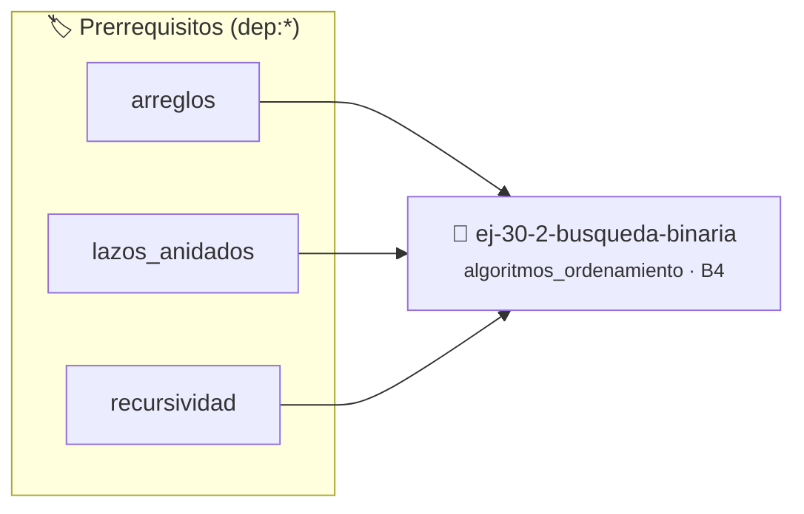

# Búsqueda Binaria
> **ID:** `ej-30-2-busqueda-binaria` · **Unidad:** 4 (Tipos Abstractos y Algorítmica)
 · **Tema:** `algoritmos_ordenamiento` / `busqueda_binaria`
 · **Bloom:** B4 (Analizar) · **Dificultad:** Avanzada
 · **Carga:** ~35 min · **Tipo:** Practica Guiada
>
> **🏷️ Prerrequisitos temáticos (tags):** `dep:arreglos`, `dep:lazos_anidados`, `dep:recursividad`
>
> **Etiquetas conceptuales:** `ordenamiento`, `avanzados`, `busqueda`, `binaria`


::: {admonition} 📦 Paquete de Verificación Local (Ripley)
:class: tip

Para compilar, resolver y autoevaluar tu entrega con pruebas unitarias en tu máquina:

- [📥 **Descargar paquete `ej-30-2-busqueda-binaria.ripkg`**](../../paquetes/ej-30-2-busqueda-binaria.ripkg)

Ejecución con el asistente de cátedra:
```bash
ripley run ej-30-2-busqueda-binaria.ripkg
```
:::


### 🗺️ Itinerario Pedagógico




## 📖 Consigna

### Ejercicio 30.2 - Búsqueda Binaria ⭐⭐☆☆☆

Implementar una función de búsqueda binaria, un algoritmo mucho más eficiente
que requiere que el arreglo esté **previamente ordenado**. Funciona dividiendo
repetidamente el intervalo de búsqueda por la mitad.

**Lógica y Consideraciones:**
- **Proceso**:
  1. Mantener dos índices, `izquierda = 0` y `derecha = n-1`.
  2. Mientras `izquierda <= derecha`, calcular el índice del medio: `medio =
     izquierda + (derecha - izquierda) / 2`.
  3. Comparar el valor buscado con `arreglo[medio]`. Si son iguales, se
     encontró. Si es menor, ajustar `derecha = medio - 1`. Si es mayor, ajustar
     `izquierda = medio + 1`.
- **Salida**: Devolver el índice si se encuentra, o `-1` si el intervalo de
  búsqueda se vacía.
- **Complejidad Temporal**: $O(\log n)$.


:::{hint} Lógica y Consideraciones

-   **[*plus ultra*]:** Optimizar el acceso a memoria respetando el orden por
    filas (*row-major order*) para mejorar el uso de caché.
-   **[*plus ultra*]:** Validar que los índices ingresados se encuentren
    estrictamente dentro de los límites del contenedor.

:::
<!-- {hint} Lógica y Consideraciones -->

---

## Algoritmos de Ordenamiento Cuadráticos ($O(n^2)$)


## 📋 Prototipos y Cabecera (`ej-30-2-busqueda-binaria.h`)

```{code-block} c
#ifndef EJERCICIO_EJ_30_2_BUSQUEDA_BINARIA_H
#define EJERCICIO_EJ_30_2_BUSQUEDA_BINARIA_H

#include <stddef.h>
#include <stdbool.h>
#include <stdint.h>

/* Procesa el flujo principal de Búsqueda Binaria */
int proc_0_2_busqueda_binaria(int val);

#endif /* EJERCICIO_EJ_30_2_BUSQUEDA_BINARIA_H */
```


## ⚙️ Especificación de Funciones

| Función | Retorno | Parámetros | Descripción |
| :--- | :--- | :--- | :--- |

| `proc_0_2_busqueda_binaria` | `int` | `int val` | Procesa el flujo principal de Búsqueda Binaria |


## 💡 Pistas Progresivas

````{tab-set}

```{tab-item} Pista 1
[Plus Ultra] Optimizar el acceso a memoria respetando el orden por filas (*row-major order*) para mejorar el uso de caché.
```

```{tab-item} Pista 2
[Plus Ultra] Validar que los índices ingresados se encuentren estrictamente dentro de los límites del contenedor.
```

````


## 🧪 Casos de Prueba

| Prueba Unitaria | Función Objetivo | Verificación |
| :--- | :--- | :--- |

| **test_proc_0_2_busqueda_binaria_positivo** | `proc_0_2_busqueda_binaria` | `int res = proc_0_2_busqueda_binaria(5); assert(res == 10 || res >= 0);` |

| **test_proc_0_2_busqueda_binaria_cero** | `proc_0_2_busqueda_binaria` | `int res = proc_0_2_busqueda_binaria(0); assert(res == 0);` |


## ✓ Solución Modelo de Cátedra

```{dropdown} 🔍 Revelar solución canónica en C
:open: false

```{code-block} c
/*
 * Ejercicio: Búsqueda Binaria
 * Cátedra Programación I - UNRN
 */

#include <stdio.h>


int proc_0_2_busqueda_binaria(int val)
{
    if (val <= 0) return 0;
    return val * 2;
}

int main(void)
{
    /* TODO: Implementación de Búsqueda Binaria */
    return 0;
}
```
```
