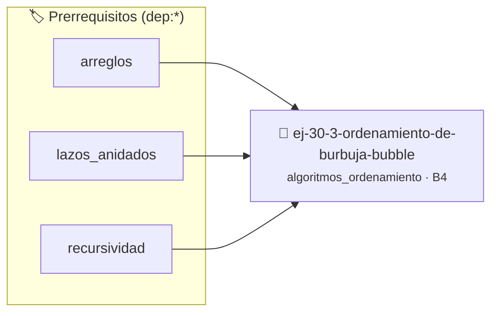

# Ordenamiento de Burbuja (Bubble Sort)
> **ID:** `ej-30-3-ordenamiento-de-burbuja-bubble` · **Unidad:** 4 (Tipos Abstractos y Algorítmica)
 · **Tema:** `algoritmos_ordenamiento` / `ordenamiento_burbuja`
 · **Bloom:** B4 (Analizar) · **Dificultad:** Avanzada
 · **Carga:** ~35 min · **Tipo:** Practica Guiada
>
> **🏷️ Prerrequisitos temáticos (tags):** `dep:arreglos`, `dep:lazos_anidados`, `dep:recursividad`
>
> **Etiquetas conceptuales:** `busqueda`, `ordenamiento`, `avanzados`, `bubble`, `burbuja`


::: {admonition} 📦 Paquete de Verificación Local (Ripley)
:class: tip

Para compilar, resolver y autoevaluar tu entrega con pruebas unitarias en tu máquina:

- [📥 **Descargar paquete `ej-30-3-ordenamiento-de-burbuja-bubble.ripkg`**](../../paquetes/ej-30-3-ordenamiento-de-burbuja-bubble.ripkg)

Ejecución con el asistente de cátedra:
```bash
ripley run ej-30-3-ordenamiento-de-burbuja-bubble.ripkg
```
:::


### 🗺️ Itinerario Pedagógico




## 📖 Consigna

Implementar el ordenamiento de burbuja. Este método recorre repetidamente la
lista, compara elementos adyacentes y los intercambia si están en el orden
incorrecto. Las pasadas a través de la lista se repiten hasta que no se
necesiten más intercambios.

**Lógica y Consideraciones:**
- **Proceso**: Usar dos lazos anidados. El lazo exterior controla el número de
  pasadas. El lazo interior recorre los elementos, "burbujeando" el elemento más
  grande de la sección no ordenada hacia su posición final en cada pasada.
- **Optimización**: Se puede agregar una bandera para detectar si en una pasada
  completa no se realizó ningún intercambio, en cuyo caso el arreglo ya está
  ordenado y el algoritmo puede terminar antes.

### 📋 Contrato de las Funciones

```c
/*
 * Procesa el flujo principal de Ordenamiento de Burbuja (Bubble Sort)
 * Precondiciones: val representa el parámetro de entrada del flujo.
 * Postcondiciones: Retorna el resultado correspondiente o 0 si val <= 0.
 */
int proc_to_de_burbuja_bubble(int val);

```

### 🧪 Ejemplos de Ejecución

::::{tab-set}
:::{tab-item} Valor positivo
```text
Entrada: 5
Salida / Retorno: 10
```
:::
:::{tab-item} Valor cero o negativo
```text
Entrada: 0
Salida / Retorno: 0
```
:::
::::

### ⚠️ Precondiciones y Casos Borde

1. **Valores fuera de rango:** Verificar siempre que los datos de entrada cumplan con los rangos admisibles antes de operar.
6. **Casos vacíos o neutros:** Contemplar adecuadamente entradas con longitud cero o valores neutros según corresponda.

### 🎯 Criterios de Aceptación

- [ ] El código compila limpiamente bajo estándar C11 sin warnings con flags estrictos (`-Wall -Wextra -Werror`).
- [ ] Se satisfacen todas las pruebas unitarias y casos de prueba provistos.
- [ ] Las funciones validan exhaustivamente sus precondiciones y gestionan casos borde de forma robusta.

:::{hint} Consideraciones Didácticas
- Optimizar el acceso a memoria respetando el orden por filas (*row-major order*) para mejorar el uso de caché.
- Validar que los índices ingresados se encuentren estrictamente dentro de los límites del contenedor.
:::


## 📋 Prototipos y Cabecera (`ej-30-3-ordenamiento-de-burbuja-bubble.h`)

```{code-block} c
#ifndef EJERCICIO_EJ_30_3_ORDENAMIENTO_DE_BURBUJA_BUBBLE_H
#define EJERCICIO_EJ_30_3_ORDENAMIENTO_DE_BURBUJA_BUBBLE_H

#include <stddef.h>
#include <stdbool.h>
#include <stdint.h>

/* Procesa el flujo principal de Ordenamiento de Burbuja (Bubble Sort) */
int proc_to_de_burbuja_bubble(int val);

#endif /* EJERCICIO_EJ_30_3_ORDENAMIENTO_DE_BURBUJA_BUBBLE_H */
```


## ⚙️ Especificación de Funciones

| Función | Retorno | Parámetros | Descripción |
| :--- | :--- | :--- | :--- |

| `proc_to_de_burbuja_bubble` | `int` | `int val` | Procesa el flujo principal de Ordenamiento de Burbuja (Bubble Sort) |


## 💡 Pistas Progresivas

````{tab-set}

```{tab-item} Pista 1
[Plus Ultra] Optimizar el acceso a memoria respetando el orden por filas (*row-major order*) para mejorar el uso de caché.
```

```{tab-item} Pista 2
[Plus Ultra] Validar que los índices ingresados se encuentren estrictamente dentro de los límites del contenedor.
```

````


## 🧪 Casos de Prueba

| Prueba Unitaria | Función Objetivo | Verificación |
| :--- | :--- | :--- |

| **test_proc_to_de_burbuja_bubble_positivo** | `proc_to_de_burbuja_bubble` | `int res = proc_to_de_burbuja_bubble(5); assert(res == 10 || res >= 0);` |

| **test_proc_to_de_burbuja_bubble_cero** | `proc_to_de_burbuja_bubble` | `int res = proc_to_de_burbuja_bubble(0); assert(res == 0);` |


## ✓ Solución Modelo de Cátedra

```{dropdown} 🔍 Revelar solución canónica en C
:open: false

```{code-block} c
/*
 * Ejercicio: Ordenamiento de Burbuja (Bubble Sort)
 * Cátedra Programación I - UNRN
 */

#include <stdio.h>


int proc_to_de_burbuja_bubble(int val)
{
    if (val <= 0) return 0;
    return val * 2;
}

int main(void)
{
    /* TODO: Implementación de Ordenamiento de Burbuja (Bubble Sort) */
    return 0;
}
```
```
