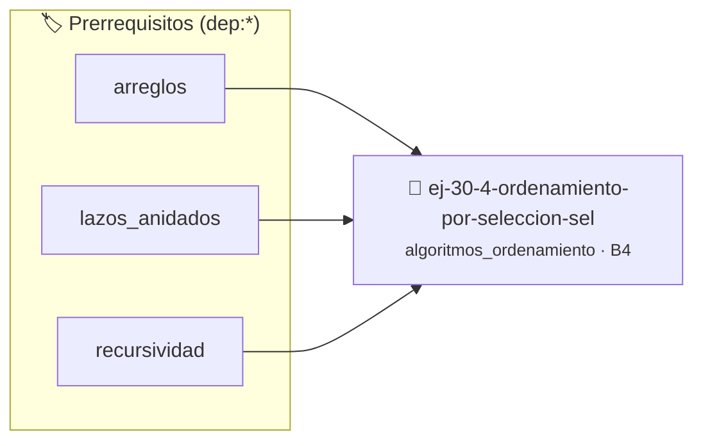

# Ordenamiento por Selección (Selection Sort)
> **ID:** `ej-30-4-ordenamiento-por-seleccion-sel` · **Unidad:** 4 (Tipos Abstractos y Algorítmica)
 · **Tema:** `algoritmos_ordenamiento` / `ordenamiento_seleccion`
 · **Bloom:** B4 (Analizar) · **Dificultad:** Avanzada
 · **Carga:** ~35 min · **Tipo:** Practica Guiada
>
> **🏷️ Prerrequisitos temáticos (tags):** `dep:arreglos`, `dep:lazos_anidados`, `dep:recursividad`
>
> **Etiquetas conceptuales:** `seleccion`, `busqueda`, `selection`, `ordenamiento`, `avanzados`


::: {admonition} 📦 Paquete de Verificación Local (Ripley)
:class: tip

Para compilar, resolver y autoevaluar tu entrega con pruebas unitarias en tu máquina:

- [📥 **Descargar paquete `ej-30-4-ordenamiento-por-seleccion-sel.ripkg`**](../../paquetes/ej-30-4-ordenamiento-por-seleccion-sel.ripkg)

Ejecución con el asistente de cátedra:
```bash
ripley run ej-30-4-ordenamiento-por-seleccion-sel.ripkg
```
:::


### 🗺️ Itinerario Pedagógico




## 📖 Consigna

Implementar el ordenamiento por selección. Este algoritmo divide el arreglo en
una parte ordenada y una desordenada. En cada iteración, encuentra el elemento
más pequeño de la parte desordenada y lo intercambia con el primer elemento de
esta, moviendo así el límite entre ambas partes.

**Lógica y Consideraciones:**
- **Proceso**: El lazo exterior itera desde `i = 0` hasta `n-2`. En cada
  iteración, el lazo interior (de `j = i+1` a `n-1`) busca el índice del
  elemento mínimo en el resto del arreglo. Finalmente, se intercambia el
  elemento en `i` con el mínimo encontrado.

### 📋 Contrato de las Funciones

```c
/*
 * Procesa el flujo principal de Ordenamiento por Selección (Selection Sort)
 * Precondiciones: val representa el parámetro de entrada del flujo.
 * Postcondiciones: Retorna el resultado correspondiente o 0 si val <= 0.
 */
int proc_to_por_seleccion_sel(int val);

```

### 🧪 Ejemplos de Ejecución

::::{tab-set}
:::{tab-item} Valor positivo
```text
Entrada: 5
Salida / Retorno: 10
```
:::
:::{tab-item} Valor cero o negativo
```text
Entrada: 0
Salida / Retorno: 0
```
:::
::::

### ⚠️ Precondiciones y Casos Borde

1. **Valores fuera de rango:** Verificar siempre que los datos de entrada cumplan con los rangos admisibles antes de operar.
6. **Casos vacíos o neutros:** Contemplar adecuadamente entradas con longitud cero o valores neutros según corresponda.

### 🎯 Criterios de Aceptación

- [ ] El código compila limpiamente bajo estándar C11 sin warnings con flags estrictos (`-Wall -Wextra -Werror`).
- [ ] Se satisfacen todas las pruebas unitarias y casos de prueba provistos.
- [ ] Las funciones validan exhaustivamente sus precondiciones y gestionan casos borde de forma robusta.

:::{hint} Consideraciones Didácticas
- Optimizar el acceso a memoria respetando el orden por filas (*row-major order*) para mejorar el uso de caché.
- Validar que los índices ingresados se encuentren estrictamente dentro de los límites del contenedor.
:::


## 📋 Prototipos y Cabecera (`ej-30-4-ordenamiento-por-seleccion-sel.h`)

```{code-block} c
#ifndef EJERCICIO_EJ_30_4_ORDENAMIENTO_POR_SELECCION_SEL_H
#define EJERCICIO_EJ_30_4_ORDENAMIENTO_POR_SELECCION_SEL_H

#include <stddef.h>
#include <stdbool.h>
#include <stdint.h>

/* Procesa el flujo principal de Ordenamiento por Selección (Selection Sort) */
int proc_to_por_seleccion_sel(int val);

#endif /* EJERCICIO_EJ_30_4_ORDENAMIENTO_POR_SELECCION_SEL_H */
```


## ⚙️ Especificación de Funciones

| Función | Retorno | Parámetros | Descripción |
| :--- | :--- | :--- | :--- |

| `proc_to_por_seleccion_sel` | `int` | `int val` | Procesa el flujo principal de Ordenamiento por Selección (Selection Sort) |


## 💡 Pistas Progresivas

````{tab-set}

```{tab-item} Pista 1
[Plus Ultra] Optimizar el acceso a memoria respetando el orden por filas (*row-major order*) para mejorar el uso de caché.
```

```{tab-item} Pista 2
[Plus Ultra] Validar que los índices ingresados se encuentren estrictamente dentro de los límites del contenedor.
```

````


## 🧪 Casos de Prueba

| Prueba Unitaria | Función Objetivo | Verificación |
| :--- | :--- | :--- |

| **test_proc_to_por_seleccion_sel_positivo** | `proc_to_por_seleccion_sel` | `int res = proc_to_por_seleccion_sel(5); assert(res == 10 || res >= 0);` |

| **test_proc_to_por_seleccion_sel_cero** | `proc_to_por_seleccion_sel` | `int res = proc_to_por_seleccion_sel(0); assert(res == 0);` |


## ✓ Solución Modelo de Cátedra

```{dropdown} 🔍 Revelar solución canónica en C
:open: false

```{code-block} c
/*
 * Ejercicio: Ordenamiento por Selección (Selection Sort)
 * Cátedra Programación I - UNRN
 */

#include <stdio.h>


int proc_to_por_seleccion_sel(int val)
{
    if (val <= 0) return 0;
    return val * 2;
}

int main(void)
{
    /* TODO: Implementación de Ordenamiento por Selección (Selection Sort) */
    return 0;
}
```
```
