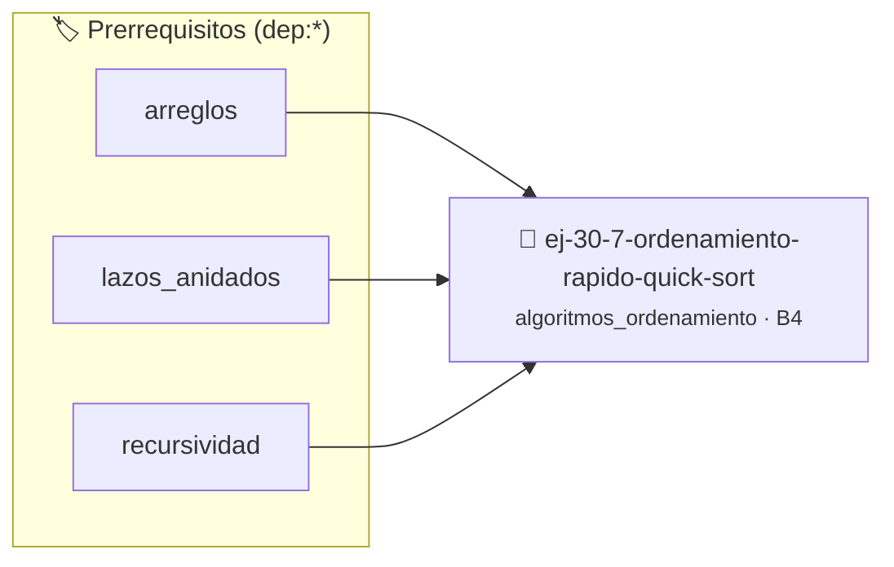

# Ordenamiento Rápido (Quick Sort)
> **ID:** `ej-30-7-ordenamiento-rapido-quick-sort`
 · **Tema:** `algoritmos_ordenamiento`
 · **Bloom:** B4 (Analizar)
 · **Carga:** ~35 min
>
> **🏷️ Prerrequisitos temáticos (tags):** `dep:arreglos`, `dep:lazos_anidados`, `dep:recursividad`
>
> **Etiquetas conceptuales:** `busqueda`, `ordenamiento`, `avanzados`, `quick`, `rapido`


::: {admonition} 📦 Paquete de Verificación Local (Ripley)
:class: tip

Para compilar, resolver y autoevaluar tu entrega con pruebas unitarias en tu máquina:

- [📥 **Descargar paquete `ej-30-7-ordenamiento-rapido-quick-sort.ripkg`**](../../paquetes/ej-30-7-ordenamiento-rapido-quick-sort.ripkg)

Ejecución con el asistente de cátedra:
```bash
ripley run ej-30-7-ordenamiento-rapido-quick-sort.ripkg
```
:::


### 🗺️ Itinerario Pedagógico




## 📖 Consigna

### Ejercicio 30.7 - Ordenamiento Rápido (Quick Sort) ⭐⭐☆☆☆

Implementar Quick Sort, otro algoritmo "Divide y Vencerás" muy eficiente en la
práctica.

**Lógica y Consideraciones:**
- **Proceso**:
  1. **Elegir Pivote**: Seleccionar un elemento del arreglo como pivote (puede
     ser el último, el primero, uno aleatorio, etc.).
  2. **Particionar**: Reorganizar el arreglo de modo que todos los elementos
     menores que el pivote queden a su izquierda y todos los mayores a su
     derecha. El pivote queda en su posición final ordenada. La función de
     partición devuelve el índice del pivote.
  3. **Vencer**: Llamar recursivamente a `quick_sort` para los sub-arreglos a la
     izquierda y a la derecha del pivote.

:::{hint} Lógica y Consideraciones

-   **[*plus ultra*]:** Optimizar el acceso a memoria respetando el orden por
    filas (*row-major order*) para mejorar el uso de caché.
-   **[*plus ultra*]:** Validar que los índices ingresados se encuentren
    estrictamente dentro de los límites del contenedor.

:::
<!-- {hint} Lógica y Consideraciones -->


## 📋 Prototipos y Cabecera (`ej-30-7-ordenamiento-rapido-quick-sort.h`)

```{code-block} c
#ifndef EJERCICIO_EJ_30_7_ORDENAMIENTO_RAPIDO_QUICK_SORT_H
#define EJERCICIO_EJ_30_7_ORDENAMIENTO_RAPIDO_QUICK_SORT_H

#include <stddef.h>
#include <stdbool.h>
#include <stdint.h>

/* Procesa el flujo principal de Ordenamiento Rápido (Quick Sort) */
int proc_to_rapido_quick_sort(int val);

#endif /* EJERCICIO_EJ_30_7_ORDENAMIENTO_RAPIDO_QUICK_SORT_H */
```


## ⚙️ Especificación de Funciones

| Función | Retorno | Parámetros | Descripción |
| :--- | :--- | :--- | :--- |

| `proc_to_rapido_quick_sort` | `int` | `int val` | Procesa el flujo principal de Ordenamiento Rápido (Quick Sort) |


## 💡 Pistas Progresivas

````{tab-set}

```{tab-item} Pista 1
[Plus Ultra] Optimizar el acceso a memoria respetando el orden por filas (*row-major order*) para mejorar el uso de caché.
```

```{tab-item} Pista 2
[Plus Ultra] Validar que los índices ingresados se encuentren estrictamente dentro de los límites del contenedor.
```

````


## 🧪 Casos de Prueba

| Prueba Unitaria | Función Objetivo | Verificación |
| :--- | :--- | :--- |

| **test_proc_to_rapido_quick_sort_positivo** | `proc_to_rapido_quick_sort` | `int res = proc_to_rapido_quick_sort(5); assert(res == 10 || res >= 0);` |

| **test_proc_to_rapido_quick_sort_cero** | `proc_to_rapido_quick_sort` | `int res = proc_to_rapido_quick_sort(0); assert(res == 0);` |


## ✓ Solución Modelo de Cátedra

```{dropdown} 🔍 Revelar solución canónica en C
:open: false

```{code-block} c
/*
 * Ejercicio: Ordenamiento Rápido (Quick Sort)
 * Cátedra Programación I - UNRN
 */

#include <stdio.h>


int proc_to_rapido_quick_sort(int val)
{
    if (val <= 0) return 0;
    return val * 2;
}

int main(void)
{
    /* TODO: Implementación de Ordenamiento Rápido (Quick Sort) */
    return 0;
}
```
```
