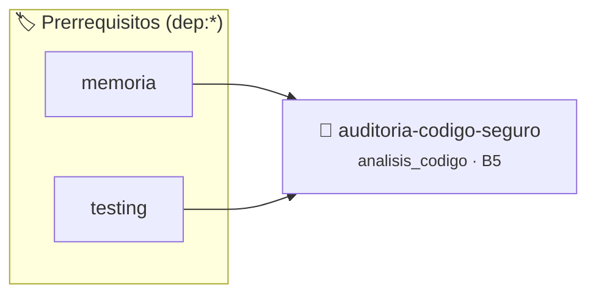

# Auditoría y Refactorización de Código Seguro (CWE-120)
> **ID:** `auditoria-codigo-seguro`
 · **Tema:** `analisis_codigo`
 · **Bloom:** B5 (Evaluar / Crear)
 · **Carga:** ~45 min
>
> **🏷️ Prerrequisitos temáticos (tags):** `dep:memoria`, `dep:testing`
>
> **Etiquetas conceptuales:** `analisis_codigo`, `seguridad`, `cwe120`, `sanitizers`, `auditoria`


::: {admonition} 📦 Paquete de Verificación Local (Ripley)
:class: tip

Para compilar, resolver y autoevaluar tu entrega con pruebas unitarias en tu máquina:

- [📥 **Descargar paquete `auditoria-codigo-seguro.ripkg`**](../../paquetes/auditoria-codigo-seguro.ripkg)

Ejecución con el asistente de cátedra:
```bash
ripley run auditoria-codigo-seguro.ripkg
```
:::


### 🗺️ Itinerario Pedagógico




## 📖 Consigna

# Auditoría y Refactorización de Código Seguro (CWE-120)

## 1. Consigna
Refactorizar un analizador de credenciales de usuario para eliminar vulnerabilidades de desbordamiento de búfer (*Buffer Overflow / CWE-120*).

El programa debe procesar credenciales de formato `USUARIO:ROL:TOKEN` asegurando:
1. Máxima longitud permitida para `USUARIO`: 31 caracteres (+ `\0`).
2. Máxima longitud permitida para `ROL`: 15 caracteres (+ `\0`).
3. Máxima longitud permitida para `TOKEN`: 63 caracteres (+ `\0`).
4. Si algún campo excede su límite o el formato está incompleto, debe rechazarlo con `RECHAZADO: OVERFLOW_PREVENTED`.
5. Si es válido, imprime `ACEPTADO user=<USUARIO> rol=<ROL>`.


## 📋 Prototipos y Cabecera (`auditoria-codigo-seguro.h`)

```{code-block} c
#ifndef EJERCICIO_AUDITORIA_CODIGO_SEGURO_H
#define EJERCICIO_AUDITORIA_CODIGO_SEGURO_H

#include <stddef.h>
#include <stdbool.h>
#include <stdint.h>

/* Operación procesar_credencial */
void procesar_credencial(const char *raw_line);

#endif /* EJERCICIO_AUDITORIA_CODIGO_SEGURO_H */
```


## ⚙️ Especificación de Funciones

| Función | Retorno | Parámetros | Descripción |
| :--- | :--- | :--- | :--- |

| `procesar_credencial` | `void` | `const char *raw_line` | Operación procesar_credencial |


## 💡 Pistas Progresivas

````{tab-set}

```{tab-item} Pista 1
Reemplazá funciones no seguras como gets() o strcpy() por fgets() y snprintf() con límite de tamaño explícito.
```

```{tab-item} Pista 2
Validá siempre los tamaños de cadena antes de copiar o concatenar.
```

```{tab-item} Pista 3
Sanitizá las terminaciones nulas '\0' en cadenas recibidas desde entrada externa.
```

````


## 🧪 Casos de Prueba

| Prueba Unitaria | Función Objetivo | Verificación |
| :--- | :--- | :--- |

| **test_procesar_credencial_1** | `procesar_credencial` | `/* Verificación unitaria de procesar_credencial */ procesar_credencial("test"); assert(true);` |


## ✓ Solución Modelo de Cátedra

```{dropdown} 🔍 Revelar solución canónica en C
:open: false

```{code-block} c
/*
 * Analizador Seguro de Credenciales (Anti-Overflow)
 * Catedra Programacion I - UNRN
 */

#include <stdio.h>
#include <stdlib.h>
#include <string.h>

#define MAX_USER 32
#define MAX_ROL 16
#define MAX_TOKEN 64

void procesar_credencial(const char *raw_line)
{
    char user[MAX_USER] = {0};
    char rol[MAX_ROL] = {0};
    char token[MAX_TOKEN] = {0};

    char formato[64] = {0};
    snprintf(formato, sizeof(formato), "%%%ds:%%%ds:%%%ds", MAX_USER - 1, MAX_ROL - 1, MAX_TOKEN - 1);

    const char *primer_dos_puntos = strchr(raw_line, ':');
    if (primer_dos_puntos == NULL)
    {
        printf("RECHAZADO: OVERFLOW_PREVENTED\n");
        return;
    }

    const char *segundo_dos_puntos = strchr(primer_dos_puntos + 1, ':');
    if (segundo_dos_puntos == NULL)
    {
        printf("RECHAZADO: OVERFLOW_PREVENTED\n");
        return;
    }

    size_t user_len = (size_t)(primer_dos_puntos - raw_line);
    size_t rol_len = (size_t)(segundo_dos_puntos - (primer_dos_puntos + 1));
    const char *token_inicio = segundo_dos_puntos + 1;
    size_t token_len = strlen(token_inicio);

    while (token_len > 0 && (token_inicio[token_len - 1] == '\n' || token_inicio[token_len - 1] == '\r'))
    {
        token_len--;
    }

    if (user_len >= MAX_USER || rol_len >= MAX_ROL || token_len >= MAX_TOKEN || user_len == 0 || rol_len == 0 || token_len == 0)
    {
        printf("RECHAZADO: OVERFLOW_PREVENTED\n");
        return;
    }

    memcpy(user, raw_line, user_len);
    user[user_len] = '\0';

    memcpy(rol, primer_dos_puntos + 1, rol_len);
    rol[rol_len] = '\0';

    memcpy(token, token_inicio, token_len);
    token[token_len] = '\0';

    printf("ACEPTADO user=%s rol=%s\n", user, rol);
}

int main(void)
{
    char buffer[512] = {0};

    while (fgets(buffer, sizeof(buffer), stdin) != NULL)
    {
        if (strncmp(buffer, "EXIT", 4) == 0 && (buffer[4] == '\n' || buffer[4] == '\0' || buffer[4] == '\r'))
        {
            break;
        }
        if (buffer[0] == '\n' || buffer[0] == '\r')
        {
            continue;
        }
        procesar_credencial(buffer);
    }

    return 0;
}
```
```
