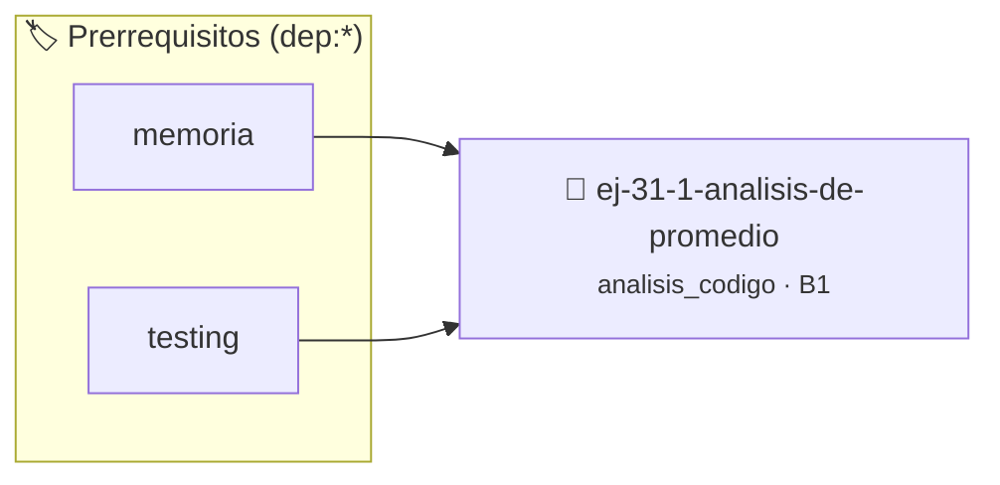

# Análisis de promedio
> **ID:** `ej-31-1-analisis-de-promedio` · **Unidad:** 5 (Ingeniería de Software y Calidad en C)
 · **Tema:** `analisis_codigo` / `estadistica_basica`
 · **Bloom:** B1 (Recordar) · **Dificultad:** Inicial
 · **Carga:** ~10 min · **Tipo:** Concepto
>
> **🏷️ Prerrequisitos temáticos (tags):** `dep:memoria`, `dep:testing`
>
> **Etiquetas conceptuales:** `code_review`, `analisis`, `avanzados`, `promedio`


::: {admonition} 📦 Paquete de Verificación Local (Ripley)
:class: tip

Para compilar, resolver y autoevaluar tu entrega con pruebas unitarias en tu máquina:

- [📥 **Descargar paquete `ej-31-1-analisis-de-promedio.ripkg`**](../../paquetes/ej-31-1-analisis-de-promedio.ripkg)

Ejecución con el asistente de cátedra:
```bash
ripley run ej-31-1-analisis-de-promedio.ripkg
```
:::


### 🗺️ Itinerario Pedagógico




## 📖 Consigna

:::{exercise} rol_promedio
:label: rol_promedio

Dado el siguiente código, identificá el "rol" principal de cada una de las
variables listadas.

```{code-block} c
:linenos:
#include <stdbool.h>
// Encuentra el promedio de los números positivos en un arreglo.
double promedio_positivos(const int arreglo[], size_t n, bool *exito)
{
    double suma = 0.0; // Variable 1
    int contador = 0;  // Variable 2
    *exito = false;    // Variable 3 (a través del puntero)
    for (size_t i = 0; i < n; i++)
    { // Variable 4
        if (arreglo[i] > 0)
        {
            suma = suma + arreglo[i];
            contador++;
        }
    }
    if (contador > 0)
    {
        *exito = true;
        return suma / contador; // Variable 5 (implícita)
    }
    return 0.0;
}
```

**Tarea**: Para cada una de las siguientes variables, describí su rol principal:

1.  `suma`
2.  `contador`
3.  `exito` (el valor al que apunta)
4.  `i`
5.  El valor de retorno de la función.

-   **[*plus ultra*]:** Validar punteros `NULL` recibidos como parámetro para
    evitar fallos de segmentación.
-   **[*plus ultra*]:** Implementar una versión utilizando aritmética de
    punteros en lugar de indexación directa.

:::

:::{solution} rol_promedio
:class: dropdown

1.  **`suma`**: **Acumulador**. Su propósito es acumular la suma de los valores
    positivos encontrados.
2.  **`contador`**: **Contador**. Su rol es contar cuántos números positivos se
    han encontrado.
3.  **`exito`**: **Bandera (Flag)**. Se utiliza para señalizar al código que
    llama a la función si la operación fue exitosa (es decir, si se encontró al
    menos un número positivo).
4.  **`i`**: **Variable de Control de lazo (Iterador)**. Su único propósito es
    controlar las iteraciones del lazo `for`.
5.  **Valor de retorno**: **Variable de Salida**. Contiene el resultado
    principal del cálculo de la función. 
    
:::

### 📋 Contrato de las Funciones

```c
/*
 * Procesa el flujo principal de Análisis de promedio
 * Precondiciones: val representa el parámetro de entrada del flujo.
 * Postcondiciones: Retorna el resultado correspondiente o 0 si val <= 0.
 */
int proc_analisis_de_promedio(int val);

```

### 🧪 Ejemplos de Ejecución

::::{tab-set}
:::{tab-item} Valor positivo
```text
Entrada: 5
Salida / Retorno: 10
```
:::
:::{tab-item} Valor cero o negativo
```text
Entrada: 0
Salida / Retorno: 0
```
:::
::::

### ⚠️ Precondiciones y Casos Borde

1. **Valores fuera de rango:** Verificar siempre que los datos de entrada cumplan con los rangos admisibles antes de operar.
6. **Casos vacíos o neutros:** Contemplar adecuadamente entradas con longitud cero o valores neutros según corresponda.

### 🎯 Criterios de Aceptación

- [ ] El código compila limpiamente bajo estándar C11 sin warnings con flags estrictos (`-Wall -Wextra -Werror`).
- [ ] Se satisfacen todas las pruebas unitarias y casos de prueba provistos.
- [ ] Las funciones validan exhaustivamente sus precondiciones y gestionan casos borde de forma robusta.


## 📋 Prototipos y Cabecera (`ej-31-1-analisis-de-promedio.h`)

```{code-block} c
#ifndef EJERCICIO_EJ_31_1_ANALISIS_DE_PROMEDIO_H
#define EJERCICIO_EJ_31_1_ANALISIS_DE_PROMEDIO_H

#include <stddef.h>
#include <stdbool.h>
#include <stdint.h>

/* Procesa el flujo principal de Análisis de promedio */
int proc_analisis_de_promedio(int val);

#endif /* EJERCICIO_EJ_31_1_ANALISIS_DE_PROMEDIO_H */
```


## ⚙️ Especificación de Funciones

| Función | Retorno | Parámetros | Descripción |
| :--- | :--- | :--- | :--- |

| `proc_analisis_de_promedio` | `int` | `int val` | Procesa el flujo principal de Análisis de promedio |


## 🧪 Casos de Prueba

| Prueba Unitaria | Función Objetivo | Verificación |
| :--- | :--- | :--- |

| **test_proc_analisis_de_promedio_positivo** | `proc_analisis_de_promedio` | `int res = proc_analisis_de_promedio(5); assert(res == 10 || res >= 0);` |

| **test_proc_analisis_de_promedio_cero** | `proc_analisis_de_promedio` | `int res = proc_analisis_de_promedio(0); assert(res == 0);` |


## ✓ Solución Modelo de Cátedra

```{dropdown} 🔍 Revelar solución canónica en C
:open: false

```{code-block} c
/*
 * Solucion modelo para ej-31-1-analisis-de-promedio
 * Catedra Programacion I - UNRN
 */
#include <stdio.h>
#include <stdlib.h>
#include <string.h>
#include <stdbool.h>


int proc_analisis_de_promedio(int val)
{
    if (val <= 0) return 0;
    return val * 2;
}

int main(void)
{
    int n = 0;
    if (scanf("%d", &n) == 1)
    {
        printf("OK %d\n", n);
    }
    else
    {
        printf("OK\n");
    }
    return 0;
}
```
```
