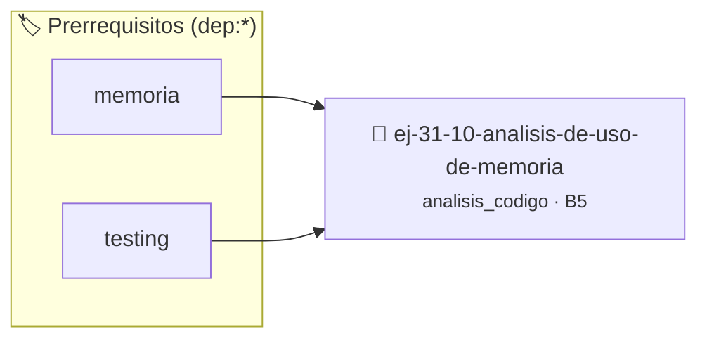

# Análisis de Uso de Memoria
> **ID:** `ej-31-10-analisis-de-uso-de-memoria` · **Unidad:** 5 (Ingeniería de Software y Calidad en C)
 · **Tema:** `analisis_codigo` / `code_review`
 · **Bloom:** B5 (Evaluar / Crear) · **Dificultad:** Desafio
 · **Carga:** ~45 min · **Tipo:** Desafio
>
> **🏷️ Prerrequisitos temáticos (tags):** `dep:memoria`, `dep:testing`
>
> **Etiquetas conceptuales:** `code_review`, `analisis`, `avanzados`, `memoria`


::: {admonition} 📦 Paquete de Verificación Local (Ripley)
:class: tip

Para compilar, resolver y autoevaluar tu entrega con pruebas unitarias en tu máquina:

- [📥 **Descargar paquete `ej-31-10-analisis-de-uso-de-memoria.ripkg`**](../../paquetes/ej-31-10-analisis-de-uso-de-memoria.ripkg)

Ejecución con el asistente de cátedra:
```bash
ripley run ej-31-10-analisis-de-uso-de-memoria.ripkg
```
:::


### 🗺️ Itinerario Pedagógico




## 📖 Consigna

### Ejercicio 31.10 - Análisis de Uso de Memoria ⭐⭐☆☆☆

:::{exercise} eficiencia_2
:label: eficiencia_2

Compará el uso de memoria de estas dos implementaciones que calculan
factoriales:

```{code-block} c
:linenos:
// Versión recursiva
long factorial_recursivo(int n)
{
    if (n <= 1)
    {
        return 1;
    }
    return n * factorial_recursivo(n - 1);
}
// Versión iterativa
long factorial_iterativo(int n)
{
    long resultado = 1;
    for (int i = 2; i <= n; i++)
    {
        resultado *= i;
    }
    return resultado;
}
// Versión con memoización
#include <stdlib.h>
static long *cache = NULL;
static int cache_size = 0;
long factorial_memoizado(int n)
{
    if (n <= 1)
    {
        return 1;
    }
    // Inicializar cache si es necesario
    if (cache == NULL || n >= cache_size)
    {
        int nuevo_tamaño = n + 1;
        cache = realloc(cache, nuevo_tamaño * sizeof(long));
        // Inicializar nuevos elementos
        for (int i = cache_size; i < nuevo_tamaño; i++)
        {
            cache[i] = -1; // Valor que indica "no calculado"
        }
        cache_size = nuevo_tamaño;
    }
    // Verificar si ya está en cache
    if (cache[n] != -1)
    {
        return cache[n];
    }
    // Calcular y almacenar en cache
    cache[n] = n * factorial_memoizado(n - 1);
    return cache[n];
}
```
<!-- {code-block} c -->

**Tarea**: Analizá cada implementación en términos de:
1. Uso de memoria de la pila
2. Uso de memoria del heap
3. Variables y sus roles
4. Trade-offs entre tiempo y espacio

-   **[*plus ultra*]:** Verificar el retorno de asignación de memoria y
    garantizar la liberación total de recursos en caso de error.
-   **[*plus ultra*]:** Verificar la ausencia de fugas de memoria (*memory
    leaks*) mediante Valgrind o AddressSanitizer.

:::
<!-- {exercise} eficiencia_2 -->

:::{solution} eficiencia_2
:class: dropdown

**Versión Recursiva:**
- **Pila**: $O(n)$ - cada llamada recursiva agrega un marco a la pila
- **Heap**: $O(1)$ - no usa memoria dinámica
- **Variables**: Solo el parámetro `n` en cada marco (rol: parámetro de entrada)
- **Riesgo**: Stack overflow para valores grandes de n

**Versión Iterativa:**
- **Pila**: $O(1)$ - un solo marco de función
- **Heap**: $O(1)$ - no usa memoria dinámica  
- **Variables**:
  - `resultado`: Acumulador para el producto
  - `i`: Variable de control de lazo
- **Ventajas**: Uso mínimo de memoria, sin riesgo de stack overflow

**Versión Memoizada:**
- **Pila**: $O(n)$ - similar a recursiva en la primera llamada, $O(1)$ en
  llamadas subsecuentes
- **Heap**: $O(n)$ - array para almacenar resultados calculados
- **Variables**:
  - `cache`: Array estático global (rol: almacén de resultados)
  - `cache_size`: Contador de tamaño actual (rol: guardián de límites)
- **Trade-off**: Usa más memoria pero acelera dramáticamente cálculos repetidos

**Comparación de Trade-offs:**

| Aspecto | Recursiva | Iterativa | Memoizada |
|---------|-----------|-----------|-----------|
| Tiempo (primera llamada) | $O(n)$ | $O(n)$ | $O(n)$ |
| Tiempo (llamadas repetidas) | $O(n)$ | $O(n)$ | $O(1)$ |
| Espacio en pila | $O(n)$ | $O(1)$ | $O(n)$→$O(1)$ |
| Espacio en heap | $O(1)$ | $O(1)$ | $O(n)$ |
| Legibilidad | Alta | Media | Baja |
| Riesgo de overflow | Alto | Bajo | Medio |

:::
<!-- {solution} eficiencia_2 -->

## 5: Ejercicios de Síntesis


## 📋 Prototipos y Cabecera (`ej-31-10-analisis-de-uso-de-memoria.h`)

```{code-block} c
#ifndef EJERCICIO_EJ_31_10_ANALISIS_DE_USO_DE_MEMORIA_H
#define EJERCICIO_EJ_31_10_ANALISIS_DE_USO_DE_MEMORIA_H

#include <stddef.h>
#include <stdbool.h>
#include <stdint.h>

/* Operación factorial_recursivo */
long factorial_recursivo(int n);
/* Operación factorial_iterativo */
long factorial_iterativo(int n);
/* Operación factorial_memoizado */
long factorial_memoizado(int n);

#endif /* EJERCICIO_EJ_31_10_ANALISIS_DE_USO_DE_MEMORIA_H */
```


## ⚙️ Especificación de Funciones

| Función | Retorno | Parámetros | Descripción |
| :--- | :--- | :--- | :--- |

| `factorial_recursivo` | `long` | `int n` | Operación factorial_recursivo |

| `factorial_iterativo` | `long` | `int n` | Operación factorial_iterativo |

| `factorial_memoizado` | `long` | `int n` | Operación factorial_memoizado |


## 🧪 Casos de Prueba

| Prueba Unitaria | Función Objetivo | Verificación |
| :--- | :--- | :--- |

| **test_factorial_recursivo_1** | `factorial_recursivo` | `/* Verificación unitaria de factorial_recursivo */ long res = factorial_recursivo(1); (void)res; assert(true);` |

| **test_factorial_iterativo_2** | `factorial_iterativo` | `/* Verificación unitaria de factorial_iterativo */ long res = factorial_iterativo(1); (void)res; assert(true);` |


## ✓ Solución Modelo de Cátedra

```{dropdown} 🔍 Revelar solución canónica en C
:open: false

```{code-block} c
// Versión recursiva
long factorial_recursivo(int n)
{
    if (n <= 1)
    {
        return 1;
    }
    return n * factorial_recursivo(n - 1);
}
// Versión iterativa
long factorial_iterativo(int n)
{
    long resultado = 1;
    for (int i = 2; i <= n; i++)
    {
        resultado *= i;
    }
    return resultado;
}
// Versión con memoización
#include <stdlib.h>
static long *cache = NULL;
static int cache_size = 0;
long factorial_memoizado(int n)
{
    if (n <= 1)
    {
        return 1;
    }
    // Inicializar cache si es necesario
    if (cache == NULL || n >= cache_size)
    {
        int nuevo_tamaño = n + 1;
        cache = realloc(cache, nuevo_tamaño * sizeof(long));
        // Inicializar nuevos elementos
        for (int i = cache_size; i < nuevo_tamaño; i++)
        {
            cache[i] = -1; // Valor que indica "no calculado"
        }
        cache_size = nuevo_tamaño;
    }
    // Verificar si ya está en cache
    if (cache[n] != -1)
    {
        return cache[n];
    }
    // Calcular y almacenar en cache
    cache[n] = n * factorial_memoizado(n - 1);
    return cache[n];
}

int main(void)
{
    return 0;
}
```
```
