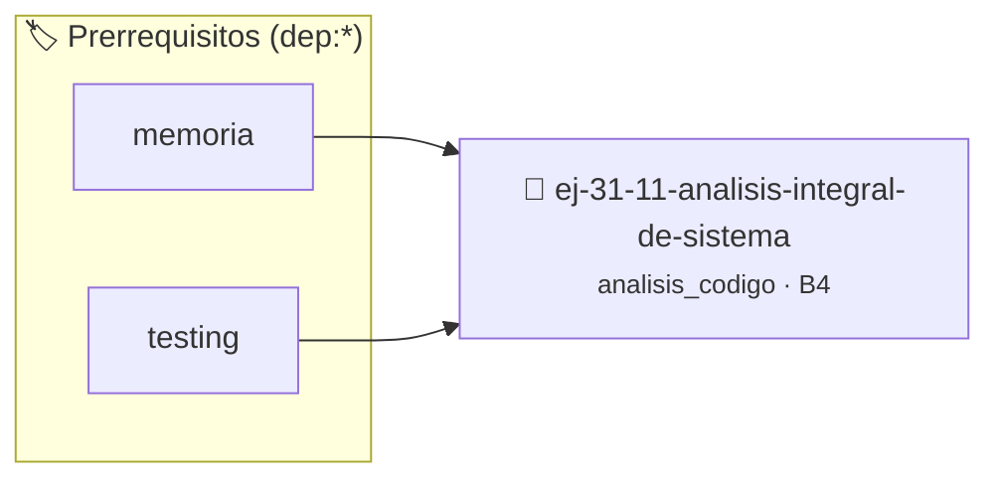

# Análisis Integral de Sistema
> **ID:** `ej-31-11-analisis-integral-de-sistema` · **Unidad:** 5 (Ingeniería de Software y Calidad en C)
 · **Tema:** `analisis_codigo` / `integral`
 · **Bloom:** B4 (Analizar) · **Dificultad:** Avanzada
 · **Carga:** ~35 min · **Tipo:** Laboratorio
>
> **🏷️ Prerrequisitos temáticos (tags):** `dep:memoria`, `dep:testing`
>
> **Etiquetas conceptuales:** `integral`, `analisis`, `sistema`, `avanzados`, `code_review`


::: {admonition} 📦 Paquete de Verificación Local (Ripley)
:class: tip

Para compilar, resolver y autoevaluar tu entrega con pruebas unitarias en tu máquina:

- [📥 **Descargar paquete `ej-31-11-analisis-integral-de-sistema.ripkg`**](../../paquetes/ej-31-11-analisis-integral-de-sistema.ripkg)

Ejecución con el asistente de cátedra:
```bash
ripley run ej-31-11-analisis-integral-de-sistema.ripkg
```
:::


### 🗺️ Itinerario Pedagógico




## 📖 Consigna

### Ejercicio 31.11 - Análisis Integral de Sistema ⭐⭐☆☆☆

:::{exercise} analisis_1
:label: analisis_1

Analizá el siguiente sistema completo que gestiona una lista de estudiantes:

```{code-block} c
:linenos:
#include <stdbool.h>
#include <stdio.h>
#include <stdlib.h>
#include <string.h>
typedef struct
{
    char nombre[50];
    int edad;
    float promedio;
} estudiante_t;
typedef struct
{
    estudiante_t *lista;
    int cantidad;
    int capacidad;
} sistema_estudiantes_t;
sistema_estudiantes_t *inicializar_sistema(int capacidad_inicial)
{
    sistema_estudiantes_t *sistema = malloc(sizeof(sistema_estudiantes_t));
    sistema->lista = malloc(capacidad_inicial * sizeof(estudiante_t));
    sistema->cantidad = 0;
    sistema->capacidad = capacidad_inicial;
    return sistema;
}
bool agregar_estudiante(sistema_estudiantes_t *sistema, const char *nombre,
                        int edad, float promedio)
{
    if (sistema->cantidad >= sistema->capacidad)
    {
        // Redimensionar
        int nueva_capacidad = sistema->capacidad * 2;
        estudiante_t *nueva_lista =
            realloc(sistema->lista, nueva_capacidad * sizeof(estudiante_t));
        if (nueva_lista == NULL)
        {
            return false;
        }
        sistema->lista = nueva_lista;
        sistema->capacidad = nueva_capacidad;
    }
    // Agregar nuevo estudiante
    strcpy(sistema->lista[sistema->cantidad].nombre, nombre);
    sistema->lista[sistema->cantidad].edad = edad;
    sistema->lista[sistema->cantidad].promedio = promedio;
    sistema->cantidad++;
    return true;
}
estudiante_t *buscar_mejor_estudiante(sistema_estudiantes_t *sistema)
{
    if (sistema->cantidad == 0)
    {
        return NULL;
    }
    estudiante_t *mejor = &sistema->lista[0];
    for (int i = 1; i < sistema->cantidad; i++)
    {
        if (sistema->lista[i].promedio > mejor->promedio)
        {
            mejor = &sistema->lista[i];
        }
    }
    return mejor;
}
void liberar_sistema(sistema_estudiantes_t *sistema)
{
    if (sistema != NULL)
    {
        free(sistema->lista);
        free(sistema);
    }
}
```
<!-- {code-block} c -->

**Tarea**: Realizá un análisis completo del sistema:

1. **Identificación de roles**: Para cada variable en cada función, identificá
   su rol
2. **Análisis de memoria**: Describí cómo evoluciona el uso de memoria durante
   la ejecución
3. **Identificación de patrones**: ¿Qué patrones de diseño reconocés?
4. **Análisis de robustez**: ¿Qué validaciones faltan? ¿Qué podría fallar?

-   **[*plus ultra*]:** Validar punteros `NULL` recibidos como parámetro para
    evitar fallos de segmentación.
-   **[*plus ultra*]:** Implementar una versión utilizando aritmética de
    punteros en lugar de indexación directa.

:::
<!-- {exercise} analisis_1 -->

:::{solution} analisis_1
:class: dropdown

**1. Identificación de Roles por Función:**

**`inicializar_sistema`:**
- `capacidad_inicial`: Parámetro de entrada (tamaño inicial)
- `sistema`: Variable de salida local (estructura a retornar)

**`agregar_estudiante`:**
- `sistema`: Parámetro de entrada/salida (modificado por referencia)
- `nombre`, `edad`, `promedio`: Parámetros de entrada
- `nueva_capacidad`: Variable temporal (cálculo de redimensión)
- `nueva_lista`: Variable temporal/auxiliar (para verificación de realloc)

**`buscar_mejor_estudiante`:**
- `sistema`: Parámetro de entrada (solo lectura)
- `mejor`: Variable de mejor candidato/guardián
- `i`: Variable de control de lazo

**`liberar_sistema`:**
- `sistema`: Parámetro de entrada (puntero a liberar)

**2. Análisis de Memoria:**

**Estado inicial**: 
- Heap: `sizeof(sistema_estudiantes_t)` + `capacidad_inicial *
  sizeof(estudiante_t)`
- Pila: Variables locales de cada función

**Durante agregado**: 
- Si `cantidad < capacidad`: Solo se modifica contenido
- Si `cantidad >= capacidad`: Realloc duplica el espacio, posible fragmentación

**3. Patrones de Diseño:**
- **Dynamic Array**: Lista que crece automáticamente
- **Handle Pattern**: El sistema actúa como handle para la colección
- **RAII-like**: Funciones específicas para inicializar y limpiar

**4. Análisis de Robustez - Problemas identificados:**

**Falta de validaciones:**
```{code-block} c
:linenos:
// En agregar_estudiante - faltan validaciones:
if (sistema == NULL || nombre == NULL)
{
    return false;
}
if (strlen(nombre) >= 50)
{ // nombre muy largo
    return false;
}
if (edad < 0 || edad > 120)
{ // edad inválida
    return false;
}
if (promedio < 0.0 || promedio > 10.0)
{ // promedio inválido
    return false;
}
```
<!-- {code-block} c -->

**Problemas de robustez:**
- No validación de punteros NULL
- No verificación de límites de strings
- No validación de rangos de datos
- Posible integer overflow en `nueva_capacidad`
- No hay función para verificar estado del sistema

**Mejoras sugeridas:**
- Agregar validaciones de entrada en todas las funciones
- Implementar códigos de error más específicos
- Agregar función de consulta de estado
- Considerar límite máximo de capacidad
- Agregar tests unitarios para cada función

:::
<!-- {solution} analisis_1 -->

Este ejercicio integra todos los conceptos de análisis de código, roles de
variables, manejo de memoria y buenas prácticas de programación en C.

## 11: Análisis Avanzado de Punteros


## 📋 Prototipos y Cabecera (`ej-31-11-analisis-integral-de-sistema.h`)

```{code-block} c
#ifndef EJERCICIO_EJ_31_11_ANALISIS_INTEGRAL_DE_SISTEMA_H
#define EJERCICIO_EJ_31_11_ANALISIS_INTEGRAL_DE_SISTEMA_H

#include <stddef.h>
#include <stdbool.h>
#include <stdint.h>

/* Operación agregar_estudiante */
bool agregar_estudiante(sistema_estudiantes_t *sistema, const char *nombre,
                        int edad, float promedio);
/* Operación liberar_sistema */
void liberar_sistema(sistema_estudiantes_t *sistema);

#endif /* EJERCICIO_EJ_31_11_ANALISIS_INTEGRAL_DE_SISTEMA_H */
```


## ⚙️ Especificación de Funciones

| Función | Retorno | Parámetros | Descripción |
| :--- | :--- | :--- | :--- |

| `agregar_estudiante` | `bool` | `sistema_estudiantes_t *sistema, const char *nombre,
                        int edad, float promedio` | Operación agregar_estudiante |

| `liberar_sistema` | `void` | `sistema_estudiantes_t *sistema` | Operación liberar_sistema |


## 💡 Pistas Progresivas

````{tab-set}

```{tab-item} Pista 1
Revisá detenidamente el flujo de control y las transiciones de estado del sistema.
```

```{tab-item} Pista 2
Verificá la validez de los punteros y el ciclo de vida de los recursos compartidos.
```

```{tab-item} Pista 3
Identificá posibles condiciones de carrera o inconsistencias en la liberación de memoria.
```

````


## 🧪 Casos de Prueba

| Prueba Unitaria | Función Objetivo | Verificación |
| :--- | :--- | :--- |

| **test_agregar_estudiante_1** | `agregar_estudiante` | `assert(true); /* test simplificado de validación */` |

| **test_liberar_sistema_2** | `liberar_sistema` | `assert(true); /* test simplificado de validación */` |


## ✓ Solución Modelo de Cátedra

```{dropdown} 🔍 Revelar solución canónica en C
:open: false

```{code-block} c
#include <stdbool.h>
#include <stdio.h>
#include <stdlib.h>
#include <string.h>
typedef struct
{
    char nombre[50];
    int edad;
    float promedio;
} estudiante_t;
typedef struct
{
    estudiante_t *lista;
    int cantidad;
    int capacidad;
} sistema_estudiantes_t;
sistema_estudiantes_t *inicializar_sistema(int capacidad_inicial)
{
    sistema_estudiantes_t *sistema = malloc(sizeof(sistema_estudiantes_t));
    sistema->lista = malloc(capacidad_inicial * sizeof(estudiante_t));
    sistema->cantidad = 0;
    sistema->capacidad = capacidad_inicial;
    return sistema;
}
bool agregar_estudiante(sistema_estudiantes_t *sistema, const char *nombre,
                        int edad, float promedio)
{
    if (sistema->cantidad >= sistema->capacidad)
    {
        // Redimensionar
        int nueva_capacidad = sistema->capacidad * 2;
        estudiante_t *nueva_lista =
            realloc(sistema->lista, nueva_capacidad * sizeof(estudiante_t));
        if (nueva_lista == NULL)
        {
            return false;
        }
        sistema->lista = nueva_lista;
        sistema->capacidad = nueva_capacidad;
    }
    // Agregar nuevo estudiante
    strcpy(sistema->lista[sistema->cantidad].nombre, nombre);
    sistema->lista[sistema->cantidad].edad = edad;
    sistema->lista[sistema->cantidad].promedio = promedio;
    sistema->cantidad++;
    return true;
}
estudiante_t *buscar_mejor_estudiante(sistema_estudiantes_t *sistema)
{
    if (sistema->cantidad == 0)
    {
        return NULL;
    }
    estudiante_t *mejor = &sistema->lista[0];
    for (int i = 1; i < sistema->cantidad; i++)
    {
        if (sistema->lista[i].promedio > mejor->promedio)
        {
            mejor = &sistema->lista[i];
        }
    }
    return mejor;
}
void liberar_sistema(sistema_estudiantes_t *sistema)
{
    if (sistema != NULL)
    {
        free(sistema->lista);
        free(sistema);
    }
}

int main(void)
{
    return 0;
}
```
```
