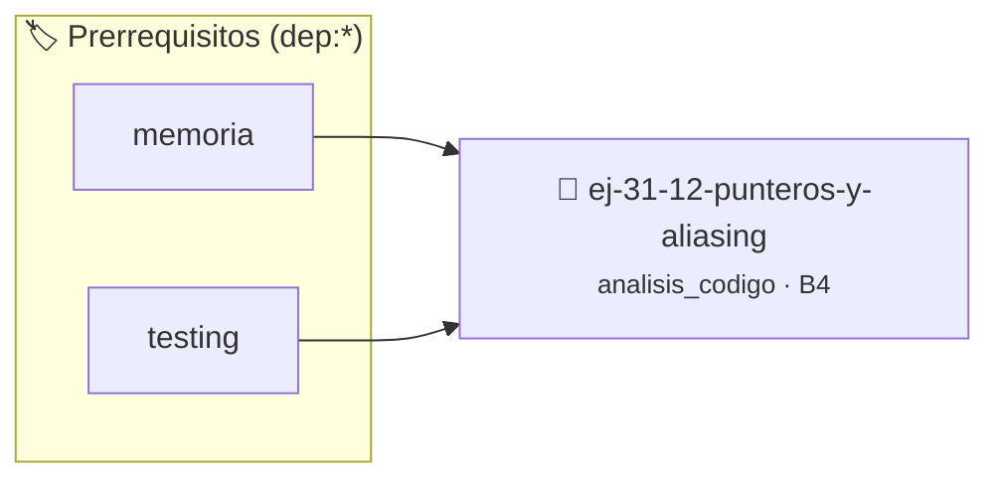

# Punteros y Aliasing
> **ID:** `ej-31-12-punteros-y-aliasing` · **Unidad:** 5 (Ingeniería de Software y Calidad en C)
 · **Tema:** `analisis_codigo` / `analisis`
 · **Bloom:** B4 (Analizar) · **Dificultad:** Avanzada
 · **Carga:** ~35 min · **Tipo:** Laboratorio
>
> **🏷️ Prerrequisitos temáticos (tags):** `dep:memoria`, `dep:testing`
>
> **Etiquetas conceptuales:** `analisis`, `punteros`, `avanzados`, `aliasing`, `code_review`


::: {admonition} 📦 Paquete de Verificación Local (Ripley)
:class: tip

Para compilar, resolver y autoevaluar tu entrega con pruebas unitarias en tu máquina:

- [📥 **Descargar paquete `ej-31-12-punteros-y-aliasing.ripkg`**](../../paquetes/ej-31-12-punteros-y-aliasing.ripkg)

Ejecución con el asistente de cátedra:
```bash
ripley run ej-31-12-punteros-y-aliasing.ripkg
```
:::


### 🗺️ Itinerario Pedagógico




## 📖 Consigna

### Ejercicio 31.12 - Punteros y Aliasing ⭐⭐⭐☆☆

:::{exercise} analisis_aliasing
:label: analisis_aliasing

Analizá el siguiente código que presenta un problema común con punteros:

```{code-block} c
:linenos:
#include <stdio.h>
#include <string.h>
void procesar_datos(int *p1, int *p2, int valor)
{
    *p1 = valor;
    *p2 = valor * 2;
    printf("p1 apunta a: %d\n", *p1);
    printf("p2 apunta a: %d\n", *p2);
}
int main(void)
{
    int x = 10;
    // Caso 1
    procesar_datos(&x, &x, 5);
    printf("Resultado x: %d\n\n", x);
    // Caso 2
    int y = 10;
    int z = 20;
    procesar_datos(&y, &z, 5);
    printf("Resultado y: %d, z: %d\n", y, z);
    return 0;
}
```
<!-- {code-block} c -->

**Tarea**:

1. **Análisis de aliasing**: ¿Qué sucede cuando `p1` y `p2` apuntan a la misma
   dirección?
2. **Predicción de salida**: ¿Qué valores se imprimirán en cada caso?
3. **Identificación del problema**: ¿Por qué el Caso 1 produce un resultado
   inesperado?
4. **Roles de variables**: Identificá el rol de `p1`, `p2` y `valor`
5. **Mejoras**: ¿Cómo modificarías la función para prevenir este problema?

-   **[*plus ultra*]:** Validar punteros `NULL` recibidos como parámetro para
    evitar fallos de segmentación.
-   **[*plus ultra*]:** Implementar una versión utilizando aritmética de
    punteros en lugar de indexación directa.

:::
<!-- {exercise} analisis_aliasing -->

:::{solution} analisis_aliasing
:class: dropdown

**1. Análisis de Aliasing:**

En el Caso 1, `p1` y `p2` apuntan a la misma dirección de memoria (`&x`). Esto
se llama **aliasing** y provoca que las modificaciones a través de un puntero
afecten al otro.

**Secuencia de ejecución en Caso 1:**
```
*p1 = valor;       // x = 5
*p2 = valor * 2;   // x = 10 (sobrescribe el valor anterior)
```

**2. Predicción de Salida:**

**Caso 1:**
```
p1 apunta a: 10    // p1 y p2 apuntan a x, que vale 10
p2 apunta a: 10
Resultado x: 10
```

**Caso 2:**
```
p1 apunta a: 5     // y = 5
p2 apunta a: 10    // z = 10
Resultado y: 5, z: 10
```

**3. Identificación del Problema:**

El problema es que la función asume que `p1` y `p2` apuntan a ubicaciones
diferentes. Cuando apuntan a la misma, la segunda asignación sobrescribe la
primera, perdiendo el valor original.

**4. Roles de Variables:**

- `p1`: **Parámetro de salida (output parameter)** - modifica el valor apuntado
- `p2`: **Parámetro de salida (output parameter)** - modifica otro valor
  apuntado
- `valor`: **Parámetro de entrada (input parameter)** - valor base para los
  cálculos

**5. Mejoras Sugeridas:**

**Opción 1: Verificar aliasing**
```{code-block} c
:linenos:
void procesar_datos(int *p1, int *p2, int valor)
{
    if (p1 == p2)
    {
        fprintf(stderr,
                "Error: p1 y p2 no pueden apuntar a la misma dirección\n");
        return;
    }
    *p1 = valor;
    *p2 = valor * 2;
}
```
<!-- {code-block} c -->

**Opción 2: Usar `restrict` (C99)**
``` c
void procesar_datos(int *restrict p1, int *restrict p2, int valor)
{
    *p1 = valor;
    *p2 = valor * 2;
}
```
<!-- c -->
El keyword `restrict` promete al compilador que los punteros no tienen aliasing.

**Opción 3: Documentar el requisito**
``` c
// PRECONDICIÓN: p1 y p2 deben apuntar a ubicaciones diferentes
// POSTCONDICIÓN: *p1 = valor, *p2 = valor * 2
void procesar_datos(int *p1, int *p2, int valor);
```
<!-- c -->

:::
<!-- {solution} analisis_aliasing -->


## 📋 Prototipos y Cabecera (`ej-31-12-punteros-y-aliasing.h`)

```{code-block} c
#ifndef EJERCICIO_EJ_31_12_PUNTEROS_Y_ALIASING_H
#define EJERCICIO_EJ_31_12_PUNTEROS_Y_ALIASING_H

#include <stddef.h>
#include <stdbool.h>
#include <stdint.h>

/* Operación procesar_datos */
void procesar_datos(int *p1, int *p2, int valor);

#endif /* EJERCICIO_EJ_31_12_PUNTEROS_Y_ALIASING_H */
```


## ⚙️ Especificación de Funciones

| Función | Retorno | Parámetros | Descripción |
| :--- | :--- | :--- | :--- |

| `procesar_datos` | `void` | `int *p1, int *p2, int valor` | Operación procesar_datos |


## 🧪 Casos de Prueba

| Prueba Unitaria | Función Objetivo | Verificación |
| :--- | :--- | :--- |

| **test_procesar_datos_1** | `procesar_datos` | `assert(true); /* test simplificado de validación */` |


## ✓ Solución Modelo de Cátedra

```{dropdown} 🔍 Revelar solución canónica en C
:open: false

```{code-block} c
#include <stdio.h>
#include <string.h>
void procesar_datos(int *p1, int *p2, int valor)
{
    *p1 = valor;
    *p2 = valor * 2;
    printf("p1 apunta a: %d\n", *p1);
    printf("p2 apunta a: %d\n", *p2);
}
int main(void)
{
    int x = 10;
    // Caso 1
    procesar_datos(&x, &x, 5);
    printf("Resultado x: %d\n\n", x);
    // Caso 2
    int y = 10;
    int z = 20;
    procesar_datos(&y, &z, 5);
    printf("Resultado y: %d, z: %d\n", y, z);
    return 0;
}
```
```
