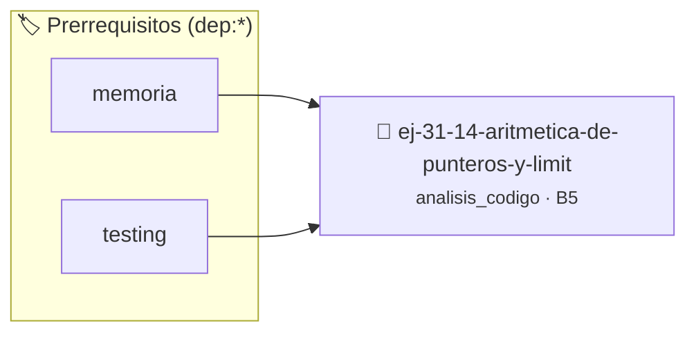

# Aritmética de Punteros y Límites de Arreglos
> **ID:** `ej-31-14-aritmetica-de-punteros-y-limit` · **Unidad:** 5 (Ingeniería de Software y Calidad en C)
 · **Tema:** `analisis_codigo` / `limites`
 · **Bloom:** B5 (Evaluar / Crear) · **Dificultad:** Desafio
 · **Carga:** ~45 min · **Tipo:** Desafio
>
> **🏷️ Prerrequisitos temáticos (tags):** `dep:memoria`, `dep:testing`
>
> **Etiquetas conceptuales:** `limites`, `analisis`, `arreglos`, `aritmetica`, `punteros`


::: {admonition} 📦 Paquete de Verificación Local (Ripley)
:class: tip

Para compilar, resolver y autoevaluar tu entrega con pruebas unitarias en tu máquina:

- [📥 **Descargar paquete `ej-31-14-aritmetica-de-punteros-y-limit.ripkg`**](../../paquetes/ej-31-14-aritmetica-de-punteros-y-limit.ripkg)

Ejecución con el asistente de cátedra:
```bash
ripley run ej-31-14-aritmetica-de-punteros-y-limit.ripkg
```
:::


### 🗺️ Itinerario Pedagógico




## 📖 Consigna

### Ejercicio 31.14 - Aritmética de Punteros y Límites de Arreglos ⭐⭐⭐☆☆

:::{exercise} analisis_aritmetica
:label: analisis_aritmetica

Analizá este código que manipula arreglos usando aritmética de punteros:

```{code-block} c
:linenos:
#include <stdio.h>
#include <string.h>
void funcion_a(int *arr, size_t n)
{
    int *p = arr;
    int *fin = arr + n;
    while (p < fin)
    {
        *p = *p * 2;
        p++;
    }
}
void funcion_b(int *arr, size_t n)
{
    for (int *p = arr; p < arr + n; p++)
    {
        printf("%d ", *p);
    }
    printf("\n");
}
void funcion_c(char *destino, const char *origen)
{
    while (*origen != '\0')
    {
        *destino = *origen;
        destino++;
        origen++;
    }
    *destino = '\0';
}
void funcion_d(int *arr, size_t n)
{
    int *inicio = arr;
    int *fin = arr + n - 1;
    while (inicio < fin)
    {
        int temp = *inicio;
        *inicio = *fin;
        *fin = temp;
        inicio++;
        fin--;
    }
}
int main(void)
{
    int arreglo[5] = {1, 2, 3, 4, 5};
    funcion_a(arreglo, 5);
    funcion_b(arreglo, 5);
    char origen[] = "Hola";
    char destino[10];
    funcion_c(destino, origen);
    printf("%s\n", destino);
    funcion_d(arreglo, 5);
    funcion_b(arreglo, 5);
    return 0;
}
```
<!-- {code-block} c -->

**Tarea**:

1. **Propósito de funciones**: Describí qué hace cada función
2. **Análisis de aritmética**: Para cada función, explicá las operaciones con
   punteros
3. **Roles de punteros**: Identificá el rol de cada puntero en las funciones
4. **Predicción de salida**: ¿Qué imprimirá el programa?
5. **Seguridad**: ¿Qué problemas de seguridad existen? ¿Qué pasa si se pasan
   parámetros inválidos?
6. **Comparación**: Compará las funciones con versiones equivalentes usando
   índices

-   **[*plus ultra*]:** Validar punteros `NULL` recibidos como parámetro para
    evitar fallos de segmentación.
-   **[*plus ultra*]:** Implementar una versión utilizando aritmética de
    punteros en lugar de indexación directa.

:::
<!-- {exercise} analisis_aritmetica -->

:::{solution} analisis_aritmetica
:class: dropdown

**1. Propósito de Funciones:**

- **`funcion_a`**: Duplica todos los elementos del arreglo
- **`funcion_b`**: Imprime todos los elementos del arreglo
- **`funcion_c`**: Copia una cadena (implementación manual de `strcpy`)
- **`funcion_d`**: Invierte el arreglo in-place

**2. Análisis de Aritmética de Punteros:**

**`funcion_a`:**
```{code-block} c
:linenos:
int *p = arr;       // p apunta al primer elemento
int *fin = arr + n; // fin apunta una posición DESPUÉS del último elemento
while (p < fin)
{                // Itera mientras p no llegue a fin
    *p = *p * 2; // Desreferencia: modifica el elemento actual
    p++;         // Avanza al siguiente elemento (p += sizeof(int))
}
```
<!-- {code-block} c -->

**Equivalente con índices:**
``` c
for (size_t i = 0; i < n; i++)
{
    arr[i] = arr[i] * 2;
}
```
<!-- c -->

**`funcion_b`:**
``` c
for (int *p = arr; p < arr + n; p++)
{
    // p recorre desde arr[0] hasta arr[n-1]
    printf("%d ", *p);
}
```
<!-- c -->

**`funcion_c`:**
```{code-block} c
:linenos:
while (*origen != '\0')
{                       // Itera hasta encontrar el terminador
    *destino = *origen; // Copia carácter por carácter
    destino++;          // Avanza ambos punteros
    origen++;
}
*destino = '\0'; // Agrega terminador al destino
```
<!-- {code-block} c -->

**`funcion_d`:**
```{code-block} c
:linenos:
int *inicio = arr;      // Apunta al primer elemento
int *fin = arr + n - 1; // Apunta al último elemento
while (inicio < fin)
{ // Se encuentran en el medio
    // Intercambia *inicio con *fin
    int temp = *inicio;
    *inicio = *fin;
    *fin = temp;
    inicio++; // Avanzan hacia el centro
    fin--;
}
```
<!-- {code-block} c -->

**3. Roles de Punteros:**

**`funcion_a`:**
- `arr`: Parámetro de entrada/salida (array a modificar)
- `p`: Iterador/caminante (walker) - recorre el arreglo
- `fin`: Centinela (sentinel) - marca el límite superior

**`funcion_b`:**
- `arr`: Parámetro de entrada (array a imprimir)
- `p`: Iterador/caminante - recorre el arreglo

**`funcion_c`:**
- `destino`: Parámetro de salida (destino de la copia)
- `origen`: Parámetro de entrada (fuente de datos)
- Ambos actúan como caminantes que avanzan en paralelo

**`funcion_d`:**
- `arr`: Parámetro de entrada/salida
- `inicio`: Caminante que avanza desde el principio
- `fin`: Caminante que retrocede desde el final
- `temp`: Variable auxiliar temporal para intercambio

**4. Predicción de Salida:**

```
Estado inicial: arreglo = {1, 2, 3, 4, 5}

Después de funcion_a: {2, 4, 6, 8, 10}
Salida de funcion_b: "2 4 6 8 10 "

Después de funcion_c: destino = "Hola"
Salida: "Hola"

Después de funcion_d: arreglo = {10, 8, 6, 4, 2}
Salida de funcion_b: "10 8 6 4 2 "
```

**5. Problemas de Seguridad:**

**`funcion_a` y `funcion_b`:**
- **Puntero NULL**: Si `arr == NULL`, desreferencia causa crash
- **n inválido**: Si `n = 0`, funciona pero no hace nada. Si `n` es muy grande,
  acceso fuera de límites

**Validación sugerida:**
``` c
void funcion_a(int *arr, size_t n)
{
    if (arr == NULL || n == 0)
        return;
    // ... resto del código
}
```
<!-- c -->

**`funcion_c` - Problema crítico:**
``` c
void funcion_c(char *destino, const char *origen)
{
    // NO verifica el tamaño de destino
    // Puede causar BUFFER OVERFLOW
}
```
<!-- c -->

**Escenario peligroso:**
``` c
char origen[] = "Esta cadena es muy larga";
char destino[5];            // Solo 5 bytes!
funcion_c(destino, origen); // BUFFER OVERFLOW
```
<!-- c -->

**Versión segura:**
```{code-block} c
:linenos:
void funcion_c_segura(char *destino, const char *origen, size_t tam_destino)
{
    if (destino == NULL || origen == NULL || tam_destino == 0)
        return;
    while (*origen != '\0' && tam_destino > 1)
    {
        *destino = *origen;
        destino++;
        origen++;
        tam_destino--;
    }
    *destino = '\0';
}
```
<!-- {code-block} c -->

**O usar `strncpy`:**
``` c
strncpy(destino, origen, sizeof(destino) - 1);
destino[sizeof(destino) - 1] = '\0';
```
<!-- c -->

**`funcion_d`:**
- **Puntero NULL**: Crash si `arr == NULL`
- **n = 0**: `arr + n - 1` apunta ANTES de `arr` (comportamiento indefinido)
- **n = 1**: Funciona correctamente (no hace nada)

**Validación sugerida:**
``` c
void funcion_d(int *arr, size_t n)
{
    if (arr == NULL || n <= 1)
        return;
    // ... resto del código
}
```
<!-- c -->

**6. Comparación: Punteros vs Índices**

**Ventajas de punteros:**
- Más eficiente en algunos compiladores (menos operaciones)
- Más "idiomático" en C para ciertos algoritmos
- No necesita calcular `arr[i]` en cada iteración

**Ventajas de índices:**
- Más legible y fácil de entender
- Más seguro (menos probabilidad de errores)
- Mejor para debugging (puedes ver el índice)
- No pierde la referencia al inicio del arreglo

**Comparación de rendimiento:**

Compiladores modernos con optimización suelen generar el mismo código máquina
para ambas versiones, así que la legibilidad debería ser el factor decisivo.

**Recomendación:** Usar índices por defecto, punteros solo cuando:
- La lógica sea más clara con punteros (ej: `funcion_d`)
- Se necesite pasar punteros intermedios
- Se implemente una interfaz que requiera punteros

**Ejemplo de refactorización de `funcion_a` con índices:**
```{code-block} c
:linenos:
void funcion_a(int *arr, size_t n)
{
    if (arr == NULL)
        return;
    for (size_t i = 0; i < n; i++)
    {
        arr[i] *= 2;
    }
}
```
<!-- {code-block} c -->

:::
<!-- {solution} analisis_aritmetica -->


## 📋 Prototipos y Cabecera (`ej-31-14-aritmetica-de-punteros-y-limit.h`)

```{code-block} c
#ifndef EJERCICIO_EJ_31_14_ARITMETICA_DE_PUNTEROS_Y_LIMIT_H
#define EJERCICIO_EJ_31_14_ARITMETICA_DE_PUNTEROS_Y_LIMIT_H

#include <stddef.h>
#include <stdbool.h>
#include <stdint.h>

/* Operación funcion_a */
void funcion_a(int *arr, size_t n);
/* Operación funcion_b */
void funcion_b(int *arr, size_t n);
/* Operación funcion_c */
void funcion_c(char *destino, const char *origen);
/* Operación funcion_d */
void funcion_d(int *arr, size_t n);

#endif /* EJERCICIO_EJ_31_14_ARITMETICA_DE_PUNTEROS_Y_LIMIT_H */
```


## ⚙️ Especificación de Funciones

| Función | Retorno | Parámetros | Descripción |
| :--- | :--- | :--- | :--- |

| `funcion_a` | `void` | `int *arr, size_t n` | Operación funcion_a |

| `funcion_b` | `void` | `int *arr, size_t n` | Operación funcion_b |

| `funcion_c` | `void` | `char *destino, const char *origen` | Operación funcion_c |

| `funcion_d` | `void` | `int *arr, size_t n` | Operación funcion_d |


## 💡 Pistas Progresivas

````{tab-set}

```{tab-item} Pista 1
Recordá que la suma de un entero a un puntero (p + i) avanza i * sizeof(*p) bytes en memoria.
```

```{tab-item} Pista 2
Comprobá que ningún acceso supere el límite superior (p + n) ni descienda por debajo de p.
```

```{tab-item} Pista 3
Prestá especial atención a los errores por un elemento (off-by-one) en los lazos de recorrido.
```

````


## 🧪 Casos de Prueba

| Prueba Unitaria | Función Objetivo | Verificación |
| :--- | :--- | :--- |

| **test_funcion_a_1** | `funcion_a` | `/* Verificación unitaria de funcion_a */ int arr[] = {1, 2, 3, 4}; funcion_a(arr, 4); assert(arr[0] == arr[0]);` |

| **test_funcion_b_2** | `funcion_b` | `/* Verificación unitaria de funcion_b */ int arr[] = {1, 2, 3, 4}; funcion_b(arr, 4); assert(arr[0] == arr[0]);` |


## ✓ Solución Modelo de Cátedra

```{dropdown} 🔍 Revelar solución canónica en C
:open: false

```{code-block} c
#include <stdio.h>
#include <string.h>
void funcion_a(int *arr, size_t n)
{
    int *p = arr;
    int *fin = arr + n;
    while (p < fin)
    {
        *p = *p * 2;
        p++;
    }
}
void funcion_b(int *arr, size_t n)
{
    for (int *p = arr; p < arr + n; p++)
    {
        printf("%d ", *p);
    }
    printf("\n");
}
void funcion_c(char *destino, const char *origen)
{
    while (*origen != '\0')
    {
        *destino = *origen;
        destino++;
        origen++;
    }
    *destino = '\0';
}
void funcion_d(int *arr, size_t n)
{
    int *inicio = arr;
    int *fin = arr + n - 1;
    while (inicio < fin)
    {
        int temp = *inicio;
        *inicio = *fin;
        *fin = temp;
        inicio++;
        fin--;
    }
}
int main(void)
{
    int arreglo[5] = {1, 2, 3, 4, 5};
    funcion_a(arreglo, 5);
    funcion_b(arreglo, 5);
    char origen[] = "Hola";
    char destino[10];
    funcion_c(destino, origen);
    printf("%s\n", destino);
    funcion_d(arreglo, 5);
    funcion_b(arreglo, 5);
    return 0;
}
```
```
