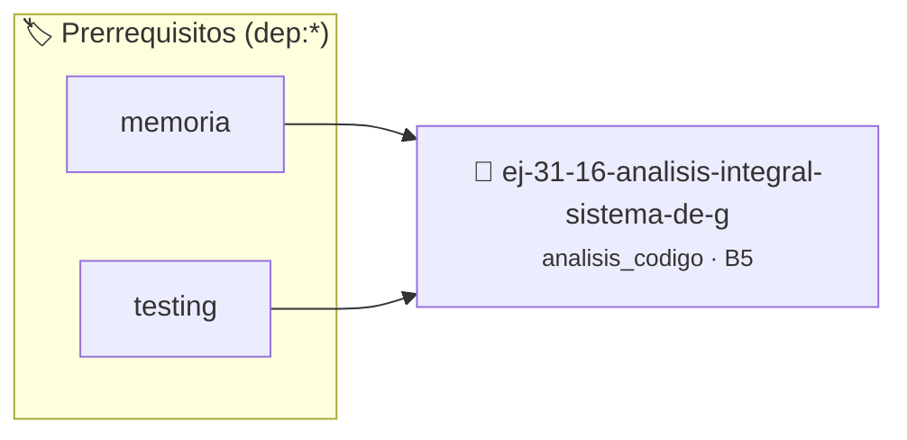

# Análisis Integral - Sistema de Gestión con Punteros
> **ID:** `ej-31-16-analisis-integral-sistema-de-g` · **Unidad:** 5 (Ingeniería de Software y Calidad en C)
 · **Tema:** `analisis_codigo` / `integral`
 · **Bloom:** B5 (Evaluar / Crear) · **Dificultad:** Desafio
 · **Carga:** ~45 min · **Tipo:** Desafio
>
> **🏷️ Prerrequisitos temáticos (tags):** `dep:memoria`, `dep:testing`
>
> **Etiquetas conceptuales:** `integral`, `analisis`, `sistema`, `punteros`, `avanzados`


::: {admonition} 📦 Paquete de Verificación Local (Ripley)
:class: tip

Para compilar, resolver y autoevaluar tu entrega con pruebas unitarias en tu máquina:

- [📥 **Descargar paquete `ej-31-16-analisis-integral-sistema-de-g.ripkg`**](../../paquetes/ej-31-16-analisis-integral-sistema-de-g.ripkg)

Ejecución con el asistente de cátedra:
```bash
ripley run ej-31-16-analisis-integral-sistema-de-g.ripkg
```
:::


### 🗺️ Itinerario Pedagógico




## 📖 Consigna

### Ejercicio 31.16 - Análisis Integral - Sistema de Gestión con Punteros ⭐⭐⭐☆☆

:::{exercise} analisis_integral_punteros
:label: analisis_integral_punteros

Analizá este sistema completo que utiliza múltiples conceptos de punteros:

```{code-block} c
:linenos:
#include <stdbool.h>
#include <stdio.h>
#include <stdlib.h>
#include <string.h>
typedef struct nodo
{
    int dato;
    struct nodo *siguiente;
} nodo_t;
typedef struct
{
    nodo_t *primero;
    nodo_t *ultimo;
    size_t tamanio;
} lista_t;
// Función 1
lista_t *lista_crear(void)
{
    lista_t *lista = malloc(sizeof(lista_t));
    if (lista == NULL)
        return NULL;
    lista->primero = NULL;
    lista->ultimo = NULL;
    lista->tamanio = 0;
    return lista;
}
// Función 2
bool lista_insertar_final(lista_t *lista, int dato)
{
    if (lista == NULL)
        return false;
    nodo_t *nuevo = malloc(sizeof(nodo_t));
    if (nuevo == NULL)
        return false;
    nuevo->dato = dato;
    nuevo->siguiente = NULL;
    if (lista->primero == NULL)
    {
        lista->primero = nuevo;
        lista->ultimo = nuevo;
    }
    else
    {
        lista->ultimo->siguiente = nuevo;
        lista->ultimo = nuevo;
    }
    lista->tamanio++;
    return true;
}
// Función 3
bool lista_eliminar_primero(lista_t *lista, int *dato)
{
    if (lista == NULL || lista->primero == NULL)
        return false;
    nodo_t *temp = lista->primero;
    *dato = temp->dato;
    lista->primero = temp->siguiente;
    if (lista->primero == NULL)
    {
        lista->ultimo = NULL;
    }
    free(temp);
    lista->tamanio--;
    return true;
}
// Función 4
void lista_destruir(lista_t *lista)
{
    if (lista == NULL)
        return;
    nodo_t *actual = lista->primero;
    while (actual != NULL)
    {
        nodo_t *siguiente = actual->siguiente;
        free(actual);
        actual = siguiente;
    }
    free(lista);
}
// Función 5
void lista_aplicar(lista_t *lista, void (*func)(int *, void *), void *extra)
{
    if (lista == NULL || func == NULL)
        return;
    nodo_t *actual = lista->primero;
    while (actual != NULL)
    {
        func(&actual->dato, extra);
        actual = actual->siguiente;
    }
}
// Función 6
lista_t *lista_filtrar(const lista_t *lista, bool (*pred)(int, void *),
                       void *extra)
{
    if (lista == NULL || pred == NULL)
        return NULL;
    lista_t *nueva = lista_crear();
    if (nueva == NULL)
        return NULL;
    nodo_t *actual = lista->primero;
    while (actual != NULL)
    {
        if (pred(actual->dato, extra))
        {
            if (!lista_insertar_final(nueva, actual->dato))
            {
                lista_destruir(nueva);
                return NULL;
            }
        }
        actual = actual->siguiente;
    }
    return nueva;
}
// Callbacks de ejemplo
void duplicar_dato(int *dato, void *extra)
{
    *dato *= 2;
}
bool es_mayor_que(int dato, void *extra)
{
    int limite = *(int *)extra;
    return dato > limite;
}
int main(void)
{
    lista_t *lista = lista_crear();
    for (int i = 1; i <= 5; i++)
    {
        lista_insertar_final(lista, i);
    }
    printf("Lista original (tamaño %zu): ", lista->tamanio);
    nodo_t *actual = lista->primero;
    while (actual != NULL)
    {
        printf("%d ", actual->dato);
        actual = actual->siguiente;
    }
    printf("\n");
    lista_aplicar(lista, duplicar_dato, NULL);
    int limite = 5;
    lista_t *filtrada = lista_filtrar(lista, es_mayor_que, &limite);
    printf("Lista filtrada (>5): ");
    actual = filtrada->primero;
    while (actual != NULL)
    {
        printf("%d ", actual->dato);
        actual = actual->siguiente;
    }
    printf("\n");
    lista_destruir(lista);
    lista_destruir(filtrada);
    return 0;
}
```
<!-- {code-block} c -->

**Tarea**:

1. **Análisis completo de punteros**: Identificá todos los tipos de punteros
   usados y su propósito
2. **Diagrama de memoria**: Dibujá el estado de la memoria después de insertar 3
   elementos
3. **Roles de variables**: Para cada función, identificá los roles de todas las
   variables
4. **Análisis de invariantes**: ¿Qué invariantes mantiene la estructura?
5. **Gestión de memoria**: Trazá el ciclo de vida de la memoria en todo el
   programa
6. **Análisis de robustez**: ¿Qué podría fallar? ¿Qué validaciones existen y
   cuáles faltan?
7. **Complejidad**: Analizá la complejidad temporal y espacial de cada función

-   **[*plus ultra*]:** Validar punteros `NULL` recibidos como parámetro para
    evitar fallos de segmentación.
-   **[*plus ultra*]:** Implementar una versión utilizando aritmética de
    punteros en lugar de indexación directa.

:::
<!-- {exercise} analisis_integral_punteros -->

:::{solution} analisis_integral_punteros
:class: dropdown

**1. Análisis Completo de Punteros:**

**Tipos de punteros identificados:**

a) **Puntero a estructura (`lista_t*`):**
   - Maneja el TAD lista como handle opaco
   - Permite modificar la estructura desde funciones
   
b) **Puntero a nodo (`nodo_t*`):**
   - Enlaces en la lista enlazada
   - Variables temporales para recorrido
   
c) **Puntero a dato (`int*`):**
   - Parámetro de salida en `lista_eliminar_primero`
   - Parámetro de entrada/salida en callbacks
   
d) **Puntero a función:**
   - `void (*func)(int*, void*)` en `lista_aplicar`
   - `bool (*pred)(int, void*)` en `lista_filtrar`
   
e) **Puntero genérico (`void*`):**
   - Contexto adicional para callbacks
   - Permite pasar datos de cualquier tipo

**2. Diagrama de Memoria (después de 3 inserciones):**

```
Stack (main):
┌────────────────┐
│ lista  ───────┼─────┐
└────────────────┘     │
                       │
Heap:                  ↓
┌─────────────────────────┐
│ lista_t                 │
│ ┌─────────┬───────────┐│
│ │primero─┼─┐         ││
│ │ultimo──┼─┼───┐     ││
│ │tamanio:3│ │   │     ││
│ └─────────┴─┼───┼─────┘│
└─────────────┼───┼───────┘
              │   │
              ↓   │
    ┌─────────────────┐
    │ nodo_t (dato=1) │
    │ ┌────┬────────┐ │
    │ │ 1  │siguiente┼─┐
    │ └────┴────────┘ │ │
    └─────────────────┘ │
                        ↓
              ┌─────────────────┐
              │ nodo_t (dato=2) │
              │ ┌────┬────────┐ │
              │ │ 2  │siguiente┼─┐
              │ └────┴────────┘ │ │
              └─────────────────┘ │
                                  ↓
                        ┌─────────────────┐
                        │ nodo_t (dato=3) │
                        │ ┌────┬────────┐ │
                        │ │ 3  │  NULL  │ │◄─┐
                        │ └────┴────────┘ │  │
                        └─────────────────┘  │
                                             │
        ultimo apunta aquí ──────────────────┘
```

**3. Roles de Variables por Función:**

**`lista_crear`:**
- `lista`: Variable local de salida - estructura recién creada

**`lista_insertar_final`:**
- `lista`: Parámetro de entrada/salida - se modifica
- `dato`: Parámetro de entrada - valor a insertar
- `nuevo`: Variable temporal - nodo recién creado

**`lista_eliminar_primero`:**
- `lista`: Parámetro de entrada/salida - se modifica
- `dato`: Parámetro de salida - valor extraído
- `temp`: Variable temporal - guarda referencia para free

**`lista_destruir`:**
- `lista`: Parámetro de entrada - estructura a liberar
- `actual`: Caminante/iterador - recorre la lista
- `siguiente`: Variable temporal - guarda siguiente antes de liberar actual

**`lista_aplicar`:**
- `lista`: Parámetro de entrada/salida - se pueden modificar elementos
- `func`: Callback - operación a aplicar
- `extra`: Contexto - datos adicionales para callback
- `actual`: Caminante - recorre la lista

**`lista_filtrar`:**
- `lista`: Parámetro de entrada - lista original (const, no modificable)
- `pred`: Callback - condición de filtrado
- `extra`: Contexto - datos para predicado
- `nueva`: Variable local de salida - lista filtrada
- `actual`: Caminante - recorre lista original

**4. Invariantes de la Estructura:**

**Invariantes mantenidos:**

1. **Si `primero == NULL`, entonces `ultimo == NULL`** (lista vacía)
2. **Si `primero != NULL`, entonces `ultimo != NULL`** (lista no vacía)
3. **`ultimo->siguiente == NULL`** (último nodo apunta a NULL)
4. **`tamanio` refleja la cantidad real de nodos**
5. **Si `tamanio == 0`, entonces `primero == NULL`**
6. **Si `tamanio == 1`, entonces `primero == ultimo`**
7. **Todos los nodos son alcanzables desde `primero` siguiendo los enlaces**

**Verificación en operaciones:**

**Insertar en lista vacía:**
``` c
if (lista->primero == NULL)
{
    lista->primero = nuevo;
    lista->ultimo = nuevo; // Mantiene invariante 1
}
```
<!-- c -->

**Eliminar último elemento:**
``` c
lista->primero = temp->siguiente;
if (lista->primero == NULL)
{
    lista->ultimo = NULL; // Mantiene invariante 1
}
```
<!-- c -->

**5. Gestión de Memoria - Ciclo de Vida:**

**Fase 1: Creación**
```
malloc(lista_t)     → Heap block 1
```

**Fase 2: Inserciones (i=1 a 5)**
```
malloc(nodo_t) → Heap block 2 (dato=1)
malloc(nodo_t) → Heap block 3 (dato=2)
malloc(nodo_t) → Heap block 4 (dato=3)
malloc(nodo_t) → Heap block 5 (dato=4)
malloc(nodo_t) → Heap block 6 (dato=5)
```

**Fase 3: Aplicar duplicar**
```
No hay nuevas allocations
Se modifican datos in-place
```

**Fase 4: Filtrar**
```
malloc(lista_t)    → Heap block 7 (nueva lista)
malloc(nodo_t)     → Heap block 8 (dato=6)
malloc(nodo_t)     → Heap block 9 (dato=8)
malloc(nodo_t)     → Heap block 10 (dato=10)
```

**Fase 5: Destrucción**
```
free(block 2), free(block 3), ..., free(block 6)
free(block 1)
free(block 8), free(block 9), free(block 10)
free(block 7)
```

**Total memoria usada:** ~10-12 bloques heap en el pico de ejecución

**6. Análisis de Robustez:**

**Validaciones existentes:**

✅ Verificación de `NULL` en `lista_crear` después de `malloc`
✅ Verificación de `NULL` en `lista_insertar_final`
✅ Verificación de lista vacía en `lista_eliminar_primero`
✅ Verificación de `NULL` en `lista_destruir`
✅ Verificación de parámetros en `lista_aplicar` y `lista_filtrar`

**Problemas potenciales identificados:**

❌ **`lista_crear` no verifica malloc de lista:**
``` c
lista_t *lista = malloc(sizeof(lista_t));
if (lista == NULL)
    return NULL; // ✅ PERO...
// No inicializa campos si malloc falla parcialmente
```
<!-- c -->

❌ **`lista_insertar_final` no verifica malloc de nuevo nodo:**
Sí lo hace, está correcto.

❌ **Falta de manejo de errores propagado:**
``` c
if (!lista_insertar_final(nueva, actual->dato))
{
    lista_destruir(nueva); // ✅ Buena práctica
    return NULL;
}
```
<!-- c -->

❌ **`lista_aplicar` no maneja excepciones en callback:**
Si el callback falla (ej. acceso inválido), no hay forma de recuperarse.

**Mejoras sugeridas:**

```{code-block} c
:linenos:
// 1. Agregar función de validación
bool lista_es_valida(const lista_t *lista)
{
    if (lista == NULL)
        return false;
    // Verificar invariantes
    if (lista->primero == NULL && lista->ultimo != NULL)
        return false;
    if (lista->primero != NULL && lista->ultimo == NULL)
        return false;
    // Contar nodos
    size_t contador = 0;
    nodo_t *actual = lista->primero;
    while (actual != NULL && contador <= lista->tamanio)
    {
        contador++;
        actual = actual->siguiente;
    }
    return contador == lista->tamanio;
}
// 2. Agregar códigos de error más específicos
typedef enum
{
    LISTA_OK = 0,
    LISTA_ERROR_MEMORIA,
    LISTA_ERROR_PARAMETRO_INVALIDO,
    LISTA_ERROR_LISTA_VACIA
} lista_error_t;
// 3. Versión robusta de insertar
lista_error_t lista_insertar_final_v2(lista_t *lista, int dato)
{
    if (lista == NULL)
        return LISTA_ERROR_PARAMETRO_INVALIDO;
    nodo_t *nuevo = malloc(sizeof(nodo_t));
    if (nuevo == NULL)
        return LISTA_ERROR_MEMORIA;
    // ... resto de la lógica
    return LISTA_OK;
}
```
<!-- {code-block} c -->

**7. Complejidad Temporal y Espacial:**

**`lista_crear`:**
- Temporal: $O(1)$
- Espacial: $O(1)$ - un bloque de tamaño fijo

**`lista_insertar_final`:**
- Temporal: $O(1)$ - acceso directo al último
- Espacial: $O(1)$ - un nodo nuevo

**`lista_eliminar_primero`:**
- Temporal: $O(1)$ - acceso directo al primero
- Espacial: $O(1)$ - libera un nodo

**`lista_destruir`:**
- Temporal: $O(n)$ - recorre todos los nodos
- Espacial: $O(1)$ - usa espacio constante auxiliar

**`lista_aplicar`:**
- Temporal: $O(n \cdot T_{callback})$ - aplica callback a cada elemento
- Espacial: $O(1)$ - sin memoria adicional (modificación in-place)

**`lista_filtrar`:**
- Temporal: $O(n \cdot (T_{pred} + T_{insertar})) = O(n)$ - recorre y copia
  elementos filtrados
- Espacial: $O(k)$ - nueva lista con k elementos (k ≤ n)

**Comparación con otras implementaciones:**

| Operación | Lista Enlazada | Arreglo Dinámico |
|-----------|----------------|------------------|
| Insertar al final | $O(1)$ con tail | $O(1)$ amortizado |
| Eliminar primero | $O(1)$ | $O(n)$ (desplazar) |
| Acceso por índice | $O(n)$ | $O(1)$ |
| Memoria overhead | Alta (punteros) | Baja + desperdicio |

**Conclusión:** Esta implementación es óptima para operaciones en los extremos,
pero ineficiente para acceso aleatorio.

:::
<!-- {solution} analisis_integral_punteros -->

---

Estos 5 ejercicios cubren conceptos avanzados de punteros incluyendo aliasing,
punteros colgantes, aritmética de punteros, callbacks con punteros a funciones,
y un análisis integral de un sistema completo con múltiples tipos de punteros.


## 📋 Prototipos y Cabecera (`ej-31-16-analisis-integral-sistema-de-g.h`)

```{code-block} c
#ifndef EJERCICIO_EJ_31_16_ANALISIS_INTEGRAL_SISTEMA_DE_G_H
#define EJERCICIO_EJ_31_16_ANALISIS_INTEGRAL_SISTEMA_DE_G_H

#include <stddef.h>
#include <stdbool.h>
#include <stdint.h>

/* Operación lista_insertar_final */
bool lista_insertar_final(lista_t *lista, int dato);
/* Operación lista_eliminar_primero */
bool lista_eliminar_primero(lista_t *lista, int *dato);
/* Operación lista_destruir */
void lista_destruir(lista_t *lista);
/* Operación duplicar_dato */
void duplicar_dato(int *dato, void *extra);
/* Operación es_mayor_que */
bool es_mayor_que(int dato, void *extra);

#endif /* EJERCICIO_EJ_31_16_ANALISIS_INTEGRAL_SISTEMA_DE_G_H */
```


## ⚙️ Especificación de Funciones

| Función | Retorno | Parámetros | Descripción |
| :--- | :--- | :--- | :--- |

| `lista_insertar_final` | `bool` | `lista_t *lista, int dato` | Operación lista_insertar_final |

| `lista_eliminar_primero` | `bool` | `lista_t *lista, int *dato` | Operación lista_eliminar_primero |

| `lista_destruir` | `void` | `lista_t *lista` | Operación lista_destruir |

| `duplicar_dato` | `void` | `int *dato, void *extra` | Operación duplicar_dato |

| `es_mayor_que` | `bool` | `int dato, void *extra` | Operación es_mayor_que |


## 💡 Pistas Progresivas

````{tab-set}

```{tab-item} Pista 1
Rastreá cada asignación dinámica (malloc/calloc) y asegurate de que exista un free correspondiente.
```

```{tab-item} Pista 2
Comprobá que no se utilicen punteros después de haber sido liberados (dangling pointers).
```

```{tab-item} Pista 3
Verificá la inicialización de todas las estructuras y sus campos antes de su primer uso.
```

````


## 🧪 Casos de Prueba

| Prueba Unitaria | Función Objetivo | Verificación |
| :--- | :--- | :--- |

| **test_lista_insertar_final_1** | `lista_insertar_final` | `assert(true); /* test simplificado de validación */` |

| **test_lista_eliminar_primero_2** | `lista_eliminar_primero` | `assert(true); /* test simplificado de validación */` |


## ✓ Solución Modelo de Cátedra

```{dropdown} 🔍 Revelar solución canónica en C
:open: false

```{code-block} c
#include <stdbool.h>
#include <stdio.h>
#include <stdlib.h>
#include <string.h>
typedef struct nodo
{
    int dato;
    struct nodo *siguiente;
} nodo_t;
typedef struct
{
    nodo_t *primero;
    nodo_t *ultimo;
    size_t tamanio;
} lista_t;
// Función 1
lista_t *lista_crear(void)
{
    lista_t *lista = malloc(sizeof(lista_t));
    if (lista == NULL)
        return NULL;
    lista->primero = NULL;
    lista->ultimo = NULL;
    lista->tamanio = 0;
    return lista;
}
// Función 2
bool lista_insertar_final(lista_t *lista, int dato)
{
    if (lista == NULL)
        return false;
    nodo_t *nuevo = malloc(sizeof(nodo_t));
    if (nuevo == NULL)
        return false;
    nuevo->dato = dato;
    nuevo->siguiente = NULL;
    if (lista->primero == NULL)
    {
        lista->primero = nuevo;
        lista->ultimo = nuevo;
    }
    else
    {
        lista->ultimo->siguiente = nuevo;
        lista->ultimo = nuevo;
    }
    lista->tamanio++;
    return true;
}
// Función 3
bool lista_eliminar_primero(lista_t *lista, int *dato)
{
    if (lista == NULL || lista->primero == NULL)
        return false;
    nodo_t *temp = lista->primero;
    *dato = temp->dato;
    lista->primero = temp->siguiente;
    if (lista->primero == NULL)
    {
        lista->ultimo = NULL;
    }
    free(temp);
    lista->tamanio--;
    return true;
}
// Función 4
void lista_destruir(lista_t *lista)
{
    if (lista == NULL)
        return;
    nodo_t *actual = lista->primero;
    while (actual != NULL)
    {
        nodo_t *siguiente = actual->siguiente;
        free(actual);
        actual = siguiente;
    }
    free(lista);
}
// Función 5
void lista_aplicar(lista_t *lista, void (*func)(int *, void *), void *extra)
{
    if (lista == NULL || func == NULL)
        return;
    nodo_t *actual = lista->primero;
    while (actual != NULL)
    {
        func(&actual->dato, extra);
        actual = actual->siguiente;
    }
}
// Función 6
lista_t *lista_filtrar(const lista_t *lista, bool (*pred)(int, void *),
                       void *extra)
{
    if (lista == NULL || pred == NULL)
        return NULL;
    lista_t *nueva = lista_crear();
    if (nueva == NULL)
        return NULL;
    nodo_t *actual = lista->primero;
    while (actual != NULL)
    {
        if (pred(actual->dato, extra))
        {
            if (!lista_insertar_final(nueva, actual->dato))
            {
                lista_destruir(nueva);
                return NULL;
            }
        }
        actual = actual->siguiente;
    }
    return nueva;
}
// Callbacks de ejemplo
void duplicar_dato(int *dato, void *extra)
{
    *dato *= 2;
}
bool es_mayor_que(int dato, void *extra)
{
    int limite = *(int *)extra;
    return dato > limite;
}
int main(void)
{
    lista_t *lista = lista_crear();
    for (int i = 1; i <= 5; i++)
    {
        lista_insertar_final(lista, i);
    }
    printf("Lista original (tamaño %zu): ", lista->tamanio);
    nodo_t *actual = lista->primero;
    while (actual != NULL)
    {
        printf("%d ", actual->dato);
        actual = actual->siguiente;
    }
    printf("\n");
    lista_aplicar(lista, duplicar_dato, NULL);
    int limite = 5;
    lista_t *filtrada = lista_filtrar(lista, es_mayor_que, &limite);
    printf("Lista filtrada (>5): ");
    actual = filtrada->primero;
    while (actual != NULL)
    {
        printf("%d ", actual->dato);
        actual = actual->siguiente;
    }
    printf("\n");
    lista_destruir(lista);
    lista_destruir(filtrada);
    return 0;
}
```
```
