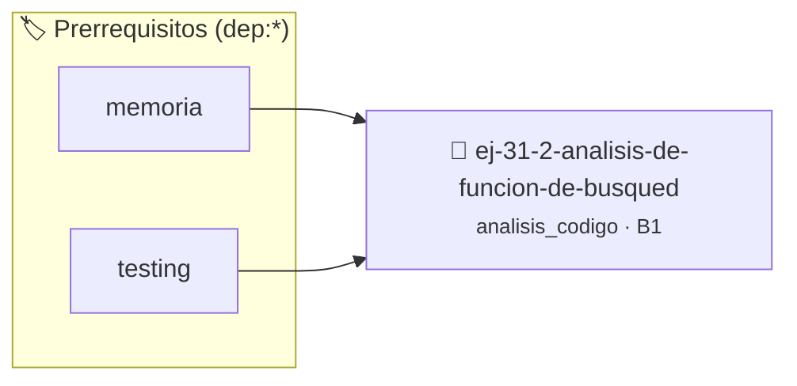

# Análisis de Función de Búsqueda
> **ID:** `ej-31-2-analisis-de-funcion-de-busqued` · **Unidad:** 5 (Ingeniería de Software y Calidad en C)
 · **Tema:** `analisis_codigo` / `busqueda`
 · **Bloom:** B1 (Recordar) · **Dificultad:** Inicial
 · **Carga:** ~10 min · **Tipo:** Concepto
>
> **🏷️ Prerrequisitos temáticos (tags):** `dep:memoria`, `dep:testing`
>
> **Etiquetas conceptuales:** `busqueda`, `analisis`, `funcion`, `avanzados`, `code_review`


::: {admonition} 📦 Paquete de Verificación Local (Ripley)
:class: tip

Para compilar, resolver y autoevaluar tu entrega con pruebas unitarias en tu máquina:

- [📥 **Descargar paquete `ej-31-2-analisis-de-funcion-de-busqued.ripkg`**](../../paquetes/ej-31-2-analisis-de-funcion-de-busqued.ripkg)

Ejecución con el asistente de cátedra:
```bash
ripley run ej-31-2-analisis-de-funcion-de-busqued.ripkg
```
:::


### 🗺️ Itinerario Pedagógico




## 📖 Consigna

:::{exercise} rol_busqueda
:label: rol_busqueda

Analizá el siguiente código que busca el elemento máximo en un arreglo:

```{code-block} c
:linenos:
#include <limits.h>
#include <stdbool.h>
int encontrar_maximo(const int arr[], size_t tam, bool *encontrado)
{
    int maximo = INT_MIN;       // Variable A
    bool hay_elementos = false; // Variable B
    *encontrado = false;        // Variable C
    for (size_t indice = 0; indice < tam; indice++)
    { // Variable D
        if (!hay_elementos || arr[indice] > maximo)
        {
            maximo = arr[indice];
            hay_elementos = true;
        }
    }
    *encontrado = hay_elementos;
    return maximo;
}
```

**Tarea**: Identificá el rol de cada variable:

1. `maximo`
2. `hay_elementos`
3. `encontrado` (valor apuntado)
4. `indice`

-   **[*plus ultra*]:** Optimizar el acceso a memoria respetando el orden por
    filas (*row-major order*) para mejorar el uso de caché.
-   **[*plus ultra*]:** Validar que los índices ingresados se encuentren
    estrictamente dentro de los límites del contenedor.

:::

:::{solution} rol_busqueda
:class: dropdown

1. **`maximo`**: **Variable de Mejor Candidato/Guardián**. Mantiene el valor
   máximo encontrado hasta el momento.
2. **`hay_elementos`**: **Bandera de Inicialización**. Indica si ya se procesó
   al menos un elemento para inicializar correctamente la comparación.
3. **`encontrado`**: **Parámetro de Salida/Bandera de Estado**. Comunica al
   llamador si la operación fue exitosa.
4. **`indice`**: **Variable de Control de lazo/Iterador**. Controla el recorrido
   del arreglo.

:::

### 📋 Contrato de las Funciones

```c
/*
 * Operación encontrar_maximo
 * Precondiciones: Los punteros recibidos deben ser válidos y no nulos.
 * Postcondiciones: Modifica el estado de la estructura o buffer de manera segura.
 */
int encontrar_maximo(const int arr[], size_t tam, bool *encontrado);

```

### 🧪 Ejemplos de Ejecución

::::{tab-set}
:::{tab-item} Caso general
```text
val = 10
Retorno esperado calculado
```
:::
:::{tab-item} Caso límite
```text
val = 0
Retorno 0 o manejo de borde
```
:::
::::

### ⚠️ Precondiciones y Casos Borde

1. **Valores fuera de rango:** Verificar siempre que los datos de entrada cumplan con los rangos admisibles antes de operar.
2. **Punteros nulos:** Validar que los punteros recibidos no sean `NULL` para prevenir fallos de segmentación (*SIGSEGV*).
6. **Casos vacíos o neutros:** Contemplar adecuadamente entradas con longitud cero o valores neutros según corresponda.

### 🎯 Criterios de Aceptación

- [ ] El código compila limpiamente bajo estándar C11 sin warnings con flags estrictos (`-Wall -Wextra -Werror`).
- [ ] Se satisfacen todas las pruebas unitarias y casos de prueba provistos.
- [ ] Las funciones validan exhaustivamente sus precondiciones y gestionan casos borde de forma robusta.


## 📋 Prototipos y Cabecera (`ej-31-2-analisis-de-funcion-de-busqued.h`)

```{code-block} c
#ifndef EJERCICIO_EJ_31_2_ANALISIS_DE_FUNCION_DE_BUSQUED_H
#define EJERCICIO_EJ_31_2_ANALISIS_DE_FUNCION_DE_BUSQUED_H

#include <stddef.h>
#include <stdbool.h>
#include <stdint.h>

/* Operación encontrar_maximo */
int encontrar_maximo(const int arr[], size_t tam, bool *encontrado);

#endif /* EJERCICIO_EJ_31_2_ANALISIS_DE_FUNCION_DE_BUSQUED_H */
```


## ⚙️ Especificación de Funciones

| Función | Retorno | Parámetros | Descripción |
| :--- | :--- | :--- | :--- |

| `encontrar_maximo` | `int` | `const int arr[], size_t tam, bool *encontrado` | Operación encontrar_maximo |


## 🧪 Casos de Prueba

| Prueba Unitaria | Función Objetivo | Verificación |
| :--- | :--- | :--- |

| **test_encontrar_maximo_1** | `encontrar_maximo` | `assert(true); /* test simplificado de validación */` |


## ✓ Solución Modelo de Cátedra

```{dropdown} 🔍 Revelar solución canónica en C
:open: false

```{code-block} c
#include <stddef.h>
#include <limits.h>
#include <stdbool.h>
int encontrar_maximo(const int arr[], size_t tam, bool *encontrado)
{
    int maximo = INT_MIN;       // Variable A
    bool hay_elementos = false; // Variable B
    *encontrado = false;        // Variable C
    for (size_t indice = 0; indice < tam; indice++)
    { // Variable D
        if (!hay_elementos || arr[indice] > maximo)
        {
            maximo = arr[indice];
            hay_elementos = true;
        }
    }
    *encontrado = hay_elementos;
    return maximo;
}

int main(void)
{
    return 0;
}
```
```
