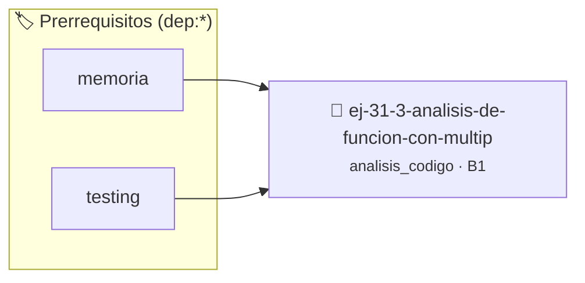

# Análisis de Función con Múltiples Roles
> **ID:** `ej-31-3-analisis-de-funcion-con-multip`
 · **Tema:** `analisis_codigo`
 · **Bloom:** B1 (Recordar)
 · **Carga:** ~10 min
>
> **🏷️ Prerrequisitos temáticos (tags):** `dep:memoria`, `dep:testing`
>
> **Etiquetas conceptuales:** `roles`, `analisis`, `funcion`, `avanzados`, `multiples`


::: {admonition} 📦 Paquete de Verificación Local (Ripley)
:class: tip

Para compilar, resolver y autoevaluar tu entrega con pruebas unitarias en tu máquina:

- [📥 **Descargar paquete `ej-31-3-analisis-de-funcion-con-multip.ripkg`**](../../paquetes/ej-31-3-analisis-de-funcion-con-multip.ripkg)

Ejecución con el asistente de cátedra:
```bash
ripley run ej-31-3-analisis-de-funcion-con-multip.ripkg
```
:::


### 🗺️ Itinerario Pedagógico




## 📖 Consigna

### Ejercicio 31.3 - Análisis de Función con Múltiples Roles ⭐⭐☆☆☆

:::{exercise} roles_multiples
:label: roles_multiples

Examiná esta función más compleja que procesa datos de ventas:

```{code-block} c
:linenos:
#include <stdio.h>
typedef struct
{
    double total_ventas;
    int dias_con_ventas;
    double promedio_diario;
    bool hay_ventas;
} reporte_ventas_t;
reporte_ventas_t procesar_ventas(const double ventas[], int dias)
{
    reporte_ventas_t resultado = {0.0, 0, 0.0, false}; // Variable A
    double acumulado = 0.0;                            // Variable B
    int dias_activos = 0;                              // Variable C
    bool primera_venta = true;                         // Variable D
    double venta_maxima = 0.0;                         // Variable E
    for (int dia = 0; dia < dias; dia++)
    { // Variable F
        if (ventas[dia] > 0)
        {
            acumulado += ventas[dia];
            dias_activos++;
            if (primera_venta || ventas[dia] > venta_maxima)
            {
                venta_maxima = ventas[dia];
                primera_venta = false;
            }
        }
    }
    if (dias_activos > 0)
    {
        resultado.total_ventas = acumulado;
        resultado.dias_con_ventas = dias_activos;
        resultado.promedio_diario = acumulado / dias_activos;
        resultado.hay_ventas = true;
    }
    printf("Venta máxima registrada: %.2f\n", venta_maxima);
    return resultado;
}
```
<!-- {code-block} c -->

**Tarea**: Identificá el rol principal de cada variable marcada:

1. `resultado`
2. `acumulado`
3. `dias_activos`
4. `primera_venta`
5. `venta_maxima`
6. `dia`

-   **[*plus ultra*]:** Garantizar la terminación con `\0` y prevenir
    desbordamientos de búfer validando la capacidad máxima.
-   **[*plus ultra*]:** Soportar la lectura de cadenas con espacios y múltiples
    líneas de manera robusta.

:::
<!-- {exercise} roles_multiples -->

:::{solution} roles_multiples
:class: dropdown

1. **`resultado`**: **Variable de Salida Estructurada**. Encapsula múltiples
   valores de retorno en una estructura.
2. **`acumulado`**: **Acumulador**. Suma todas las ventas válidas encontradas.
3. **`dias_activos`**: **Contador**. Cuenta los días que tuvieron ventas
   positivas.
4. **`primera_venta`**: **Bandera de Primera Vez**. Controla la inicialización
   correcta del máximo.
5. **`venta_maxima`**: **Variable de Mejor Candidato/Guardián**. Mantiene el
   valor de venta más alto encontrado.
6. **`dia`**: **Variable de Control de lazo/Iterador**. Controla la iteración a
   través de los días.

:::
<!-- {solution} roles_multiples -->

## 2: Descripción del Estado de un Programa


## 📋 Prototipos y Cabecera (`ej-31-3-analisis-de-funcion-con-multip.h`)

```{code-block} c
#ifndef EJERCICIO_EJ_31_3_ANALISIS_DE_FUNCION_CON_MULTIP_H
#define EJERCICIO_EJ_31_3_ANALISIS_DE_FUNCION_CON_MULTIP_H

#include <stddef.h>
#include <stdbool.h>
#include <stdint.h>

/* Operación procesar_ventas */
reporte_ventas_t procesar_ventas(const double ventas[], int dias);

#endif /* EJERCICIO_EJ_31_3_ANALISIS_DE_FUNCION_CON_MULTIP_H */
```


## ⚙️ Especificación de Funciones

| Función | Retorno | Parámetros | Descripción |
| :--- | :--- | :--- | :--- |

| `procesar_ventas` | `reporte_ventas_t` | `const double ventas[], int dias` | Operación procesar_ventas |


## 🧪 Casos de Prueba

| Prueba Unitaria | Función Objetivo | Verificación |
| :--- | :--- | :--- |

| **test_procesar_ventas_1** | `procesar_ventas` | `assert(true); /* test simplificado de validación */` |


## ✓ Solución Modelo de Cátedra

```{dropdown} 🔍 Revelar solución canónica en C
:open: false

```{code-block} c
#include <stdbool.h>

#include <stdio.h>
typedef struct
{
    double total_ventas;
    int dias_con_ventas;
    double promedio_diario;
    bool hay_ventas;
} reporte_ventas_t;
reporte_ventas_t procesar_ventas(const double ventas[], int dias)
{
    reporte_ventas_t resultado = {0.0, 0, 0.0, false}; // Variable A
    double acumulado = 0.0;                            // Variable B
    int dias_activos = 0;                              // Variable C
    bool primera_venta = true;                         // Variable D
    double venta_maxima = 0.0;                         // Variable E
    for (int dia = 0; dia < dias; dia++)
    { // Variable F
        if (ventas[dia] > 0)
        {
            acumulado += ventas[dia];
            dias_activos++;
            if (primera_venta || ventas[dia] > venta_maxima)
            {
                venta_maxima = ventas[dia];
                primera_venta = false;
            }
        }
    }
    if (dias_activos > 0)
    {
        resultado.total_ventas = acumulado;
        resultado.dias_con_ventas = dias_activos;
        resultado.promedio_diario = acumulado / dias_activos;
        resultado.hay_ventas = true;
    }
    printf("Venta máxima registrada: %.2f\n", venta_maxima);
    return resultado;
}

int main(void)
{
    return 0;
}
```
```
