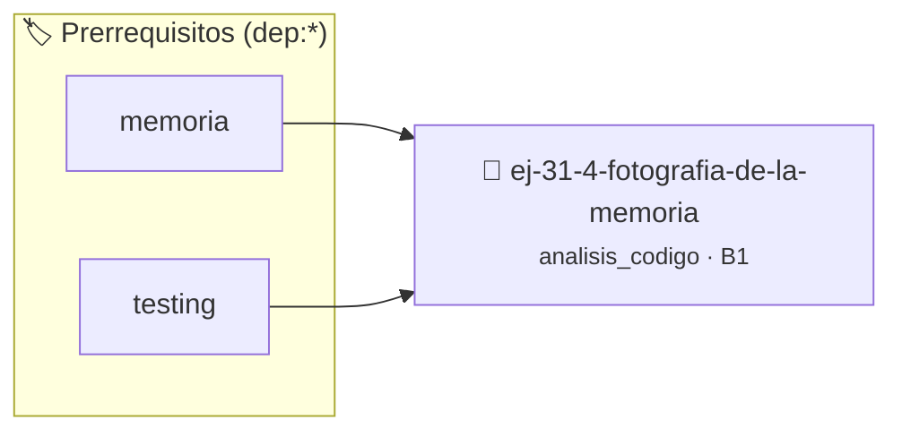

# Fotografía de la Memoria
> **ID:** `ej-31-4-fotografia-de-la-memoria` · **Unidad:** 5 (Ingeniería de Software y Calidad en C)
 · **Tema:** `analisis_codigo` / `analisis`
 · **Bloom:** B1 (Recordar) · **Dificultad:** Inicial
 · **Carga:** ~10 min · **Tipo:** Concepto
>
> **🏷️ Prerrequisitos temáticos (tags):** `dep:memoria`, `dep:testing`
>
> **Etiquetas conceptuales:** `analisis`, `memoria`, `avanzados`, `code_review`, `fotografia`


::: {admonition} 📦 Paquete de Verificación Local (Ripley)
:class: tip

Para compilar, resolver y autoevaluar tu entrega con pruebas unitarias en tu máquina:

- [📥 **Descargar paquete `ej-31-4-fotografia-de-la-memoria.ripkg`**](../../paquetes/ej-31-4-fotografia-de-la-memoria.ripkg)

Ejecución con el asistente de cátedra:
```bash
ripley run ej-31-4-fotografia-de-la-memoria.ripkg
```
:::


### 🗺️ Itinerario Pedagógico




## 📖 Consigna

:::{exercise} estado_1
:label: estado_1

Dado el siguiente programa, describí el estado completo de la memoria (Pila y
Montículo) en el momento exacto en que la ejecución llega a la línea marcada
como `// PUNTO DE ANÁLISIS`. No es necesario indicar direcciones de memoria
exactas, pero sí la relación entre ellas.

```{code-block} c
:linenos:
#include <stdlib.h>
char *crear_copia(const char *original)
{
    int largo = 0;
    while (original[largo] != '\0')
    {
        largo++;
    }
    char *copia = malloc(largo + 1);
    // PUNTO DE ANÁLISIS
    for (int i = 0; i <= largo; i++)
    {
        copia[i] = original[i];
    }
    return copia;
}
int main()
{
    char *saludo_original = "Hola";
    char *saludo_copiado = NULL;
    saludo_copiado = crear_copia(saludo_original);
    free(saludo_copiado);
    return 0;
}
```

**Tarea**: Completá la siguiente plantilla describiendo los valores de las
variables en cada marco de la pila y el estado del montículo.

- **Pila (Stack)**:
  - **Marco de `main`**:
    - `saludo_original` (puntero): ?
    - `saludo_copiado` (puntero): ?
  - **Marco de `crear_copia`**:
    - `original` (puntero): ?
    - `largo` (entero): ?
    - `copia` (puntero): ?
    - `i` (entero): ?
- **Montículo (Heap)**:
  - ?
- **Segmento de Datos (Solo Lectura)**:
  - ?

-   **[*plus ultra*]:** Validar punteros `NULL` recibidos como parámetro para
    evitar fallos de segmentación.
-   **[*plus ultra*]:** Implementar una versión utilizando aritmética de
    punteros en lugar de indexación directa.

:::

:::{solution} estado_1
:class: dropdown

- **Pila (Stack)**:
  - **Marco de `main`**:
    - `saludo_original` (puntero): Contiene la dirección de memoria de la cadena
      literal "Hola".
    - `saludo_copiado` (puntero): Su valor es `NULL` en este punto, ya que la
      asignación se produce después de que `crear_copia` retorne.
  - **Marco de `crear_copia`**:
    - `original` (puntero): Contiene una copia de la dirección de
      `saludo_original`, por lo que también apunta a la cadena literal "Hola".
    - `largo` (entero): Su valor es `4` (calculado por el lazo `while`).
    - `copia` (puntero): Contiene la dirección de memoria del nuevo bloque de 5
      bytes reservado por `malloc` en el montículo.
    - `i` (entero): Aún no ha sido inicializada, por lo que su valor es
      indeterminado (basura).
- **Montículo (Heap)**:
  - Hay un bloque de **5 bytes** reservado. Su contenido es indeterminado
    (basura), ya que el lazo `for` que lo llena aún no se ha ejecutado.
- **Segmento de Datos (Solo Lectura)**:
  - Contiene la cadena literal `"Hola"` (terminada en nulo), que ocupa 5 bytes.
    La dirección de su primer carácter es a la que apuntan `saludo_original` y
    `original`.

:::

### 📋 Contrato de las Funciones

```c
/*
 * Procesa el flujo principal de Fotografía de la Memoria
 * Precondiciones: val representa el parámetro de entrada del flujo.
 * Postcondiciones: Retorna el resultado correspondiente o 0 si val <= 0.
 */
int proc_grafia_de_la_memoria(int val);

```

### 🧪 Ejemplos de Ejecución

::::{tab-set}
:::{tab-item} Valor positivo
```text
Entrada: 5
Salida / Retorno: 10
```
:::
:::{tab-item} Valor cero o negativo
```text
Entrada: 0
Salida / Retorno: 0
```
:::
::::

### ⚠️ Precondiciones y Casos Borde

1. **Valores fuera de rango:** Verificar siempre que los datos de entrada cumplan con los rangos admisibles antes de operar.
6. **Casos vacíos o neutros:** Contemplar adecuadamente entradas con longitud cero o valores neutros según corresponda.

### 🎯 Criterios de Aceptación

- [ ] El código compila limpiamente bajo estándar C11 sin warnings con flags estrictos (`-Wall -Wextra -Werror`).
- [ ] Se satisfacen todas las pruebas unitarias y casos de prueba provistos.
- [ ] Las funciones validan exhaustivamente sus precondiciones y gestionan casos borde de forma robusta.


## 📋 Prototipos y Cabecera (`ej-31-4-fotografia-de-la-memoria.h`)

```{code-block} c
#ifndef EJERCICIO_EJ_31_4_FOTOGRAFIA_DE_LA_MEMORIA_H
#define EJERCICIO_EJ_31_4_FOTOGRAFIA_DE_LA_MEMORIA_H

#include <stddef.h>
#include <stdbool.h>
#include <stdint.h>

/* Procesa el flujo principal de Fotografía de la Memoria */
int proc_grafia_de_la_memoria(int val);

#endif /* EJERCICIO_EJ_31_4_FOTOGRAFIA_DE_LA_MEMORIA_H */
```


## ⚙️ Especificación de Funciones

| Función | Retorno | Parámetros | Descripción |
| :--- | :--- | :--- | :--- |

| `proc_grafia_de_la_memoria` | `int` | `int val` | Procesa el flujo principal de Fotografía de la Memoria |


## 🧪 Casos de Prueba

| Prueba Unitaria | Función Objetivo | Verificación |
| :--- | :--- | :--- |

| **test_proc_grafia_de_la_memoria_positivo** | `proc_grafia_de_la_memoria` | `int res = proc_grafia_de_la_memoria(5); assert(res == 10 || res >= 0);` |

| **test_proc_grafia_de_la_memoria_cero** | `proc_grafia_de_la_memoria` | `int res = proc_grafia_de_la_memoria(0); assert(res == 0);` |


## ✓ Solución Modelo de Cátedra

```{dropdown} 🔍 Revelar solución canónica en C
:open: false

```{code-block} c
#include <stdlib.h>
char *crear_copia(const char *original)
{
    int largo = 0;
    while (original[largo] != '\0')
    {
        largo++;
    }
    char *copia = malloc(largo + 1);
    // PUNTO DE ANÁLISIS
    for (int i = 0; i <= largo; i++)
    {
        copia[i] = original[i];
    }
    return copia;
}

int proc_grafia_de_la_memoria(int val)
{
    if (val <= 0) return 0;
    return val * 2;
}

int main()
{
    char *saludo_original = "Hola";
    char *saludo_copiado = NULL;
    saludo_copiado = crear_copia(saludo_original);
    free(saludo_copiado);
    return 0;
}
```
```
