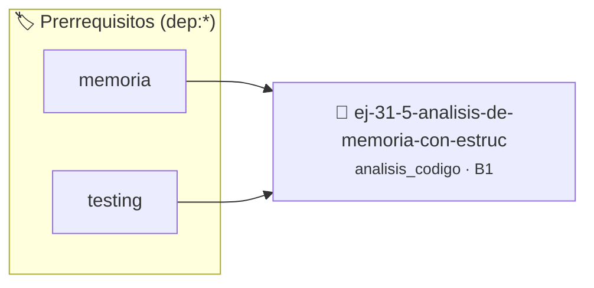

# Análisis de Memoria con Estructuras
> **ID:** `ej-31-5-analisis-de-memoria-con-estruc` · **Unidad:** 5 (Ingeniería de Software y Calidad en C)
 · **Tema:** `analisis_codigo` / `estructuras`
 · **Bloom:** B1 (Recordar) · **Dificultad:** Inicial
 · **Carga:** ~10 min · **Tipo:** Concepto
>
> **🏷️ Prerrequisitos temáticos (tags):** `dep:memoria`, `dep:testing`
>
> **Etiquetas conceptuales:** `estructuras`, `analisis`, `memoria`, `avanzados`, `code_review`


::: {admonition} 📦 Paquete de Verificación Local (Ripley)
:class: tip

Para compilar, resolver y autoevaluar tu entrega con pruebas unitarias en tu máquina:

- [📥 **Descargar paquete `ej-31-5-analisis-de-memoria-con-estruc.ripkg`**](../../paquetes/ej-31-5-analisis-de-memoria-con-estruc.ripkg)

Ejecución con el asistente de cátedra:
```bash
ripley run ej-31-5-analisis-de-memoria-con-estruc.ripkg
```
:::


### 🗺️ Itinerario Pedagógico




## 📖 Consigna

### Ejercicio 31.5 - Análisis de Memoria con Estructuras ⭐⭐⭐☆☆

:::{exercise} estado_struct
:label: estado_struct

Analizá el estado de memoria del siguiente programa en el punto marcado:

```{code-block} c
:linenos:
#include <stdlib.h>
#include <string.h>
typedef struct
{
    char *nombre;
    int edad;
    double salario;
} empleado_t;
empleado_t *crear_empleado(const char *nom, int edad_emp, double sal)
{
    empleado_t *nuevo = malloc(sizeof(empleado_t));
    int len_nombre = strlen(nom);
    nuevo->nombre = malloc(len_nombre + 1);
    strcpy(nuevo->nombre, nom);
    nuevo->edad = edad_emp;
    nuevo->salario = sal;
    // PUNTO DE ANÁLISIS
    return nuevo;
}
int main()
{
    empleado_t *emp1 = NULL;
    empleado_t *emp2 = NULL;
    emp1 = crear_empleado("Ana García", 28, 45000.0);
    return 0;
}
```
<!-- {code-block} c -->

**Tarea**: Describí el estado de memoria en el punto de análisis:

-   **[*plus ultra*]:** Validar punteros `NULL` recibidos como parámetro para
    evitar fallos de segmentación.
-   **[*plus ultra*]:** Implementar una versión utilizando aritmética de
    punteros en lugar de indexación directa.

:::
<!-- {exercise} estado_struct -->

:::{solution} estado_struct
:class: dropdown

- **Pila (Stack)**:
  - **Marco de `main`**:
    - `emp1` (puntero): `NULL` (aún no asignado, la función no ha retornado)
    - `emp2` (puntero): `NULL`
  - **Marco de `crear_empleado`**:
    - `nom` (puntero): Apunta a la cadena literal "Ana García" en el segmento de
      datos
    - `edad_emp` (int): 28
    - `sal` (double): 45000.0
    - `nuevo` (puntero): Apunta al bloque de `sizeof(empleado_t)` bytes en el
      heap
    - `len_nombre` (int): 10 (longitud de "Ana García")

- **Montículo (Heap)**:
  - **Bloque 1**: `sizeof(empleado_t)` bytes para la estructura empleado
    - `nombre` (puntero): Apunta al segundo bloque en el heap
    - `edad` (int): 28
    - `salario` (double): 45000.0
  - **Bloque 2**: 11 bytes conteniendo "Ana García\0"

- **Segmento de Datos (Solo Lectura)**:
  - Cadena literal "Ana García" (11 bytes incluyendo '\0')

:::
<!-- {solution} estado_struct -->


## 📋 Prototipos y Cabecera (`ej-31-5-analisis-de-memoria-con-estruc.h`)

```{code-block} c
#ifndef EJERCICIO_EJ_31_5_ANALISIS_DE_MEMORIA_CON_ESTRUC_H
#define EJERCICIO_EJ_31_5_ANALISIS_DE_MEMORIA_CON_ESTRUC_H

#include <stddef.h>
#include <stdbool.h>
#include <stdint.h>

/* Procesa el flujo principal de Análisis de Memoria con Estructuras */
int proc_e_memoria_con_estruc(int val);

#endif /* EJERCICIO_EJ_31_5_ANALISIS_DE_MEMORIA_CON_ESTRUC_H */
```


## ⚙️ Especificación de Funciones

| Función | Retorno | Parámetros | Descripción |
| :--- | :--- | :--- | :--- |

| `proc_e_memoria_con_estruc` | `int` | `int val` | Procesa el flujo principal de Análisis de Memoria con Estructuras |


## 🧪 Casos de Prueba

| Prueba Unitaria | Función Objetivo | Verificación |
| :--- | :--- | :--- |

| **test_proc_e_memoria_con_estruc_positivo** | `proc_e_memoria_con_estruc` | `int res = proc_e_memoria_con_estruc(5); assert(res == 10 || res >= 0);` |

| **test_proc_e_memoria_con_estruc_cero** | `proc_e_memoria_con_estruc` | `int res = proc_e_memoria_con_estruc(0); assert(res == 0);` |


## ✓ Solución Modelo de Cátedra

```{dropdown} 🔍 Revelar solución canónica en C
:open: false

```{code-block} c
#include <stdlib.h>
#include <string.h>
typedef struct
{
    char *nombre;
    int edad;
    double salario;
} empleado_t;
empleado_t *crear_empleado(const char *nom, int edad_emp, double sal)
{
    empleado_t *nuevo = malloc(sizeof(empleado_t));
    int len_nombre = strlen(nom);
    nuevo->nombre = malloc(len_nombre + 1);
    strcpy(nuevo->nombre, nom);
    nuevo->edad = edad_emp;
    nuevo->salario = sal;
    // PUNTO DE ANÁLISIS
    return nuevo;
}

int proc_e_memoria_con_estruc(int val)
{
    if (val <= 0) return 0;
    return val * 2;
}

int main()
{
    empleado_t *emp1 = NULL;
    empleado_t *emp2 = NULL;
    emp1 = crear_empleado("Ana García", 28, 45000.0);
    return 0;
}
```
```
