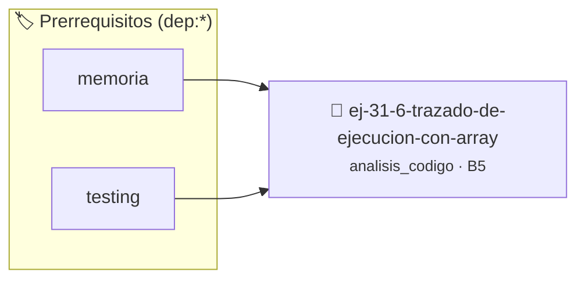

# Trazado de Ejecución con Arrays Dinámicos
> **ID:** `ej-31-6-trazado-de-ejecucion-con-array` · **Unidad:** 5 (Ingeniería de Software y Calidad en C)
 · **Tema:** `analisis_codigo` / `dinamicos`
 · **Bloom:** B5 (Evaluar / Crear) · **Dificultad:** Desafio
 · **Carga:** ~45 min · **Tipo:** Desafio
>
> **🏷️ Prerrequisitos temáticos (tags):** `dep:memoria`, `dep:testing`
>
> **Etiquetas conceptuales:** `dinamicos`, `analisis`, `ejecucion`, `trazado`, `arrays`


::: {admonition} 📦 Paquete de Verificación Local (Ripley)
:class: tip

Para compilar, resolver y autoevaluar tu entrega con pruebas unitarias en tu máquina:

- [📥 **Descargar paquete `ej-31-6-trazado-de-ejecucion-con-array.ripkg`**](../../paquetes/ej-31-6-trazado-de-ejecucion-con-array.ripkg)

Ejecución con el asistente de cátedra:
```bash
ripley run ej-31-6-trazado-de-ejecucion-con-array.ripkg
```
:::


### 🗺️ Itinerario Pedagógico




## 📖 Consigna

### Ejercicio 31.6 - Trazado de Ejecución con Arrays Dinámicos ⭐⭐⭐☆☆

:::{exercise} traza_ejecucion
:label: traza_ejecucion

Seguí la ejecución del siguiente código y describí el estado en cada punto
marcado:

```{code-block} c
:linenos:
#include <stdlib.h>
int *duplicar_array(int *original, int tam)
{
    int *nuevo = malloc(tam * sizeof(int));
    // PUNTO A
    for (int i = 0; i < tam; i++)
    {
        nuevo[i] = original[i] * 2;
    }
    // PUNTO B
    return nuevo;
}
int main()
{
    int numeros[3] = {5, 10, 15};
    int *duplicados = NULL;
    // PUNTO C
    duplicados = duplicar_array(numeros, 3);
    // PUNTO D
    free(duplicados);
    return 0;
}
```
<!-- {code-block} c -->

**Tarea**: Para cada punto (A, B, C, D), describí:
1. Estado de la pila
2. Estado del montículo
3. Valores de las variables relevantes

-   **[*plus ultra*]:** Verificar el retorno de asignación de memoria y
    garantizar la liberación total de recursos en caso de error.
-   **[*plus ultra*]:** Verificar la ausencia de fugas de memoria (*memory
    leaks*) mediante Valgrind o AddressSanitizer.

:::
<!-- {exercise} traza_ejecucion -->

:::{solution} traza_ejecucion
:class: dropdown

**PUNTO A** (después del malloc en `duplicar_array`):
- **Pila**:
  - **Marco de `main`**: 
    - `numeros[3]`: {5, 10, 15}
    - `duplicados`: NULL
  - **Marco de `duplicar_array`**:
    - `original`: apunta a `numeros[0]` en main
    - `tam`: 3
    - `nuevo`: apunta al bloque malloc'eado en heap
    - `i`: no inicializada (basura)
- **Heap**: Bloque de 12 bytes (3 * sizeof(int)) con contenido indeterminado

**PUNTO B** (después del lazo for):
- **Pila**: Igual que punto A, excepto `i` = 3
- **Heap**: El bloque ahora contiene {10, 20, 30}

**PUNTO C** (antes de llamar a `duplicar_array`):
- **Pila**:
  - **Marco de `main`**:
    - `numeros[3]`: {5, 10, 15}
    - `duplicados`: NULL
- **Heap**: Vacío

**PUNTO D** (después de retornar de `duplicar_array`):
- **Pila**:
  - **Marco de `main`**:
    - `numeros[3]`: {5, 10, 15}
    - `duplicados`: apunta al bloque en heap
- **Heap**: Bloque de 12 bytes conteniendo {10, 20, 30}

:::
<!-- {solution} traza_ejecucion -->

## 3: Análisis de Bugs y Problemas


## 📋 Prototipos y Cabecera (`ej-31-6-trazado-de-ejecucion-con-array.h`)

```{code-block} c
#ifndef EJERCICIO_EJ_31_6_TRAZADO_DE_EJECUCION_CON_ARRAY_H
#define EJERCICIO_EJ_31_6_TRAZADO_DE_EJECUCION_CON_ARRAY_H

#include <stddef.h>
#include <stdbool.h>
#include <stdint.h>

/* Procesa el flujo principal de Trazado de Ejecución con Arrays Dinámicos */
int proc__ejecucion_con_array(int val);

#endif /* EJERCICIO_EJ_31_6_TRAZADO_DE_EJECUCION_CON_ARRAY_H */
```


## ⚙️ Especificación de Funciones

| Función | Retorno | Parámetros | Descripción |
| :--- | :--- | :--- | :--- |

| `proc__ejecucion_con_array` | `int` | `int val` | Procesa el flujo principal de Trazado de Ejecución con Arrays Dinámicos |


## 🧪 Casos de Prueba

| Prueba Unitaria | Función Objetivo | Verificación |
| :--- | :--- | :--- |

| **test_proc__ejecucion_con_array_positivo** | `proc__ejecucion_con_array` | `int res = proc__ejecucion_con_array(5); assert(res == 10 || res >= 0);` |

| **test_proc__ejecucion_con_array_cero** | `proc__ejecucion_con_array` | `int res = proc__ejecucion_con_array(0); assert(res == 0);` |


## ✓ Solución Modelo de Cátedra

```{dropdown} 🔍 Revelar solución canónica en C
:open: false

```{code-block} c
#include <stdlib.h>
int *duplicar_array(int *original, int tam)
{
    int *nuevo = malloc(tam * sizeof(int));
    // PUNTO A
    for (int i = 0; i < tam; i++)
    {
        nuevo[i] = original[i] * 2;
    }
    // PUNTO B
    return nuevo;
}

int proc__ejecucion_con_array(int val)
{
    if (val <= 0) return 0;
    return val * 2;
}

int main()
{
    int numeros[3] = {5, 10, 15};
    int *duplicados = NULL;
    // PUNTO C
    duplicados = duplicar_array(numeros, 3);
    // PUNTO D
    free(duplicados);
    return 0;
}
```
```
