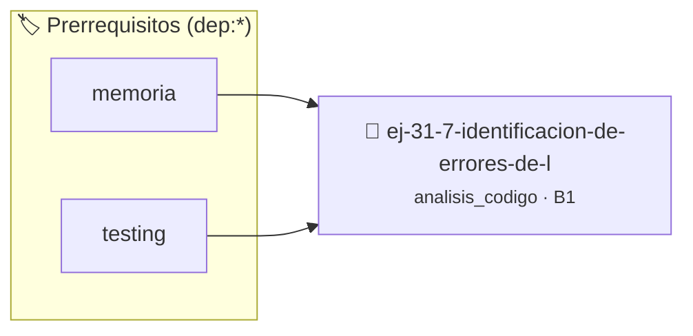

# Identificación de Errores de Lógica
> **ID:** `ej-31-7-identificacion-de-errores-de-l` · **Unidad:** 5 (Ingeniería de Software y Calidad en C)
 · **Tema:** `analisis_codigo` / `registro_eventos`
 · **Bloom:** B1 (Recordar) · **Dificultad:** Inicial
 · **Carga:** ~10 min · **Tipo:** Concepto
>
> **🏷️ Prerrequisitos temáticos (tags):** `dep:memoria`, `dep:testing`
>
> **Etiquetas conceptuales:** `errores`, `logica`, `analisis`, `identificacion`, `avanzados`


::: {admonition} 📦 Paquete de Verificación Local (Ripley)
:class: tip

Para compilar, resolver y autoevaluar tu entrega con pruebas unitarias en tu máquina:

- [📥 **Descargar paquete `ej-31-7-identificacion-de-errores-de-l.ripkg`**](../../paquetes/ej-31-7-identificacion-de-errores-de-l.ripkg)

Ejecución con el asistente de cátedra:
```bash
ripley run ej-31-7-identificacion-de-errores-de-l.ripkg
```
:::


### 🗺️ Itinerario Pedagógico




## 📖 Consigna

:::{exercise} debugging_1
:label: debugging_1

El siguiente código intenta encontrar el segundo elemento más grande en un
arreglo, pero contiene errores. Identificá los problemas sin ejecutar el código:

```{code-block} c
:linenos:
#include <limits.h>
#include <stdio.h>
int segundo_maximo(int arr[], int tam)
{
    int maximo = INT_MIN;
    int segundo = INT_MIN;
    for (int i = 0; i < tam; i++)
    {
        if (arr[i] > maximo)
        {
            segundo = maximo;
            maximo = arr[i];
        }
        else if (arr[i] > segundo)
        {
            segundo = arr[i];
        }
    }
    return segundo;
}
```

**Tarea**: 
1. ¿Qué problemas podés identificar en este código?
2. ¿En qué casos fallaría?
3. ¿Cómo lo corregirías?

-   **[*plus ultra*]:** Optimizar el acceso a memoria respetando el orden por
    filas (*row-major order*) para mejorar el uso de caché.
-   **[*plus ultra*]:** Validar que los índices ingresados se encuentren
    estrictamente dentro de los límites del contenedor.

:::

:::{solution} debugging_1
:class: dropdown

**Problemas identificados:**

1. **Falta validación de tamaño**: No verifica que `tam >= 2`, que es el mínimo
   necesario para tener un segundo máximo.

2. **Elementos duplicados**: Si el máximo se repite, el segundo máximo será
   igual al máximo, lo cual puede no ser el comportamiento deseado.

3. **Array con menos de 2 elementos únicos**: Si todos los elementos son
   iguales, no hay un verdadero "segundo máximo".

4. **No maneja el caso de array vacío**: Si `tam == 0`, el comportamiento es
   indefinido.

**Casos que fallan:**
- Array vacío: `[]`
- Array con un elemento: `[5]`
- Array con elementos iguales: `[3, 3, 3]`
- Array con solo dos valores únicos donde uno se repite: `[5, 3, 5, 5]`

**Corrección sugerida:**
```{code-block} c
:linenos:
int segundo_maximo_corregido(int arr[], int tam)
{
    if (tam < 2)
    {
        return INT_MIN; // o manejar error apropiadamente
    }
    int maximo = INT_MIN;
    int segundo = INT_MIN;
    for (int i = 0; i < tam; i++)
    {
        if (arr[i] > maximo)
        {
            segundo = maximo;
            maximo = arr[i];
        }
        else if (arr[i] > segundo && arr[i] != maximo)
        {
            segundo = arr[i];
        }
    }
    // Verificar si realmente hay un segundo máximo
    if (segundo == INT_MIN)
    {
        // Todos los elementos eran iguales
        return INT_MIN; // o manejar apropiadamente
    }
    return segundo;
}
```

:::

### 📋 Contrato de las Funciones

```c
/*
 * Operación segundo_maximo
 * Precondiciones: Parámetros dentro del dominio válido de la operación.
 * Postcondiciones: Retorna el valor procesado.
 */
int segundo_maximo(int arr[], int tam);

```

### 🧪 Ejemplos de Ejecución

::::{tab-set}
:::{tab-item} Caso general
```text
val = 10
Retorno esperado calculado
```
:::
:::{tab-item} Caso límite
```text
val = 0
Retorno 0 o manejo de borde
```
:::
::::

### ⚠️ Precondiciones y Casos Borde

1. **Valores fuera de rango:** Verificar siempre que los datos de entrada cumplan con los rangos admisibles antes de operar.
6. **Casos vacíos o neutros:** Contemplar adecuadamente entradas con longitud cero o valores neutros según corresponda.

### 🎯 Criterios de Aceptación

- [ ] El código compila limpiamente bajo estándar C11 sin warnings con flags estrictos (`-Wall -Wextra -Werror`).
- [ ] Se satisfacen todas las pruebas unitarias y casos de prueba provistos.
- [ ] Las funciones validan exhaustivamente sus precondiciones y gestionan casos borde de forma robusta.

:::{hint} Consideraciones Didácticas
- Analizá las condiciones de borde y los casos extremos (arreglos vacíos, elementos únicos).
- Inspeccioná la lógica booleana de los condicionales para detectar cláusulas contradictorias o redundantes.
- Seguí la traza de ejecución manual con un conjunto pequeño de datos de prueba.
:::


## 📋 Prototipos y Cabecera (`ej-31-7-identificacion-de-errores-de-l.h`)

```{code-block} c
#ifndef EJERCICIO_EJ_31_7_IDENTIFICACION_DE_ERRORES_DE_L_H
#define EJERCICIO_EJ_31_7_IDENTIFICACION_DE_ERRORES_DE_L_H

#include <stddef.h>
#include <stdbool.h>
#include <stdint.h>

/* Operación segundo_maximo */
int segundo_maximo(int arr[], int tam);

#endif /* EJERCICIO_EJ_31_7_IDENTIFICACION_DE_ERRORES_DE_L_H */
```


## ⚙️ Especificación de Funciones

| Función | Retorno | Parámetros | Descripción |
| :--- | :--- | :--- | :--- |

| `segundo_maximo` | `int` | `int arr[], int tam` | Operación segundo_maximo |


## 💡 Pistas Progresivas

````{tab-set}

```{tab-item} Pista 1
Analizá las condiciones de borde y los casos extremos (arreglos vacíos, elementos únicos).
```

```{tab-item} Pista 2
Inspeccioná la lógica booleana de los condicionales para detectar cláusulas contradictorias o redundantes.
```

```{tab-item} Pista 3
Seguí la traza de ejecución manual con un conjunto pequeño de datos de prueba.
```

````


## 🧪 Casos de Prueba

| Prueba Unitaria | Función Objetivo | Verificación |
| :--- | :--- | :--- |

| **test_segundo_maximo_1** | `segundo_maximo` | `/* Verificación unitaria de segundo_maximo */ int arr[] = {1, 2, 3, 4}; int res = segundo_maximo(arr, 4); (void)res; assert(true);` |


## ✓ Solución Modelo de Cátedra

```{dropdown} 🔍 Revelar solución canónica en C
:open: false

```{code-block} c
#include <limits.h>
#include <stdio.h>
int segundo_maximo(int arr[], int tam)
{
    int maximo = INT_MIN;
    int segundo = INT_MIN;
    for (int i = 0; i < tam; i++)
    {
        if (arr[i] > maximo)
        {
            segundo = maximo;
            maximo = arr[i];
        }
        else if (arr[i] > segundo)
        {
            segundo = arr[i];
        }
    }
    return segundo;
}

int main(void)
{
    return 0;
}
```
```
