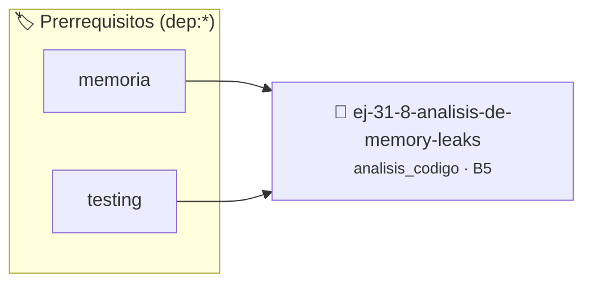

# Análisis de Memory Leaks
> **ID:** `ej-31-8-analisis-de-memory-leaks` · **Unidad:** 5 (Ingeniería de Software y Calidad en C)
 · **Tema:** `analisis_codigo` / `analisis`
 · **Bloom:** B5 (Evaluar / Crear) · **Dificultad:** Desafio
 · **Carga:** ~45 min · **Tipo:** Desafio
>
> **🏷️ Prerrequisitos temáticos (tags):** `dep:memoria`, `dep:testing`
>
> **Etiquetas conceptuales:** `analisis`, `memory`, `avanzados`, `code_review`, `leaks`


::: {admonition} 📦 Paquete de Verificación Local (Ripley)
:class: tip

Para compilar, resolver y autoevaluar tu entrega con pruebas unitarias en tu máquina:

- [📥 **Descargar paquete `ej-31-8-analisis-de-memory-leaks.ripkg`**](../../paquetes/ej-31-8-analisis-de-memory-leaks.ripkg)

Ejecución con el asistente de cátedra:
```bash
ripley run ej-31-8-analisis-de-memory-leaks.ripkg
```
:::


### 🗺️ Itinerario Pedagógico




## 📖 Consigna

:::{exercise} fugas_1
:label: fugas_1

Identificá los problemas de manejo de memoria en el siguiente código:

```{code-block} c
:linenos:
#include <stdlib.h>
#include <string.h>
char *procesar_texto(const char *entrada)
{
    int len = strlen(entrada);
    char *resultado = malloc(len * 2 + 1);
    char *temp = malloc(len + 1);
    strcpy(temp, entrada);
    // Duplicar cada carácter
    for (int i = 0; i < len; i++)
    {
        resultado[i * 2] = temp[i];
        resultado[i * 2 + 1] = temp[i];
    }
    resultado[len * 2] = '\0';
    if (len > 10)
    {
        char *resultado_largo = malloc(len * 3 + 1);
        // Triplicar en lugar de duplicar
        for (int i = 0; i < len; i++)
        {
            resultado_largo[i * 3] = temp[i];
            resultado_largo[i * 3 + 1] = temp[i];
            resultado_largo[i * 3 + 2] = temp[i];
        }
        resultado_largo[len * 3] = '\0';
        return resultado_largo;
    }
    return resultado;
}
int main()
{
    char *texto1 = procesar_texto("Hola");
    char *texto2 = procesar_texto("Este es un texto muy largo");
    printf("Texto 1: %s\n", texto1);
    printf("Texto 2: %s\n", texto2);
    return 0;
}
```

**Tarea**: Identificá todos los memory leaks y problemas de manejo de memoria.

-   **[*plus ultra*]:** Verificar el retorno de asignación de memoria y
    garantizar la liberación total de recursos en caso de error.
-   **[*plus ultra*]:** Verificar la ausencia de fugas de memoria (*memory
    leaks*) mediante Valgrind o AddressSanitizer.

:::

:::{solution} fugas_1
:class: dropdown

**Problemas identificados:**

1. **Memory leak de `temp`**: La variable `temp` se aloca con `malloc()` pero
   nunca se libera con `free()`. Esto ocurre en ambos caminos de ejecución.

2. **Memory leak de `resultado`**: Cuando `len > 10`, se aloca `resultado` pero
   luego se aloca `resultado_largo` y se retorna este último, perdiendo la
   referencia a `resultado` sin liberarlo.

3. **Memory leaks en `main`**: Las variables `texto1` y `texto2` reciben memoria
   alocada dinámicamente pero nunca se libera.

4. **Uso innecesario de memoria**: El `temp` es redundante ya que se puede
   trabajar directamente con `entrada`.

**Código corregido:**
```{code-block} c
:linenos:
char *procesar_texto_corregido(const char *entrada)
{
    int len = strlen(entrada);
    char *resultado;
    if (len > 10)
    {
        resultado = malloc(len * 3 + 1);
        for (int i = 0; i < len; i++)
        {
            resultado[i * 3] = entrada[i];
            resultado[i * 3 + 1] = entrada[i];
            resultado[i * 3 + 2] = entrada[i];
        }
        resultado[len * 3] = '\0';
    }
    else
    {
        resultado = malloc(len * 2 + 1);
        for (int i = 0; i < len; i++)
        {
            resultado[i * 2] = entrada[i];
            resultado[i * 2 + 1] = entrada[i];
        }
        resultado[len * 2] = '\0';
    }
    return resultado;
}
int main()
{
    char *texto1 = procesar_texto_corregido("Hola");
    char *texto2 = procesar_texto_corregido("Este es un texto muy largo");
    printf("Texto 1: %s\n", texto1);
    printf("Texto 2: %s\n", texto2);
    // Liberar memoria
    free(texto1);
    free(texto2);
    return 0;
}
```

:::

### 📋 Contrato de las Funciones

```c
/*
 * Procesa el flujo principal de Análisis de Memory Leaks
 * Precondiciones: val representa el parámetro de entrada del flujo.
 * Postcondiciones: Retorna el resultado correspondiente o 0 si val <= 0.
 */
int proc_isis_de_memory_leaks(int val);

```

### 🧪 Ejemplos de Ejecución

::::{tab-set}
:::{tab-item} Valor positivo
```text
Entrada: 5
Salida / Retorno: 10
```
:::
:::{tab-item} Valor cero o negativo
```text
Entrada: 0
Salida / Retorno: 0
```
:::
::::

### ⚠️ Precondiciones y Casos Borde

1. **Valores fuera de rango:** Verificar siempre que los datos de entrada cumplan con los rangos admisibles antes de operar.
6. **Casos vacíos o neutros:** Contemplar adecuadamente entradas con longitud cero o valores neutros según corresponda.

### 🎯 Criterios de Aceptación

- [ ] El código compila limpiamente bajo estándar C11 sin warnings con flags estrictos (`-Wall -Wextra -Werror`).
- [ ] Se satisfacen todas las pruebas unitarias y casos de prueba provistos.
- [ ] Las funciones validan exhaustivamente sus precondiciones y gestionan casos borde de forma robusta.

:::{hint} Consideraciones Didácticas
- Identificá todas las rutas de salida temprana (return, break) que puedan omitir la liberación de recursos.
- Verificá que las estructuras anidadas o listas liberen sus nodos antes de liberar el contenedor principal.
- Utilizá herramientas como Valgrind o AddressSanitizer para confirmar la ausencia de fugas.
:::


## 📋 Prototipos y Cabecera (`ej-31-8-analisis-de-memory-leaks.h`)

```{code-block} c
#ifndef EJERCICIO_EJ_31_8_ANALISIS_DE_MEMORY_LEAKS_H
#define EJERCICIO_EJ_31_8_ANALISIS_DE_MEMORY_LEAKS_H

#include <stddef.h>
#include <stdbool.h>
#include <stdint.h>

/* Procesa el flujo principal de Análisis de Memory Leaks */
int proc_isis_de_memory_leaks(int val);

#endif /* EJERCICIO_EJ_31_8_ANALISIS_DE_MEMORY_LEAKS_H */
```


## ⚙️ Especificación de Funciones

| Función | Retorno | Parámetros | Descripción |
| :--- | :--- | :--- | :--- |

| `proc_isis_de_memory_leaks` | `int` | `int val` | Procesa el flujo principal de Análisis de Memory Leaks |


## 💡 Pistas Progresivas

````{tab-set}

```{tab-item} Pista 1
Identificá todas las rutas de salida temprana (return, break) que puedan omitir la liberación de recursos.
```

```{tab-item} Pista 2
Verificá que las estructuras anidadas o listas liberen sus nodos antes de liberar el contenedor principal.
```

```{tab-item} Pista 3
Utilizá herramientas como Valgrind o AddressSanitizer para confirmar la ausencia de fugas.
```

````


## 🧪 Casos de Prueba

| Prueba Unitaria | Función Objetivo | Verificación |
| :--- | :--- | :--- |

| **test_proc_isis_de_memory_leaks_positivo** | `proc_isis_de_memory_leaks` | `int res = proc_isis_de_memory_leaks(5); assert(res == 10 || res >= 0);` |

| **test_proc_isis_de_memory_leaks_cero** | `proc_isis_de_memory_leaks` | `int res = proc_isis_de_memory_leaks(0); assert(res == 0);` |


## ✓ Solución Modelo de Cátedra

```{dropdown} 🔍 Revelar solución canónica en C
:open: false

```{code-block} c
#include <stdio.h>

#include <stdlib.h>
#include <string.h>
char *procesar_texto(const char *entrada)
{
    int len = strlen(entrada);
    char *resultado = malloc(len * 2 + 1);
    char *temp = malloc(len + 1);
    strcpy(temp, entrada);
    // Duplicar cada carácter
    for (int i = 0; i < len; i++)
    {
        resultado[i * 2] = temp[i];
        resultado[i * 2 + 1] = temp[i];
    }
    resultado[len * 2] = '\0';
    if (len > 10)
    {
        char *resultado_largo = malloc(len * 3 + 1);
        // Triplicar en lugar de duplicar
        for (int i = 0; i < len; i++)
        {
            resultado_largo[i * 3] = temp[i];
            resultado_largo[i * 3 + 1] = temp[i];
            resultado_largo[i * 3 + 2] = temp[i];
        }
        resultado_largo[len * 3] = '\0';
        return resultado_largo;
    }
    return resultado;
}

int proc_isis_de_memory_leaks(int val)
{
    if (val <= 0) return 0;
    return val * 2;
}

int main()
{
    char *texto1 = procesar_texto("Hola");
    char *texto2 = procesar_texto("Este es un texto muy largo");
    printf("Texto 1: %s\n", texto1);
    printf("Texto 2: %s\n", texto2);
    return 0;
}
```
```
