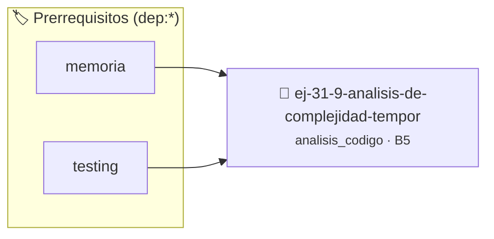

# Análisis de Complejidad Temporal
> **ID:** `ej-31-9-analisis-de-complejidad-tempor` · **Unidad:** 5 (Ingeniería de Software y Calidad en C)
 · **Tema:** `analisis_codigo` / `analisis`
 · **Bloom:** B5 (Evaluar / Crear) · **Dificultad:** Desafio
 · **Carga:** ~45 min · **Tipo:** Desafio
>
> **🏷️ Prerrequisitos temáticos (tags):** `dep:memoria`, `dep:testing`
>
> **Etiquetas conceptuales:** `analisis`, `complejidad`, `avanzados`, `code_review`, `temporal`


::: {admonition} 📦 Paquete de Verificación Local (Ripley)
:class: tip

Para compilar, resolver y autoevaluar tu entrega con pruebas unitarias en tu máquina:

- [📥 **Descargar paquete `ej-31-9-analisis-de-complejidad-tempor.ripkg`**](../../paquetes/ej-31-9-analisis-de-complejidad-tempor.ripkg)

Ejecución con el asistente de cátedra:
```bash
ripley run ej-31-9-analisis-de-complejidad-tempor.ripkg
```
:::


### 🗺️ Itinerario Pedagógico




## 📖 Consigna

### Ejercicio 31.9 - Análisis de Complejidad Temporal ⭐⭐⭐☆☆

:::{exercise} eficiencia_1
:label: eficiencia_1

Analizá la complejidad temporal del siguiente algoritmo de búsqueda:

```{code-block} c
:linenos:
#include <stdbool.h>
bool buscar_par_suma(int arr[], int tam, int objetivo)
{
    // Busca si existe un par de números que sumen al objetivo
    for (int i = 0; i < tam - 1; i++)
    {
        for (int j = i + 1; j < tam; j++)
        {
            if (arr[i] + arr[j] == objetivo)
            {
                return true;
            }
        }
    }
    return false;
}
bool buscar_par_suma_optimizado(int arr[], int tam, int objetivo)
{
    // Versión con array ordenado (asumimos que está ordenado)
    int izq = 0;
    int der = tam - 1;
    while (izq < der)
    {
        int suma_actual = arr[izq] + arr[der];
        if (suma_actual == objetivo)
        {
            return true;
        }
        else if (suma_actual < objetivo)
        {
            izq++;
        }
        else
        {
            der--;
        }
    }
    return false;
}
```
<!-- {code-block} c -->

**Tarea**: 
1. ¿Cuál es la complejidad temporal de cada función?
2. ¿Cuáles son las variables de control y qué roles cumplen?
3. ¿En qué escenarios cada algoritmo sería más apropiado?

-   **[*plus ultra*]:** Validar punteros `NULL` recibidos como parámetro para
    evitar fallos de segmentación.
-   **[*plus ultra*]:** Implementar una versión utilizando aritmética de
    punteros en lugar de indexación directa.

:::
<!-- {exercise} eficiencia_1 -->

:::{solution} eficiencia_1
:class: dropdown

**Análisis de `buscar_par_suma`:**
- **Complejidad temporal**: $O(n^2)$ - hay dos lazos anidados que recorren el
  array
- **Variables de control**: 
  - `i`: Iterador externo (rol: control de lazo principal)
  - `j`: Iterador interno (rol: control de lazo secundario, siempre j > i)
- **Complejidad espacial**: $O(1)$ - solo usa variables locales

**Análisis de `buscar_par_suma_optimizado`:**
- **Complejidad temporal**: $O(n)$ - cada elemento se visita máximo una vez
- **Variables de control**:
  - `izq`: Puntero izquierdo (rol: guardián del límite inferior)
  - `der`: Puntero derecho (rol: guardián del límite superior)
  - `suma_actual`: Variable temporal (rol: almacén de cálculo intermedio)
- **Complejidad espacial**: $O(1)$

**Escenarios apropiados:**
- **Primer algoritmo**: Cuando el array NO está ordenado y no podemos/queremos
  ordenarlo
- **Segundo algoritmo**: Cuando el array YA está ordenado o el costo de
  ordenarlo es amortizable

**Trade-offs:**
- Si necesitamos ordenar: $O(n log n) + O(n)$ vs $O(n^2)$
- Si ya está ordenado: $O(n)$ vs $O(n^2)$ - clara ventaja para el optimizado

:::
<!-- {solution} eficiencia_1 -->


## 📋 Prototipos y Cabecera (`ej-31-9-analisis-de-complejidad-tempor.h`)

```{code-block} c
#ifndef EJERCICIO_EJ_31_9_ANALISIS_DE_COMPLEJIDAD_TEMPOR_H
#define EJERCICIO_EJ_31_9_ANALISIS_DE_COMPLEJIDAD_TEMPOR_H

#include <stddef.h>
#include <stdbool.h>
#include <stdint.h>

/* Operación buscar_par_suma */
bool buscar_par_suma(int arr[], int tam, int objetivo);
/* Operación buscar_par_suma_optimizado */
bool buscar_par_suma_optimizado(int arr[], int tam, int objetivo);

#endif /* EJERCICIO_EJ_31_9_ANALISIS_DE_COMPLEJIDAD_TEMPOR_H */
```


## ⚙️ Especificación de Funciones

| Función | Retorno | Parámetros | Descripción |
| :--- | :--- | :--- | :--- |

| `buscar_par_suma` | `bool` | `int arr[], int tam, int objetivo` | Operación buscar_par_suma |

| `buscar_par_suma_optimizado` | `bool` | `int arr[], int tam, int objetivo` | Operación buscar_par_suma_optimizado |


## 🧪 Casos de Prueba

| Prueba Unitaria | Función Objetivo | Verificación |
| :--- | :--- | :--- |

| **test_buscar_par_suma_1** | `buscar_par_suma` | `assert(true); /* test simplificado de validación */` |

| **test_buscar_par_suma_optimizado_2** | `buscar_par_suma_optimizado` | `assert(true); /* test simplificado de validación */` |


## ✓ Solución Modelo de Cátedra

```{dropdown} 🔍 Revelar solución canónica en C
:open: false

```{code-block} c
#include <stdbool.h>
bool buscar_par_suma(int arr[], int tam, int objetivo)
{
    // Busca si existe un par de números que sumen al objetivo
    for (int i = 0; i < tam - 1; i++)
    {
        for (int j = i + 1; j < tam; j++)
        {
            if (arr[i] + arr[j] == objetivo)
            {
                return true;
            }
        }
    }
    return false;
}
bool buscar_par_suma_optimizado(int arr[], int tam, int objetivo)
{
    // Versión con array ordenado (asumimos que está ordenado)
    int izq = 0;
    int der = tam - 1;
    while (izq < der)
    {
        int suma_actual = arr[izq] + arr[der];
        if (suma_actual == objetivo)
        {
            return true;
        }
        else if (suma_actual < objetivo)
        {
            izq++;
        }
        else
        {
            der--;
        }
    }
    return false;
}

int main(void)
{
    return 0;
}
```
```
