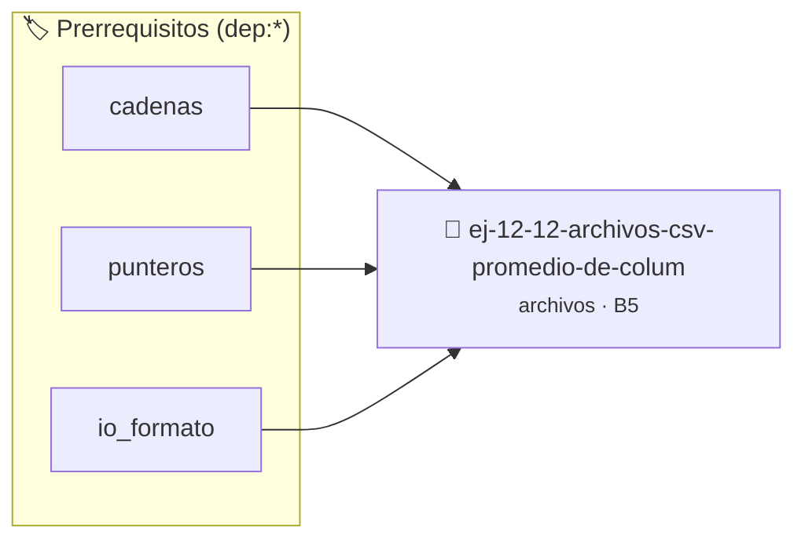

# Archivos CSV - Promedio de Columna
> **ID:** `ej-12-12-archivos-csv-promedio-de-colum` · **Unidad:** 3 (Memoria Dinámica y Persistencia)
 · **Tema:** `archivos` / `archivos_estructurados`
 · **Bloom:** B5 (Evaluar / Crear) · **Dificultad:** Desafio
 · **Carga:** ~45 min · **Tipo:** Desafio
>
> **🏷️ Prerrequisitos temáticos (tags):** `dep:cadenas`, `dep:punteros`, `dep:io_formato`
>
> **Etiquetas conceptuales:** `columna`, `memoria`, `promedio`, `io_disco`, `archivos`


::: {admonition} 📦 Paquete de Verificación Local (Ripley)
:class: tip

Para compilar, resolver y autoevaluar tu entrega con pruebas unitarias en tu máquina:

- [📥 **Descargar paquete `ej-12-12-archivos-csv-promedio-de-colum.ripkg`**](../../paquetes/ej-12-12-archivos-csv-promedio-de-colum.ripkg)

Ejecución con el asistente de cátedra:
```bash
ripley run ej-12-12-archivos-csv-promedio-de-colum.ripkg
```
:::


### 🗺️ Itinerario Pedagógico




## 📖 Consigna

Leer un archivo en formato CSV (valores separados por comas) que contiene datos
de estudiantes (ej. `nombre,nota1,nota2`). Calcular el promedio de una columna
numérica específica (ej. la segunda columna de notas) e imprimir el resultado.


Creá un archivo de texto y escribí "Hola, archivo!" en él.

**Orientación:**
- `FILE *fp = fopen("salida.txt", "w");`
- Verificá: `if (fp == NULL) { perror("Error"); return 1; }`
- Escribí: `fprintf(fp, "Hola, archivo!\n");`
- Cerrá: `fclose(fp);`


---

Leé y mostrá todo el contenido de un archivo de texto.

**Orientación:**
- Abrí en modo "r"
- Leé línea por línea con `fgets(buffer, tamaño, fp)`
- Mientras no sea EOF: `while (fgets(...) != NULL)`
- Mostrá cada línea en stdout


---

Contá cuántas líneas tiene un archivo de texto.

**Orientación:**
- Leé carácter por carácter con `fgetc`
- Contador de saltos de línea: `if (c == '\n') lineas++;`
- Considerá última línea sin '\n' al final


---

Copiá el contenido de un archivo a otro.

**Orientación:**
- Abrí origen en "r"
- Abrí destino en "w"
- Leé carácter por carácter del origen
- Escribí en destino con `fputc`
- Cerrá ambos archivos


---

Contá la cantidad de palabras en un archivo de texto.

**Orientación:**
- Palabra: secuencia de caracteres no-espacio
- Estado: dentro/fuera de palabra
- Al encontrar espacio después de no-espacio: incrementar contador
- Usá `isspace()` de `<ctype.h>`


---

Agregá texto al final de un archivo existente sin sobrescribir.

**Orientación:**
- Modo "a" (append)
- `fopen("archivo.txt", "a")`
- Todo lo que escribas se agrega al final
- Si el archivo no existe, se crea


---

Buscá si una palabra específica existe en un archivo y mostrá la línea.

**Orientación:**
- Leé línea por línea con `fgets`
- Usá `strstr(linea, palabra)` para buscar
- Si `strstr` no retorna NULL: palabra encontrada
- Mostrá número de línea y contenido


---

Calculá: líneas, palabras, caracteres y bytes de un archivo.

**Orientación:**
- Similar a `wc` de Unix
- Contadores para cada métrica
- Recorré el archivo completo
- Para bytes: `ftell(fp)` al final, o contar en lectura


---

Leé un archivo y escribí sus líneas en orden inverso en otro archivo.

**Orientación:**
- Opción 1: Leé todo en array dinámico de strings, escribí al revés
- Opción 2: Leé dos veces (primera cuenta líneas, segunda lee y posiciona)
- Recordá liberar memoria dinámica


---

Leé un archivo CSV con datos de personas y cargá en array de estructuras.

**Formato CSV:**


```
Juan,Perez,25
Maria,Gomez,30
```

**Orientación:**
- Estructura: `typedef struct { char nombre[50]; char apellido[50]; int edad; }
  persona_t;`
- Leé línea con `fgets`
- Parseá con `sscanf` o `strtok`
- Almacená en array

---

Dados dos archivos con números ordenados, generá un tercer archivo con todos
ordenados.

**Orientación:**
- Abrí ambos archivos de entrada y uno de salida
- Leé un número de cada archivo
- Escribí el menor en salida
- Avanzá el archivo del que se tomó el número
- Cuando uno se acabe, copiá el resto del otro


---

Reemplazá todas las ocurrencias de una palabra por otra en un archivo.

**Orientación:**
- Leé archivo completo en memoria o procesá línea por línea
- Para cada línea, buscá la palabra con `strstr`
- Cuando encontrás: copiá parte antes, palabra nueva, parte después
- Escribí en archivo temporal
- Al final: renombrá temporal al original


---

Escribí un array de enteros en un archivo binario.

**Orientación:**
- Modo "wb" (write binary)
- `fwrite(array, sizeof(int), cantidad, fp)`
- Verificá cantidad escrita: `size_t escritos = fwrite(...)`


---

Leé enteros de un archivo binario y mostralos.

**Orientación:**
- Modo "rb" (read binary)
- `fread(array, sizeof(int), cantidad, fp)`
- Leé hasta EOF: `while (fread(&num, sizeof(int), 1, fp) == 1)`


---

Guardá y leé array de estructuras en archivo binario.

**Orientación:**
- `fwrite(&persona, sizeof(persona_t), 1, fp)`
- `fread(&persona, sizeof(persona_t), 1, fp)`
- Escribí todo el array: `fwrite(array, sizeof(persona_t), n, fp)`
- **Cuidado:** Punteros dentro de structs no se serializan bien


---

Implementá CRUD (Create, Read, Update, Delete) sobre archivo binario de
registros.

**Orientación:**
- Usa `fseek(fp, offset, SEEK_SET)` para posicionarte
- Offset del registro i: `i * sizeof(registro_t)`
- `ftell(fp)` para obtener posición actual
- Marcá registros eliminados con flag en lugar de borrar físicamente


---

Implementá sistema de logging que agregue eventos con timestamp a un archivo.

**Orientación:**
- Modo "a" para append
- Cada línea: `[timestamp] nivel: mensaje`
- Timestamp: `time()` y `strftime()`
- Niveles: INFO, WARNING, ERROR
- Función: `void log_evento(const char *nivel, const char *msg)`


---

Implementá compresión Run-Length Encoding: caracteres repetidos se almacenan
como `<contador><carácter>`.

**Ejemplo:** "aaabbcccc" → "3a2b4c"

**Orientación:**
- Leé carácter por carácter
- Contá repeticiones consecutivas
- Escribí contador + carácter en salida
- Descompresión: leé contador, repetí carácter esas veces


---

Creá un índice de palabras con sus posiciones (número de línea) en el archivo.

**Orientación:**
- Diccionario: palabra → lista de líneas
- Leé archivo, parseá palabras
- Para cada palabra: agregá número de línea actual a su lista
- Escribí índice ordenado en archivo de salida


---

Implementá versión simple de `diff`: mostrá líneas diferentes entre dos
archivos.

**Orientación:**
- Abrí ambos archivos
- Leé línea por línea de ambos simultáneamente
- Compará con `strcmp`
- Si difieren: mostrá número de línea y contenido de ambas
- Manejá archivos de diferente longitud


---

### 📋 Contrato de las Funciones

```c
/*
 * Procesa el flujo principal de Archivos CSV - Promedio de Columna
 * Precondiciones: val representa el parámetro de entrada del flujo.
 * Postcondiciones: Retorna el resultado correspondiente o 0 si val <= 0.
 */
int proc_sv_promedio_de_colum(int val);

```

### 🧪 Ejemplos de Ejecución

::::{tab-set}
:::{tab-item} Valor positivo
```text
Entrada: 5
Salida / Retorno: 10
```
:::
:::{tab-item} Valor cero o negativo
```text
Entrada: 0
Salida / Retorno: 0
```
:::
::::

### ⚠️ Precondiciones y Casos Borde

1. **Valores fuera de rango:** Verificar siempre que los datos de entrada cumplan con los rangos admisibles antes de operar.
5. **Acceso a archivos:** Verificar que los punteros `FILE*` retornados por `fopen` sean distintos de `NULL` antes de leer o escribir.
6. **Casos vacíos o neutros:** Contemplar adecuadamente entradas con longitud cero o valores neutros según corresponda.

### 🎯 Criterios de Aceptación

- [ ] El código compila limpiamente bajo estándar C11 sin warnings con flags estrictos (`-Wall -Wextra -Werror`).
- [ ] Se satisfacen todas las pruebas unitarias y casos de prueba provistos.
- [ ] Las funciones validan exhaustivamente sus precondiciones y gestionan casos borde de forma robusta.

:::{hint} Consideraciones Didácticas
- Verificar la correcta apertura del archivo y controlar errores de E/S con `ferror` y `feof`.
- Soportar rutas complejas y asegurar el cierre del archivo en todos los caminos de ejecución.
- Verificar la correcta apertura del archivo y controlar errores de E/S con `ferror` y `feof`.
- Soportar rutas complejas y asegurar el cierre del archivo en todos los caminos de ejecución.
- Garantizar la terminación con `\0` y prevenir desbordamientos de búfer validando la capacidad máxima.
- Soportar la lectura de cadenas con espacios y múltiples líneas de manera robusta.
- Verificar la correcta apertura del archivo y controlar errores de E/S con `ferror` y `feof`.
- Soportar rutas complejas y asegurar el cierre del archivo en todos los caminos de ejecución.
- Verificar la correcta apertura del archivo y controlar errores de E/S con `ferror` y `feof`.
- Soportar rutas complejas y asegurar el cierre del archivo en todos los caminos de ejecución.
- Verificar la correcta apertura del archivo y controlar errores de E/S con `ferror` y `feof`.
- Soportar rutas complejas y asegurar el cierre del archivo en todos los caminos de ejecución.
- Verificar la correcta apertura del archivo y controlar errores de E/S con `ferror` y `feof`.
- Soportar rutas complejas y asegurar el cierre del archivo en todos los caminos de ejecución.
- Garantizar la terminación con `\0` y prevenir desbordamientos de búfer validando la capacidad máxima.
- Soportar la lectura de cadenas con espacios y múltiples líneas de manera robusta.
- Verificar la correcta apertura del archivo y controlar errores de E/S con `ferror` y `feof`.
- Soportar rutas complejas y asegurar el cierre del archivo en todos los caminos de ejecución.
- Verificar el retorno de asignación de memoria y garantizar la liberación total de recursos en caso de error.
- Verificar la ausencia de fugas de memoria (*memory leaks*) mediante Valgrind o AddressSanitizer.
- Garantizar la terminación con `\0` y prevenir desbordamientos de búfer validando la capacidad máxima.
- Soportar la lectura de cadenas con espacios y múltiples líneas de manera robusta.
- Verificar la correcta apertura del archivo y controlar errores de E/S con `ferror` y `feof`.
- Soportar rutas complejas y asegurar el cierre del archivo en todos los caminos de ejecución.
- Verificar el retorno de asignación de memoria y garantizar la liberación total de recursos en caso de error.
- Verificar la ausencia de fugas de memoria (*memory leaks*) mediante Valgrind o AddressSanitizer.
- Optimizar el acceso a memoria respetando el orden por filas (*row-major order*) para mejorar el uso de caché.
- Validar que los índices ingresados se encuentren estrictamente dentro de los límites del contenedor.
- Garantizar la terminación con `\0` y prevenir desbordamientos de búfer validando la capacidad máxima.
- Soportar la lectura de cadenas con espacios y múltiples líneas de manera robusta.
- Validar punteros `NULL` recibidos como parámetro para evitar fallos de segmentación.
- Implementar una versión utilizando aritmética de punteros en lugar de indexación directa.
- Garantizar la terminación con `\0` y prevenir desbordamientos de búfer validando la capacidad máxima.
- Soportar la lectura de cadenas con espacios y múltiples líneas de manera robusta.
- Garantizar la terminación con `\0` y prevenir desbordamientos de búfer validando la capacidad máxima.
- Soportar la lectura de cadenas con espacios y múltiples líneas de manera robusta.
- Implementar encapsulamiento completo manteniendo la definición interna oculta en el archivo `.c`.
- Añadir una función de duplicación profunda (*deep copy*) para copiar la estructura de forma segura.
- Verificar la correcta apertura del archivo y controlar errores de E/S con `ferror` y `feof`.
- Soportar rutas complejas y asegurar el cierre del archivo en todos los caminos de ejecución.
- Garantizar la terminación con `\0` y prevenir desbordamientos de búfer validando la capacidad máxima.
- Soportar la lectura de cadenas con espacios y múltiples líneas de manera robusta.
- Validar estrictamente los datos de entrada para manejar valores fuera de rango o tipos inválidos.
- Permitir el procesamiento interactivo continuo mediante un lazo hasta que el usuario elija finalizar.
:::


## 📋 Prototipos y Cabecera (`ej-12-12-archivos-csv-promedio-de-colum.h`)

```{code-block} c
#ifndef EJERCICIO_EJ_12_12_ARCHIVOS_CSV_PROMEDIO_DE_COLUM_H
#define EJERCICIO_EJ_12_12_ARCHIVOS_CSV_PROMEDIO_DE_COLUM_H

#include <stddef.h>
#include <stdbool.h>
#include <stdint.h>

/* Procesa el flujo principal de Archivos CSV - Promedio de Columna */
int proc_sv_promedio_de_colum(int val);

#endif /* EJERCICIO_EJ_12_12_ARCHIVOS_CSV_PROMEDIO_DE_COLUM_H */
```


## ⚙️ Especificación de Funciones

| Función | Retorno | Parámetros | Descripción |
| :--- | :--- | :--- | :--- |

| `proc_sv_promedio_de_colum` | `int` | `int val` | Procesa el flujo principal de Archivos CSV - Promedio de Columna |


## 💡 Pistas Progresivas

````{tab-set}

```{tab-item} Pista 1
[Plus Ultra] Verificar la correcta apertura del archivo y controlar errores de E/S con `ferror` y `feof`.
```

```{tab-item} Pista 2
[Plus Ultra] Soportar rutas complejas y asegurar el cierre del archivo en todos los caminos de ejecución.
```

```{tab-item} Pista 3
[Plus Ultra] Verificar la correcta apertura del archivo y controlar errores de E/S con `ferror` y `feof`.
```

```{tab-item} Pista 4
[Plus Ultra] Soportar rutas complejas y asegurar el cierre del archivo en todos los caminos de ejecución.
```

```{tab-item} Pista 5
[Plus Ultra] Garantizar la terminación con `\0` y prevenir desbordamientos de búfer validando la capacidad máxima.
```

```{tab-item} Pista 6
[Plus Ultra] Soportar la lectura de cadenas con espacios y múltiples líneas de manera robusta.
```

```{tab-item} Pista 7
[Plus Ultra] Verificar la correcta apertura del archivo y controlar errores de E/S con `ferror` y `feof`.
```

```{tab-item} Pista 8
[Plus Ultra] Soportar rutas complejas y asegurar el cierre del archivo en todos los caminos de ejecución.
```

```{tab-item} Pista 9
[Plus Ultra] Verificar la correcta apertura del archivo y controlar errores de E/S con `ferror` y `feof`.
```

```{tab-item} Pista 10
[Plus Ultra] Soportar rutas complejas y asegurar el cierre del archivo en todos los caminos de ejecución.
```

```{tab-item} Pista 11
[Plus Ultra] Verificar la correcta apertura del archivo y controlar errores de E/S con `ferror` y `feof`.
```

```{tab-item} Pista 12
[Plus Ultra] Soportar rutas complejas y asegurar el cierre del archivo en todos los caminos de ejecución.
```

```{tab-item} Pista 13
[Plus Ultra] Verificar la correcta apertura del archivo y controlar errores de E/S con `ferror` y `feof`.
```

```{tab-item} Pista 14
[Plus Ultra] Soportar rutas complejas y asegurar el cierre del archivo en todos los caminos de ejecución.
```

```{tab-item} Pista 15
[Plus Ultra] Garantizar la terminación con `\0` y prevenir desbordamientos de búfer validando la capacidad máxima.
```

```{tab-item} Pista 16
[Plus Ultra] Soportar la lectura de cadenas con espacios y múltiples líneas de manera robusta.
```

```{tab-item} Pista 17
[Plus Ultra] Verificar la correcta apertura del archivo y controlar errores de E/S con `ferror` y `feof`.
```

```{tab-item} Pista 18
[Plus Ultra] Soportar rutas complejas y asegurar el cierre del archivo en todos los caminos de ejecución.
```

```{tab-item} Pista 19
[Plus Ultra] Verificar el retorno de asignación de memoria y garantizar la liberación total de recursos en caso de error.
```

```{tab-item} Pista 20
[Plus Ultra] Verificar la ausencia de fugas de memoria (*memory leaks*) mediante Valgrind o AddressSanitizer.
```

```{tab-item} Pista 21
[Plus Ultra] Garantizar la terminación con `\0` y prevenir desbordamientos de búfer validando la capacidad máxima.
```

```{tab-item} Pista 22
[Plus Ultra] Soportar la lectura de cadenas con espacios y múltiples líneas de manera robusta.
```

```{tab-item} Pista 23
[Plus Ultra] Verificar la correcta apertura del archivo y controlar errores de E/S con `ferror` y `feof`.
```

```{tab-item} Pista 24
[Plus Ultra] Soportar rutas complejas y asegurar el cierre del archivo en todos los caminos de ejecución.
```

```{tab-item} Pista 25
[Plus Ultra] Verificar el retorno de asignación de memoria y garantizar la liberación total de recursos en caso de error.
```

```{tab-item} Pista 26
[Plus Ultra] Verificar la ausencia de fugas de memoria (*memory leaks*) mediante Valgrind o AddressSanitizer.
```

```{tab-item} Pista 27
[Plus Ultra] Optimizar el acceso a memoria respetando el orden por filas (*row-major order*) para mejorar el uso de caché.
```

```{tab-item} Pista 28
[Plus Ultra] Validar que los índices ingresados se encuentren estrictamente dentro de los límites del contenedor.
```

```{tab-item} Pista 29
[Plus Ultra] Garantizar la terminación con `\0` y prevenir desbordamientos de búfer validando la capacidad máxima.
```

```{tab-item} Pista 30
[Plus Ultra] Soportar la lectura de cadenas con espacios y múltiples líneas de manera robusta.
```

```{tab-item} Pista 31
[Plus Ultra] Validar punteros `NULL` recibidos como parámetro para evitar fallos de segmentación.
```

```{tab-item} Pista 32
[Plus Ultra] Implementar una versión utilizando aritmética de punteros en lugar de indexación directa.
```

```{tab-item} Pista 33
[Plus Ultra] Garantizar la terminación con `\0` y prevenir desbordamientos de búfer validando la capacidad máxima.
```

```{tab-item} Pista 34
[Plus Ultra] Soportar la lectura de cadenas con espacios y múltiples líneas de manera robusta.
```

```{tab-item} Pista 35
[Plus Ultra] Garantizar la terminación con `\0` y prevenir desbordamientos de búfer validando la capacidad máxima.
```

```{tab-item} Pista 36
[Plus Ultra] Soportar la lectura de cadenas con espacios y múltiples líneas de manera robusta.
```

```{tab-item} Pista 37
[Plus Ultra] Implementar encapsulamiento completo manteniendo la definición interna oculta en el archivo `.c`.
```

```{tab-item} Pista 38
[Plus Ultra] Añadir una función de duplicación profunda (*deep copy*) para copiar la estructura de forma segura.
```

```{tab-item} Pista 39
[Plus Ultra] Verificar la correcta apertura del archivo y controlar errores de E/S con `ferror` y `feof`.
```

```{tab-item} Pista 40
[Plus Ultra] Soportar rutas complejas y asegurar el cierre del archivo en todos los caminos de ejecución.
```

```{tab-item} Pista 41
[Plus Ultra] Garantizar la terminación con `\0` y prevenir desbordamientos de búfer validando la capacidad máxima.
```

```{tab-item} Pista 42
[Plus Ultra] Soportar la lectura de cadenas con espacios y múltiples líneas de manera robusta.
```

```{tab-item} Pista 43
[Plus Ultra] Validar estrictamente los datos de entrada para manejar valores fuera de rango o tipos inválidos.
```

```{tab-item} Pista 44
[Plus Ultra] Permitir el procesamiento interactivo continuo mediante un lazo hasta que el usuario elija finalizar.
```

````


## 🧪 Casos de Prueba

| Prueba Unitaria | Función Objetivo | Verificación |
| :--- | :--- | :--- |

| **test_proc_sv_promedio_de_colum_positivo** | `proc_sv_promedio_de_colum` | `int res = proc_sv_promedio_de_colum(5); assert(res == 10 || res >= 0);` |

| **test_proc_sv_promedio_de_colum_cero** | `proc_sv_promedio_de_colum` | `int res = proc_sv_promedio_de_colum(0); assert(res == 0);` |


## ✓ Solución Modelo de Cátedra

```{dropdown} 🔍 Revelar solución canónica en C
:open: false

```{code-block} c
/*
 * Ejercicio: Archivos CSV - Promedio de Columna
 * Cátedra Programación I - UNRN
 */

#include <stdio.h>


int proc_sv_promedio_de_colum(int val)
{
    if (val <= 0) return 0;
    return val * 2;
}

int main(void)
{
    /* TODO: Implementación de Archivos CSV - Promedio de Columna */
    return 0;
}
```
```
