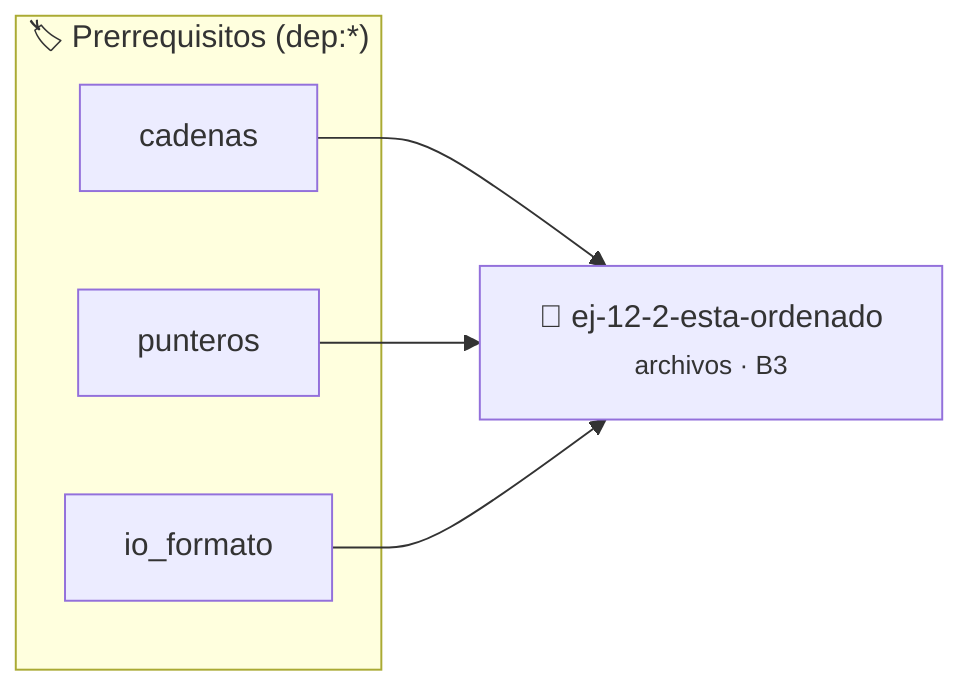

# ¿Está ordenado?
> **ID:** `ej-12-2-esta-ordenado` · **Unidad:** 3 (Memoria Dinámica y Persistencia)
 · **Tema:** `archivos` / `esta`
 · **Bloom:** B3 (Aplicar) · **Dificultad:** Intermedia
 · **Carga:** ~25 min · **Tipo:** Practica Guiada
>
> **🏷️ Prerrequisitos temáticos (tags):** `dep:cadenas`, `dep:punteros`, `dep:io_formato`
>
> **Etiquetas conceptuales:** `esta`, `memoria`, `ordenado`, `io_disco`, `archivos`


::: {admonition} 📦 Paquete de Verificación Local (Ripley)
:class: tip

Para compilar, resolver y autoevaluar tu entrega con pruebas unitarias en tu máquina:

- [📥 **Descargar paquete `ej-12-2-esta-ordenado.ripkg`**](../../paquetes/ej-12-2-esta-ordenado.ripkg)

Ejecución con el asistente de cátedra:
```bash
ripley run ej-12-2-esta-ordenado.ripkg
```
:::


### 🗺️ Itinerario Pedagógico




## 📖 Consigna

### Ejercicio 12.2 - ¿Está ordenado? ⭐⭐☆☆☆

Implementar `int verificar_orden(const char *ruta)`.

**Lógica**: Leer el archivo, guardando el número anterior en cada iteración y
comparándolo con el actual para determinar si la secuencia es ascendente,
descendente o desordenada.


:::{hint} Lógica y Consideraciones

-   **[*plus ultra*]:** Garantizar la terminación con `\0` y prevenir
    desbordamientos de búfer validando la capacidad máxima.
-   **[*plus ultra*]:** Soportar la lectura de cadenas con espacios y múltiples
    líneas de manera robusta.

:::
<!-- {hint} Lógica y Consideraciones -->

---

## Manipulación de Archivos


## 📋 Prototipos y Cabecera (`ej-12-2-esta-ordenado.h`)

```{code-block} c
#ifndef EJERCICIO_EJ_12_2_ESTA_ORDENADO_H
#define EJERCICIO_EJ_12_2_ESTA_ORDENADO_H

#include <stddef.h>
#include <stdbool.h>
#include <stdint.h>

/* Procesa el flujo principal de ¿Está ordenado? */
int ejecutar_ej_12_2_esta_ordenado(int val);

#endif /* EJERCICIO_EJ_12_2_ESTA_ORDENADO_H */
```


## ⚙️ Especificación de Funciones

| Función | Retorno | Parámetros | Descripción |
| :--- | :--- | :--- | :--- |

| `ejecutar_ej_12_2_esta_ordenado` | `int` | `int val` | Procesa el flujo principal de ¿Está ordenado? |


## 💡 Pistas Progresivas

````{tab-set}

```{tab-item} Pista 1
[Plus Ultra] Garantizar la terminación con `\0` y prevenir desbordamientos de búfer validando la capacidad máxima.
```

```{tab-item} Pista 2
[Plus Ultra] Soportar la lectura de cadenas con espacios y múltiples líneas de manera robusta.
```

````


## 🧪 Casos de Prueba

| Prueba Unitaria | Función Objetivo | Verificación |
| :--- | :--- | :--- |

| **test_ejecutar_ej_12_2_esta_ordenado_positivo** | `ejecutar_ej_12_2_esta_ordenado` | `int res = ejecutar_ej_12_2_esta_ordenado(5); assert(res == 10 || res >= 0);` |

| **test_ejecutar_ej_12_2_esta_ordenado_cero** | `ejecutar_ej_12_2_esta_ordenado` | `int res = ejecutar_ej_12_2_esta_ordenado(0); assert(res == 0);` |


## ✓ Solución Modelo de Cátedra

```{dropdown} 🔍 Revelar solución canónica en C
:open: false

```{code-block} c
/*
 * Ejercicio: ¿Está ordenado?
 * Cátedra Programación I - UNRN
 */

#include <stdio.h>


int ejecutar_ej_12_2_esta_ordenado(int val)
{
    if (val <= 0) return 0;
    return val * 2;
}

int main(void)
{
    /* TODO: Implementación de ¿Está ordenado? */
    return 0;
}
```
```
