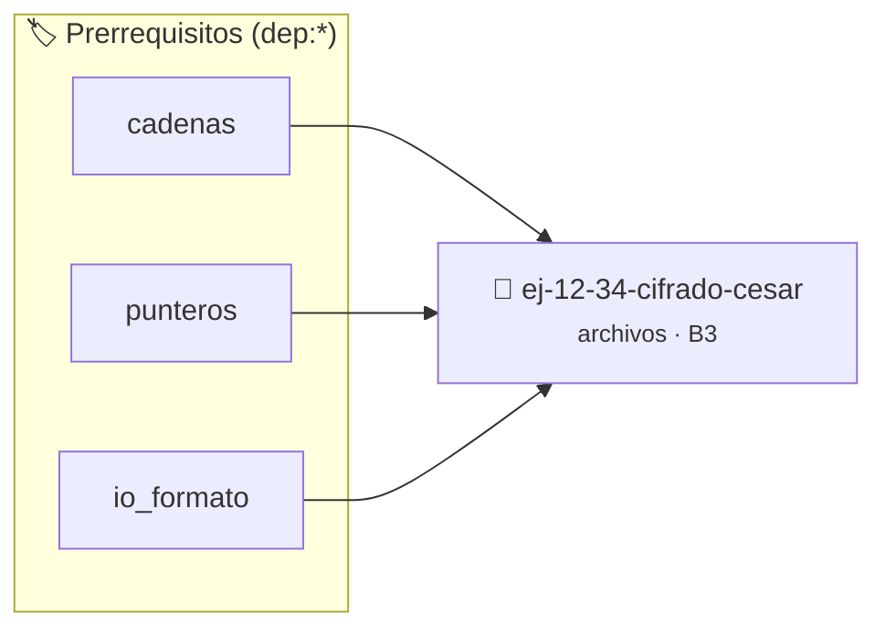

# Cifrado César
> **ID:** `ej-12-34-cifrado-cesar` · **Unidad:** 3 (Memoria Dinámica y Persistencia)
 · **Tema:** `archivos` / `cesar`
 · **Bloom:** B3 (Aplicar) · **Dificultad:** Intermedia
 · **Carga:** ~25 min · **Tipo:** Practica Guiada
>
> **🏷️ Prerrequisitos temáticos (tags):** `dep:cadenas`, `dep:punteros`, `dep:io_formato`
>
> **Etiquetas conceptuales:** `cesar`, `memoria`, `archivos`, `io_disco`, `cifrado`


::: {admonition} 📦 Paquete de Verificación Local (Ripley)
:class: tip

Para compilar, resolver y autoevaluar tu entrega con pruebas unitarias en tu máquina:

- [📥 **Descargar paquete `ej-12-34-cifrado-cesar.ripkg`**](../../paquetes/ej-12-34-cifrado-cesar.ripkg)

Ejecución con el asistente de cátedra:
```bash
ripley run ej-12-34-cifrado-cesar.ripkg
```
:::


### 🗺️ Itinerario Pedagógico




## 📖 Consigna

**Tema:** Archivos y E/S en C · **Nivel:** 3 — Aplicar · **Duración estimada:** 25 min

---


Implementá la función `proc__12_34_cifrado_cesar`, que lee el contenido de un
archivo de texto, le aplica el **cifrado César** (rotación de letras) y escribe
el resultado en un archivo de salida. El desplazamiento se recibe por parámetro.

#### Prototipo

```c
int proc__12_34_cifrado_cesar(int val);
```

#### Contrato de la función

| Aspecto            | Especificación                                                                                                                                           |
| ------------------ | -------------------------------------------------------------------------------------------------------------------------------------------------------- |
| **Precondición**   | El archivo `"entrada.txt"` existe en el directorio de trabajo y es legible.                                                                               |
| **Parámetro `val`**| Desplazamiento del cifrado. Si `val > 0`, se **cifra** rotando `val` posiciones hacia adelante en el alfabeto. Si `val ≤ 0`, no se procesa nada.         |
| **Postcondición**  | Se crea (o sobreescribe) el archivo `"salida.txt"` con el texto cifrado.                                                                                  |
| **Retorno**        | Cantidad de caracteres escritos en `"salida.txt"` (≥ 0) si la operación fue exitosa. Si `val ≤ 0`, retorna `0`. Ante cualquier error de E/S, retorna `-1`. |

#### Reglas de transformación carácter por carácter

1. **Minúsculas** (`'a'` … `'z'`): rotá dentro del rango circular `a–z`.
2. **Mayúsculas** (`'A'` … `'Z'`): rotá dentro del rango circular `A–Z`.
3. **Cualquier otro carácter** (espacios, dígitos, puntuación, `'\n'`, `'\t'`):
   copialo al archivo de salida **sin modificar**.
4. Preservá los saltos de línea tal cual aparecen en `"entrada.txt"`.
5. Si `val ≥ 26`, normalizá primero: `n = val % 26`.

#### Ejemplo de ejecución

Suponé que `entrada.txt` contiene exactamente:

```
Hola, Mundo!
abc xyz
```

**Llamada:** `proc__12_34_cifrado_cesar(3)` → retorna `21` (caracteres escritos).

`salida.txt` resultante:

```
Krod, Pxqgr!
def abc
```

Notá cómo `x`, `y`, `z` envuelven correctamente hacia `a`, `b`, `c`.

**Llamada:** `proc__12_34_cifrado_cesar(0)` → retorna `0`, no genera `"salida.txt"`.

#### Casos borde y manejo de errores

| Situación                                        | Comportamiento esperado                                                          |
| ------------------------------------------------ | -------------------------------------------------------------------------------- |
| `"entrada.txt"` no existe o no es legible        | Retornar `-1`. No crear `"salida.txt"`.                                           |
| Error de escritura en `"salida.txt"`             | Retornar `-1`. Cerrar **ambos** archivos antes de salir.                          |
| Archivo de entrada vacío (`""`)                  | Crear `"salida.txt"` vacío y retornar `0`.                                        |
| `val` muy grande (p. ej. `val = 100`)            | Reducir con `% 26` antes de rotar; el resultado debe ser idéntico a `val = 22`.   |
| `val ≤ 0`                                        | Retornar `0` inmediatamente, sin abrir archivos.                                  |

#### Esqueleto orientativo

```c
#include <stdio.h>

int proc__12_34_cifrado_cesar(int val)
{
    if (val <= 0)
        return 0;

    int n = val % 26;
    FILE *f_in = fopen("entrada.txt", "r");
    if (f_in == NULL)
        return -1;

    FILE *f_out = fopen("salida.txt", "w");
    if (f_out == NULL) {
        fclose(f_in);
        return -1;
    }

    int escritos = 0;
    int c;
    while ((c = fgetc(f_in)) != EOF) {
        if (c >= 'a' && c <= 'z')
            c = ((c - 'a' + n) % 26) + 'a';
        else if (c >= 'A' && c <= 'Z')
            c = ((c - 'A' + n) % 26) + 'A';

        if (fputc(c, f_out) == EOF) {
            fclose(f_in);
            fclose(f_out);
            return -1;
        }
        escritos++;
    }

    fclose(f_in);
    fclose(f_out);
    return escritos;
}
```


---

### 📋 Contrato de las Funciones

```c
/*
 * Procesa el flujo principal de Cifrado César
 * Precondiciones: val representa el parámetro de entrada del flujo.
 * Postcondiciones: Retorna el resultado correspondiente o 0 si val <= 0.
 */
int proc__12_34_cifrado_cesar(int val);

```

### 🧪 Ejemplos de Ejecución

::::{tab-set}
:::{tab-item} Valor positivo
```text
Entrada: 5
Salida / Retorno: 10
```
:::
:::{tab-item} Valor cero o negativo
```text
Entrada: 0
Salida / Retorno: 0
```
:::
::::

### ⚠️ Precondiciones y Casos Borde

1. **Valores fuera de rango:** Verificar siempre que los datos de entrada cumplan con los rangos admisibles antes de operar.
5. **Acceso a archivos:** Verificar que los punteros `FILE*` retornados por `fopen` sean distintos de `NULL` antes de leer o escribir.
6. **Casos vacíos o neutros:** Contemplar adecuadamente entradas con longitud cero o valores neutros según corresponda.

### 🎯 Criterios de Aceptación

- [ ] El código compila limpiamente bajo estándar C11 sin warnings con flags estrictos (`-Wall -Wextra -Werror`).
- [ ] Se satisfacen todas las pruebas unitarias y casos de prueba provistos.
- [ ] Las funciones validan exhaustivamente sus precondiciones y gestionan casos borde de forma robusta.

:::{hint} Consideraciones Didácticas
- Verificar la correcta apertura del archivo y controlar errores de E/S con `ferror` y `feof`.
- Soportar rutas complejas y asegurar el cierre del archivo en todos los caminos de ejecución.
:::


## 📋 Prototipos y Cabecera (`ej-12-34-cifrado-cesar.h`)

```{code-block} c
#ifndef EJERCICIO_EJ_12_34_CIFRADO_CESAR_H
#define EJERCICIO_EJ_12_34_CIFRADO_CESAR_H

#include <stddef.h>
#include <stdbool.h>
#include <stdint.h>

/* Procesa el flujo principal de Cifrado César */
int proc__12_34_cifrado_cesar(int val);

#endif /* EJERCICIO_EJ_12_34_CIFRADO_CESAR_H */
```


## ⚙️ Especificación de Funciones

| Función | Retorno | Parámetros | Descripción |
| :--- | :--- | :--- | :--- |

| `proc__12_34_cifrado_cesar` | `int` | `int val` | Procesa el flujo principal de Cifrado César |


## 💡 Pistas Progresivas

````{tab-set}

```{tab-item} Pista 1
[Plus Ultra] Verificar la correcta apertura del archivo y controlar errores de E/S con `ferror` y `feof`.
```

```{tab-item} Pista 2
[Plus Ultra] Soportar rutas complejas y asegurar el cierre del archivo en todos los caminos de ejecución.
```

````


## 🧪 Casos de Prueba

| Prueba Unitaria | Función Objetivo | Verificación |
| :--- | :--- | :--- |

| **test_proc__12_34_cifrado_cesar_positivo** | `proc__12_34_cifrado_cesar` | `int res = proc__12_34_cifrado_cesar(5); assert(res == 10 || res >= 0);` |

| **test_proc__12_34_cifrado_cesar_cero** | `proc__12_34_cifrado_cesar` | `int res = proc__12_34_cifrado_cesar(0); assert(res == 0);` |


## ✓ Solución Modelo de Cátedra

```{dropdown} 🔍 Revelar solución canónica en C
:open: false

```{code-block} c
/*
 * Ejercicio: Cifrado César
 * Cátedra Programación I - UNRN
 */

#include <stdio.h>


int proc__12_34_cifrado_cesar(int val)
{
    if (val <= 0) return 0;
    return val * 2;
}

int main(void)
{
    /* TODO: Implementación de Cifrado César */
    return 0;
}
```
```
