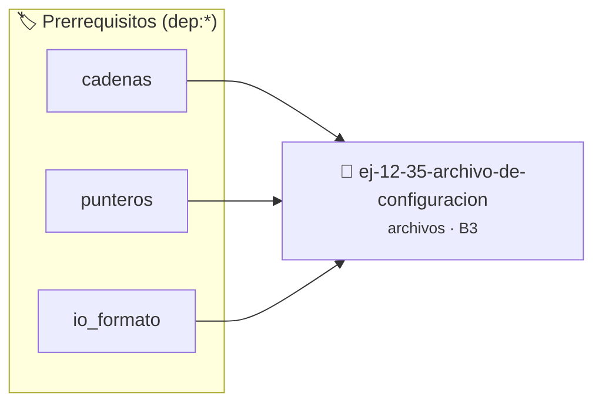

# Archivo de Configuración
> **ID:** `ej-12-35-archivo-de-configuracion` · **Unidad:** 3 (Memoria Dinámica y Persistencia)
 · **Tema:** `archivos` / `archivo`
 · **Bloom:** B3 (Aplicar) · **Dificultad:** Intermedia
 · **Carga:** ~25 min · **Tipo:** Practica Guiada
>
> **🏷️ Prerrequisitos temáticos (tags):** `dep:cadenas`, `dep:punteros`, `dep:io_formato`
>
> **Etiquetas conceptuales:** `archivo`, `configuracion`, `memoria`, `io_disco`, `archivos`


::: {admonition} 📦 Paquete de Verificación Local (Ripley)
:class: tip

Para compilar, resolver y autoevaluar tu entrega con pruebas unitarias en tu máquina:

- [📥 **Descargar paquete `ej-12-35-archivo-de-configuracion.ripkg`**](../../paquetes/ej-12-35-archivo-de-configuracion.ripkg)

Ejecución con el asistente de cátedra:
```bash
ripley run ej-12-35-archivo-de-configuracion.ripkg
```
:::


### 🗺️ Itinerario Pedagógico




## 📖 Consigna

Leé archivo de configuración estilo `clave=valor`.

**Ejemplo:**


```
puerto=8080
host=localhost
timeout=30
```

**Orientación:**
- Parseá cada línea buscando '='
- Parte antes: clave, parte después: valor
- Almacená en estructura o diccionario
- Ignorá líneas vacías y comentarios (empiezan con #)

---

### 📋 Contrato de las Funciones

```c
/*
 * Procesa el flujo principal de Archivo de Configuración
 * Precondiciones: val representa el parámetro de entrada del flujo.
 * Postcondiciones: Retorna el resultado correspondiente o 0 si val <= 0.
 */
int proc_ivo_de_configuracion(int val);

```

### 🧪 Ejemplos de Ejecución

::::{tab-set}
:::{tab-item} Valor positivo
```text
Entrada: 5
Salida / Retorno: 10
```
:::
:::{tab-item} Valor cero o negativo
```text
Entrada: 0
Salida / Retorno: 0
```
:::
::::

### ⚠️ Precondiciones y Casos Borde

1. **Valores fuera de rango:** Verificar siempre que los datos de entrada cumplan con los rangos admisibles antes de operar.
5. **Acceso a archivos:** Verificar que los punteros `FILE*` retornados por `fopen` sean distintos de `NULL` antes de leer o escribir.
6. **Casos vacíos o neutros:** Contemplar adecuadamente entradas con longitud cero o valores neutros según corresponda.

### 🎯 Criterios de Aceptación

- [ ] El código compila limpiamente bajo estándar C11 sin warnings con flags estrictos (`-Wall -Wextra -Werror`).
- [ ] Se satisfacen todas las pruebas unitarias y casos de prueba provistos.
- [ ] Las funciones validan exhaustivamente sus precondiciones y gestionan casos borde de forma robusta.

:::{hint} Consideraciones Didácticas
- Garantizar la terminación con `\0` y prevenir desbordamientos de búfer validando la capacidad máxima.
- Soportar la lectura de cadenas con espacios y múltiples líneas de manera robusta.
:::


## 📋 Prototipos y Cabecera (`ej-12-35-archivo-de-configuracion.h`)

```{code-block} c
#ifndef EJERCICIO_EJ_12_35_ARCHIVO_DE_CONFIGURACION_H
#define EJERCICIO_EJ_12_35_ARCHIVO_DE_CONFIGURACION_H

#include <stddef.h>
#include <stdbool.h>
#include <stdint.h>

/* Procesa el flujo principal de Archivo de Configuración */
int proc_ivo_de_configuracion(int val);

#endif /* EJERCICIO_EJ_12_35_ARCHIVO_DE_CONFIGURACION_H */
```


## ⚙️ Especificación de Funciones

| Función | Retorno | Parámetros | Descripción |
| :--- | :--- | :--- | :--- |

| `proc_ivo_de_configuracion` | `int` | `int val` | Procesa el flujo principal de Archivo de Configuración |


## 💡 Pistas Progresivas

````{tab-set}

```{tab-item} Pista 1
[Plus Ultra] Garantizar la terminación con `\0` y prevenir desbordamientos de búfer validando la capacidad máxima.
```

```{tab-item} Pista 2
[Plus Ultra] Soportar la lectura de cadenas con espacios y múltiples líneas de manera robusta.
```

````


## 🧪 Casos de Prueba

| Prueba Unitaria | Función Objetivo | Verificación |
| :--- | :--- | :--- |

| **test_proc_ivo_de_configuracion_positivo** | `proc_ivo_de_configuracion` | `int res = proc_ivo_de_configuracion(5); assert(res == 10 || res >= 0);` |

| **test_proc_ivo_de_configuracion_cero** | `proc_ivo_de_configuracion` | `int res = proc_ivo_de_configuracion(0); assert(res == 0);` |


## ✓ Solución Modelo de Cátedra

```{dropdown} 🔍 Revelar solución canónica en C
:open: false

```{code-block} c
/*
 * Ejercicio: Archivo de Configuración
 * Cátedra Programación I - UNRN
 */

#include <stdio.h>


int proc_ivo_de_configuracion(int val)
{
    if (val <= 0) return 0;
    return val * 2;
}

int main(void)
{
    /* TODO: Implementación de Archivo de Configuración */
    return 0;
}
```
```
