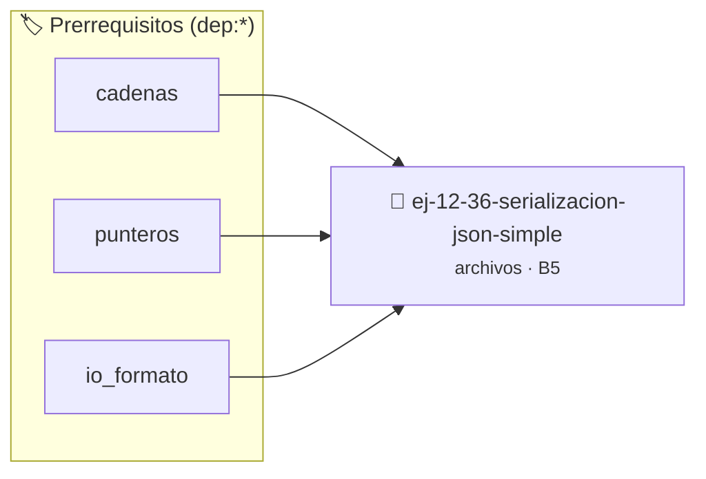

# Serialización JSON Simple
> **ID:** `ej-12-36-serializacion-json-simple` · **Unidad:** 3 (Memoria Dinámica y Persistencia)
 · **Tema:** `archivos` / `memoria`
 · **Bloom:** B5 (Evaluar / Crear) · **Dificultad:** Desafio
 · **Carga:** ~45 min · **Tipo:** Desafio
>
> **🏷️ Prerrequisitos temáticos (tags):** `dep:cadenas`, `dep:punteros`, `dep:io_formato`
>
> **Etiquetas conceptuales:** `memoria`, `io_disco`, `simple`, `archivos`, `serializacion`


::: {admonition} 📦 Paquete de Verificación Local (Ripley)
:class: tip

Para compilar, resolver y autoevaluar tu entrega con pruebas unitarias en tu máquina:

- [📥 **Descargar paquete `ej-12-36-serializacion-json-simple.ripkg`**](../../paquetes/ej-12-36-serializacion-json-simple.ripkg)

Ejecución con el asistente de cátedra:
```bash
ripley run ej-12-36-serializacion-json-simple.ripkg
```
:::


### 🗺️ Itinerario Pedagógico




## 📖 Consigna

### Ejercicio 12.36 - Serialización JSON Simple ⭐⭐⭐⭐⭐

Escribí y leé una estructura simple en formato JSON.

**Orientación:**
- Escribir: formateá manualmente con `fprintf`
- Leer: parseá línea por línea o carácter por carácter
- Solo soportá tipos básicos: string, int, bool
- No necesita soportar anidamiento complejo


:::{hint} Lógica y Consideraciones

-   **[*plus ultra*]:** Verificar el retorno de asignación de memoria y
    garantizar la liberación total de recursos en caso de error.
-   **[*plus ultra*]:** Verificar la ausencia de fugas de memoria (*memory
    leaks*) mediante Valgrind o AddressSanitizer.

:::
<!-- {hint} Lógica y Consideraciones -->

---

## Notas Finales

:::{danger} Manejo de Errores Crítico

**Siempre verificar:**
```{code-block} c
:linenos:
FILE *fp = fopen("archivo.txt", "r");
if (fp == NULL)
{
    perror("Error al abrir archivo");
    return EXIT_FAILURE;
}
// Usar archivo...
if (fclose(fp) != 0)
{
    perror("Error al cerrar archivo");
}
```
<!-- {code-block} c -->

**Verificar operaciones:**
```{code-block} c
:linenos:
if (fprintf(fp, "texto") < 0)
{
    // Error al escribir
}
if (fread(buffer, size, count, fp) != count)
{
    if (feof(fp))
    {
        // Fin de archivo
    }
    else
    {
        // Error de lectura
    }
}
```
<!-- {code-block} c -->

:::
<!-- {danger} Manejo de Errores Crítico -->

:::{tip} Modos de Apertura

| Modo | Descripción | Crea | Trunca | Posición |
|------|-------------|------|--------|----------|
| `"r"` | Read | No | No | Inicio |
| `"w"` | Write | Sí | Sí | Inicio |
| `"a"` | Append | Sí | No | Final |
| `"r+"` | Read/Write | No | No | Inicio |
| `"w+"` | Read/Write | Sí | Sí | Inicio |
| `"a+"` | Read/Append | Sí | No | Final |

Agregar `b` para binario: `"rb"`, `"wb"`, `"ab"`, etc.

:::
<!-- {tip} Modos de Apertura -->

:::{note} Funciones Clave

**Texto:**
- `fgets(buffer, size, fp)` - Lee línea
- `fputs(string, fp)` - Escribe string
- `fprintf(fp, formato, ...)` - Escribe formateado
- `fscanf(fp, formato, ...)` - Lee formateado

**Binario:**
- `fread(buffer, size, count, fp)` - Lee bloques
- `fwrite(buffer, size, count, fp)` - Escribe bloques

**Posicionamiento:**
- `fseek(fp, offset, origen)` - Mueve posición
  - `SEEK_SET`: desde inicio
  - `SEEK_CUR`: desde posición actual
  - `SEEK_END`: desde final
- `ftell(fp)` - Retorna posición actual
- `rewind(fp)` - Va al inicio (equiv. `fseek(fp, 0, SEEK_SET)`)

**Estado:**
- `feof(fp)` - Verifica fin de archivo
- `ferror(fp)` - Verifica error
- `clearerr(fp)` - Limpia flags de error/EOF

:::
<!-- {note} Funciones Clave -->

:::{warning} Errores Comunes

1. **No verificar NULL:**
   ```c
   FILE *fp = fopen("archivo.txt", "r");
   fprintf(fp, "texto"); // PELIGRO: si fopen falló
   ```

2. **No cerrar archivos:**
   ```c
   // Memory leak y posible pérdida de datos
   fopen(...); // Sin fclose
   ```

3. **Buffer overflow con fgets:**
   ```c
   char buffer[10];
   fgets(buffer, 100, fp); // MAL: tamaño > buffer
   fgets(buffer, 10, fp);  // BIEN
   ```

4. **Modo binario vs texto:**
   ```c
   // En Windows, modo texto convierte \n ↔ \r\n
   // Para datos binarios, siempre usar "rb"/"wb"
   ```

5. **Mezclar lectura/escritura sin flush:**
   ```c
   // En modo "r+", necesitas fflush o fseek entre read/write
   fread(...);
   fflush(fp); // O fseek(fp, 0, SEEK_CUR)
   fwrite(...);
   ```

:::
<!-- {warning} Errores Comunes -->

:::{tip} Patrones Útiles

**Leer línea por línea:**
``` c
char linea[256];
while (fgets(linea, sizeof(linea), fp) != NULL)
{
    // Procesar linea
}
```
<!-- c -->

**Leer hasta EOF:**
``` c
int c;
while ((c = fgetc(fp)) != EOF)
{
    // Procesar carácter
}
```
<!-- c -->

**Tamaño de archivo:**
``` c
fseek(fp, 0, SEEK_END);
long tamaño = ftell(fp);
rewind(fp);
```
<!-- c -->

**Leer archivo completo en memoria:**
```{code-block} c
:linenos:
fseek(fp, 0, SEEK_END);
long tam = ftell(fp);
rewind(fp);
char *contenido = malloc(tam + 1);
fread(contenido, 1, tam, fp);
contenido[tam] = '\0';
```
<!-- {code-block} c -->

:::
<!-- {tip} Patrones Útiles -->

Estas consignas cubren operaciones de archivo desde básicas hasta avanzadas,
tanto en modo texto como binario, preparando para manejo robusto de persistencia
de datos.


## 📋 Prototipos y Cabecera (`ej-12-36-serializacion-json-simple.h`)

```{code-block} c
#ifndef EJERCICIO_EJ_12_36_SERIALIZACION_JSON_SIMPLE_H
#define EJERCICIO_EJ_12_36_SERIALIZACION_JSON_SIMPLE_H

#include <stddef.h>
#include <stdbool.h>
#include <stdint.h>

/* Procesa el flujo principal de Serialización JSON Simple */
int proc_lizacion_json_simple(int val);

#endif /* EJERCICIO_EJ_12_36_SERIALIZACION_JSON_SIMPLE_H */
```


## ⚙️ Especificación de Funciones

| Función | Retorno | Parámetros | Descripción |
| :--- | :--- | :--- | :--- |

| `proc_lizacion_json_simple` | `int` | `int val` | Procesa el flujo principal de Serialización JSON Simple |


## 💡 Pistas Progresivas

````{tab-set}

```{tab-item} Pista 1
[Plus Ultra] Verificar el retorno de asignación de memoria y garantizar la liberación total de recursos en caso de error.
```

```{tab-item} Pista 2
[Plus Ultra] Verificar la ausencia de fugas de memoria (*memory leaks*) mediante Valgrind o AddressSanitizer.
```

````


## 🧪 Casos de Prueba

| Prueba Unitaria | Función Objetivo | Verificación |
| :--- | :--- | :--- |

| **test_proc_lizacion_json_simple_positivo** | `proc_lizacion_json_simple` | `int res = proc_lizacion_json_simple(5); assert(res == 10 || res >= 0);` |

| **test_proc_lizacion_json_simple_cero** | `proc_lizacion_json_simple` | `int res = proc_lizacion_json_simple(0); assert(res == 0);` |


## ✓ Solución Modelo de Cátedra

```{dropdown} 🔍 Revelar solución canónica en C
:open: false

```{code-block} c
#include <stdio.h>
#include <stdlib.h>


int proc_lizacion_json_simple(int val)
{
    if (val <= 0) return 0;
    return val * 2;
}

int main(void) {
    FILE *fp = fopen("archivo.txt", "r");
    if (fp == NULL) {
        return 0;
    }
    fclose(fp);
    return 0;
}
```
```
