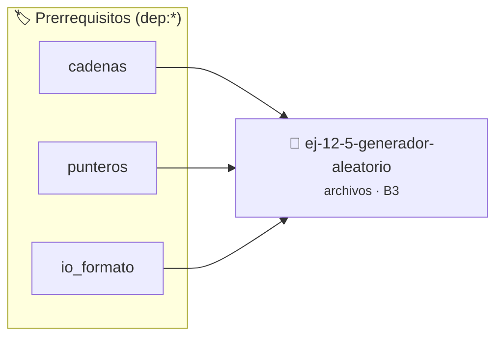

# Generador aleatorio
> **ID:** `ej-12-5-generador-aleatorio` · **Unidad:** 3 (Memoria Dinámica y Persistencia)
 · **Tema:** `archivos` / `memoria`
 · **Bloom:** B3 (Aplicar) · **Dificultad:** Intermedia
 · **Carga:** ~25 min · **Tipo:** Practica Guiada
>
> **🏷️ Prerrequisitos temáticos (tags):** `dep:cadenas`, `dep:punteros`, `dep:io_formato`
>
> **Etiquetas conceptuales:** `memoria`, `aleatorio`, `generador`, `io_disco`, `archivos`


::: {admonition} 📦 Paquete de Verificación Local (Ripley)
:class: tip

Para compilar, resolver y autoevaluar tu entrega con pruebas unitarias en tu máquina:

- [📥 **Descargar paquete `ej-12-5-generador-aleatorio.ripkg`**](../../paquetes/ej-12-5-generador-aleatorio.ripkg)

Ejecución con el asistente de cátedra:
```bash
ripley run ej-12-5-generador-aleatorio.ripkg
```
:::


### 🗺️ Itinerario Pedagógico




## 📖 Consigna

### Ejercicio 12.5 - Generador aleatorio ⭐⭐☆☆☆

Implementar `generar_aleatorio(ruta, cantidad, min, max)`.

**Lógica**: Usar `srand(time(NULL))` una vez al inicio del programa, y luego
`rand() % (max - min + 1) + min` para generar cada número.


:::{hint} Lógica y Consideraciones

-   **[*plus ultra*]:** Validar estrictamente los datos de entrada para manejar
    valores fuera de rango o tipos inválidos.
-   **[*plus ultra*]:** Permitir el procesamiento interactivo continuo mediante
    un lazo hasta que el usuario elija finalizar.

:::
<!-- {hint} Lógica y Consideraciones -->

---

## Operaciones Avanzadas


## 📋 Prototipos y Cabecera (`ej-12-5-generador-aleatorio.h`)

```{code-block} c
#ifndef EJERCICIO_EJ_12_5_GENERADOR_ALEATORIO_H
#define EJERCICIO_EJ_12_5_GENERADOR_ALEATORIO_H

#include <stddef.h>
#include <stdbool.h>
#include <stdint.h>

/* Procesa el flujo principal de Generador aleatorio */
int proc__generador_aleatorio(int val);

#endif /* EJERCICIO_EJ_12_5_GENERADOR_ALEATORIO_H */
```


## ⚙️ Especificación de Funciones

| Función | Retorno | Parámetros | Descripción |
| :--- | :--- | :--- | :--- |

| `proc__generador_aleatorio` | `int` | `int val` | Procesa el flujo principal de Generador aleatorio |


## 💡 Pistas Progresivas

````{tab-set}

```{tab-item} Pista 1
[Plus Ultra] Validar estrictamente los datos de entrada para manejar valores fuera de rango o tipos inválidos.
```

```{tab-item} Pista 2
[Plus Ultra] Permitir el procesamiento interactivo continuo mediante un lazo hasta que el usuario elija finalizar.
```

````


## 🧪 Casos de Prueba

| Prueba Unitaria | Función Objetivo | Verificación |
| :--- | :--- | :--- |

| **test_proc__generador_aleatorio_positivo** | `proc__generador_aleatorio` | `int res = proc__generador_aleatorio(5); assert(res == 10 || res >= 0);` |

| **test_proc__generador_aleatorio_cero** | `proc__generador_aleatorio` | `int res = proc__generador_aleatorio(0); assert(res == 0);` |


## ✓ Solución Modelo de Cátedra

```{dropdown} 🔍 Revelar solución canónica en C
:open: false

```{code-block} c
/*
 * Ejercicio: Generador aleatorio
 * Cátedra Programación I - UNRN
 */

#include <stdio.h>


int proc__generador_aleatorio(int val)
{
    if (val <= 0) return 0;
    return val * 2;
}

int main(void)
{
    /* TODO: Implementación de Generador aleatorio */
    return 0;
}
```
```
