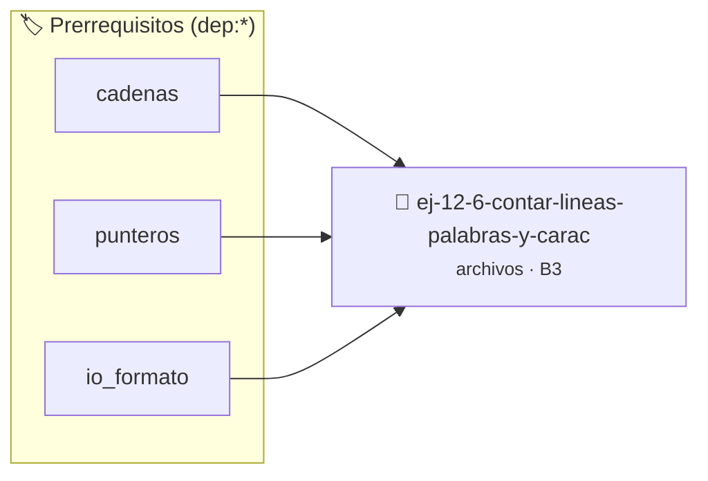

# Contar Líneas, Palabras y Caracteres
> **ID:** `ej-12-6-contar-lineas-palabras-y-carac` · **Unidad:** 3 (Memoria Dinámica y Persistencia)
 · **Tema:** `archivos` / `contar`
 · **Bloom:** B3 (Aplicar) · **Dificultad:** Intermedia
 · **Carga:** ~25 min · **Tipo:** Practica Guiada
>
> **🏷️ Prerrequisitos temáticos (tags):** `dep:cadenas`, `dep:punteros`, `dep:io_formato`
>
> **Etiquetas conceptuales:** `contar`, `lineas`, `memoria`, `io_disco`, `palabras`


::: {admonition} 📦 Paquete de Verificación Local (Ripley)
:class: tip

Para compilar, resolver y autoevaluar tu entrega con pruebas unitarias en tu máquina:

- [📥 **Descargar paquete `ej-12-6-contar-lineas-palabras-y-carac.ripkg`**](../../paquetes/ej-12-6-contar-lineas-palabras-y-carac.ripkg)

Ejecución con el asistente de cátedra:
```bash
ripley run ej-12-6-contar-lineas-palabras-y-carac.ripkg
```
:::


### 🗺️ Itinerario Pedagógico




## 📖 Consigna

### Ejercicio 12.6 - Contar Líneas, Palabras y Caracteres ⭐⭐☆☆☆

Implementar una versión simple del comando `wc` de Unix. El programa debe
recibir una ruta de archivo y reportar el número total de líneas, palabras y
caracteres que contiene.
:::{hint} Lógica y Consideraciones

-   **[*plus ultra*]:** Verificar la correcta apertura del archivo y controlar
    errores de E/S con `ferror` y `feof`.
-   **[*plus ultra*]:** Soportar rutas complejas y asegurar el cierre del
    archivo en todos los caminos de ejecución.

:::
<!-- {hint} Lógica y Consideraciones -->


## 📋 Prototipos y Cabecera (`ej-12-6-contar-lineas-palabras-y-carac.h`)

```{code-block} c
#ifndef EJERCICIO_EJ_12_6_CONTAR_LINEAS_PALABRAS_Y_CARAC_H
#define EJERCICIO_EJ_12_6_CONTAR_LINEAS_PALABRAS_Y_CARAC_H

#include <stddef.h>
#include <stdbool.h>
#include <stdint.h>

/* Procesa el flujo principal de Contar Líneas, Palabras y Caracteres */
int proc_eas_palabras_y_carac(int val);

#endif /* EJERCICIO_EJ_12_6_CONTAR_LINEAS_PALABRAS_Y_CARAC_H */
```


## ⚙️ Especificación de Funciones

| Función | Retorno | Parámetros | Descripción |
| :--- | :--- | :--- | :--- |

| `proc_eas_palabras_y_carac` | `int` | `int val` | Procesa el flujo principal de Contar Líneas, Palabras y Caracteres |


## 💡 Pistas Progresivas

````{tab-set}

```{tab-item} Pista 1
[Plus Ultra] Verificar la correcta apertura del archivo y controlar errores de E/S con `ferror` y `feof`.
```

```{tab-item} Pista 2
[Plus Ultra] Soportar rutas complejas y asegurar el cierre del archivo en todos los caminos de ejecución.
```

````


## 🧪 Casos de Prueba

| Prueba Unitaria | Función Objetivo | Verificación |
| :--- | :--- | :--- |

| **test_proc_eas_palabras_y_carac_positivo** | `proc_eas_palabras_y_carac` | `int res = proc_eas_palabras_y_carac(5); assert(res == 10 || res >= 0);` |

| **test_proc_eas_palabras_y_carac_cero** | `proc_eas_palabras_y_carac` | `int res = proc_eas_palabras_y_carac(0); assert(res == 0);` |


## ✓ Solución Modelo de Cátedra

```{dropdown} 🔍 Revelar solución canónica en C
:open: false

```{code-block} c
/*
 * Ejercicio: Contar Líneas, Palabras y Caracteres
 * Cátedra Programación I - UNRN
 */

#include <stdio.h>


int proc_eas_palabras_y_carac(int val)
{
    if (val <= 0) return 0;
    return val * 2;
}

int main(void)
{
    /* TODO: Implementación de Contar Líneas, Palabras y Caracteres */
    return 0;
}
```
```
