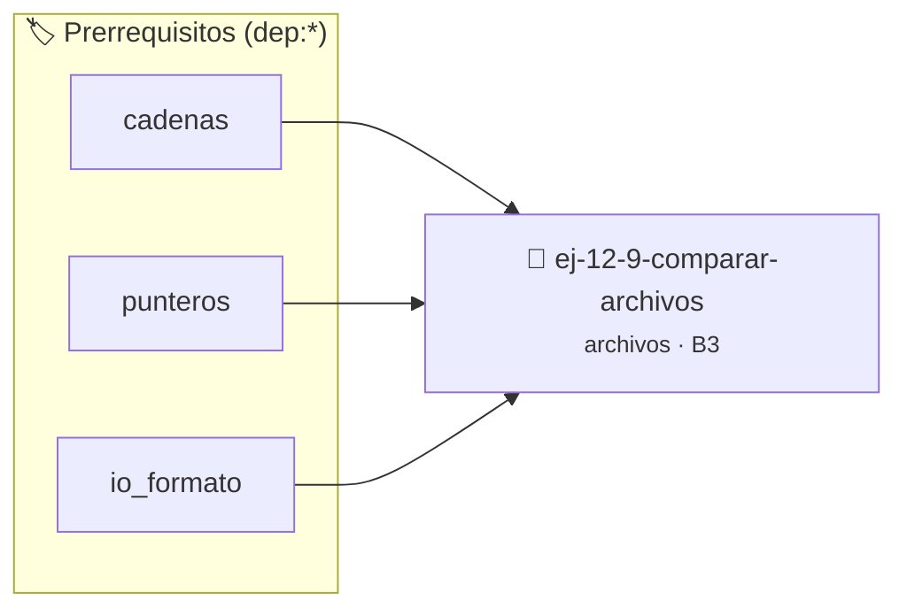

# Comparar Archivos
> **ID:** `ej-12-9-comparar-archivos` · **Unidad:** 3 (Memoria Dinámica y Persistencia)
 · **Tema:** `archivos` / `comparar`
 · **Bloom:** B3 (Aplicar) · **Dificultad:** Intermedia
 · **Carga:** ~25 min · **Tipo:** Practica Guiada
>
> **🏷️ Prerrequisitos temáticos (tags):** `dep:cadenas`, `dep:punteros`, `dep:io_formato`
>
> **Etiquetas conceptuales:** `comparar`, `io_disco`, `archivos`, `memoria`


::: {admonition} 📦 Paquete de Verificación Local (Ripley)
:class: tip

Para compilar, resolver y autoevaluar tu entrega con pruebas unitarias en tu máquina:

- [📥 **Descargar paquete `ej-12-9-comparar-archivos.ripkg`**](../../paquetes/ej-12-9-comparar-archivos.ripkg)

Ejecución con el asistente de cátedra:
```bash
ripley run ej-12-9-comparar-archivos.ripkg
```
:::


### 🗺️ Itinerario Pedagógico




## 📖 Consigna

### Ejercicio 12.9 - Comparar Archivos ⭐⭐⭐☆☆

Implementar un programa que compare dos archivos de texto e indique si son
idénticos o no. Opcionalmente, puede reportar la primera línea y número de
columna donde difieren.
:::{hint} Lógica y Consideraciones

-   **[*plus ultra*]:** Verificar la correcta apertura del archivo y controlar
    errores de E/S con `ferror` y `feof`.
-   **[*plus ultra*]:** Soportar rutas complejas y asegurar el cierre del
    archivo en todos los caminos de ejecución.

:::
<!-- {hint} Lógica y Consideraciones -->


## 📋 Prototipos y Cabecera (`ej-12-9-comparar-archivos.h`)

```{code-block} c
#ifndef EJERCICIO_EJ_12_9_COMPARAR_ARCHIVOS_H
#define EJERCICIO_EJ_12_9_COMPARAR_ARCHIVOS_H

#include <stddef.h>
#include <stdbool.h>
#include <stdint.h>

/* Procesa el flujo principal de Comparar Archivos */
int proc__9_comparar_archivos(int val);

#endif /* EJERCICIO_EJ_12_9_COMPARAR_ARCHIVOS_H */
```


## ⚙️ Especificación de Funciones

| Función | Retorno | Parámetros | Descripción |
| :--- | :--- | :--- | :--- |

| `proc__9_comparar_archivos` | `int` | `int val` | Procesa el flujo principal de Comparar Archivos |


## 💡 Pistas Progresivas

````{tab-set}

```{tab-item} Pista 1
[Plus Ultra] Verificar la correcta apertura del archivo y controlar errores de E/S con `ferror` y `feof`.
```

```{tab-item} Pista 2
[Plus Ultra] Soportar rutas complejas y asegurar el cierre del archivo en todos los caminos de ejecución.
```

````


## 🧪 Casos de Prueba

| Prueba Unitaria | Función Objetivo | Verificación |
| :--- | :--- | :--- |

| **test_proc__9_comparar_archivos_positivo** | `proc__9_comparar_archivos` | `int res = proc__9_comparar_archivos(5); assert(res == 10 || res >= 0);` |

| **test_proc__9_comparar_archivos_cero** | `proc__9_comparar_archivos` | `int res = proc__9_comparar_archivos(0); assert(res == 0);` |


## ✓ Solución Modelo de Cátedra

```{dropdown} 🔍 Revelar solución canónica en C
:open: false

```{code-block} c
/*
 * Ejercicio: Comparar Archivos
 * Cátedra Programación I - UNRN
 */

#include <stdio.h>


int proc__9_comparar_archivos(int val)
{
    if (val <= 0) return 0;
    return val * 2;
}

int main(void)
{
    /* TODO: Implementación de Comparar Archivos */
    return 0;
}
```
```
