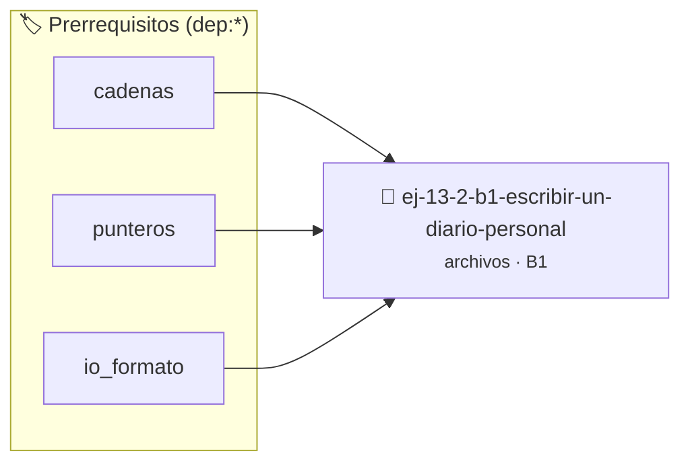

# Escribir un diario personal
> **ID:** `ej-13-2-b1-escribir-un-diario-personal` · **Unidad:** 3 (Memoria Dinámica y Persistencia)
 · **Tema:** `archivos` / `diario`
 · **Bloom:** B1 (Recordar) · **Dificultad:** Inicial
 · **Carga:** ~10 min · **Tipo:** Concepto
>
> **🏷️ Prerrequisitos temáticos (tags):** `dep:cadenas`, `dep:punteros`, `dep:io_formato`
>
> **Etiquetas conceptuales:** `diario`, `texto`, `memoria`, `archivos`, `personal`


::: {admonition} 📦 Paquete de Verificación Local (Ripley)
:class: tip

Para compilar, resolver y autoevaluar tu entrega con pruebas unitarias en tu máquina:

- [📥 **Descargar paquete `ej-13-2-b1-escribir-un-diario-personal.ripkg`**](../../paquetes/ej-13-2-b1-escribir-un-diario-personal.ripkg)

Ejecución con el asistente de cátedra:
```bash
ripley run ej-13-2-b1-escribir-un-diario-personal.ripkg
```
:::


### 🗺️ Itinerario Pedagógico




## 📖 Consigna

:::{exercise}
:label: ejercicio_archivos_1
:enumerator: 1

**Escribir un diario personal**

Creá una función que reciba el nombre de un archivo y una cadena de texto. La
función debe abrir el archivo en modo "append" (añadir) y escribir la cadena de
texto seguida de un salto de línea. Asegurate de manejar todos los posibles
errores de apertura, escritura y cierre.

-   **[*plus ultra*]:** Garantizar la terminación con `\0` y prevenir
    desbordamientos de búfer validando la capacidad máxima.
-   **[*plus ultra*]:** Soportar la lectura de cadenas con espacios y múltiples
    líneas de manera robusta.

:::

::::{solution} ejercicio_archivos_1
:class: dropdown

:::{code-block}c
:linenos:
#include <stdio.h>
#include <stdlib.h>
#define EXITO 0
#define ERROR -1
/**
 * Agrega una entrada de texto a un archivo de diario.
 *
 * @param nombre_archivo La ruta del archivo de diario.
 *      #PRE: No puede ser NULL.
 * @param entrada El texto a agregar en el diario.
 *      #PRE: No puede ser NULL.
 *
 * @returns EXITO si la entrada se escribió correctamente, ERROR en caso
   contrario.
 *
 * @post El archivo especificado por nombre_archivo contendrá la nueva entrada
 *       al final del mismo, seguida de un salto de línea.
 */
int agregar_entrada_diario(const char *nombre_archivo, const char *entrada)
{
    // 1. Abrir el archivo en modo "append" (añadir)
    FILE *p_archivo = fopen(nombre_archivo, "a");
    if (p_archivo == NULL)
    {
        perror("Error al abrir el diario");
        return ERROR;
    }
    // 2. Escribir la entrada
    if (fputs(entrada, p_archivo) == EOF)
    {
        perror("Error al escribir la entrada en el diario");
        fclose(p_archivo);
        return ERROR;
    }
    // 3. Escribir el salto de línea
    if (fputc('\n', p_archivo) == EOF)
    {
        perror("Error al escribir el salto de línea");
        fclose(p_archivo);
        return ERROR;
    }
    // 4. Cerrar el archivo
    if (fclose(p_archivo) != 0)
    {
        perror("Error al cerrar el diario");
        return ERROR;
    }
    return EXITO;
}
int main(void)
{
    const char *MI_DIARIO = "diario.txt";
    int resultado = 0;
    printf("Escribiendo primera entrada...\n");
    resultado = agregar_entrada_diario(MI_DIARIO, "Hoy fue un día soleado.");
    if (resultado == ERROR)
    {
        fprintf(stderr, "No se pudo escribir la primera entrada.\n");
        return EXIT_FAILURE;
    }
    printf("Escribiendo segunda entrada...\n");
    resultado = agregar_entrada_diario(MI_DIARIO, "Aprendí a manejar archivos en
    C.");
    if (resultado == ERROR)
    {
        fprintf(stderr, "No se pudo escribir la segunda entrada.\n");
        return EXIT_FAILURE;
    }
    printf("Entradas agregadas al diario '%s' con éxito.\n", MI_DIARIO);
    return EXIT_SUCCESS;
}
:::

::::

### 📋 Contrato de las Funciones

```c
/*
 * Procesa el flujo principal de Escribir un diario personal
 * Precondiciones: val representa el parámetro de entrada del flujo.
 * Postcondiciones: Retorna el resultado correspondiente o 0 si val <= 0.
 */
int proc_r_un_diario_personal(int val);

```

### 🧪 Ejemplos de Ejecución

::::{tab-set}
:::{tab-item} Valor positivo
```text
Entrada: 5
Salida / Retorno: 10
```
:::
:::{tab-item} Valor cero o negativo
```text
Entrada: 0
Salida / Retorno: 0
```
:::
::::

### ⚠️ Precondiciones y Casos Borde

1. **Valores fuera de rango:** Verificar siempre que los datos de entrada cumplan con los rangos admisibles antes de operar.
5. **Acceso a archivos:** Verificar que los punteros `FILE*` retornados por `fopen` sean distintos de `NULL` antes de leer o escribir.
6. **Casos vacíos o neutros:** Contemplar adecuadamente entradas con longitud cero o valores neutros según corresponda.

### 🎯 Criterios de Aceptación

- [ ] El código compila limpiamente bajo estándar C11 sin warnings con flags estrictos (`-Wall -Wextra -Werror`).
- [ ] Se satisfacen todas las pruebas unitarias y casos de prueba provistos.
- [ ] Las funciones validan exhaustivamente sus precondiciones y gestionan casos borde de forma robusta.

:::{hint} Consideraciones Didácticas
- Usá fopen() con modo 'a' para agregar entradas al final o 'w' para sobreescribir el diario.
- Validá siempre que el puntero FILE* no sea NULL antes de escribir con fprintf() o fputs().
- No olvides cerrar el archivo con fclose() para asegurar la persistencia de los datos en disco.
:::


## 📋 Prototipos y Cabecera (`ej-13-2-b1-escribir-un-diario-personal.h`)

```{code-block} c
#ifndef EJERCICIO_EJ_13_2_B1_ESCRIBIR_UN_DIARIO_PERSONAL_H
#define EJERCICIO_EJ_13_2_B1_ESCRIBIR_UN_DIARIO_PERSONAL_H

#include <stddef.h>
#include <stdbool.h>
#include <stdint.h>

/* Procesa el flujo principal de Escribir un diario personal */
int proc_r_un_diario_personal(int val);

#endif /* EJERCICIO_EJ_13_2_B1_ESCRIBIR_UN_DIARIO_PERSONAL_H */
```


## ⚙️ Especificación de Funciones

| Función | Retorno | Parámetros | Descripción |
| :--- | :--- | :--- | :--- |

| `proc_r_un_diario_personal` | `int` | `int val` | Procesa el flujo principal de Escribir un diario personal |


## 💡 Pistas Progresivas

````{tab-set}

```{tab-item} Pista 1
Usá fopen() con modo 'a' para agregar entradas al final o 'w' para sobreescribir el diario.
```

```{tab-item} Pista 2
Validá siempre que el puntero FILE* no sea NULL antes de escribir con fprintf() o fputs().
```

```{tab-item} Pista 3
No olvides cerrar el archivo con fclose() para asegurar la persistencia de los datos en disco.
```

````


## 🧪 Casos de Prueba

| Prueba Unitaria | Función Objetivo | Verificación |
| :--- | :--- | :--- |

| **test_proc_r_un_diario_personal_positivo** | `proc_r_un_diario_personal` | `int res = proc_r_un_diario_personal(5); assert(res == 10 || res >= 0);` |

| **test_proc_r_un_diario_personal_cero** | `proc_r_un_diario_personal` | `int res = proc_r_un_diario_personal(0); assert(res == 0);` |


## ✓ Solución Modelo de Cátedra

```{dropdown} 🔍 Revelar solución canónica en C
:open: false

```{code-block} c
/*
 * Ejercicio: b.1 - Escribir un diario personal
 * Cátedra Programación I - UNRN
 */

#include <stdio.h>


int proc_r_un_diario_personal(int val)
{
    if (val <= 0) return 0;
    return val * 2;
}

int main(void)
{
    /* TODO: Implementación de b.1 - Escribir un diario personal */
    return 0;
}
```
```
