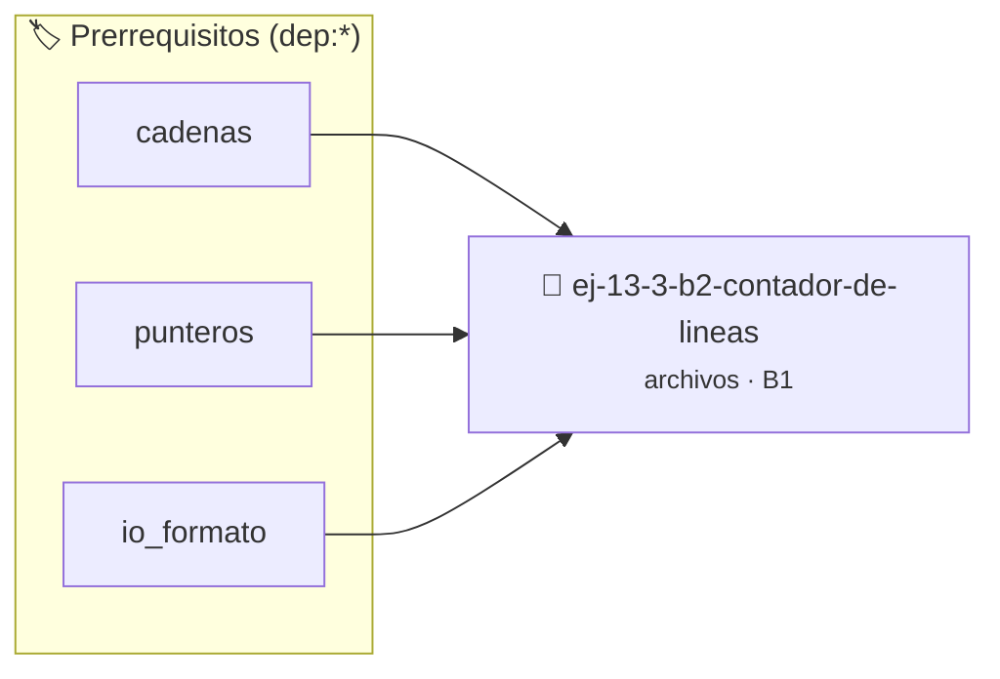

# Contador de líneas
> **ID:** `ej-13-3-b2-contador-de-lineas` · **Unidad:** 3 (Memoria Dinámica y Persistencia)
 · **Tema:** `archivos` / `texto`
 · **Bloom:** B1 (Recordar) · **Dificultad:** Inicial
 · **Carga:** ~10 min · **Tipo:** Concepto
>
> **🏷️ Prerrequisitos temáticos (tags):** `dep:cadenas`, `dep:punteros`, `dep:io_formato`
>
> **Etiquetas conceptuales:** `texto`, `lineas`, `memoria`, `contador`, `archivos`


::: {admonition} 📦 Paquete de Verificación Local (Ripley)
:class: tip

Para compilar, resolver y autoevaluar tu entrega con pruebas unitarias en tu máquina:

- [📥 **Descargar paquete `ej-13-3-b2-contador-de-lineas.ripkg`**](../../paquetes/ej-13-3-b2-contador-de-lineas.ripkg)

Ejecución con el asistente de cátedra:
```bash
ripley run ej-13-3-b2-contador-de-lineas.ripkg
```
:::


### 🗺️ Itinerario Pedagógico




## 📖 Consigna

:::{exercise}
:label: ejercicio_archivos_2
:enumerator: 2

**Contador de líneas**

Escribí una función que reciba el nombre de un archivo, lo lea y devuelva la
cantidad de líneas que contiene. Una línea se define como una secuencia de
caracteres terminada por un `\n`. La función debe devolver un número negativo en
caso de error.

-   **[*plus ultra*]:** Garantizar la terminación con `\0` y prevenir
    desbordamientos de búfer validando la capacidad máxima.
-   **[*plus ultra*]:** Soportar la lectura de cadenas con espacios y múltiples
    líneas de manera robusta.

:::

::::{solution} ejercicio_archivos_2
:class: dropdown

:::{code-block}c
:linenos:
#include <stdio.h>
#include <stdlib.h>
#define MAX_LONGITUD_LINEA 1024
#define ERROR_APERTURA -1
#define ERROR_LECTURA -2
/**
 * Cuenta el número de líneas en un archivo de texto.
 *
 * @param nombre_archivo La ruta del archivo a leer.
 *      #PRE: No puede ser NULL.
 *
 * @returns El número de líneas contadas si la operación es exitosa.
 *          Retorna ERROR_APERTURA si el archivo no puede abrirse.
 *          Retorna ERROR_LECTURA si ocurre un error durante la lectura.
 *
 * @post El archivo no es modificado.
 */
int contar_lineas(const char *nombre_archivo)
{
    int cantidad_lineas = 0;
    FILE *p_archivo = NULL;
    char buffer[MAX_LONGITUD_LINEA];
    p_archivo = fopen(nombre_archivo, "r");
    if (p_archivo == NULL)
    {
        perror("Error al abrir el archivo para contar líneas");
        return ERROR_APERTURA;
    }
    while (fgets(buffer, sizeof(buffer), p_archivo) != NULL)
    {
        cantidad_lineas++;
    }
    // Después del lazo, verificar si salimos por error o por fin de archivo
    if (ferror(p_archivo))
    {
        perror("Error de lectura mientras se contaban las líneas");
        cantidad_lineas = ERROR_LECTURA; // Sobrescribimos el conteo con un
        código de error
    }
    if (fclose(p_archivo) != 0)
    {
        perror("Error al cerrar el archivo después de contar");
        if (cantidad_lineas >= 0) // No sobrescribir un error de lectura previo
        {
            cantidad_lineas = ERROR_APERTURA; // Reutilizamos código de error
        }
    }
    return cantidad_lineas;
}
int main(void)
{
    const char *NOMBRE_ARCHIVO = "diario.txt";
    // Crear un archivo de prueba primero
    FILE *p_archivo_prueba = fopen(NOMBRE_ARCHIVO, "w");
    if (p_archivo_prueba != NULL)
    {
        fputs("Primera línea.\n", p_archivo_prueba);
        fputs("Segunda línea.\n", p_archivo_prueba);
        fputs("Tercera línea.\n", p_archivo_prueba);
        fclose(p_archivo_prueba);
    }
    printf("Contando líneas en el archivo '%s'...\n", NOMBRE_ARCHIVO);
    int lineas = contar_lineas(NOMBRE_ARCHIVO);
    if (lineas >= 0)
    {
        printf("El archivo contiene %d líneas.\n", lineas);
    }
    else
    {
        fprintf(stderr, "Ocurrió un error al procesar el archivo (código:
                            % d)
            .\n ", lineas);
            return EXIT_FAILURE;
    }
    return EXIT_SUCCESS;
}
:::

::::

### 📋 Contrato de las Funciones

```c
/*
 * Procesa el flujo principal de Contador de líneas
 * Precondiciones: val representa el parámetro de entrada del flujo.
 * Postcondiciones: Retorna el resultado correspondiente o 0 si val <= 0.
 */
int proc_2_contador_de_lineas(int val);

```

### 🧪 Ejemplos de Ejecución

::::{tab-set}
:::{tab-item} Valor positivo
```text
Entrada: 5
Salida / Retorno: 10
```
:::
:::{tab-item} Valor cero o negativo
```text
Entrada: 0
Salida / Retorno: 0
```
:::
::::

### ⚠️ Precondiciones y Casos Borde

1. **Valores fuera de rango:** Verificar siempre que los datos de entrada cumplan con los rangos admisibles antes de operar.
5. **Acceso a archivos:** Verificar que los punteros `FILE*` retornados por `fopen` sean distintos de `NULL` antes de leer o escribir.
6. **Casos vacíos o neutros:** Contemplar adecuadamente entradas con longitud cero o valores neutros según corresponda.

### 🎯 Criterios de Aceptación

- [ ] El código compila limpiamente bajo estándar C11 sin warnings con flags estrictos (`-Wall -Wextra -Werror`).
- [ ] Se satisfacen todas las pruebas unitarias y casos de prueba provistos.
- [ ] Las funciones validan exhaustivamente sus precondiciones y gestionan casos borde de forma robusta.


## 📋 Prototipos y Cabecera (`ej-13-3-b2-contador-de-lineas.h`)

```{code-block} c
#ifndef EJERCICIO_EJ_13_3_B2_CONTADOR_DE_LINEAS_H
#define EJERCICIO_EJ_13_3_B2_CONTADOR_DE_LINEAS_H

#include <stddef.h>
#include <stdbool.h>
#include <stdint.h>

/* Procesa el flujo principal de Contador de líneas */
int proc_2_contador_de_lineas(int val);

#endif /* EJERCICIO_EJ_13_3_B2_CONTADOR_DE_LINEAS_H */
```


## ⚙️ Especificación de Funciones

| Función | Retorno | Parámetros | Descripción |
| :--- | :--- | :--- | :--- |

| `proc_2_contador_de_lineas` | `int` | `int val` | Procesa el flujo principal de Contador de líneas |


## 🧪 Casos de Prueba

| Prueba Unitaria | Función Objetivo | Verificación |
| :--- | :--- | :--- |

| **test_proc_2_contador_de_lineas_positivo** | `proc_2_contador_de_lineas` | `int res = proc_2_contador_de_lineas(5); assert(res == 10 || res >= 0);` |

| **test_proc_2_contador_de_lineas_cero** | `proc_2_contador_de_lineas` | `int res = proc_2_contador_de_lineas(0); assert(res == 0);` |


## ✓ Solución Modelo de Cátedra

```{dropdown} 🔍 Revelar solución canónica en C
:open: false

```{code-block} c
/*
 * Ejercicio: b.2 - Contador de líneas
 * Cátedra Programación I - UNRN
 */

#include <stdio.h>


int proc_2_contador_de_lineas(int val)
{
    if (val <= 0) return 0;
    return val * 2;
}

int main(void)
{
    /* TODO: Implementación de b.2 - Contador de líneas */
    return 0;
}
```
```
