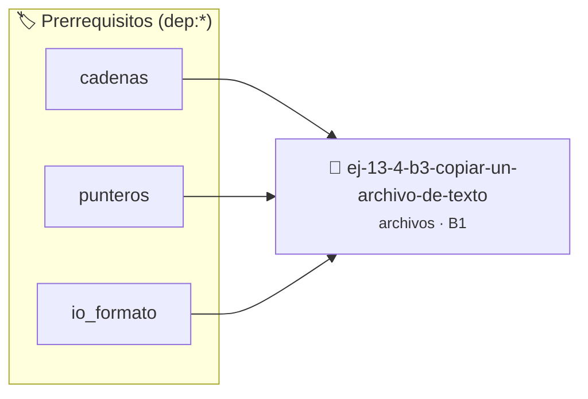

# Copiar un archivo de texto
> **ID:** `ej-13-4-b3-copiar-un-archivo-de-texto` · **Unidad:** 3 (Memoria Dinámica y Persistencia)
 · **Tema:** `archivos` / `texto`
 · **Bloom:** B1 (Recordar) · **Dificultad:** Inicial
 · **Carga:** ~10 min · **Tipo:** Concepto
>
> **🏷️ Prerrequisitos temáticos (tags):** `dep:cadenas`, `dep:punteros`, `dep:io_formato`
>
> **Etiquetas conceptuales:** `texto`, `archivo`, `memoria`, `copiar`, `archivos`


::: {admonition} 📦 Paquete de Verificación Local (Ripley)
:class: tip

Para compilar, resolver y autoevaluar tu entrega con pruebas unitarias en tu máquina:

- [📥 **Descargar paquete `ej-13-4-b3-copiar-un-archivo-de-texto.ripkg`**](../../paquetes/ej-13-4-b3-copiar-un-archivo-de-texto.ripkg)

Ejecución con el asistente de cátedra:
```bash
ripley run ej-13-4-b3-copiar-un-archivo-de-texto.ripkg
```
:::


### 🗺️ Itinerario Pedagógico




## 📖 Consigna

:::{exercise}
:label: ejercicio_archivos_3
:enumerator: 3

**Copiar un archivo de texto**

Implementá una función que copie el contenido de un archivo de origen a un
archivo de destino. La función debe leer el archivo de origen línea por línea y
escribir cada línea en el archivo de destino. Debe manejar errores para ambos
archivos (apertura, lectura, escritura y cierre).

-   **[*plus ultra*]:** Garantizar la terminación con `\0` y prevenir
    desbordamientos de búfer validando la capacidad máxima.
-   **[*plus ultra*]:** Soportar la lectura de cadenas con espacios y múltiples
    líneas de manera robusta.

:::

::::{solution} ejercicio_archivos_3
:class: dropdown

:::{code-block}c
:linenos:
#include <stdbool.h>
#include <stdio.h>
#include <stdlib.h>
#define EXITO 0
#define ERROR -1
#define MAX_BUFFER 4096
/**
 * Copia el contenido de un archivo de texto a otro.
 *
 * @param ruta_origen La ruta del archivo a leer.
 *      #PRE: No puede ser NULL.
 * @param ruta_destino La ruta del archivo donde se escribirá el contenido.
 *      #PRE: No puede ser NULL.
 *
 * @returns EXITO si la copia fue completamente exitosa, ERROR si ocurrió algún
   fallo.
 *
 * @post Si la operación es exitosa, el archivo en ruta_destino tendrá el mismo
 *       contenido que el de ruta_origen.
 */
int copiar_archivo(const char *ruta_origen, const char *ruta_destino)
{
    int estado_operacion = EXITO;
    FILE *p_origen = NULL;
    FILE *p_destino = NULL;
    char buffer[MAX_BUFFER];
    bool continuar_lazo = true;
    p_origen = fopen(ruta_origen, "r");
    if (p_origen == NULL)
    {
        perror("Error al abrir el archivo de origen");
        estado_operacion = ERROR;
    }
    if (estado_operacion == EXITO)
    {
        p_destino = fopen(ruta_destino, "w");
        if (p_destino == NULL)
        {
            perror("Error al abrir el archivo de destino");
            estado_operacion = ERROR;
        }
    }
    while (estado_operacion == EXITO && continuar_lazo)
    {
        if (fgets(buffer, sizeof(buffer), p_origen) != NULL)
        {
            if (fputs(buffer, p_destino) == EOF)
            {
                perror("Error al escribir en el archivo de destino");
                estado_operacion = ERROR;
            }
        }
        else
        {
            continuar_lazo = false; // Se terminó de leer o hubo un error
        }
    }
    // Verificar si el lazo terminó por un error de lectura
    if (p_origen != NULL && ferror(p_origen))
    {
        perror("Error de lectura en el archivo de origen");
        estado_operacion = ERROR;
    }
    // Cerrar ambos archivos, verificando errores en cada cierre
    if (p_origen != NULL && fclose(p_origen) != 0)
    {
        perror("Error al cerrar el archivo de origen");
        estado_operacion = ERROR;
    }
    if (p_destino != NULL && fclose(p_destino) != 0)
    {
        perror("Error al cerrar el archivo de destino");
        estado_operacion = ERROR;
    }
    return estado_operacion;
}
int main(void)
{
    const char *ARCHIVO_ORIGEN = "original.txt";
    const char *ARCHIVO_COPIA = "copia.txt";
    // Crear archivo original de prueba
    FILE *p_temp = fopen(ARCHIVO_ORIGEN, "w");
    if (p_temp != NULL)
    {
        fprintf(p_temp, "Línea 1 del original.\n");
        fprintf(p_temp, "Línea 2 con algunos caracteres especiales: áéíóú.\n");
        fprintf(p_temp, "Fin del archivo original.\n");
        fclose(p_temp);
    }
    printf("Copiando '%s' a '%s'...\n", ARCHIVO_ORIGEN, ARCHIVO_COPIA);
    if (copiar_archivo(ARCHIVO_ORIGEN, ARCHIVO_COPIA) == EXITO)
    {
        printf("Archivo copiado con éxito.\n");
    }
    else
    {
        fprintf(stderr, "La copia del archivo falló.\n");
        return EXIT_FAILURE;
    }
    return EXIT_SUCCESS;
}
:::

::::

### 📋 Contrato de las Funciones

```c
/*
 * Procesa el flujo principal de Copiar un archivo de texto
 * Precondiciones: val representa el parámetro de entrada del flujo.
 * Postcondiciones: Retorna el resultado correspondiente o 0 si val <= 0.
 */
int proc__un_archivo_de_texto(int val);

```

### 🧪 Ejemplos de Ejecución

::::{tab-set}
:::{tab-item} Valor positivo
```text
Entrada: 5
Salida / Retorno: 10
```
:::
:::{tab-item} Valor cero o negativo
```text
Entrada: 0
Salida / Retorno: 0
```
:::
::::

### ⚠️ Precondiciones y Casos Borde

1. **Valores fuera de rango:** Verificar siempre que los datos de entrada cumplan con los rangos admisibles antes de operar.
5. **Acceso a archivos:** Verificar que los punteros `FILE*` retornados por `fopen` sean distintos de `NULL` antes de leer o escribir.
6. **Casos vacíos o neutros:** Contemplar adecuadamente entradas con longitud cero o valores neutros según corresponda.

### 🎯 Criterios de Aceptación

- [ ] El código compila limpiamente bajo estándar C11 sin warnings con flags estrictos (`-Wall -Wextra -Werror`).
- [ ] Se satisfacen todas las pruebas unitarias y casos de prueba provistos.
- [ ] Las funciones validan exhaustivamente sus precondiciones y gestionan casos borde de forma robusta.


## 📋 Prototipos y Cabecera (`ej-13-4-b3-copiar-un-archivo-de-texto.h`)

```{code-block} c
#ifndef EJERCICIO_EJ_13_4_B3_COPIAR_UN_ARCHIVO_DE_TEXTO_H
#define EJERCICIO_EJ_13_4_B3_COPIAR_UN_ARCHIVO_DE_TEXTO_H

#include <stddef.h>
#include <stdbool.h>
#include <stdint.h>

/* Procesa el flujo principal de Copiar un archivo de texto */
int proc__un_archivo_de_texto(int val);

#endif /* EJERCICIO_EJ_13_4_B3_COPIAR_UN_ARCHIVO_DE_TEXTO_H */
```


## ⚙️ Especificación de Funciones

| Función | Retorno | Parámetros | Descripción |
| :--- | :--- | :--- | :--- |

| `proc__un_archivo_de_texto` | `int` | `int val` | Procesa el flujo principal de Copiar un archivo de texto |


## 🧪 Casos de Prueba

| Prueba Unitaria | Función Objetivo | Verificación |
| :--- | :--- | :--- |

| **test_proc__un_archivo_de_texto_positivo** | `proc__un_archivo_de_texto` | `int res = proc__un_archivo_de_texto(5); assert(res == 10 || res >= 0);` |

| **test_proc__un_archivo_de_texto_cero** | `proc__un_archivo_de_texto` | `int res = proc__un_archivo_de_texto(0); assert(res == 0);` |


## ✓ Solución Modelo de Cátedra

```{dropdown} 🔍 Revelar solución canónica en C
:open: false

```{code-block} c
/*
 * Ejercicio: b.3 - Copiar un archivo de texto
 * Cátedra Programación I - UNRN
 */

#include <stdio.h>


int proc__un_archivo_de_texto(int val)
{
    if (val <= 0) return 0;
    return val * 2;
}

int main(void)
{
    /* TODO: Implementación de b.3 - Copiar un archivo de texto */
    return 0;
}
```
```
