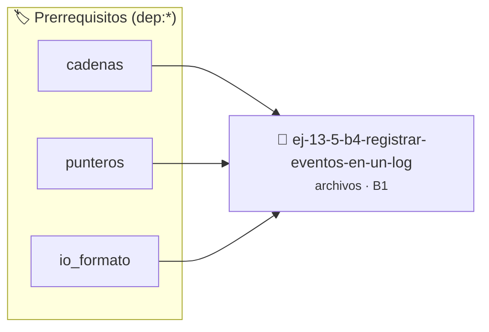

# Registrar eventos en un log
> **ID:** `ej-13-5-b4-registrar-eventos-en-un-log` · **Unidad:** 3 (Memoria Dinámica y Persistencia)
 · **Tema:** `archivos` / `registro_eventos`
 · **Bloom:** B1 (Recordar) · **Dificultad:** Inicial
 · **Carga:** ~10 min · **Tipo:** Concepto
>
> **🏷️ Prerrequisitos temáticos (tags):** `dep:cadenas`, `dep:punteros`, `dep:io_formato`
>
> **Etiquetas conceptuales:** `texto`, `registrar`, `memoria`, `eventos`, `archivos`


::: {admonition} 📦 Paquete de Verificación Local (Ripley)
:class: tip

Para compilar, resolver y autoevaluar tu entrega con pruebas unitarias en tu máquina:

- [📥 **Descargar paquete `ej-13-5-b4-registrar-eventos-en-un-log.ripkg`**](../../paquetes/ej-13-5-b4-registrar-eventos-en-un-log.ripkg)

Ejecución con el asistente de cátedra:
```bash
ripley run ej-13-5-b4-registrar-eventos-en-un-log.ripkg
```
:::


### 🗺️ Itinerario Pedagógico




## 📖 Consigna

### Ejercicio 13.5 - b.4 - Registrar eventos en un log ⭐⭐☆☆☆

:::{exercise}
:label: ejercicio_archivos_4
:enumerator: 4

**Registrar eventos en un log**

Crea una función `registrar_evento` que reciba un mensaje y lo añada a un
archivo llamado `eventos.log`. La función debe asegurarse de que cada mensaje
nuevo se agregue al final del archivo, sin borrar el contenido anterior. Por
simplicidad, no es necesario agregar una marca de tiempo.

-   **[*plus ultra*]:** Garantizar la terminación con `\0` y prevenir
    desbordamientos de búfer validando la capacidad máxima.
-   **[*plus ultra*]:** Soportar la lectura de cadenas con espacios y múltiples
    líneas de manera robusta.

:::
<!-- {exercise} -->

::::{solution} ejercicio_archivos_4
:class: dropdown

:::{code-block}c
:linenos:
#include <stdio.h>
#include <stdlib.h>
#define EXITO 0
#define ERROR -1
#define ARCHIVO_LOG "eventos.log"
/**
 * Registra un mensaje de evento en un archivo de log.
 *
 * @param mensaje El mensaje a registrar.
 *      #PRE: No puede ser NULL.
 *
 * @returns EXITO si el evento se registró correctamente, ERROR en caso
   contrario.
 *
 * @post El archivo de log contendrá el nuevo mensaje al final.
 */
int registrar_evento(const char *mensaje)
{
    int resultado = EXITO;
    FILE *p_log = fopen(ARCHIVO_LOG, "a");
    if (p_log == NULL)
    {
        perror("Error al abrir el archivo de log");
        resultado = ERROR;
    }
    else
    {
        // Escribir el mensaje y un salto de línea
        if (fprintf(p_log, "%s\n", mensaje) < 0)
        {
            perror("Error al escribir en el archivo de log");
            resultado = ERROR;
        }
        // Cerrar el archivo
        if (fclose(p_log) != 0)
        {
            perror("Error al cerrar el archivo de log");
            resultado = ERROR;
        }
    }
    return resultado;
}
int main(void)
{
    printf("Registrando eventos...\n");
    if (registrar_evento("[INFO] El sistema ha iniciado.") != EXITO)
    {
        fprintf(stderr, "Fallo al registrar el primer evento.\n");
        return EXIT_FAILURE;
    }
    if (registrar_evento("[WARN] El disco está casi lleno.") != EXITO)
    {
        fprintf(stderr, "Fallo al registrar el segundo evento.\n");
        return EXIT_FAILURE;
    }
    if (registrar_evento("[FATAL] No se pudo conectar a la base de datos.") !=
        EXITO)
    {
        fprintf(stderr, "Fallo al registrar el tercer evento.\n");
        return EXIT_FAILURE;
    }
    printf("Eventos registrados en '%s'.\n", ARCHIVO_LOG);
    return EXIT_SUCCESS;
}
:::
<!-- {code-block}c -->

::::
<!-- {solution} ejercicio_archivos_4 -->


## 📋 Prototipos y Cabecera (`ej-13-5-b4-registrar-eventos-en-un-log.h`)

```{code-block} c
#ifndef EJERCICIO_EJ_13_5_B4_REGISTRAR_EVENTOS_EN_UN_LOG_H
#define EJERCICIO_EJ_13_5_B4_REGISTRAR_EVENTOS_EN_UN_LOG_H

#include <stddef.h>
#include <stdbool.h>
#include <stdint.h>

/* Procesa el flujo principal de Registrar eventos en un log */
int proc_ar_eventos_en_un_log(int val);

#endif /* EJERCICIO_EJ_13_5_B4_REGISTRAR_EVENTOS_EN_UN_LOG_H */
```


## ⚙️ Especificación de Funciones

| Función | Retorno | Parámetros | Descripción |
| :--- | :--- | :--- | :--- |

| `proc_ar_eventos_en_un_log` | `int` | `int val` | Procesa el flujo principal de Registrar eventos en un log |


## 🧪 Casos de Prueba

| Prueba Unitaria | Función Objetivo | Verificación |
| :--- | :--- | :--- |

| **test_proc_ar_eventos_en_un_log_positivo** | `proc_ar_eventos_en_un_log` | `int res = proc_ar_eventos_en_un_log(5); assert(res == 10 || res >= 0);` |

| **test_proc_ar_eventos_en_un_log_cero** | `proc_ar_eventos_en_un_log` | `int res = proc_ar_eventos_en_un_log(0); assert(res == 0);` |


## ✓ Solución Modelo de Cátedra

```{dropdown} 🔍 Revelar solución canónica en C
:open: false

```{code-block} c
/*
 * Ejercicio: b.4 - Registrar eventos en un log
 * Cátedra Programación I - UNRN
 */

#include <stdio.h>


int proc_ar_eventos_en_un_log(int val)
{
    if (val <= 0) return 0;
    return val * 2;
}

int main(void)
{
    /* TODO: Implementación de b.4 - Registrar eventos en un log */
    return 0;
}
```
```
