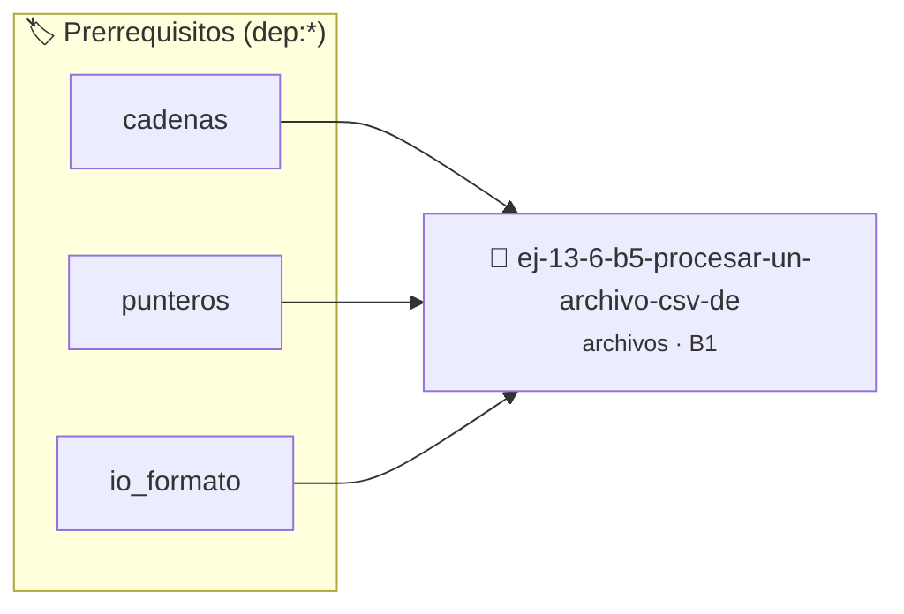

# Procesar un archivo CSV de ventas
> **ID:** `ej-13-6-b5-procesar-un-archivo-csv-de` · **Unidad:** 3 (Memoria Dinámica y Persistencia)
 · **Tema:** `archivos` / `archivos_estructurados`
 · **Bloom:** B1 (Recordar) · **Dificultad:** Inicial
 · **Carga:** ~10 min · **Tipo:** Concepto
>
> **🏷️ Prerrequisitos temáticos (tags):** `dep:cadenas`, `dep:punteros`, `dep:io_formato`
>
> **Etiquetas conceptuales:** `ventas`, `texto`, `archivo`, `memoria`, `procesar`


::: {admonition} 📦 Paquete de Verificación Local (Ripley)
:class: tip

Para compilar, resolver y autoevaluar tu entrega con pruebas unitarias en tu máquina:

- [📥 **Descargar paquete `ej-13-6-b5-procesar-un-archivo-csv-de.ripkg`**](../../paquetes/ej-13-6-b5-procesar-un-archivo-csv-de.ripkg)

Ejecución con el asistente de cátedra:
```bash
ripley run ej-13-6-b5-procesar-un-archivo-csv-de.ripkg
```
:::


### 🗺️ Itinerario Pedagógico




## 📖 Consigna

:::::{exercise}
:label: ejercicio_archivos_5
:enumerator: 5

**Procesar un archivo CSV de ventas**

Escribí una función que lea un archivo `ventas.csv` con el formato
`producto,precio,cantidad`. Por cada línea, debe calcular el total (precio *
cantidad) y mostrarlo en pantalla. La función debe ignorar líneas mal formadas o
vacías.

**Ejemplo de `ventas.csv`:**
``` csv
Teclado Mecanico,150.50,2
Mouse Gamer,75.00,5
Monitor 24 pulgadas,300.25,1
# Esto es un comentario, debe ser ignorado
Webcam,no_es_un_precio,3
```

::::{solution} ejercicio_archivos_5
:class: dropdown

:::{code-block}c
:linenos:
#include <stdio.h>
#include <stdlib.h>
#include <string.h>
#define EXITO 0
#define ERROR -1
#define MAX_LINEA 256
#define MAX_PRODUCTO 100
/**
 * Procesa un archivo CSV de ventas, calculando e imprimiendo el total por
   línea.
 *
 * @param nombre_archivo La ruta del archivo CSV a procesar.
 *      #PRE: No puede ser NULL.
 *
 * @returns EXITO si el archivo se procesó (incluso si algunas líneas
 fallaron),
 *          ERROR si no se pudo abrir el archivo o hubo un error de lectura
            irrecuperable.
 *
 * @post Se imprimirán en la salida estándar los totales de las líneas bien
   formadas.
 */
int procesar_ventas(const char *nombre_archivo)
{
    int estado_general = EXITO;
    FILE *p_archivo = fopen(nombre_archivo, "r");
    char buffer[MAX_LINEA];
    size_t numero_linea = 0;
    if (p_archivo == NULL)
    {
        perror("No se pudo abrir el archivo de ventas");
        return ERROR;
    }
    while (fgets(buffer, sizeof(buffer), p_archivo) != NULL)
    {
        numero_linea++;
        // Ignorar líneas vacías o comentarios usando lógica positiva conforme
        // a
        la regla 0x1002h if (buffer[0] != '\n' && buffer[0] != '#')
        {
            char nombre_producto[MAX_PRODUCTO];
            double precio = 0.0;
            int cantidad = 0;
            // Usar sscanf para parsear la línea. Formato:
            string - hasta - coma, double,
                int int campos_leidos =
                    sscanf(buffer, "%99[^,],%lf,%d", nombre_producto, &precio,
                           &cantidad);
            if (campos_leidos == 3)
            {
                double total_linea = precio * (double)cantidad;
                printf("Línea %zu: Producto \x27%s\x27, Total: %.2f\n",
                       numero_linea, nombre_producto, total_linea);
            }
            else
            {
                fprintf(stderr, "[Advertencia] Línea %zu mal formada: %s",
                        numero_linea, buffer);
            }
        }
    }
    if (ferror(p_archivo))
    {
        perror("Ocurrió un error de lectura");
        estado_general = ERROR;
    }
    if (fclose(p_archivo) != 0)
    {
        perror("Error al cerrar el archivo de ventas");
        estado_general = ERROR;
    }
    return estado_general;
}
int main(void)
{
    const char *ARCHIVO_VENTAS = "ventas.csv";
    // Crear archivo de ventas de prueba
    FILE *p_temp = fopen(ARCHIVO_VENTAS, "w");
    if (p_temp != NULL)
    {
        fprintf(p_temp, "Teclado Mecanico,150.50,2\n");
        fprintf(p_temp, "Mouse Gamer,75.00,5\n");
        fprintf(p_temp, "\n"); // Línea vacía
        fprintf(p_temp, "Monitor 24 pulgadas,300.25,1\n");
        fprintf(p_temp, "# Esto es un comentario, debe ser ignorado\n");
        fprintf(p_temp, "Webcam,no_es_un_precio,3\n"); // Línea mal formada
        fclose(p_temp);
    }
    printf("Procesando archivo \x27%s\x27...\n", ARCHIVO_VENTAS);
    if (procesar_ventas(ARCHIVO_VENTAS) == ERROR)
    {
        fprintf(stderr,
                "No se pudo completar el procesamiento del archivo.\n");
        return EXIT_FAILURE;
    }
    printf("\nProcesamiento finalizado.\n");
    return EXIT_SUCCESS;
}
- * *
        [*plus ultra *
]:**Garantizar la terminación con `\0` y prevenir desbordamientos de búfer
            validando la capacidad máxima.-
    **
     [*plus ultra * ]:**Soportar la lectura de cadenas con espacios y múltiples
                          líneas de manera robusta.
:::

::::

### 📋 Contrato de las Funciones

```c
/*
 * Procesa el flujo principal de Procesar un archivo CSV de ventas
 * Precondiciones: val representa el parámetro de entrada del flujo.
 * Postcondiciones: Retorna el resultado correspondiente o 0 si val <= 0.
 */
int proc_ar_un_archivo_csv_de(int val);

```

### 🧪 Ejemplos de Ejecución

::::{tab-set}
:::{tab-item} Valor positivo
```text
Entrada: 5
Salida / Retorno: 10
```
:::
:::{tab-item} Valor cero o negativo
```text
Entrada: 0
Salida / Retorno: 0
```
:::
::::

### ⚠️ Precondiciones y Casos Borde

1. **Valores fuera de rango:** Verificar siempre que los datos de entrada cumplan con los rangos admisibles antes de operar.
5. **Acceso a archivos:** Verificar que los punteros `FILE*` retornados por `fopen` sean distintos de `NULL` antes de leer o escribir.
6. **Casos vacíos o neutros:** Contemplar adecuadamente entradas con longitud cero o valores neutros según corresponda.

### 🎯 Criterios de Aceptación

- [ ] El código compila limpiamente bajo estándar C11 sin warnings con flags estrictos (`-Wall -Wextra -Werror`).
- [ ] Se satisfacen todas las pruebas unitarias y casos de prueba provistos.
- [ ] Las funciones validan exhaustivamente sus precondiciones y gestionan casos borde de forma robusta.


## 📋 Prototipos y Cabecera (`ej-13-6-b5-procesar-un-archivo-csv-de.h`)

```{code-block} c
#ifndef EJERCICIO_EJ_13_6_B5_PROCESAR_UN_ARCHIVO_CSV_DE_H
#define EJERCICIO_EJ_13_6_B5_PROCESAR_UN_ARCHIVO_CSV_DE_H

#include <stddef.h>
#include <stdbool.h>
#include <stdint.h>

/* Procesa el flujo principal de Procesar un archivo CSV de ventas */
int proc_ar_un_archivo_csv_de(int val);

#endif /* EJERCICIO_EJ_13_6_B5_PROCESAR_UN_ARCHIVO_CSV_DE_H */
```


## ⚙️ Especificación de Funciones

| Función | Retorno | Parámetros | Descripción |
| :--- | :--- | :--- | :--- |

| `proc_ar_un_archivo_csv_de` | `int` | `int val` | Procesa el flujo principal de Procesar un archivo CSV de ventas |


## 🧪 Casos de Prueba

| Prueba Unitaria | Función Objetivo | Verificación |
| :--- | :--- | :--- |

| **test_proc_ar_un_archivo_csv_de_positivo** | `proc_ar_un_archivo_csv_de` | `int res = proc_ar_un_archivo_csv_de(5); assert(res == 10 || res >= 0);` |

| **test_proc_ar_un_archivo_csv_de_cero** | `proc_ar_un_archivo_csv_de` | `int res = proc_ar_un_archivo_csv_de(0); assert(res == 0);` |


## ✓ Solución Modelo de Cátedra

```{dropdown} 🔍 Revelar solución canónica en C
:open: false

```{code-block} c
/*
 * Ejercicio: b.5 - Procesar un archivo CSV de ventas
 * Cátedra Programación I - UNRN
 */

#include <stdio.h>


int proc_ar_un_archivo_csv_de(int val)
{
    if (val <= 0) return 0;
    return val * 2;
}

int main(void)
{
    /* TODO: Implementación de b.5 - Procesar un archivo CSV de ventas */
    return 0;
}
```
```
