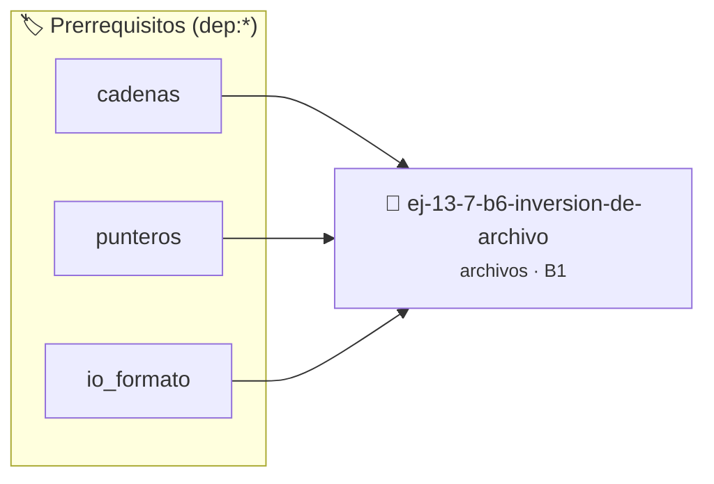

# Inversión de archivo
> **ID:** `ej-13-7-b6-inversion-de-archivo` · **Unidad:** 3 (Memoria Dinámica y Persistencia)
 · **Tema:** `archivos` / `texto`
 · **Bloom:** B1 (Recordar) · **Dificultad:** Inicial
 · **Carga:** ~10 min · **Tipo:** Concepto
>
> **🏷️ Prerrequisitos temáticos (tags):** `dep:cadenas`, `dep:punteros`, `dep:io_formato`
>
> **Etiquetas conceptuales:** `texto`, `archivo`, `inversion`, `memoria`, `archivos`


::: {admonition} 📦 Paquete de Verificación Local (Ripley)
:class: tip

Para compilar, resolver y autoevaluar tu entrega con pruebas unitarias en tu máquina:

- [📥 **Descargar paquete `ej-13-7-b6-inversion-de-archivo.ripkg`**](../../paquetes/ej-13-7-b6-inversion-de-archivo.ripkg)

Ejecución con el asistente de cátedra:
```bash
ripley run ej-13-7-b6-inversion-de-archivo.ripkg
```
:::


### 🗺️ Itinerario Pedagógico




## 📖 Consigna

:::{exercise}
:label: ejercicio_archivos_6
:enumerator: 6

**Inversión de archivo**

Implementá una función `int invertir_archivo(const char *origen, const char
*destino)` que reciba el nombre de un archivo de texto existente (`origen`) y
genere un nuevo archivo (`destino`) que contenga exactamente el mismo texto pero
invertido carácter por carácter (es decir, el último carácter del original será
el primero del nuevo, y así sucesivamente). La función debe usar `fseek` y
`ftell` para determinar el tamaño del archivo y leer los caracteres desde el
final hacia el principio. Debe retornar `0` en caso de éxito y un valor negativo
ante fallas de apertura, posicionamiento o escritura.

-   **[*plus ultra*]:** Garantizar la terminación con `\0` y prevenir
    desbordamientos de búfer validando la capacidad máxima.
-   **[*plus ultra*]:** Soportar la lectura de cadenas con espacios y múltiples
    líneas de manera robusta.

:::

::::{solution} ejercicio_archivos_6
:class: dropdown

:::{code-block}c
:linenos:
#include <stdio.h>
#include <stdlib.h>
#define EXITO 0
#define ERROR_APERTURA -1
#define ERROR_POSICIONAMIENTO -2
#define ERROR_ESCRITURA -3
int invertir_archivo(const char *origen, const char *destino)
{
    FILE *p_origen = fopen(origen, "r");
    if (p_origen == NULL)
    {
        perror("Error al abrir el archivo de origen");
        return ERROR_APERTURA;
    }
    FILE *p_destino = fopen(destino, "w");
    if (p_destino == NULL)
    {
        perror("Error al abrir el archivo de destino");
        fclose(p_origen);
        return ERROR_APERTURA;
    }
    // Determinar el tamaño del archivo de origen usando fseek y ftell
    if (fseek(p_origen, 0L, SEEK_END) != 0)
    {
        perror("Error al posicionarse al final del archivo");
        fclose(p_origen);
        fclose(p_destino);
        return ERROR_POSICIONAMIENTO;
    }
    long tamanio = ftell(p_origen);
    if (tamanio == -1L)
    {
        perror("Error al obtener la posición actual (tamaño)");
        fclose(p_origen);
        fclose(p_destino);
        return ERROR_POSICIONAMIENTO;
    }
    // Leer carácter por carácter desde el final hacia el inicio
    for (long i = tamanio - 1; i >= 0; i--)
    {
        if (fseek(p_origen, i, SEEK_SET) != 0)
        {
            perror("Error de posicionamiento en el lazo");
            fclose(p_origen);
            fclose(p_destino);
            return ERROR_POSICIONAMIENTO;
        }
        int c = fgetc(p_origen);
        if (c == EOF)
        {
            perror("Error al leer carácter");
            fclose(p_origen);
            fclose(p_destino);
            return ERROR_POSICIONAMIENTO;
        }
        if (fputc(c, p_destino) == EOF)
        {
            perror("Error al escribir carácter en destino");
            fclose(p_origen);
            fclose(p_destino);
            return ERROR_ESCRITURA;
        }
    }
    fclose(p_origen);
    if (fclose(p_destino) != 0)
    {
        perror("Error al cerrar el archivo de destino");
        return ERROR_ESCRITURA;
    }
    return EXITO;
}
int main(void)
{
    const char *ORIGEN = "entrada.txt";
    const char *DESTINO = "salida_invertida.txt";
    // Crear un archivo de prueba
    FILE *f = fopen(ORIGEN, "w");
    if (f != NULL)
    {
        fputs("Ingenieria en Computacion UNRN", f);
        fclose(f);
    }
    printf("Invirtiendo archivo \x27%s\x27 en \x27%s\x27...\n", ORIGEN,
           DESTINO);
    if (invertir_archivo(ORIGEN, DESTINO) == EXITO)
    {
        printf("Archivo invertido exitosamente.\n");
    }
    else
    {
        printf("Ocurrió un error al invertir el archivo.\n");
    }
    return 0;
}
:::

::::

### 📋 Contrato de las Funciones

```c
/*
 * Procesa el flujo principal de Inversión de archivo
 * Precondiciones: val representa el parámetro de entrada del flujo.
 * Postcondiciones: Retorna el resultado correspondiente o 0 si val <= 0.
 */
int proc_inversion_de_archivo(int val);

```

### 🧪 Ejemplos de Ejecución

::::{tab-set}
:::{tab-item} Valor positivo
```text
Entrada: 5
Salida / Retorno: 10
```
:::
:::{tab-item} Valor cero o negativo
```text
Entrada: 0
Salida / Retorno: 0
```
:::
::::

### ⚠️ Precondiciones y Casos Borde

1. **Valores fuera de rango:** Verificar siempre que los datos de entrada cumplan con los rangos admisibles antes de operar.
5. **Acceso a archivos:** Verificar que los punteros `FILE*` retornados por `fopen` sean distintos de `NULL` antes de leer o escribir.
6. **Casos vacíos o neutros:** Contemplar adecuadamente entradas con longitud cero o valores neutros según corresponda.

### 🎯 Criterios de Aceptación

- [ ] El código compila limpiamente bajo estándar C11 sin warnings con flags estrictos (`-Wall -Wextra -Werror`).
- [ ] Se satisfacen todas las pruebas unitarias y casos de prueba provistos.
- [ ] Las funciones validan exhaustivamente sus precondiciones y gestionan casos borde de forma robusta.


## 📋 Prototipos y Cabecera (`ej-13-7-b6-inversion-de-archivo.h`)

```{code-block} c
#ifndef EJERCICIO_EJ_13_7_B6_INVERSION_DE_ARCHIVO_H
#define EJERCICIO_EJ_13_7_B6_INVERSION_DE_ARCHIVO_H

#include <stddef.h>
#include <stdbool.h>
#include <stdint.h>

/* Procesa el flujo principal de Inversión de archivo */
int proc_inversion_de_archivo(int val);

#endif /* EJERCICIO_EJ_13_7_B6_INVERSION_DE_ARCHIVO_H */
```


## ⚙️ Especificación de Funciones

| Función | Retorno | Parámetros | Descripción |
| :--- | :--- | :--- | :--- |

| `proc_inversion_de_archivo` | `int` | `int val` | Procesa el flujo principal de Inversión de archivo |


## 🧪 Casos de Prueba

| Prueba Unitaria | Función Objetivo | Verificación |
| :--- | :--- | :--- |

| **test_proc_inversion_de_archivo_positivo** | `proc_inversion_de_archivo` | `int res = proc_inversion_de_archivo(5); assert(res == 10 || res >= 0);` |

| **test_proc_inversion_de_archivo_cero** | `proc_inversion_de_archivo` | `int res = proc_inversion_de_archivo(0); assert(res == 0);` |


## ✓ Solución Modelo de Cátedra

```{dropdown} 🔍 Revelar solución canónica en C
:open: false

```{code-block} c
/*
 * Ejercicio: b.6 - Inversión de archivo
 * Cátedra Programación I - UNRN
 */

#include <stdio.h>


int proc_inversion_de_archivo(int val)
{
    if (val <= 0) return 0;
    return val * 2;
}

int main(void)
{
    /* TODO: Implementación de b.6 - Inversión de archivo */
    return 0;
}
```
```
