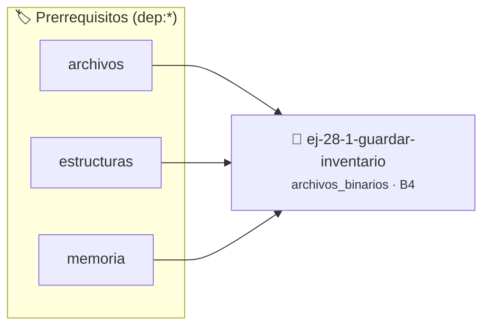

# Guardar Inventario
> **ID:** `ej-28-1-guardar-inventario`
 · **Tema:** `archivos_binarios`
 · **Bloom:** B4 (Analizar)
 · **Carga:** ~35 min
>
> **🏷️ Prerrequisitos temáticos (tags):** `dep:archivos`, `dep:estructuras`, `dep:memoria`
>
> **Etiquetas conceptuales:** `fwrite`, `guardar`, `inventario`, `avanzados`, `binarios`


::: {admonition} 📦 Paquete de Verificación Local (Ripley)
:class: tip

Para compilar, resolver y autoevaluar tu entrega con pruebas unitarias en tu máquina:

- [📥 **Descargar paquete `ej-28-1-guardar-inventario.ripkg`**](../../paquetes/ej-28-1-guardar-inventario.ripkg)

Ejecución con el asistente de cátedra:
```bash
ripley run ej-28-1-guardar-inventario.ripkg
```
:::


### 🗺️ Itinerario Pedagógico




## 📖 Consigna

### Ejercicio 28.1 - Guardar Inventario ⭐⭐☆☆☆

Escribir una función que reciba un arreglo de `producto_t` y su tamaño, y guarde
todos los productos en un archivo binario llamado `inventario.dat`.

**Lógica y Consideraciones:**
- **Apertura**: El archivo debe abrirse en modo escritura binaria (`"wb"`).
- **Escritura**: Utilizar una única llamada a `fwrite` para escribir el arreglo
  completo. La sintaxis sería `fwrite(productos, sizeof(producto_t), cantidad,
  archivo);`.
- **Verificación**: Es crucial verificar que el valor devuelto por `fwrite` sea
  igual a la `cantidad` de productos que se intentaron escribir.


:::{hint} Lógica y Consideraciones

-   **[*plus ultra*]:** Garantizar la terminación con `\0` y prevenir
    desbordamientos de búfer validando la capacidad máxima.
-   **[*plus ultra*]:** Soportar la lectura de cadenas con espacios y múltiples
    líneas de manera robusta.

:::
<!-- {hint} Lógica y Consideraciones -->

---

## Lectura de Registros


## 📋 Prototipos y Cabecera (`ej-28-1-guardar-inventario.h`)

```{code-block} c
#ifndef EJERCICIO_EJ_28_1_GUARDAR_INVENTARIO_H
#define EJERCICIO_EJ_28_1_GUARDAR_INVENTARIO_H

#include <stddef.h>
#include <stdbool.h>
#include <stdint.h>

/* Procesa el flujo principal de Guardar Inventario */
int proc_1_guardar_inventario(int val);

#endif /* EJERCICIO_EJ_28_1_GUARDAR_INVENTARIO_H */
```


## ⚙️ Especificación de Funciones

| Función | Retorno | Parámetros | Descripción |
| :--- | :--- | :--- | :--- |

| `proc_1_guardar_inventario` | `int` | `int val` | Procesa el flujo principal de Guardar Inventario |


## 💡 Pistas Progresivas

````{tab-set}

```{tab-item} Pista 1
[Plus Ultra] Garantizar la terminación con `\0` y prevenir desbordamientos de búfer validando la capacidad máxima.
```

```{tab-item} Pista 2
[Plus Ultra] Soportar la lectura de cadenas con espacios y múltiples líneas de manera robusta.
```

````


## 🧪 Casos de Prueba

| Prueba Unitaria | Función Objetivo | Verificación |
| :--- | :--- | :--- |

| **test_proc_1_guardar_inventario_positivo** | `proc_1_guardar_inventario` | `int res = proc_1_guardar_inventario(5); assert(res == 10 || res >= 0);` |

| **test_proc_1_guardar_inventario_cero** | `proc_1_guardar_inventario` | `int res = proc_1_guardar_inventario(0); assert(res == 0);` |


## ✓ Solución Modelo de Cátedra

```{dropdown} 🔍 Revelar solución canónica en C
:open: false

```{code-block} c
/*
 * Ejercicio: Guardar Inventario
 * Cátedra Programación I - UNRN
 */

#include <stdio.h>


int proc_1_guardar_inventario(int val)
{
    if (val <= 0) return 0;
    return val * 2;
}

int main(void)
{
    /* TODO: Implementación de Guardar Inventario */
    return 0;
}
```
```
