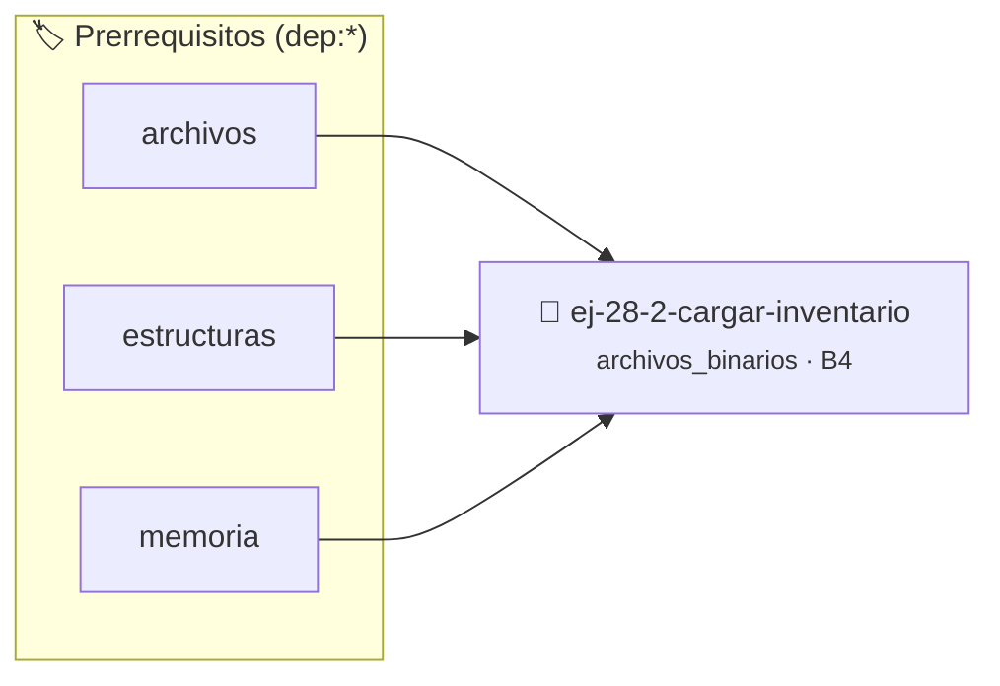

# Cargar Inventario
> **ID:** `ej-28-2-cargar-inventario` · **Unidad:** 3 (Memoria Dinámica y Persistencia)
 · **Tema:** `archivos_binarios` / `fwrite`
 · **Bloom:** B4 (Analizar) · **Dificultad:** Avanzada
 · **Carga:** ~35 min · **Tipo:** Practica Guiada
>
> **🏷️ Prerrequisitos temáticos (tags):** `dep:archivos`, `dep:estructuras`, `dep:memoria`
>
> **Etiquetas conceptuales:** `fwrite`, `inventario`, `avanzados`, `binarios`, `fread`


::: {admonition} 📦 Paquete de Verificación Local (Ripley)
:class: tip

Para compilar, resolver y autoevaluar tu entrega con pruebas unitarias en tu máquina:

- [📥 **Descargar paquete `ej-28-2-cargar-inventario.ripkg`**](../../paquetes/ej-28-2-cargar-inventario.ripkg)

Ejecución con el asistente de cátedra:
```bash
ripley run ej-28-2-cargar-inventario.ripkg
```
:::


### 🗺️ Itinerario Pedagógico




## 📖 Consigna

Escribir una función que lea todos los registros de `inventario.dat` y los
muestre por pantalla.

**Lógica y Consideraciones:**
- **Apertura**: Abrir el archivo en modo lectura binaria (`"rb"`).
- **Lectura**: Usar un lazo `while` que intente leer un registro a la vez con
  `fread`. El lazo continuará mientras `fread` devuelva 1 (indicando que un
  registro fue leído exitosamente).
- **Búfer**: Se necesita una única variable de tipo `producto_t` que actúe como
  búfer para recibir los datos de cada registro leído.
- **Manejo de EOF**: Al final del lazo, verificar `feof` y `ferror` para
  asegurarse de que la lectura terminó porque se llegó al final del archivo y no
  por un error.


---

## Acceso Aleatorio

### 📋 Contrato de las Funciones

```c
/*
 * Procesa el flujo principal de Cargar Inventario
 * Precondiciones: val representa el parámetro de entrada del flujo.
 * Postcondiciones: Retorna el resultado correspondiente o 0 si val <= 0.
 */
int proc__2_cargar_inventario(int val);

```

### 🧪 Ejemplos de Ejecución

::::{tab-set}
:::{tab-item} Valor positivo
```text
Entrada: 5
Salida / Retorno: 10
```
:::
:::{tab-item} Valor cero o negativo
```text
Entrada: 0
Salida / Retorno: 0
```
:::
::::

### ⚠️ Precondiciones y Casos Borde

1. **Valores fuera de rango:** Verificar siempre que los datos de entrada cumplan con los rangos admisibles antes de operar.
5. **Acceso a archivos:** Verificar que los punteros `FILE*` retornados por `fopen` sean distintos de `NULL` antes de leer o escribir.
6. **Casos vacíos o neutros:** Contemplar adecuadamente entradas con longitud cero o valores neutros según corresponda.

### 🎯 Criterios de Aceptación

- [ ] El código compila limpiamente bajo estándar C11 sin warnings con flags estrictos (`-Wall -Wextra -Werror`).
- [ ] Se satisfacen todas las pruebas unitarias y casos de prueba provistos.
- [ ] Las funciones validan exhaustivamente sus precondiciones y gestionan casos borde de forma robusta.

:::{hint} Consideraciones Didácticas
- Garantizar la terminación con `\0` y prevenir desbordamientos de búfer validando la capacidad máxima.
- Soportar la lectura de cadenas con espacios y múltiples líneas de manera robusta.
:::


## 📋 Prototipos y Cabecera (`ej-28-2-cargar-inventario.h`)

```{code-block} c
#ifndef EJERCICIO_EJ_28_2_CARGAR_INVENTARIO_H
#define EJERCICIO_EJ_28_2_CARGAR_INVENTARIO_H

#include <stddef.h>
#include <stdbool.h>
#include <stdint.h>

/* Procesa el flujo principal de Cargar Inventario */
int proc__2_cargar_inventario(int val);

#endif /* EJERCICIO_EJ_28_2_CARGAR_INVENTARIO_H */
```


## ⚙️ Especificación de Funciones

| Función | Retorno | Parámetros | Descripción |
| :--- | :--- | :--- | :--- |

| `proc__2_cargar_inventario` | `int` | `int val` | Procesa el flujo principal de Cargar Inventario |


## 💡 Pistas Progresivas

````{tab-set}

```{tab-item} Pista 1
[Plus Ultra] Garantizar la terminación con `\0` y prevenir desbordamientos de búfer validando la capacidad máxima.
```

```{tab-item} Pista 2
[Plus Ultra] Soportar la lectura de cadenas con espacios y múltiples líneas de manera robusta.
```

````


## 🧪 Casos de Prueba

| Prueba Unitaria | Función Objetivo | Verificación |
| :--- | :--- | :--- |

| **test_proc__2_cargar_inventario_positivo** | `proc__2_cargar_inventario` | `int res = proc__2_cargar_inventario(5); assert(res == 10 || res >= 0);` |

| **test_proc__2_cargar_inventario_cero** | `proc__2_cargar_inventario` | `int res = proc__2_cargar_inventario(0); assert(res == 0);` |


## ✓ Solución Modelo de Cátedra

```{dropdown} 🔍 Revelar solución canónica en C
:open: false

```{code-block} c
/*
 * Ejercicio: Cargar Inventario
 * Cátedra Programación I - UNRN
 */

#include <stdio.h>


int proc__2_cargar_inventario(int val)
{
    if (val <= 0) return 0;
    return val * 2;
}

int main(void)
{
    /* TODO: Implementación de Cargar Inventario */
    return 0;
}
```
```
