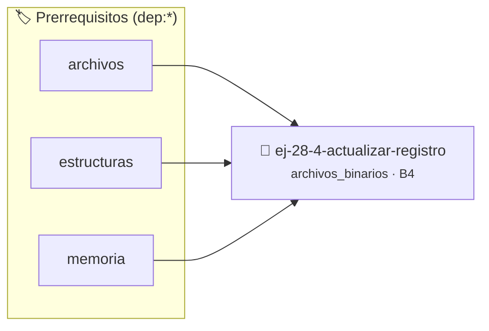

# Actualizar Registro
> **ID:** `ej-28-4-actualizar-registro` · **Unidad:** 3 (Memoria Dinámica y Persistencia)
 · **Tema:** `archivos_binarios` / `fwrite`
 · **Bloom:** B4 (Analizar) · **Dificultad:** Avanzada
 · **Carga:** ~35 min · **Tipo:** Practica Guiada
>
> **🏷️ Prerrequisitos temáticos (tags):** `dep:archivos`, `dep:estructuras`, `dep:memoria`
>
> **Etiquetas conceptuales:** `fwrite`, `registro`, `avanzados`, `binarios`, `fread`


::: {admonition} 📦 Paquete de Verificación Local (Ripley)
:class: tip

Para compilar, resolver y autoevaluar tu entrega con pruebas unitarias en tu máquina:

- [📥 **Descargar paquete `ej-28-4-actualizar-registro.ripkg`**](../../paquetes/ej-28-4-actualizar-registro.ripkg)

Ejecución con el asistente de cátedra:
```bash
ripley run ej-28-4-actualizar-registro.ripkg
```
:::


### 🗺️ Itinerario Pedagógico




## 📖 Consigna

### Ejercicio 28.4 - Actualizar Registro ⭐⭐☆☆☆

Implementar una función `void actualizar_stock(int n, int nuevo_stock)` que
modifique únicamente el stock del `n`-ésimo registro en el archivo.

**Lógica y Consideraciones:**
- **Apertura**: El archivo debe abrirse en un modo que permita tanto lectura
  como escritura, sin borrar el contenido: `"rb+"`.
- **Proceso**: 
  1. Usar `fseek` para posicionarse al inicio del registro `n`.
  2. Usar `fread` para leer el registro actual en una variable `producto_t`.
  3. Modificar el campo `stock` en la variable.
  4. **Crucial**: Usar `fseek` de nuevo para volver a la misma posición (porque
     la lectura movió el puntero).
  5. Usar `fwrite` para sobrescribir el registro en el archivo con la estructura
     ya modificada.

:::{hint} Lógica y Consideraciones

-   **[*plus ultra*]:** Validar punteros `NULL` recibidos como parámetro para
    evitar fallos de segmentación.
-   **[*plus ultra*]:** Implementar una versión utilizando aritmética de
    punteros en lugar de indexación directa.

:::
<!-- {hint} Lógica y Consideraciones -->


## 📋 Prototipos y Cabecera (`ej-28-4-actualizar-registro.h`)

```{code-block} c
#ifndef EJERCICIO_EJ_28_4_ACTUALIZAR_REGISTRO_H
#define EJERCICIO_EJ_28_4_ACTUALIZAR_REGISTRO_H

#include <stddef.h>
#include <stdbool.h>
#include <stdint.h>

/* Procesa el flujo principal de Actualizar Registro */
int proc__actualizar_registro(int val);

#endif /* EJERCICIO_EJ_28_4_ACTUALIZAR_REGISTRO_H */
```


## ⚙️ Especificación de Funciones

| Función | Retorno | Parámetros | Descripción |
| :--- | :--- | :--- | :--- |

| `proc__actualizar_registro` | `int` | `int val` | Procesa el flujo principal de Actualizar Registro |


## 💡 Pistas Progresivas

````{tab-set}

```{tab-item} Pista 1
[Plus Ultra] Validar punteros `NULL` recibidos como parámetro para evitar fallos de segmentación.
```

```{tab-item} Pista 2
[Plus Ultra] Implementar una versión utilizando aritmética de punteros en lugar de indexación directa.
```

````


## 🧪 Casos de Prueba

| Prueba Unitaria | Función Objetivo | Verificación |
| :--- | :--- | :--- |

| **test_proc__actualizar_registro_positivo** | `proc__actualizar_registro` | `int res = proc__actualizar_registro(5); assert(res == 10 || res >= 0);` |

| **test_proc__actualizar_registro_cero** | `proc__actualizar_registro` | `int res = proc__actualizar_registro(0); assert(res == 0);` |


## ✓ Solución Modelo de Cátedra

```{dropdown} 🔍 Revelar solución canónica en C
:open: false

```{code-block} c
/*
 * Ejercicio: Actualizar Registro
 * Cátedra Programación I - UNRN
 */

#include <stdio.h>


int proc__actualizar_registro(int val)
{
    if (val <= 0) return 0;
    return val * 2;
}

int main(void)
{
    /* TODO: Implementación de Actualizar Registro */
    return 0;
}
```
```
