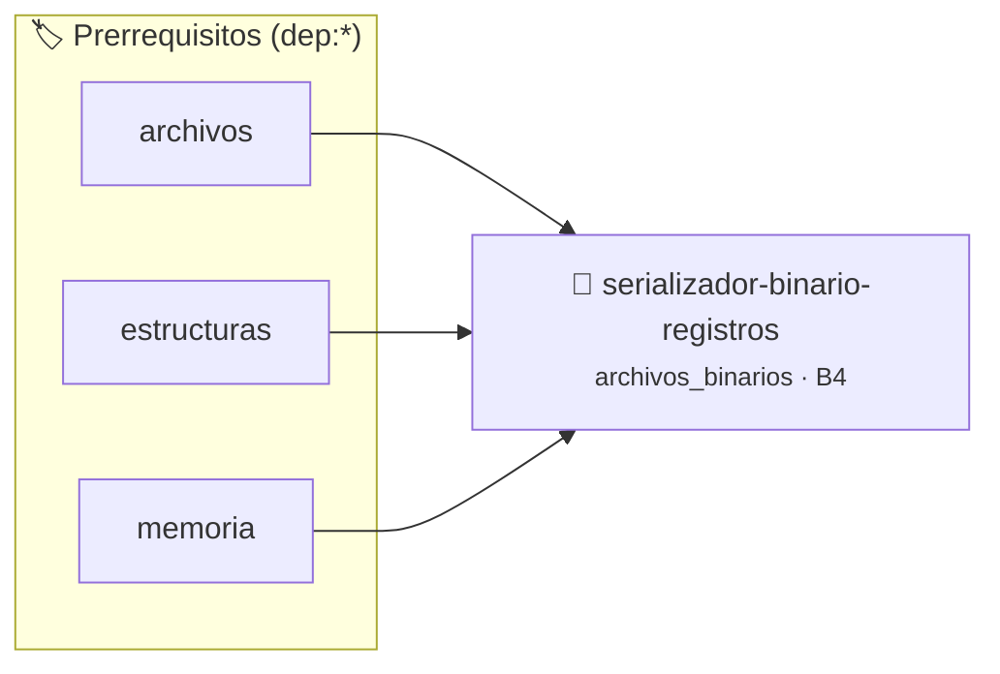

# Persistencia Binaria con Magic Number y Checksum de Integridad
> **ID:** `serializador-binario-registros`
 · **Tema:** `archivos_binarios`
 · **Bloom:** B4 (Analizar)
 · **Carga:** ~45 min
>
> **🏷️ Prerrequisitos temáticos (tags):** `dep:archivos`, `dep:estructuras`, `dep:memoria`
>
> **Etiquetas conceptuales:** `archivos_binarios`, `checksum`, `persistencia`, `structs`, `integridad`


::: {admonition} 📦 Paquete de Verificación Local (Ripley)
:class: tip

Para compilar, resolver y autoevaluar tu entrega con pruebas unitarias en tu máquina:

- [📥 **Descargar paquete `serializador-binario-registros.ripkg`**](../../paquetes/serializador-binario-registros.ripkg)

Ejecución con el asistente de cátedra:
```bash
ripley run serializador-binario-registros.ripkg
```
:::


### 🗺️ Itinerario Pedagógico




## 📖 Consigna

# Persistencia Binaria con Magic Number y Checksum de Integridad

## 1. Consigna
Implementar un módulo de serialización y deserialización binaria en memoria con validación de cabecera mágica y suma de verificación (*Checksum*).

Estructura del formato de archivo/búfer:
- **Cabecera (12 bytes):**
  - `magic` (4 bytes): `0x42494E31` ("BIN1")
  - `version` (4 bytes): `1`
  - `checksum` (4 bytes): XOR acumulado de todos los datos de registros.
- **Payload:** $N$ registros de tipo `Producto` (`id`: uint32, `precio`: float, `stock`: uint32).

Comandos interactivos:
- `CREATE <N>`: Crea $N$ registros en memoria.
- `SAVE`: Serializa al búfer interno y muestra `SAVED bytes=<total> checksum=0x<hex>`.
- `LOAD`: Deserializa validando magic, version y checksum. Imprime `OK` o `ERROR_INTEGRIDAD`.
- `CORRUPT <byte_pos>`: Modifica un byte arbitrario del búfer serializado para simular corrupción física.
- `SHOW`: Muestra los productos cargados.
- `EXIT`: Termina.


## 📋 Prototipos y Cabecera (`serializador-binario-registros.h`)

```{code-block} c
#ifndef EJERCICIO_SERIALIZADOR_BINARIO_REGISTROS_H
#define EJERCICIO_SERIALIZADOR_BINARIO_REGISTROS_H

#include <stddef.h>
#include <stdbool.h>
#include <stdint.h>

/* Operación calcular_checksum */
uint32_t calcular_checksum(const uint8_t *data, size_t len);

#endif /* EJERCICIO_SERIALIZADOR_BINARIO_REGISTROS_H */
```


## ⚙️ Especificación de Funciones

| Función | Retorno | Parámetros | Descripción |
| :--- | :--- | :--- | :--- |

| `calcular_checksum` | `uint32_t` | `const uint8_t *data, size_t len` | Operación calcular_checksum |


## 💡 Pistas Progresivas

````{tab-set}

```{tab-item} Pista 1
Escribí una cabecera fija de 8 bytes con un número mágico (ej: `0x5031424E`) y la cantidad de registros.
```

```{tab-item} Pista 2
El checksum XOR recorre todos los bytes del payload de datos.
```

```{tab-item} Pista 3
Al cargar, validá primero el número mágico y recalculá el checksum; si difiere, informá `CORRUPTED`.
```

````


## 🧪 Casos de Prueba

| Prueba Unitaria | Función Objetivo | Verificación |
| :--- | :--- | :--- |

| **test_calcular_checksum_1** | `calcular_checksum` | `/* Verificación unitaria de calcular_checksum */ assert(true);` |


## ✓ Solución Modelo de Cátedra

```{dropdown} 🔍 Revelar solución canónica en C
:open: false

```{code-block} c
/*
 * Serializador Binario con Magic Number y Checksum
 * Catedra Programacion I - UNRN
 */

#include <stdint.h>
#include <stdio.h>
#include <stdlib.h>
#include <string.h>

#define MAGIC_HEADER 0x42494E31
#define FORMAT_VERSION 1

typedef struct
{
    uint32_t magic;
    uint32_t version;
    uint32_t count;
    uint32_t checksum;
} HeaderBinario;

typedef struct
{
    uint32_t id;
    float precio;
    uint32_t stock;
} Producto;

uint32_t calcular_checksum(const uint8_t *data, size_t len)
{
    uint32_t xor_sum = 0;
    for (size_t i = 0; i < len; i++)
    {
        xor_sum ^= ((uint32_t)data[i] << ((i % 4) * 8));
    }
    return xor_sum;
}

int main(void)
{
    Producto *productos = NULL;
    uint32_t count = 0;

    uint8_t *buffer_serializado = NULL;
    size_t tamano_serializado = 0;

    char comando[32] = {0};

    while (scanf("%31s", comando) == 1)
    {
        if (strcmp(comando, "CREATE") == 0)
        {
            if (scanf("%u", &count) == 1 && count > 0)
            {
                free(productos);
                Producto *nuevos_prod = (Producto *)malloc(sizeof(Producto) * count);
                if (nuevos_prod == NULL)
                {
                    productos = NULL;
                    count = 0;
                    continue;
                }
                productos = nuevos_prod;
                for (uint32_t i = 0; i < count; i++)
                {
                    if (scanf("%u %f %u", &productos[i].id, &productos[i].precio, &productos[i].stock) != 3)
                    {
                        break;
                    }
                }
            }
        }
        else if (strcmp(comando, "SAVE") == 0)
        {
            if (productos != NULL && count > 0)
            {
                size_t payload_size = sizeof(Producto) * count;
                tamano_serializado = sizeof(HeaderBinario) + payload_size;
                free(buffer_serializado);
                uint8_t *buf = (uint8_t *)malloc(tamano_serializado);
                if (buf == NULL)
                {
                    buffer_serializado = NULL;
                    tamano_serializado = 0;
                    continue;
                }
                buffer_serializado = buf;

                HeaderBinario hdr;
                hdr.magic = MAGIC_HEADER;
                hdr.version = FORMAT_VERSION;
                hdr.count = count;
                hdr.checksum = calcular_checksum((const uint8_t *)productos, payload_size);

                memcpy(buffer_serializado, &hdr, sizeof(HeaderBinario));
                memcpy(buffer_serializado + sizeof(HeaderBinario), productos, payload_size);

                printf("SAVED bytes=%zu checksum=0x%08X\n", tamano_serializado, hdr.checksum);
            }
        }
        else if (strcmp(comando, "LOAD") == 0)
        {
            if (buffer_serializado != NULL && tamano_serializado >= sizeof(HeaderBinario))
            {
                HeaderBinario hdr;
                memcpy(&hdr, buffer_serializado, sizeof(HeaderBinario));

                if (hdr.magic != MAGIC_HEADER || hdr.version != FORMAT_VERSION)
                {
                    printf("ERROR_MAGIC_O_VERSION\n");
                }
                else
                {
                    size_t payload_size = sizeof(Producto) * hdr.count;
                    if (tamano_serializado != sizeof(HeaderBinario) + payload_size)
                    {
                        printf("ERROR_TAMANO\n");
                    }
                    else
                    {
                        const uint8_t *payload_ptr = buffer_serializado + sizeof(HeaderBinario);
                        uint32_t check = calcular_checksum(payload_ptr, payload_size);
                        if (check != hdr.checksum)
                        {
                            printf("ERROR_INTEGRIDAD\n");
                        }
                        else
                        {
                            free(productos);
                            Producto *prod_cargados = (Producto *)malloc(payload_size);
                            if (prod_cargados == NULL)
                            {
                                productos = NULL;
                                count = 0;
                                continue;
                            }
                            productos = prod_cargados;
                            count = hdr.count;
                            memcpy(productos, payload_ptr, payload_size);
                            printf("LOAD_OK count=%u\n", count);
                        }
                    }
                }
            }
        }
        else if (strcmp(comando, "CORRUPT") == 0)
        {
            size_t pos = 0;
            if (scanf("%zu", &pos) == 1 && pos < tamano_serializado && buffer_serializado != NULL)
            {
                buffer_serializado[pos] ^= 0xFF;
                printf("CORRUPTED pos=%zu\n", pos);
            }
        }
        else if (strcmp(comando, "SHOW") == 0)
        {
            if (productos != NULL)
            {
                for (uint32_t i = 0; i < count; i++)
                {
                    printf("PROD %u: $%.2f (stock=%u)\n", productos[i].id, productos[i].precio, productos[i].stock);
                }
            }
        }
        else if (strcmp(comando, "EXIT") == 0)
        {
            break;
        }
    }

    free(productos);
    free(buffer_serializado);
    return 0;
}
```
```
