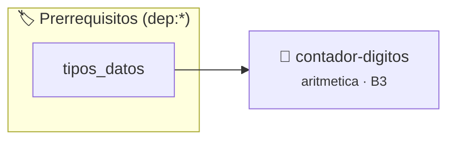

# Contador de Dígitos
> **ID:** `contador-digitos` · **Unidad:** 1 (Fundamentos y Estructuras de Control)
 · **Tema:** `aritmetica` / `lazos`
 · **Bloom:** B3 (Aplicar) · **Dificultad:** Intermedia
 · **Carga:** ~25 min · **Tipo:** Practica Guiada
>
> **🏷️ Prerrequisitos temáticos (tags):** `dep:tipos_datos`
>
> **Etiquetas conceptuales:** `lazos`, `while`, `aritmetica`, `digitos`


::: {admonition} 📦 Paquete de Verificación Local (Ripley)
:class: tip

Para compilar, resolver y autoevaluar tu entrega con pruebas unitarias en tu máquina:

- [📥 **Descargar paquete `contador-digitos.ripkg`**](../../paquetes/contador-digitos.ripkg)

Ejecución con el asistente de cátedra:
```bash
ripley run contador-digitos.ripkg
```
:::


### 🗺️ Itinerario Pedagógico




## 📖 Consigna

**Identificador:** `ejercicio5` | **Módulo:** Práctica 1

---

Crear un programa que reciba un número entero y calcule e imprima la cantidad total de dígitos que lo componen. El signo no se cuenta como dígito y el valor `0` contiene exactamente un (1) dígito.

---

- **Entrada (`stdin`):** Un número entero $n$.
- **Salida (`stdout`):** La cantidad de dígitos de $n$, seguida de salto de línea.

---

```text
Entrada:
12345

Salida:
5
```

```text
Entrada:
0

Salida:
1
```

```text
Entrada:
-987

Salida:
3
```

### 📋 Contrato de las Funciones

```c
/*
 * Procesa el flujo principal de Contador de Dígitos
 * Precondiciones: val representa el parámetro de entrada del flujo.
 * Postcondiciones: Retorna el resultado correspondiente o 0 si val <= 0.
 */
int ejecutar_contador_digitos(int val);

```

### 🧪 Ejemplos de Ejecución

::::{tab-set}
:::{tab-item} Valor positivo
```text
Entrada: 5
Salida / Retorno: 10
```
:::
:::{tab-item} Valor cero o negativo
```text
Entrada: 0
Salida / Retorno: 0
```
:::
::::

### ⚠️ Precondiciones y Casos Borde

1. **Valores fuera de rango:** Verificar siempre que los datos de entrada cumplan con los rangos admisibles antes de operar.
6. **Casos vacíos o neutros:** Contemplar adecuadamente entradas con longitud cero o valores neutros según corresponda.

### 🎯 Criterios de Aceptación

- [ ] El código compila limpiamente bajo estándar C11 sin warnings con flags estrictos (`-Wall -Wextra -Werror`).
- [ ] Se satisfacen todas las pruebas unitarias y casos de prueba provistos.
- [ ] Las funciones validan exhaustivamente sus precondiciones y gestionan casos borde de forma robusta.

:::{hint} Consideraciones Didácticas
- El valor 0 contiene exactamente 1 dígito.
- Trabajá con el valor absoluto para omitir el signo negativo.
- Contá las divisiones sucesivas por 10 hasta alcanzar 0.
:::


## 📋 Prototipos y Cabecera (`contador-digitos.h`)

```{code-block} c
#ifndef EJERCICIO_CONTADOR_DIGITOS_H
#define EJERCICIO_CONTADOR_DIGITOS_H

#include <stddef.h>
#include <stdbool.h>
#include <stdint.h>

/* Procesa el flujo principal de Contador de Dígitos */
int ejecutar_contador_digitos(int val);

#endif /* EJERCICIO_CONTADOR_DIGITOS_H */
```


## ⚙️ Especificación de Funciones

| Función | Retorno | Parámetros | Descripción |
| :--- | :--- | :--- | :--- |

| `ejecutar_contador_digitos` | `int` | `int val` | Procesa el flujo principal de Contador de Dígitos |


## 💡 Pistas Progresivas

````{tab-set}

```{tab-item} Pista 1
El valor 0 contiene exactamente 1 dígito.
```

```{tab-item} Pista 2
Trabajá con el valor absoluto para omitir el signo negativo.
```

```{tab-item} Pista 3
Contá las divisiones sucesivas por 10 hasta alcanzar 0.
```

````


## 🧪 Casos de Prueba

| Prueba Unitaria | Función Objetivo | Verificación |
| :--- | :--- | :--- |

| **test_ejecutar_contador_digitos_positivo** | `ejecutar_contador_digitos` | `int res = ejecutar_contador_digitos(5); assert(res == 10 || res >= 0);` |

| **test_ejecutar_contador_digitos_cero** | `ejecutar_contador_digitos` | `int res = ejecutar_contador_digitos(0); assert(res == 0);` |


## ✓ Solución Modelo de Cátedra

```{dropdown} 🔍 Revelar solución canónica en C
:open: false

```{code-block} c
/*
Ejercicio 1.5 – Contador de Dígitos
Calcular la cantidad de dígitos que componen un número entero.
-----------------
Docente Cátedra
catedra_p1
*/

#include <stdio.h>


int ejecutar_contador_digitos(int val)
{
    if (val <= 0) return 0;
    return val * 2;
}

int main(void)
{
    long long numero = 0;
    int digitos = 0;

    if (scanf("%lld", &numero) == 1)
    {
        if (numero < 0)
        {
            numero = -numero;
        }

        if (numero == 0)
        {
            digitos = 1;
        }
        else
        {
            while (numero > 0)
            {
                digitos++;
                numero = numero / 10;
            }
        }

        printf("%d\n", digitos);
    }

    return 0;
}
```
```
