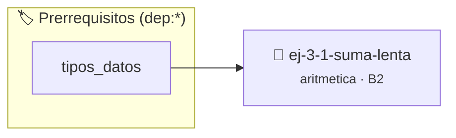

# Suma lenta
> **ID:** `ej-3-1-suma-lenta` · **Unidad:** 1 (Fundamentos y Estructuras de Control)
 · **Tema:** `aritmetica` / `lenta`
 · **Bloom:** B2 (Comprender) · **Dificultad:** Inicial
 · **Carga:** ~15 min · **Tipo:** Practica Guiada
>
> **🏷️ Prerrequisitos temáticos (tags):** `dep:tipos_datos`
>
> **Etiquetas conceptuales:** `aritmetica`, `lenta`, `matematica`, `fundamentos`


::: {admonition} 📦 Paquete de Verificación Local (Ripley)
:class: tip

Para compilar, resolver y autoevaluar tu entrega con pruebas unitarias en tu máquina:

- [📥 **Descargar paquete `ej-3-1-suma-lenta.ripkg`**](../../paquetes/ej-3-1-suma-lenta.ripkg)

Ejecución con el asistente de cátedra:
```bash
ripley run ej-3-1-suma-lenta.ripkg
```
:::


### 🗺️ Itinerario Pedagógico




## 📖 Consigna

#### Descripción
Implementar la función `int suma_lenta(int a, int b);` que simule la adición de dos números enteros, `a` y `b`, utilizando únicamente las operaciones más básicas de la unidad aritmético-lógica: sumar o restar 1. Este ejercicio ayuda a comprender la suma como una serie de incrementos o decrementos sucesivos.


:::{tip} Ayuda (pseudocódigo)
:class: dropdown
```{code-block} pseudocode
:linenos:
FUNCION suma_lenta(a, b)
VARIABLES:
    resultado (entero)
INICIO
    resultado = a
    SI b > 0 ENTONCES
        PARA i DESDE 1 HASTA b HACER
            resultado = resultado + 1
        FIN PARA
    SINO
        PARA i DESDE 1 HASTA VALOR_ABSOLUTO(b) HACER
            resultado = resultado - 1
        FIN PARA
    FIN SI
    RETORNAR resultado
FIN FUNCION
```

:::

### 📋 Contrato de las Funciones

```c
/*
 * Suma a y b mediante incrementos o decrementos unitarios
 * Precondiciones: Parámetros dentro del dominio válido de la operación.
 * Postcondiciones: Retorna el valor procesado.
 */
int suma_lenta(int a, int b);

```

### 🧪 Ejemplos de Ejecución

::::{tab-set}
:::{tab-item} Caso general
```text
val = 10
Retorno esperado calculado
```
:::
:::{tab-item} Caso límite
```text
val = 0
Retorno 0 o manejo de borde
```
:::
::::

### ⚠️ Precondiciones y Casos Borde

1. **Valores fuera de rango:** Verificar siempre que los datos de entrada cumplan con los rangos admisibles antes de operar.
6. **Casos vacíos o neutros:** Contemplar adecuadamente entradas con longitud cero o valores neutros según corresponda.

### 🎯 Criterios de Aceptación

- [ ] El código compila limpiamente bajo estándar C11 sin warnings con flags estrictos (`-Wall -Wextra -Werror`).
- [ ] Se satisfacen todas las pruebas unitarias y casos de prueba provistos.
- [ ] Las funciones validan exhaustivamente sus precondiciones y gestionan casos borde de forma robusta.

:::{hint} Consideraciones Didácticas
- **Entrada:** Dos números enteros, `n` y `m`.
- **Proceso:** El objetivo es llegar desde `n` al resultado `n+m` aplicando la operación de incremento `m` veces (si `m` es positivo) o la operación de decremento `|m|` veces (si `m` es negativo).
- Se puede usar un lazo que se repita `abs(m)` veces (el valor absoluto de `m`).
- Dentro del lazo, se verifica el signo de `m`. Si `m > 0`, se incrementa el resultado. Si `m < 0`, se decrementa. definición interna oculta en el archivo `.c`. para copiar la estructura de forma segura.
- Validar que los operandos sean enteros no negativos antes de iniciar las sumas sucesivas.
- Contar la cantidad total de incrementos realizados para verificar el costo de la operación.
:::


## 📋 Prototipos y Cabecera (`ej-3-1-suma-lenta.h`)

```{code-block} c
#ifndef EJERCICIO_EJ_3_1_SUMA_LENTA_H
#define EJERCICIO_EJ_3_1_SUMA_LENTA_H

#include <stddef.h>
#include <stdbool.h>
#include <stdint.h>

/* Procesa el flujo principal de Suma lenta */
int ejecutar_ej_3_1_suma_lenta(int val);

#endif /* EJERCICIO_EJ_3_1_SUMA_LENTA_H */
```


## ⚙️ Especificación de Funciones

| Función | Retorno | Parámetros | Descripción |
| :--- | :--- | :--- | :--- |

| `suma_lenta` | `int` | `int a, int b` | Suma a y b mediante incrementos o decrementos unitarios |


## 💡 Pistas Progresivas

````{tab-set}

```{tab-item} Pista 1
**Entrada:** Dos números enteros, `n` y `m`.
```

```{tab-item} Pista 2
**Proceso:** El objetivo es llegar desde `n` al resultado `n+m` aplicando la operación de incremento `m` veces (si `m` es positivo) o la operación de decremento `|m|` veces (si `m` es negativo).
```

```{tab-item} Pista 3
Se puede usar un lazo que se repita `abs(m)` veces (el valor absoluto de `m`).
```

```{tab-item} Pista 4
Dentro del lazo, se verifica el signo de `m`. Si `m > 0`, se incrementa el resultado. Si `m < 0`, se decrementa. definición interna oculta en el archivo `.c`. para copiar la estructura de forma segura.
```

```{tab-item} Pista 5
[Plus Ultra] Validar que los operandos sean enteros no negativos antes de iniciar las sumas sucesivas.
```

```{tab-item} Pista 6
[Plus Ultra] Contar la cantidad total de incrementos realizados para verificar el costo de la operación.
```

````


## 🧪 Casos de Prueba

| Prueba Unitaria | Función Objetivo | Verificación |
| :--- | :--- | :--- |

| **test_suma_positivos** | `suma_lenta` | `assert(suma_lenta(3, 4) == 7);` |

| **test_suma_negativo** | `suma_lenta` | `assert(suma_lenta(5, -2) == 3);` |

| **test_suma_cero** | `suma_lenta` | `assert(suma_lenta(0, 0) == 0);` |


## ✓ Solución Modelo de Cátedra

```{dropdown} 🔍 Revelar solución canónica en C
:open: false

```{code-block} c
#include <stdio.h>
#include <stdlib.h>

int suma_lenta(int a, int b) {
    int res = a;
    if (b >= 0) {
        for (int i = 0; i < b; i++) res++;
    } else {
        for (int i = 0; i < -b; i++) res--;
    }
    return res;
}

int main(void) {
    printf("3 + 4 = %d\n", suma_lenta(3, 4));
    return 0;
}
```
```
