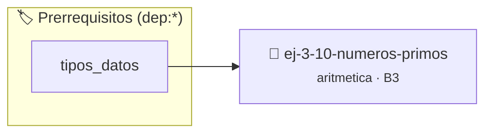

# Números Primos
> **ID:** `ej-3-10-numeros-primos` · **Unidad:** 1 (Fundamentos y Estructuras de Control)
 · **Tema:** `aritmetica` / `teoria_numeros`
 · **Bloom:** B3 (Aplicar) · **Dificultad:** Intermedia
 · **Carga:** ~25 min · **Tipo:** Practica Guiada
>
> **🏷️ Prerrequisitos temáticos (tags):** `dep:tipos_datos`
>
> **Etiquetas conceptuales:** `fundamentos`, `aritmetica`, `primos`, `numeros`, `matematica`


::: {admonition} 📦 Paquete de Verificación Local (Ripley)
:class: tip

Para compilar, resolver y autoevaluar tu entrega con pruebas unitarias en tu máquina:

- [📥 **Descargar paquete `ej-3-10-numeros-primos.ripkg`**](../../paquetes/ej-3-10-numeros-primos.ripkg)

Ejecución con el asistente de cátedra:
```bash
ripley run ej-3-10-numeros-primos.ripkg
```
:::


### 🗺️ Itinerario Pedagógico




## 📖 Consigna

#### Descripción
Verificar si un número entero mayor que 1 es un número primo. Un número es primo
si solo es divisible por 1 y por sí mismo.


:::{tip} Ayuda (pseudocódigo)
:class: dropdown
```{code-block} pseudocode
:linenos:
FUNCION es_primo(n)
INICIO
    SI n <= 1 ENTONCES RETORNAR FALSO
    PARA i DESDE 2 HASTA RAIZ_CUADRADA(n) HACER
        SI n MOD i == 0 ENTONCES
            RETORNAR FALSO
        FIN SI
    FIN PARA
    RETORNAR VERDADERO
FIN FUNCION

```

:::

### 📋 Contrato de las Funciones

```c
/*
 * Procesa el flujo principal de Números Primos
 * Precondiciones: val representa el parámetro de entrada del flujo.
 * Postcondiciones: Retorna el resultado correspondiente o 0 si val <= 0.
 */
int proc__3_10_numeros_primos(int val);

```

### 🧪 Ejemplos de Ejecución

::::{tab-set}
:::{tab-item} Valor positivo
```text
Entrada: 5
Salida / Retorno: 10
```
:::
:::{tab-item} Valor cero o negativo
```text
Entrada: 0
Salida / Retorno: 0
```
:::
::::

### ⚠️ Precondiciones y Casos Borde

1. **Valores fuera de rango:** Verificar siempre que los datos de entrada cumplan con los rangos admisibles antes de operar.
6. **Casos vacíos o neutros:** Contemplar adecuadamente entradas con longitud cero o valores neutros según corresponda.

### 🎯 Criterios de Aceptación

- [ ] El código compila limpiamente bajo estándar C11 sin warnings con flags estrictos (`-Wall -Wextra -Werror`).
- [ ] Se satisfacen todas las pruebas unitarias y casos de prueba provistos.
- [ ] Las funciones validan exhaustivamente sus precondiciones y gestionan casos borde de forma robusta.

:::{hint} Consideraciones Didácticas
- **Entrada:** Un entero `n`.
- **Casos Base:** Números menores o iguales a 1 no son primos. 2 es el único primo par.
- **Proceso:** Para verificar si `n` es primo, basta con comprobar si es divisible por algún número desde 2 hasta la raíz cuadrada de `n` ($\sqrt{n}$). Si se encuentra un divisor en ese rango, el número no es primo. error e informar el resultado mediante parámetros de salida. especificando precondiciones y postcondiciones.
- Optimizar el lazo comprobando divisores solo hasta sqrt(n).
- Contar la cantidad de números primos dentro de un rango dado por el usuario.
:::


## 📋 Prototipos y Cabecera (`ej-3-10-numeros-primos.h`)

```{code-block} c
#ifndef EJERCICIO_EJ_3_10_NUMEROS_PRIMOS_H
#define EJERCICIO_EJ_3_10_NUMEROS_PRIMOS_H

#include <stddef.h>
#include <stdbool.h>
#include <stdint.h>

/* Procesa el flujo principal de Números Primos */
int proc__3_10_numeros_primos(int val);

#endif /* EJERCICIO_EJ_3_10_NUMEROS_PRIMOS_H */
```


## ⚙️ Especificación de Funciones

| Función | Retorno | Parámetros | Descripción |
| :--- | :--- | :--- | :--- |

| `proc__3_10_numeros_primos` | `int` | `int val` | Procesa el flujo principal de Números Primos |


## 💡 Pistas Progresivas

````{tab-set}

```{tab-item} Pista 1
**Entrada:** Un entero `n`.
```

```{tab-item} Pista 2
**Casos Base:** Números menores o iguales a 1 no son primos. 2 es el único primo par.
```

```{tab-item} Pista 3
**Proceso:** Para verificar si `n` es primo, basta con comprobar si es divisible por algún número desde 2 hasta la raíz cuadrada de `n` ($\sqrt{n}$). Si se encuentra un divisor en ese rango, el número no es primo. error e informar el resultado mediante parámetros de salida. especificando precondiciones y postcondiciones.
```

```{tab-item} Pista 4
[Plus Ultra] Optimizar el lazo comprobando divisores solo hasta sqrt(n).
```

```{tab-item} Pista 5
[Plus Ultra] Contar la cantidad de números primos dentro de un rango dado por el usuario.
```

````


## 🧪 Casos de Prueba

| Prueba Unitaria | Función Objetivo | Verificación |
| :--- | :--- | :--- |

| **test_proc__3_10_numeros_primos_positivo** | `proc__3_10_numeros_primos` | `int res = proc__3_10_numeros_primos(5); assert(res == 10 || res >= 0);` |

| **test_proc__3_10_numeros_primos_cero** | `proc__3_10_numeros_primos` | `int res = proc__3_10_numeros_primos(0); assert(res == 0);` |


## ✓ Solución Modelo de Cátedra

```{dropdown} 🔍 Revelar solución canónica en C
:open: false

```{code-block} c
/*
 * Ejercicio: Números Primos
 * Cátedra Programación I - UNRN
 */

#include <stdio.h>


int proc__3_10_numeros_primos(int val)
{
    if (val <= 0) return 0;
    return val * 2;
}

int main(void)
{
    /* TODO: Implementación de Números Primos */
    return 0;
}
```
```
