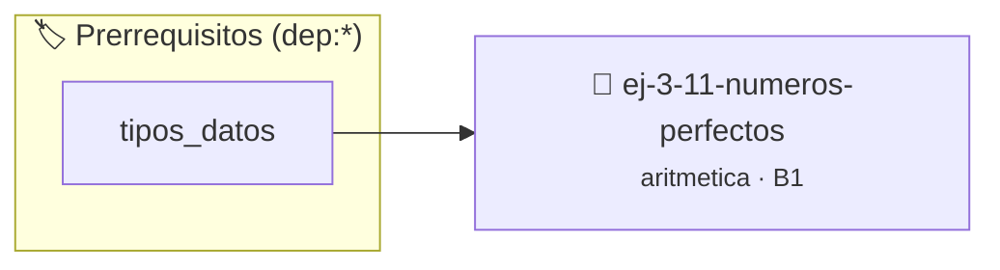

# Números Perfectos
> **ID:** `ej-3-11-numeros-perfectos` · **Unidad:** 1 (Fundamentos y Estructuras de Control)
 · **Tema:** `aritmetica` / `fundamentos`
 · **Bloom:** B1 (Recordar) · **Dificultad:** Inicial
 · **Carga:** ~10 min · **Tipo:** Concepto
>
> **🏷️ Prerrequisitos temáticos (tags):** `dep:tipos_datos`
>
> **Etiquetas conceptuales:** `fundamentos`, `aritmetica`, `numeros`, `matematica`, `perfectos`


::: {admonition} 📦 Paquete de Verificación Local (Ripley)
:class: tip

Para compilar, resolver y autoevaluar tu entrega con pruebas unitarias en tu máquina:

- [📥 **Descargar paquete `ej-3-11-numeros-perfectos.ripkg`**](../../paquetes/ej-3-11-numeros-perfectos.ripkg)

Ejecución con el asistente de cátedra:
```bash
ripley run ej-3-11-numeros-perfectos.ripkg
```
:::


### 🗺️ Itinerario Pedagógico




## 📖 Consigna

#### Descripción
Determinar si un número es un "número perfecto". Un número perfecto es un entero
positivo que es igual a la suma de sus divisores propios positivos (todos sus
divisores excepto él mismo).


:::{tip} Ayuda (pseudocódigo)
:class: dropdown
```{code-block} pseudocode
:linenos:
FUNCION es_perfecto(n)
VARIABLES:
    suma_divisores (entero)
INICIO
    suma_divisores = 0
    PARA i DESDE 1 HASTA n-1 HACER
        SI n MOD i == 0 ENTONCES
            suma_divisores = suma_divisores + i
        FIN SI
    FIN PARA
    RETORNAR (suma_divisores == n)
FIN FUNCION

```

:::

### 📋 Contrato de las Funciones

```c
/*
 * Procesa el flujo principal de Números Perfectos
 * Precondiciones: val representa el parámetro de entrada del flujo.
 * Postcondiciones: Retorna el resultado correspondiente o 0 si val <= 0.
 */
int proc_11_numeros_perfectos(int val);

```

### 🧪 Ejemplos de Ejecución

::::{tab-set}
:::{tab-item} Valor positivo
```text
Entrada: 5
Salida / Retorno: 10
```
:::
:::{tab-item} Valor cero o negativo
```text
Entrada: 0
Salida / Retorno: 0
```
:::
::::

### ⚠️ Precondiciones y Casos Borde

1. **Valores fuera de rango:** Verificar siempre que los datos de entrada cumplan con los rangos admisibles antes de operar.
6. **Casos vacíos o neutros:** Contemplar adecuadamente entradas con longitud cero o valores neutros según corresponda.

### 🎯 Criterios de Aceptación

- [ ] El código compila limpiamente bajo estándar C11 sin warnings con flags estrictos (`-Wall -Wextra -Werror`).
- [ ] Se satisfacen todas las pruebas unitarias y casos de prueba provistos.
- [ ] Las funciones validan exhaustivamente sus precondiciones y gestionan casos borde de forma robusta.

:::{hint} Consideraciones Didácticas
- **Entrada:** Un entero `n`.
- **Proceso:**
- Calcular la suma de los divisores propios de `n`. Para ello, iterar desde 1 hasta `n/2`.
- En cada iteración, si el iterador `i` es un divisor de `n` (`n % i == 0`), se suma `i` a un acumulador.
- Finalmente, comparar la suma obtenida con el número original `n`. error e informar el resultado mediante parámetros de salida. especificando precondiciones y postcondiciones.
- Validar que el número sea entero positivo mayor a 1.
- Determinar si el número es abundante, deficiente o perfecto.
:::


## 📋 Prototipos y Cabecera (`ej-3-11-numeros-perfectos.h`)

```{code-block} c
#ifndef EJERCICIO_EJ_3_11_NUMEROS_PERFECTOS_H
#define EJERCICIO_EJ_3_11_NUMEROS_PERFECTOS_H

#include <stddef.h>
#include <stdbool.h>
#include <stdint.h>

/* Procesa el flujo principal de Números Perfectos */
int proc_11_numeros_perfectos(int val);

#endif /* EJERCICIO_EJ_3_11_NUMEROS_PERFECTOS_H */
```


## ⚙️ Especificación de Funciones

| Función | Retorno | Parámetros | Descripción |
| :--- | :--- | :--- | :--- |

| `proc_11_numeros_perfectos` | `int` | `int val` | Procesa el flujo principal de Números Perfectos |


## 💡 Pistas Progresivas

````{tab-set}

```{tab-item} Pista 1
**Entrada:** Un entero `n`.
```

```{tab-item} Pista 2
**Proceso:**
```

```{tab-item} Pista 3
Calcular la suma de los divisores propios de `n`. Para ello, iterar desde 1 hasta `n/2`.
```

```{tab-item} Pista 4
En cada iteración, si el iterador `i` es un divisor de `n` (`n % i == 0`), se suma `i` a un acumulador.
```

```{tab-item} Pista 5
Finalmente, comparar la suma obtenida con el número original `n`. error e informar el resultado mediante parámetros de salida. especificando precondiciones y postcondiciones.
```

```{tab-item} Pista 6
[Plus Ultra] Validar que el número sea entero positivo mayor a 1.
```

```{tab-item} Pista 7
[Plus Ultra] Determinar si el número es abundante, deficiente o perfecto.
```

````


## 🧪 Casos de Prueba

| Prueba Unitaria | Función Objetivo | Verificación |
| :--- | :--- | :--- |

| **test_proc_11_numeros_perfectos_positivo** | `proc_11_numeros_perfectos` | `int res = proc_11_numeros_perfectos(5); assert(res == 10 || res >= 0);` |

| **test_proc_11_numeros_perfectos_cero** | `proc_11_numeros_perfectos` | `int res = proc_11_numeros_perfectos(0); assert(res == 0);` |


## ✓ Solución Modelo de Cátedra

```{dropdown} 🔍 Revelar solución canónica en C
:open: false

```{code-block} c
/*
 * Ejercicio: Números Perfectos
 * Cátedra Programación I - UNRN
 */

#include <stdio.h>


int proc_11_numeros_perfectos(int val)
{
    if (val <= 0) return 0;
    return val * 2;
}

int main(void)
{
    /* TODO: Implementación de Números Perfectos */
    return 0;
}
```
```
