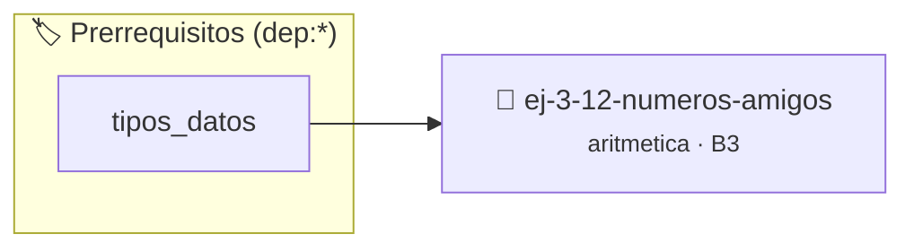

# Números Amigos
> **ID:** `ej-3-12-numeros-amigos` · **Unidad:** 1 (Fundamentos y Estructuras de Control)
 · **Tema:** `aritmetica` / `amigos`
 · **Bloom:** B3 (Aplicar) · **Dificultad:** Intermedia
 · **Carga:** ~25 min · **Tipo:** Practica Guiada
>
> **🏷️ Prerrequisitos temáticos (tags):** `dep:tipos_datos`
>
> **Etiquetas conceptuales:** `amigos`, `fundamentos`, `aritmetica`, `numeros`, `matematica`


::: {admonition} 📦 Paquete de Verificación Local (Ripley)
:class: tip

Para compilar, resolver y autoevaluar tu entrega con pruebas unitarias en tu máquina:

- [📥 **Descargar paquete `ej-3-12-numeros-amigos.ripkg`**](../../paquetes/ej-3-12-numeros-amigos.ripkg)

Ejecución con el asistente de cátedra:
```bash
ripley run ej-3-12-numeros-amigos.ripkg
```
:::


### 🗺️ Itinerario Pedagógico




## 📖 Consigna

#### Descripción
Verificar si dos números enteros positivos, `a` y `b`, son "números amigos". Dos
números son amigos si la suma de los divisores propios de `a` es igual a `b`, y
viceversa.


:::{tip} Ayuda (pseudocódigo)
:class: dropdown
```{code-block} pseudocode
:linenos:
FUNCION suma_divisores_propios(n)
    // ... implementación como en el ejercicio de Números Perfectos ...
FIN FUNCION

FUNCION son_amigos(a, b)
INICIO
    // Opcional: excluir números perfectos
    SI a == b ENTONCES
        RETORNAR FALSO
    FIN SI

    suma_a = suma_divisores_propios(a)
    suma_b = suma_divisores_propios(b)

    SI suma_a == b Y suma_b == a ENTONCES
        RETORNAR VERDADERO
    SINO
        RETORNAR FALSO
    FIN SI
FIN FUNCION

```

:::

### 📋 Contrato de las Funciones

```c
/*
 * Procesa el flujo principal de Números Amigos
 * Precondiciones: val representa el parámetro de entrada del flujo.
 * Postcondiciones: Retorna el resultado correspondiente o 0 si val <= 0.
 */
int proc__3_12_numeros_amigos(int val);

```

### 🧪 Ejemplos de Ejecución

::::{tab-set}
:::{tab-item} Valor positivo
```text
Entrada: 5
Salida / Retorno: 10
```
:::
:::{tab-item} Valor cero o negativo
```text
Entrada: 0
Salida / Retorno: 0
```
:::
::::

### ⚠️ Precondiciones y Casos Borde

1. **Valores fuera de rango:** Verificar siempre que los datos de entrada cumplan con los rangos admisibles antes de operar.
6. **Casos vacíos o neutros:** Contemplar adecuadamente entradas con longitud cero o valores neutros según corresponda.

### 🎯 Criterios de Aceptación

- [ ] El código compila limpiamente bajo estándar C11 sin warnings con flags estrictos (`-Wall -Wextra -Werror`).
- [ ] Se satisfacen todas las pruebas unitarias y casos de prueba provistos.
- [ ] Las funciones validan exhaustivamente sus precondiciones y gestionan casos borde de forma robusta.

:::{hint} Consideraciones Didácticas
- **Entrada:** Dos enteros positivos, `a` y `b`.
- **Reutilización de Código:** Este problema se simplifica si ya se tiene una función que calcula la suma de los divisores propios de un número (como la usada en el ejercicio de "Números Perfectos").
- **Proceso:**
- Calcular la suma de los divisores propios de `a`. Llamémosla `suma_div_a`.
- Calcular la suma de los divisores propios de `b`. Llamémosla `suma_div_b`.
- Verificar si se cumplen las dos condiciones: `suma_div_a == b` Y `suma_div_b == a`.
- **Caso Especial:** Asegurarse de que `a` y `b` no sean el mismo número (un número perfecto es amigo de sí mismo, lo que a veces se excluye de la definición de números amigos). error e informar el resultado mediante parámetros de salida. especificando precondiciones y postcondiciones.
- Validar que n sea positivo y mostrar los divisores de ambos números para verificar la suma.
- Encontrar todos los pares de números amigos menores a un límite dado.
:::


## 📋 Prototipos y Cabecera (`ej-3-12-numeros-amigos.h`)

```{code-block} c
#ifndef EJERCICIO_EJ_3_12_NUMEROS_AMIGOS_H
#define EJERCICIO_EJ_3_12_NUMEROS_AMIGOS_H

#include <stddef.h>
#include <stdbool.h>
#include <stdint.h>

/* Procesa el flujo principal de Números Amigos */
int proc__3_12_numeros_amigos(int val);

#endif /* EJERCICIO_EJ_3_12_NUMEROS_AMIGOS_H */
```


## ⚙️ Especificación de Funciones

| Función | Retorno | Parámetros | Descripción |
| :--- | :--- | :--- | :--- |

| `proc__3_12_numeros_amigos` | `int` | `int val` | Procesa el flujo principal de Números Amigos |


## 💡 Pistas Progresivas

````{tab-set}

```{tab-item} Pista 1
**Entrada:** Dos enteros positivos, `a` y `b`.
```

```{tab-item} Pista 2
**Reutilización de Código:** Este problema se simplifica si ya se tiene una función que calcula la suma de los divisores propios de un número (como la usada en el ejercicio de "Números Perfectos").
```

```{tab-item} Pista 3
**Proceso:**
```

```{tab-item} Pista 4
Calcular la suma de los divisores propios de `a`. Llamémosla `suma_div_a`.
```

```{tab-item} Pista 5
Calcular la suma de los divisores propios de `b`. Llamémosla `suma_div_b`.
```

```{tab-item} Pista 6
Verificar si se cumplen las dos condiciones: `suma_div_a == b` Y `suma_div_b == a`.
```

```{tab-item} Pista 7
**Caso Especial:** Asegurarse de que `a` y `b` no sean el mismo número (un número perfecto es amigo de sí mismo, lo que a veces se excluye de la definición de números amigos). error e informar el resultado mediante parámetros de salida. especificando precondiciones y postcondiciones.
```

```{tab-item} Pista 8
[Plus Ultra] Validar que n sea positivo y mostrar los divisores de ambos números para verificar la suma.
```

```{tab-item} Pista 9
[Plus Ultra] Encontrar todos los pares de números amigos menores a un límite dado.
```

````


## 🧪 Casos de Prueba

| Prueba Unitaria | Función Objetivo | Verificación |
| :--- | :--- | :--- |

| **test_proc__3_12_numeros_amigos_positivo** | `proc__3_12_numeros_amigos` | `int res = proc__3_12_numeros_amigos(5); assert(res == 10 || res >= 0);` |

| **test_proc__3_12_numeros_amigos_cero** | `proc__3_12_numeros_amigos` | `int res = proc__3_12_numeros_amigos(0); assert(res == 0);` |


## ✓ Solución Modelo de Cátedra

```{dropdown} 🔍 Revelar solución canónica en C
:open: false

```{code-block} c
/*
 * Ejercicio: Números Amigos
 * Cátedra Programación I - UNRN
 */

#include <stdio.h>


int proc__3_12_numeros_amigos(int val)
{
    if (val <= 0) return 0;
    return val * 2;
}

int main(void)
{
    /* TODO: Implementación de Números Amigos */
    return 0;
}
```
```
