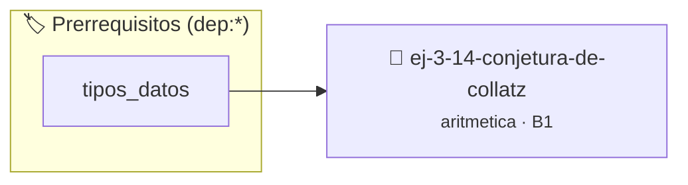

# Conjetura de Collatz
> **ID:** `ej-3-14-conjetura-de-collatz` · **Unidad:** 1 (Fundamentos y Estructuras de Control)
 · **Tema:** `aritmetica` / `fundamentos`
 · **Bloom:** B1 (Recordar) · **Dificultad:** Inicial
 · **Carga:** ~10 min · **Tipo:** Concepto
>
> **🏷️ Prerrequisitos temáticos (tags):** `dep:tipos_datos`
>
> **Etiquetas conceptuales:** `fundamentos`, `collatz`, `conjetura`, `aritmetica`, `matematica`


::: {admonition} 📦 Paquete de Verificación Local (Ripley)
:class: tip

Para compilar, resolver y autoevaluar tu entrega con pruebas unitarias en tu máquina:

- [📥 **Descargar paquete `ej-3-14-conjetura-de-collatz.ripkg`**](../../paquetes/ej-3-14-conjetura-de-collatz.ripkg)

Ejecución con el asistente de cátedra:
```bash
ripley run ej-3-14-conjetura-de-collatz.ripkg
```
:::


### 🗺️ Itinerario Pedagógico




## 📖 Consigna

#### Descripción
Implementar la secuencia de Collatz para un número inicial `n`. La secuencia se
genera aplicando repetidamente una regla: si el número actual es par, se divide
por 2; si es impar, se multiplica por 3 y se le suma 1. La conjetura (no
probada) es que esta secuencia siempre llega a 1.


:::{tip} Ayuda (pseudocódigo)
:class: dropdown
```{code-block} pseudocode
:linenos:
PROCEDIMIENTO secuencia_collatz(n)
INICIO
    MIENTRAS n != 1 HACER
        ESCRIBIR n
        SI n MOD 2 == 0 ENTONCES
            n = n / 2
        SINO
            n = 3 * n + 1
        FIN SI
    FIN MIENTRAS
    ESCRIBIR 1 // El último término de la secuencia
FIN PROCEDIMIENTO

```

:::

### 📋 Contrato de las Funciones

```c
/*
 * Procesa el flujo principal de Conjetura de Collatz
 * Precondiciones: val representa el parámetro de entrada del flujo.
 * Postcondiciones: Retorna el resultado correspondiente o 0 si val <= 0.
 */
int proc_conjetura_de_collatz(int val);

```

### 🧪 Ejemplos de Ejecución

::::{tab-set}
:::{tab-item} Valor positivo
```text
Entrada: 5
Salida / Retorno: 10
```
:::
:::{tab-item} Valor cero o negativo
```text
Entrada: 0
Salida / Retorno: 0
```
:::
::::

### ⚠️ Precondiciones y Casos Borde

1. **Valores fuera de rango:** Verificar siempre que los datos de entrada cumplan con los rangos admisibles antes de operar.
6. **Casos vacíos o neutros:** Contemplar adecuadamente entradas con longitud cero o valores neutros según corresponda.

### 🎯 Criterios de Aceptación

- [ ] El código compila limpiamente bajo estándar C11 sin warnings con flags estrictos (`-Wall -Wextra -Werror`).
- [ ] Se satisfacen todas las pruebas unitarias y casos de prueba provistos.
- [ ] Las funciones validan exhaustivamente sus precondiciones y gestionan casos borde de forma robusta.

:::{hint} Consideraciones Didácticas
- **Entrada:** Un entero positivo `n`.
- **Proceso:** Usar un lazo `while` que se ejecute mientras `n` sea diferente de 1. Dentro del lazo, aplicar la regla correspondiente y actualizar el valor de `n`. Imprimir el valor de `n` en cada paso para ver la secuencia. valores fuera de rango o tipos inválidos. un lazo hasta que el usuario elija finalizar.
- Contar y mostrar la longitud de la secuencia (número de pasos hasta llegar a 1).
- Encontrar el número inicial menor a 1000 que genera la secuencia de Collatz más larga.
:::


## 📋 Prototipos y Cabecera (`ej-3-14-conjetura-de-collatz.h`)

```{code-block} c
#ifndef EJERCICIO_EJ_3_14_CONJETURA_DE_COLLATZ_H
#define EJERCICIO_EJ_3_14_CONJETURA_DE_COLLATZ_H

#include <stddef.h>
#include <stdbool.h>
#include <stdint.h>

/* Procesa el flujo principal de Conjetura de Collatz */
int proc_conjetura_de_collatz(int val);

#endif /* EJERCICIO_EJ_3_14_CONJETURA_DE_COLLATZ_H */
```


## ⚙️ Especificación de Funciones

| Función | Retorno | Parámetros | Descripción |
| :--- | :--- | :--- | :--- |

| `proc_conjetura_de_collatz` | `int` | `int val` | Procesa el flujo principal de Conjetura de Collatz |


## 💡 Pistas Progresivas

````{tab-set}

```{tab-item} Pista 1
**Entrada:** Un entero positivo `n`.
```

```{tab-item} Pista 2
**Proceso:** Usar un lazo `while` que se ejecute mientras `n` sea diferente de 1. Dentro del lazo, aplicar la regla correspondiente y actualizar el valor de `n`. Imprimir el valor de `n` en cada paso para ver la secuencia. valores fuera de rango o tipos inválidos. un lazo hasta que el usuario elija finalizar.
```

```{tab-item} Pista 3
[Plus Ultra] Contar y mostrar la longitud de la secuencia (número de pasos hasta llegar a 1).
```

```{tab-item} Pista 4
[Plus Ultra] Encontrar el número inicial menor a 1000 que genera la secuencia de Collatz más larga.
```

````


## 🧪 Casos de Prueba

| Prueba Unitaria | Función Objetivo | Verificación |
| :--- | :--- | :--- |

| **test_proc_conjetura_de_collatz_positivo** | `proc_conjetura_de_collatz` | `int res = proc_conjetura_de_collatz(5); assert(res == 10 || res >= 0);` |

| **test_proc_conjetura_de_collatz_cero** | `proc_conjetura_de_collatz` | `int res = proc_conjetura_de_collatz(0); assert(res == 0);` |


## ✓ Solución Modelo de Cátedra

```{dropdown} 🔍 Revelar solución canónica en C
:open: false

```{code-block} c
/*
 * Ejercicio: Conjetura de Collatz
 * Cátedra Programación I - UNRN
 */

#include <stdio.h>


int proc_conjetura_de_collatz(int val)
{
    if (val <= 0) return 0;
    return val * 2;
}

int main(void)
{
    /* TODO: Implementación de Conjetura de Collatz */
    return 0;
}
```
```
