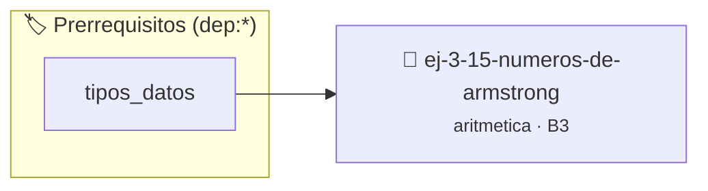

# Números de Armstrong
> **ID:** `ej-3-15-numeros-de-armstrong` · **Unidad:** 1 (Fundamentos y Estructuras de Control)
 · **Tema:** `aritmetica` / `fundamentos`
 · **Bloom:** B3 (Aplicar) · **Dificultad:** Intermedia
 · **Carga:** ~25 min · **Tipo:** Practica Guiada
>
> **🏷️ Prerrequisitos temáticos (tags):** `dep:tipos_datos`
>
> **Etiquetas conceptuales:** `fundamentos`, `armstrong`, `aritmetica`, `numeros`, `matematica`


::: {admonition} 📦 Paquete de Verificación Local (Ripley)
:class: tip

Para compilar, resolver y autoevaluar tu entrega con pruebas unitarias en tu máquina:

- [📥 **Descargar paquete `ej-3-15-numeros-de-armstrong.ripkg`**](../../paquetes/ej-3-15-numeros-de-armstrong.ripkg)

Ejecución con el asistente de cátedra:
```bash
ripley run ej-3-15-numeros-de-armstrong.ripkg
```
:::


### 🗺️ Itinerario Pedagógico




## 📖 Consigna

#### Descripción
Verificar si un número es un número de Armstrong (o narcisista). Un número de
`k` dígitos es de Armstrong si es igual a la suma de sus propios dígitos
elevados a la potencia `k`.


:::{tip} Ayuda (pseudocódigo)
:class: dropdown
```{code-block} pseudocode
:linenos:

FUNCION es_armstrong(n)
VARIABLES:
    k, suma, temp, digito (enteros)
INICIO
    k = contar_digitos(n)
    suma = 0
    temp = n

    MIENTRAS temp > 0 HACER
        digito = temp MOD 10
        suma = suma + potencia(digito, k)
        temp = temp / 10
    FIN MIENTRAS

    RETORNAR (suma == n)
FIN FUNCION

```

:::

### 📋 Contrato de las Funciones

```c
/*
 * Procesa el flujo principal de Números de Armstrong
 * Precondiciones: val representa el parámetro de entrada del flujo.
 * Postcondiciones: Retorna el resultado correspondiente o 0 si val <= 0.
 */
int proc_numeros_de_armstrong(int val);

```

### 🧪 Ejemplos de Ejecución

::::{tab-set}
:::{tab-item} Valor positivo
```text
Entrada: 5
Salida / Retorno: 10
```
:::
:::{tab-item} Valor cero o negativo
```text
Entrada: 0
Salida / Retorno: 0
```
:::
::::

### ⚠️ Precondiciones y Casos Borde

1. **Valores fuera de rango:** Verificar siempre que los datos de entrada cumplan con los rangos admisibles antes de operar.
6. **Casos vacíos o neutros:** Contemplar adecuadamente entradas con longitud cero o valores neutros según corresponda.

### 🎯 Criterios de Aceptación

- [ ] El código compila limpiamente bajo estándar C11 sin warnings con flags estrictos (`-Wall -Wextra -Werror`).
- [ ] Se satisfacen todas las pruebas unitarias y casos de prueba provistos.
- [ ] Las funciones validan exhaustivamente sus precondiciones y gestionan casos borde de forma robusta.

:::{hint} Consideraciones Didácticas
- **Entrada:** Un entero `n`.
- **Proceso:**
- Contar el número de dígitos (`k`) del número `n`.
- Inicializar un acumulador `suma` en 0.
- Recorrer los dígitos de `n` (usando `% 10` y `/ 10`). Para cada dígito, calcular `digito^k` y añadirlo a la `suma`.
- Comparar la `suma` final con el número original `n`. desbordamientos de búfer validando la capacidad máxima. líneas de manera robusta.
- Determinar automáticamente la cantidad de dígitos del número antes de calcular las potencias.
- Encontrar todos los números de Armstrong de 3 y 4 dígitos.
:::


## 📋 Prototipos y Cabecera (`ej-3-15-numeros-de-armstrong.h`)

```{code-block} c
#ifndef EJERCICIO_EJ_3_15_NUMEROS_DE_ARMSTRONG_H
#define EJERCICIO_EJ_3_15_NUMEROS_DE_ARMSTRONG_H

#include <stddef.h>
#include <stdbool.h>
#include <stdint.h>

/* Procesa el flujo principal de Números de Armstrong */
int proc_numeros_de_armstrong(int val);

#endif /* EJERCICIO_EJ_3_15_NUMEROS_DE_ARMSTRONG_H */
```


## ⚙️ Especificación de Funciones

| Función | Retorno | Parámetros | Descripción |
| :--- | :--- | :--- | :--- |

| `proc_numeros_de_armstrong` | `int` | `int val` | Procesa el flujo principal de Números de Armstrong |


## 💡 Pistas Progresivas

````{tab-set}

```{tab-item} Pista 1
**Entrada:** Un entero `n`.
```

```{tab-item} Pista 2
**Proceso:**
```

```{tab-item} Pista 3
Contar el número de dígitos (`k`) del número `n`.
```

```{tab-item} Pista 4
Inicializar un acumulador `suma` en 0.
```

```{tab-item} Pista 5
Recorrer los dígitos de `n` (usando `% 10` y `/ 10`). Para cada dígito, calcular `digito^k` y añadirlo a la `suma`.
```

```{tab-item} Pista 6
Comparar la `suma` final con el número original `n`. desbordamientos de búfer validando la capacidad máxima. líneas de manera robusta.
```

```{tab-item} Pista 7
[Plus Ultra] Determinar automáticamente la cantidad de dígitos del número antes de calcular las potencias.
```

```{tab-item} Pista 8
[Plus Ultra] Encontrar todos los números de Armstrong de 3 y 4 dígitos.
```

````


## 🧪 Casos de Prueba

| Prueba Unitaria | Función Objetivo | Verificación |
| :--- | :--- | :--- |

| **test_proc_numeros_de_armstrong_positivo** | `proc_numeros_de_armstrong` | `int res = proc_numeros_de_armstrong(5); assert(res == 10 || res >= 0);` |

| **test_proc_numeros_de_armstrong_cero** | `proc_numeros_de_armstrong` | `int res = proc_numeros_de_armstrong(0); assert(res == 0);` |


## ✓ Solución Modelo de Cátedra

```{dropdown} 🔍 Revelar solución canónica en C
:open: false

```{code-block} c
/*
 * Ejercicio: Números de Armstrong
 * Cátedra Programación I - UNRN
 */

#include <stdio.h>


int proc_numeros_de_armstrong(int val)
{
    if (val <= 0) return 0;
    return val * 2;
}

int main(void)
{
    /* TODO: Implementación de Números de Armstrong */
    return 0;
}
```
```
