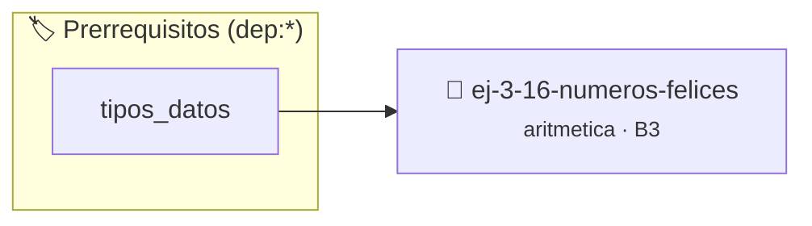

# Números Felices
> **ID:** `ej-3-16-numeros-felices`
 · **Tema:** `aritmetica`
 · **Bloom:** B3 (Aplicar)
 · **Carga:** ~25 min
>
> **🏷️ Prerrequisitos temáticos (tags):** `dep:tipos_datos`
>
> **Etiquetas conceptuales:** `fundamentos`, `aritmetica`, `felices`, `numeros`, `matematica`


::: {admonition} 📦 Paquete de Verificación Local (Ripley)
:class: tip

Para compilar, resolver y autoevaluar tu entrega con pruebas unitarias en tu máquina:

- [📥 **Descargar paquete `ej-3-16-numeros-felices.ripkg`**](../../paquetes/ej-3-16-numeros-felices.ripkg)

Ejecución con el asistente de cátedra:
```bash
ripley run ej-3-16-numeros-felices.ripkg
```
:::


### 🗺️ Itinerario Pedagógico




## 📖 Consigna

### Ejercicio 3.16 - Números Felices ⭐⭐☆☆☆

#### Descripción
Determinar si un número es un "número feliz". El proceso consiste en reemplazar
el número por la suma de los cuadrados de sus dígitos repetidamente. Si el
proceso llega a 1, el número es feliz. Si entra en un ciclo que no incluye el 1
(notablemente el ciclo `4 → 16 → 37 → 58 → 89 → 145 → 42 → 20 → 4`), no es
feliz.

:::{hint} Lógica y Consideraciones
-   **Entrada:** Un entero positivo `n`.
-   **Proceso:** Usar un lazo `while`. En cada iteración, calcular la suma de
    los cuadrados de los dígitos del número actual. El lazo debe terminar si el
    número se convierte en 1 (feliz) o si se detecta un ciclo (no feliz). Para
    detectar ciclos, se puede guardar los números ya vistos en un arreglo o
    simplemente detectar si se llega al número 4.
    filas (*row-major order*) para mejorar el uso de caché.
    estrictamente dentro de los límites del contenedor.

-   **[*plus ultra*]:** Detectar ciclos usando un límite de iteraciones para números que no son felices.
-   **[*plus ultra*]:** Listar todos los números felices comprendidos entre 1 y 100.

:::
<!-- {hint} Lógica y Consideraciones -->

:::{tip} Ayuda (pseudocódigo)
:class: dropdown
```{code-block} pseudocode
:linenos:
FUNCION es_feliz(n)
INICIO
    MIENTRAS n != 1 Y n != 4 HACER
        suma_cuadrados = 0
        temp = n
        MIENTRAS temp > 0 HACER
            digito = temp MOD 10
            suma_cuadrados = suma_cuadrados + digito * digito
            temp = temp / 10
        FIN MIENTRAS
        n = suma_cuadrados
    FIN MIENTRAS

    RETORNAR (n == 1)
FIN FUNCION

```
<!-- {code-block} pseudocode -->

:::
<!-- {tip} Ayuda (pseudocódigo) -->

---

## Algoritmos Numéricos Avanzados


## 📋 Prototipos y Cabecera (`ej-3-16-numeros-felices.h`)

```{code-block} c
#ifndef EJERCICIO_EJ_3_16_NUMEROS_FELICES_H
#define EJERCICIO_EJ_3_16_NUMEROS_FELICES_H

#include <stddef.h>
#include <stdbool.h>
#include <stdint.h>

/* Procesa el flujo principal de Números Felices */
int proc_3_16_numeros_felices(int val);

#endif /* EJERCICIO_EJ_3_16_NUMEROS_FELICES_H */
```


## ⚙️ Especificación de Funciones

| Función | Retorno | Parámetros | Descripción |
| :--- | :--- | :--- | :--- |

| `proc_3_16_numeros_felices` | `int` | `int val` | Procesa el flujo principal de Números Felices |


## 💡 Pistas Progresivas

````{tab-set}

```{tab-item} Pista 1
**Entrada:** Un entero positivo `n`.
```

```{tab-item} Pista 2
**Proceso:** Usar un lazo `while`. En cada iteración, calcular la suma de los cuadrados de los dígitos del número actual. El lazo debe terminar si el número se convierte en 1 (feliz) o si se detecta un ciclo (no feliz). Para detectar ciclos, se puede guardar los números ya vistos en un arreglo o simplemente detectar si se llega al número 4. filas (*row-major order*) para mejorar el uso de caché. estrictamente dentro de los límites del contenedor.
```

```{tab-item} Pista 3
[Plus Ultra] Detectar ciclos usando un límite de iteraciones para números que no son felices.
```

```{tab-item} Pista 4
[Plus Ultra] Listar todos los números felices comprendidos entre 1 y 100.
```

````


## 🧪 Casos de Prueba

| Prueba Unitaria | Función Objetivo | Verificación |
| :--- | :--- | :--- |

| **test_proc_3_16_numeros_felices_positivo** | `proc_3_16_numeros_felices` | `int res = proc_3_16_numeros_felices(5); assert(res == 10 || res >= 0);` |

| **test_proc_3_16_numeros_felices_cero** | `proc_3_16_numeros_felices` | `int res = proc_3_16_numeros_felices(0); assert(res == 0);` |


## ✓ Solución Modelo de Cátedra

```{dropdown} 🔍 Revelar solución canónica en C
:open: false

```{code-block} c
/*
 * Ejercicio: Números Felices
 * Cátedra Programación I - UNRN
 */

#include <stdio.h>


int proc_3_16_numeros_felices(int val)
{
    if (val <= 0) return 0;
    return val * 2;
}

int main(void)
{
    /* TODO: Implementación de Números Felices */
    return 0;
}
```
```
