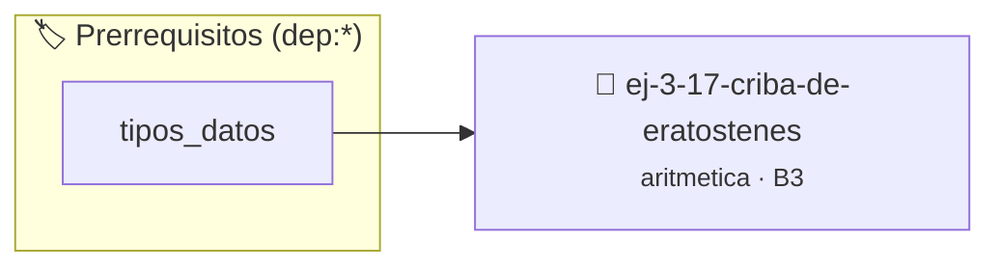

# Criba de Eratóstenes
> **ID:** `ej-3-17-criba-de-eratostenes` · **Unidad:** 1 (Fundamentos y Estructuras de Control)
 · **Tema:** `aritmetica` / `fundamentos`
 · **Bloom:** B3 (Aplicar) · **Dificultad:** Intermedia
 · **Carga:** ~25 min · **Tipo:** Practica Guiada
>
> **🏷️ Prerrequisitos temáticos (tags):** `dep:tipos_datos`
>
> **Etiquetas conceptuales:** `fundamentos`, `eratostenes`, `aritmetica`, `matematica`, `criba`


::: {admonition} 📦 Paquete de Verificación Local (Ripley)
:class: tip

Para compilar, resolver y autoevaluar tu entrega con pruebas unitarias en tu máquina:

- [📥 **Descargar paquete `ej-3-17-criba-de-eratostenes.ripkg`**](../../paquetes/ej-3-17-criba-de-eratostenes.ripkg)

Ejecución con el asistente de cátedra:
```bash
ripley run ej-3-17-criba-de-eratostenes.ripkg
```
:::


### 🗺️ Itinerario Pedagógico




## 📖 Consigna

#### Descripción
Implementar la Criba de Eratóstenes, un algoritmo altamente eficiente para
encontrar todos los números primos hasta un límite superior $N$ especificado.


:::{tip} Ayuda (pseudocódigo)
:class: dropdown
```{code-block} pseudocode
:linenos:
PROCEDIMIENTO criba_eratostenes(N)
VARIABLES:
    es_primo (arreglo booleano de tamaño N+1)

INICIO
    // Inicialización
    PARA i DESDE 0 HASTA N HACER
        es_primo[i] = VERDADERO
    FIN PARA
    es_primo[0] = FALSO, es_primo[1] = FALSO

    // Marcado de múltiplos
    PARA p DESDE 2 HASTA RAIZ_CUADRADA(N) HACER
        SI es_primo[p] == VERDADERO ENTONCES
            PARA i DESDE p*p HASTA N CON PASO p HACER
                es_primo[i] = FALSO
            FIN PARA
        FIN SI
    FIN PARA

    // Imprimir resultados
    ESCRIBIR "Números primos hasta ", N, ":"
    PARA i DESDE 2 HASTA N HACER
        SI es_primo[i] == VERDADERO ENTONCES
            ESCRIBIR i
        FIN SI
    FIN PARA
FIN PROCEDIMIENTO

```

:::

### 📋 Contrato de las Funciones

```c
/*
 * Procesa el flujo principal de Criba de Eratóstenes
 * Precondiciones: val representa el parámetro de entrada del flujo.
 * Postcondiciones: Retorna el resultado correspondiente o 0 si val <= 0.
 */
int proc_criba_de_eratostenes(int val);

```

### 🧪 Ejemplos de Ejecución

::::{tab-set}
:::{tab-item} Valor positivo
```text
Entrada: 5
Salida / Retorno: 10
```
:::
:::{tab-item} Valor cero o negativo
```text
Entrada: 0
Salida / Retorno: 0
```
:::
::::

### ⚠️ Precondiciones y Casos Borde

1. **Valores fuera de rango:** Verificar siempre que los datos de entrada cumplan con los rangos admisibles antes de operar.
6. **Casos vacíos o neutros:** Contemplar adecuadamente entradas con longitud cero o valores neutros según corresponda.

### 🎯 Criterios de Aceptación

- [ ] El código compila limpiamente bajo estándar C11 sin warnings con flags estrictos (`-Wall -Wextra -Werror`).
- [ ] Se satisfacen todas las pruebas unitarias y casos de prueba provistos.
- [ ] Las funciones validan exhaustivamente sus precondiciones y gestionan casos borde de forma robusta.

:::{hint} Consideraciones Didácticas
- **Estructura de Datos:** Se necesita un arreglo booleano (o de enteros) `es_primo` de tamaño `N+1`. `es_primo[i]` será verdadero si `i` es primo y falso en caso contrario.
- **Inicialización:** Se inicializa todo el arreglo a `verdadero`, asumiendo que todos los números son primos al principio. Luego, se marcan 0 y 1 como no primos.
- **Proceso:**
- Se itera con un número `p` desde 2 hasta $\sqrt{N}$.
- Si `p` sigue marcado como primo (`es_primo[p]` es verdadero): a. Se itera a través de todos los múltiplos de `p` (comenzando desde `p*p`) y se marcan como no primos (`es_primo[multiplo] = falso`). Se empieza en `p*p` porque los múltiplos menores ya habrán sido marcados por primos más pequeños.
- **Salida:** Al final, se recorre el arreglo `es_primo` y se imprimen todos los índices `i` para los cuales `es_primo[i]` es verdadero. desbordamientos de búfer validando la capacidad máxima. líneas de manera robusta.
- Validar que el límite superior sea mayor a 1 y usar un arreglo de tamaño fijo para marcar primos.
- Mostrar la cantidad total de primos encontrados y el porcentaje que representan en el rango.
:::


## 📋 Prototipos y Cabecera (`ej-3-17-criba-de-eratostenes.h`)

```{code-block} c
#ifndef EJERCICIO_EJ_3_17_CRIBA_DE_ERATOSTENES_H
#define EJERCICIO_EJ_3_17_CRIBA_DE_ERATOSTENES_H

#include <stddef.h>
#include <stdbool.h>
#include <stdint.h>

/* Procesa el flujo principal de Criba de Eratóstenes */
int proc_criba_de_eratostenes(int val);

#endif /* EJERCICIO_EJ_3_17_CRIBA_DE_ERATOSTENES_H */
```


## ⚙️ Especificación de Funciones

| Función | Retorno | Parámetros | Descripción |
| :--- | :--- | :--- | :--- |

| `proc_criba_de_eratostenes` | `int` | `int val` | Procesa el flujo principal de Criba de Eratóstenes |


## 💡 Pistas Progresivas

````{tab-set}

```{tab-item} Pista 1
**Estructura de Datos:** Se necesita un arreglo booleano (o de enteros) `es_primo` de tamaño `N+1`. `es_primo[i]` será verdadero si `i` es primo y falso en caso contrario.
```

```{tab-item} Pista 2
**Inicialización:** Se inicializa todo el arreglo a `verdadero`, asumiendo que todos los números son primos al principio. Luego, se marcan 0 y 1 como no primos.
```

```{tab-item} Pista 3
**Proceso:**
```

```{tab-item} Pista 4
Se itera con un número `p` desde 2 hasta $\sqrt{N}$.
```

```{tab-item} Pista 5
Si `p` sigue marcado como primo (`es_primo[p]` es verdadero): a. Se itera a través de todos los múltiplos de `p` (comenzando desde `p*p`) y se marcan como no primos (`es_primo[multiplo] = falso`). Se empieza en `p*p` porque los múltiplos menores ya habrán sido marcados por primos más pequeños.
```

```{tab-item} Pista 6
**Salida:** Al final, se recorre el arreglo `es_primo` y se imprimen todos los índices `i` para los cuales `es_primo[i]` es verdadero. desbordamientos de búfer validando la capacidad máxima. líneas de manera robusta.
```

```{tab-item} Pista 7
[Plus Ultra] Validar que el límite superior sea mayor a 1 y usar un arreglo de tamaño fijo para marcar primos.
```

```{tab-item} Pista 8
[Plus Ultra] Mostrar la cantidad total de primos encontrados y el porcentaje que representan en el rango.
```

````


## 🧪 Casos de Prueba

| Prueba Unitaria | Función Objetivo | Verificación |
| :--- | :--- | :--- |

| **test_proc_criba_de_eratostenes_positivo** | `proc_criba_de_eratostenes` | `int res = proc_criba_de_eratostenes(5); assert(res == 10 || res >= 0);` |

| **test_proc_criba_de_eratostenes_cero** | `proc_criba_de_eratostenes` | `int res = proc_criba_de_eratostenes(0); assert(res == 0);` |


## ✓ Solución Modelo de Cátedra

```{dropdown} 🔍 Revelar solución canónica en C
:open: false

```{code-block} c
/*
 * Ejercicio: Criba de Eratóstenes
 * Cátedra Programación I - UNRN
 */

#include <stdio.h>


int proc_criba_de_eratostenes(int val)
{
    if (val <= 0) return 0;
    return val * 2;
}

int main(void)
{
    /* TODO: Implementación de Criba de Eratóstenes */
    return 0;
}
```
```
