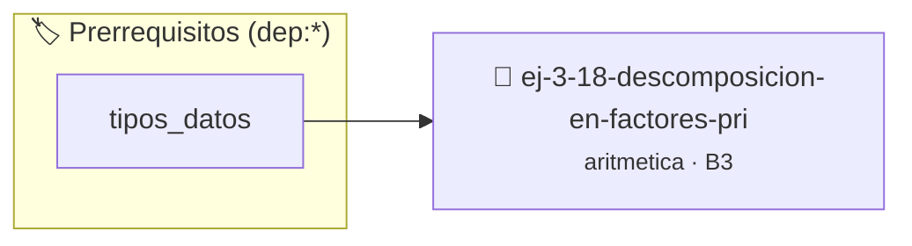

# Descomposición en Factores Primos
> **ID:** `ej-3-18-descomposicion-en-factores-pri` · **Unidad:** 1 (Fundamentos y Estructuras de Control)
 · **Tema:** `aritmetica` / `teoria_numeros`
 · **Bloom:** B3 (Aplicar) · **Dificultad:** Intermedia
 · **Carga:** ~25 min · **Tipo:** Practica Guiada
>
> **🏷️ Prerrequisitos temáticos (tags):** `dep:tipos_datos`
>
> **Etiquetas conceptuales:** `fundamentos`, `descomposicion`, `aritmetica`, `primos`, `factores`


::: {admonition} 📦 Paquete de Verificación Local (Ripley)
:class: tip

Para compilar, resolver y autoevaluar tu entrega con pruebas unitarias en tu máquina:

- [📥 **Descargar paquete `ej-3-18-descomposicion-en-factores-pri.ripkg`**](../../paquetes/ej-3-18-descomposicion-en-factores-pri.ripkg)

Ejecución con el asistente de cátedra:
```bash
ripley run ej-3-18-descomposicion-en-factores-pri.ripkg
```
:::


### 🗺️ Itinerario Pedagógico




## 📖 Consigna

### Ejercicio 3.18 - Descomposición en Factores Primos ⭐⭐☆☆☆

#### Descripción
Dado un número entero, encontrar y mostrar su descomposición en factores primos.
Por ejemplo, para 360, la salida sería `2^3 * 3^2 * 5`.

:::{hint} Lógica y Consideraciones
-   **Entrada:** Un entero `n`.
-   **Proceso:** 
    1.  Se itera con un divisor `d` comenzando en 2.
    2.  Mientras `d*d <= n`, se verifica si `d` divide a `n`.
    3.  Si `d` divide a `n`, se cuenta cuántas veces lo divide, se imprime el
        factor y su potencia, y se actualiza `n` dividiéndolo por `d` esa
        cantidad de veces.
    4.  Si al final del lazo `n` es mayor que 1, ese `n` restante es también un
        factor primo.
    desbordamientos de búfer validando la capacidad máxima.
    líneas de manera robusta.

-   **[*plus ultra*]:** Mostrar los factores primos en formato canónico con exponentes (ej. 2^3 * 3^2).
-   **[*plus ultra*]:** Validar que el número a factorizar sea mayor que 1.

:::
<!-- {hint} Lógica y Consideraciones -->

:::{tip} Ayuda (pseudocódigo)
:class: dropdown
```{code-block} pseudocode
:linenos:
PROCEDIMIENTO factores_primos(n)
VARIABLES:
    contador (entero)
INICIO
    // Manejar el factor 2
    contador = 0
    MIENTRAS n MOD 2 == 0 HACER
        contador = contador + 1
        n = n / 2
    FIN MIENTRAS
    SI contador > 0 ENTONCES ESCRIBIR "2^", contador

    // Manejar factores impares
    PARA i DESDE 3 HASTA RAIZ_CUADRADA(n) CON PASO 2 HACER
        contador = 0
        MIENTRAS n MOD i == 0 HACER
            contador = contador + 1
            n = n / i
        FIN MIENTRAS
        SI contador > 0 ENTONCES ESCRIBIR i, "^", contador
    FIN PARA

    // Si n es primo > 2
    SI n > 2 ENTONCES
        ESCRIBIR n, "^1"
    FIN SI
FIN PROCEDIMIENTO

```
<!-- {code-block} pseudocode -->

:::
<!-- {tip} Ayuda (pseudocódigo) -->


## 📋 Prototipos y Cabecera (`ej-3-18-descomposicion-en-factores-pri.h`)

```{code-block} c
#ifndef EJERCICIO_EJ_3_18_DESCOMPOSICION_EN_FACTORES_PRI_H
#define EJERCICIO_EJ_3_18_DESCOMPOSICION_EN_FACTORES_PRI_H

#include <stddef.h>
#include <stdbool.h>
#include <stdint.h>

/* Procesa el flujo principal de Descomposición en Factores Primos */
int proc_cion_en_factores_pri(int val);

#endif /* EJERCICIO_EJ_3_18_DESCOMPOSICION_EN_FACTORES_PRI_H */
```


## ⚙️ Especificación de Funciones

| Función | Retorno | Parámetros | Descripción |
| :--- | :--- | :--- | :--- |

| `proc_cion_en_factores_pri` | `int` | `int val` | Procesa el flujo principal de Descomposición en Factores Primos |


## 💡 Pistas Progresivas

````{tab-set}

```{tab-item} Pista 1
**Entrada:** Un entero `n`.
```

```{tab-item} Pista 2
**Proceso:**
```

```{tab-item} Pista 3
Se itera con un divisor `d` comenzando en 2.
```

```{tab-item} Pista 4
Mientras `d*d <= n`, se verifica si `d` divide a `n`.
```

```{tab-item} Pista 5
Si `d` divide a `n`, se cuenta cuántas veces lo divide, se imprime el factor y su potencia, y se actualiza `n` dividiéndolo por `d` esa cantidad de veces.
```

```{tab-item} Pista 6
Si al final del lazo `n` es mayor que 1, ese `n` restante es también un factor primo. desbordamientos de búfer validando la capacidad máxima. líneas de manera robusta.
```

```{tab-item} Pista 7
[Plus Ultra] Mostrar los factores primos en formato canónico con exponentes (ej. 2^3 * 3^2).
```

```{tab-item} Pista 8
[Plus Ultra] Validar que el número a factorizar sea mayor que 1.
```

````


## 🧪 Casos de Prueba

| Prueba Unitaria | Función Objetivo | Verificación |
| :--- | :--- | :--- |

| **test_proc_cion_en_factores_pri_positivo** | `proc_cion_en_factores_pri` | `int res = proc_cion_en_factores_pri(5); assert(res == 10 || res >= 0);` |

| **test_proc_cion_en_factores_pri_cero** | `proc_cion_en_factores_pri` | `int res = proc_cion_en_factores_pri(0); assert(res == 0);` |


## ✓ Solución Modelo de Cátedra

```{dropdown} 🔍 Revelar solución canónica en C
:open: false

```{code-block} c
/*
 * Ejercicio: Descomposición en Factores Primos
 * Cátedra Programación I - UNRN
 */

#include <stdio.h>


int proc_cion_en_factores_pri(int val)
{
    if (val <= 0) return 0;
    return val * 2;
}

int main(void)
{
    /* TODO: Implementación de Descomposición en Factores Primos */
    return 0;
}
```
```
