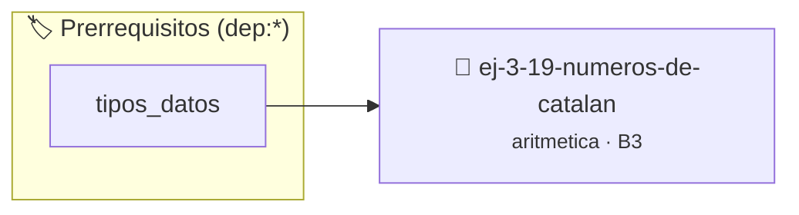

# Números de Catalan
> **ID:** `ej-3-19-numeros-de-catalan` · **Unidad:** 1 (Fundamentos y Estructuras de Control)
 · **Tema:** `aritmetica` / `catalan`
 · **Bloom:** B3 (Aplicar) · **Dificultad:** Intermedia
 · **Carga:** ~25 min · **Tipo:** Practica Guiada
>
> **🏷️ Prerrequisitos temáticos (tags):** `dep:tipos_datos`
>
> **Etiquetas conceptuales:** `catalan`, `fundamentos`, `aritmetica`, `numeros`, `matematica`


::: {admonition} 📦 Paquete de Verificación Local (Ripley)
:class: tip

Para compilar, resolver y autoevaluar tu entrega con pruebas unitarias en tu máquina:

- [📥 **Descargar paquete `ej-3-19-numeros-de-catalan.ripkg`**](../../paquetes/ej-3-19-numeros-de-catalan.ripkg)

Ejecución con el asistente de cátedra:
```bash
ripley run ej-3-19-numeros-de-catalan.ripkg
```
:::


### 🗺️ Itinerario Pedagógico




## 📖 Consigna

#### Descripción
Implementar una función que calcule el n-ésimo número de Catalan, $C_n$. Estos
números forman una secuencia de números naturales que aparece en varios
problemas de conteo en combinatoria.


:::{tip} Ayuda (pseudocódigo)
:class: dropdown
```{code-block} pseudocode
:linenos:
FUNCION coeficiente_binomial(n, k)
    SI k < 0 O k > n ENTONCES
        RETORNAR 0
    FIN SI
    SI k == 0 O k == n ENTONCES
        RETORNAR 1
    FIN SI
    SI k > n / 2 ENTONCES
        k = n - k
    FIN SI

    resultado = 1
    PARA i DESDE 1 HASTA k HACER
        resultado = resultado * (n - i + 1) / i
    FIN PARA
    RETORNAR resultado
FIN FUNCION

FUNCION numero_catalan(n)
INICIO
    // C_n = C(2n, n) / (n+1)
    c = coeficiente_binomial(2 * n, n)
    RETORNAR c / (n + 1)
FIN FUNCION

```

:::

### 📋 Contrato de las Funciones

```c
/*
 * Procesa el flujo principal de Números de Catalan
 * Precondiciones: val representa el parámetro de entrada del flujo.
 * Postcondiciones: Retorna el resultado correspondiente o 0 si val <= 0.
 */
int proc_9_numeros_de_catalan(int val);

```

### 🧪 Ejemplos de Ejecución

::::{tab-set}
:::{tab-item} Valor positivo
```text
Entrada: 5
Salida / Retorno: 10
```
:::
:::{tab-item} Valor cero o negativo
```text
Entrada: 0
Salida / Retorno: 0
```
:::
::::

### ⚠️ Precondiciones y Casos Borde

1. **Valores fuera de rango:** Verificar siempre que los datos de entrada cumplan con los rangos admisibles antes de operar.
6. **Casos vacíos o neutros:** Contemplar adecuadamente entradas con longitud cero o valores neutros según corresponda.

### 🎯 Criterios de Aceptación

- [ ] El código compila limpiamente bajo estándar C11 sin warnings con flags estrictos (`-Wall -Wextra -Werror`).
- [ ] Se satisfacen todas las pruebas unitarias y casos de prueba provistos.
- [ ] Las funciones validan exhaustivamente sus precondiciones y gestionan casos borde de forma robusta.

:::{hint} Consideraciones Didácticas
- **Entrada:** Un entero no negativo `n`.
- **Fórmula:** La fórmula más directa es $C_n = \frac{1}{n+1} \binom{2n}{n}$. Para calcularla, se necesita una función para el coeficiente binomial $\binom{n}{k}$.
- **Coeficiente Binomial:** $\binom{n}{k}$ se puede calcular como $\frac{n!}{k!(n-k)!}$. Sin embargo, calcular los factoriales directamente puede causar desbordamiento muy rápido. Una forma más segura es calcularlo iterativamente: $\binom{n}{k} = \prod_{i=1}^{k} \frac{n-i+1}{i}$.
- **Proceso:**
- Implementar una función `coeficiente_binomial(n, k)`.
- La función `numero_catalan(n)` llamará a `coeficiente_binomial(2*n, n)` y dividirá el resultado por `n+1`. definición interna oculta en el archivo `.c`. para copiar la estructura de forma segura.
- Calcular el n-ésimo número de Catalan simplificando factores para evitar desbordamiento temprano.
- Mostrar los primeros N términos de la secuencia de Catalan.
:::


## 📋 Prototipos y Cabecera (`ej-3-19-numeros-de-catalan.h`)

```{code-block} c
#ifndef EJERCICIO_EJ_3_19_NUMEROS_DE_CATALAN_H
#define EJERCICIO_EJ_3_19_NUMEROS_DE_CATALAN_H

#include <stddef.h>
#include <stdbool.h>
#include <stdint.h>

/* Procesa el flujo principal de Números de Catalan */
int proc_9_numeros_de_catalan(int val);

#endif /* EJERCICIO_EJ_3_19_NUMEROS_DE_CATALAN_H */
```


## ⚙️ Especificación de Funciones

| Función | Retorno | Parámetros | Descripción |
| :--- | :--- | :--- | :--- |

| `proc_9_numeros_de_catalan` | `int` | `int val` | Procesa el flujo principal de Números de Catalan |


## 💡 Pistas Progresivas

````{tab-set}

```{tab-item} Pista 1
**Entrada:** Un entero no negativo `n`.
```

```{tab-item} Pista 2
**Fórmula:** La fórmula más directa es $C_n = \frac{1}{n+1} \binom{2n}{n}$. Para calcularla, se necesita una función para el coeficiente binomial $\binom{n}{k}$.
```

```{tab-item} Pista 3
**Coeficiente Binomial:** $\binom{n}{k}$ se puede calcular como $\frac{n!}{k!(n-k)!}$. Sin embargo, calcular los factoriales directamente puede causar desbordamiento muy rápido. Una forma más segura es calcularlo iterativamente: $\binom{n}{k} = \prod_{i=1}^{k} \frac{n-i+1}{i}$.
```

```{tab-item} Pista 4
**Proceso:**
```

```{tab-item} Pista 5
Implementar una función `coeficiente_binomial(n, k)`.
```

```{tab-item} Pista 6
La función `numero_catalan(n)` llamará a `coeficiente_binomial(2*n, n)` y dividirá el resultado por `n+1`. definición interna oculta en el archivo `.c`. para copiar la estructura de forma segura.
```

```{tab-item} Pista 7
[Plus Ultra] Calcular el n-ésimo número de Catalan simplificando factores para evitar desbordamiento temprano.
```

```{tab-item} Pista 8
[Plus Ultra] Mostrar los primeros N términos de la secuencia de Catalan.
```

````


## 🧪 Casos de Prueba

| Prueba Unitaria | Función Objetivo | Verificación |
| :--- | :--- | :--- |

| **test_proc_9_numeros_de_catalan_positivo** | `proc_9_numeros_de_catalan` | `int res = proc_9_numeros_de_catalan(5); assert(res == 10 || res >= 0);` |

| **test_proc_9_numeros_de_catalan_cero** | `proc_9_numeros_de_catalan` | `int res = proc_9_numeros_de_catalan(0); assert(res == 0);` |


## ✓ Solución Modelo de Cátedra

```{dropdown} 🔍 Revelar solución canónica en C
:open: false

```{code-block} c
/*
 * Ejercicio: Números de Catalan
 * Cátedra Programación I - UNRN
 */

#include <stdio.h>


int proc_9_numeros_de_catalan(int val)
{
    if (val <= 0) return 0;
    return val * 2;
}

int main(void)
{
    /* TODO: Implementación de Números de Catalan */
    return 0;
}
```
```
