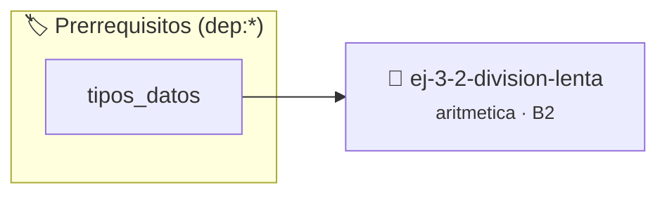

# División lenta
> **ID:** `ej-3-2-division-lenta` · **Unidad:** 1 (Fundamentos y Estructuras de Control)
 · **Tema:** `aritmetica` / `fundamentos`
 · **Bloom:** B2 (Comprender) · **Dificultad:** Inicial
 · **Carga:** ~15 min · **Tipo:** Practica Guiada
>
> **🏷️ Prerrequisitos temáticos (tags):** `dep:tipos_datos`
>
> **Etiquetas conceptuales:** `fundamentos`, `lenta`, `aritmetica`, `matematica`, `division`


::: {admonition} 📦 Paquete de Verificación Local (Ripley)
:class: tip

Para compilar, resolver y autoevaluar tu entrega con pruebas unitarias en tu máquina:

- [📥 **Descargar paquete `ej-3-2-division-lenta.ripkg`**](../../paquetes/ej-3-2-division-lenta.ripkg)

Ejecución con el asistente de cátedra:
```bash
ripley run ej-3-2-division-lenta.ripkg
```
:::


### 🗺️ Itinerario Pedagógico




## 📖 Consigna

#### Descripción
Implementar la función `int division_lenta(int dividendo, int divisor);` que calcula el cociente entero de la división de dos enteros mediante restas sucesivas. Este método emula cómo se realiza una división entera sin utilizar el operador `/`.


:::{tip} Ayuda (pseudocódigo)
:class: dropdown
```{code-block} pseudocode
:linenos:
FUNCION division_lenta(dividendo, divisor)
VARIABLES:
    cociente (entero)
INICIO
    cociente = 0
    MIENTRAS dividendo >= divisor HACER
        dividendo = dividendo - divisor
        cociente = cociente + 1
    FIN MIENTRAS
    RETORNAR cociente
FIN FUNCION
```

:::

### 📋 Contrato de las Funciones

```c
/*
 * Calcula cociente de division mediante restas sucesivas
 * Precondiciones: Parámetros dentro del dominio válido de la operación.
 * Postcondiciones: Retorna el valor procesado.
 */
int division_lenta(int dividendo, int divisor);

```

### 🧪 Ejemplos de Ejecución

::::{tab-set}
:::{tab-item} Caso general
```text
val = 10
Retorno esperado calculado
```
:::
:::{tab-item} Caso límite
```text
val = 0
Retorno 0 o manejo de borde
```
:::
::::

### ⚠️ Precondiciones y Casos Borde

1. **Valores fuera de rango:** Verificar siempre que los datos de entrada cumplan con los rangos admisibles antes de operar.
6. **Casos vacíos o neutros:** Contemplar adecuadamente entradas con longitud cero o valores neutros según corresponda.

### 🎯 Criterios de Aceptación

- [ ] El código compila limpiamente bajo estándar C11 sin warnings con flags estrictos (`-Wall -Wextra -Werror`).
- [ ] Se satisfacen todas las pruebas unitarias y casos de prueba provistos.
- [ ] Las funciones validan exhaustivamente sus precondiciones y gestionan casos borde de forma robusta.

:::{hint} Consideraciones Didácticas
- **Entrada:** Dos enteros positivos, `dividendo` y `divisor`.
- **Proceso:** Se resta el `divisor` del `dividendo` de forma repetida hasta que el `dividendo` sea menor que el `divisor`. Se necesita un contador (`cociente`) que se incrementa en cada resta exitosa.
- El lazo (preferiblemente `while`) se ejecuta mientras `dividendo >= divisor`.
- **Salida:** El valor final del contador es el cociente, y el valor final del `dividendo` (lo que sobra) es el resto. definición interna oculta en el archivo `.c`. para copiar la estructura de forma segura.
- Validar que el divisor sea estrictamente mayor que cero retornando un código de error si es cero.
- Calcular simultáneamente el cociente y el resto sin usar los operadores / ni %.
:::


## 📋 Prototipos y Cabecera (`ej-3-2-division-lenta.h`)

```{code-block} c
#ifndef EJERCICIO_EJ_3_2_DIVISION_LENTA_H
#define EJERCICIO_EJ_3_2_DIVISION_LENTA_H

#include <stddef.h>
#include <stdbool.h>
#include <stdint.h>

/* Procesa el flujo principal de División lenta */
int ejecutar_ej_3_2_division_lenta(int val);

#endif /* EJERCICIO_EJ_3_2_DIVISION_LENTA_H */
```


## ⚙️ Especificación de Funciones

| Función | Retorno | Parámetros | Descripción |
| :--- | :--- | :--- | :--- |

| `division_lenta` | `int` | `int dividendo, int divisor` | Calcula cociente de division mediante restas sucesivas |


## 💡 Pistas Progresivas

````{tab-set}

```{tab-item} Pista 1
**Entrada:** Dos enteros positivos, `dividendo` y `divisor`.
```

```{tab-item} Pista 2
**Proceso:** Se resta el `divisor` del `dividendo` de forma repetida hasta que el `dividendo` sea menor que el `divisor`. Se necesita un contador (`cociente`) que se incrementa en cada resta exitosa.
```

```{tab-item} Pista 3
El lazo (preferiblemente `while`) se ejecuta mientras `dividendo >= divisor`.
```

```{tab-item} Pista 4
**Salida:** El valor final del contador es el cociente, y el valor final del `dividendo` (lo que sobra) es el resto. definición interna oculta en el archivo `.c`. para copiar la estructura de forma segura.
```

```{tab-item} Pista 5
[Plus Ultra] Validar que el divisor sea estrictamente mayor que cero retornando un código de error si es cero.
```

```{tab-item} Pista 6
[Plus Ultra] Calcular simultáneamente el cociente y el resto sin usar los operadores / ni %.
```

````


## 🧪 Casos de Prueba

| Prueba Unitaria | Función Objetivo | Verificación |
| :--- | :--- | :--- |

| **test_div_exacta** | `division_lenta` | `assert(division_lenta(12, 3) == 4);` |

| **test_div_inexacta** | `division_lenta` | `assert(division_lenta(14, 3) == 4);` |

| **test_div_cero** | `division_lenta` | `assert(division_lenta(0, 5) == 0);` |


## ✓ Solución Modelo de Cátedra

```{dropdown} 🔍 Revelar solución canónica en C
:open: false

```{code-block} c
#include <stdio.h>
#include <stdlib.h>

int division_lenta(int dividendo, int divisor) {
    if (divisor <= 0 || dividendo < 0) return 0;
    int cociente = 0;
    while (dividendo >= divisor) {
        dividendo -= divisor;
        cociente++;
    }
    return cociente;
}

int main(void) {
    printf("12 / 3 = %d\n", division_lenta(12, 3));
    return 0;
}
```
```
