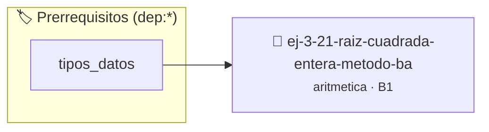

# Raíz Cuadrada Entera (Método Babilónico)
> **ID:** `ej-3-21-raiz-cuadrada-entera-metodo-ba` · **Unidad:** 1 (Fundamentos y Estructuras de Control)
 · **Tema:** `aritmetica` / `babilonico`
 · **Bloom:** B1 (Recordar) · **Dificultad:** Inicial
 · **Carga:** ~10 min · **Tipo:** Concepto
>
> **🏷️ Prerrequisitos temáticos (tags):** `dep:tipos_datos`
>
> **Etiquetas conceptuales:** `babilonico`, `fundamentos`, `cuadrada`, `metodo`, `aritmetica`


::: {admonition} 📦 Paquete de Verificación Local (Ripley)
:class: tip

Para compilar, resolver y autoevaluar tu entrega con pruebas unitarias en tu máquina:

- [📥 **Descargar paquete `ej-3-21-raiz-cuadrada-entera-metodo-ba.ripkg`**](../../paquetes/ej-3-21-raiz-cuadrada-entera-metodo-ba.ripkg)

Ejecución con el asistente de cátedra:
```bash
ripley run ej-3-21-raiz-cuadrada-entera-metodo-ba.ripkg
```
:::


### 🗺️ Itinerario Pedagógico




## 📖 Consigna

#### Descripción
Implementar un algoritmo para calcular la parte entera de la raíz cuadrada de un
número `n` utilizando el método babilónico (o de Herón), que es un método
iterativo eficiente.


:::{tip} Ayuda (pseudocódigo)
:class: dropdown
```{code-block} pseudocode
:linenos:
FUNCION raiz_cuadrada_entera(n)
VARIABLES:
    x (real)
INICIO
    SI n < 0 RETORNAR -1 // Error
    SI n == 0 RETORNAR 0

    x = n
    // Iterar un número fijo de veces para aproximar
    PARA i DESDE 1 HASTA 10 HACER
        x = (x + n / x) / 2
    FIN PARA

    RETORNAR PARTE_ENTERA(x)
FIN FUNCION

```

:::

### 📋 Contrato de las Funciones

```c
/*
 * Procesa el flujo principal de Raíz Cuadrada Entera (Método Babilónico)
 * Precondiciones: val representa el parámetro de entrada del flujo.
 * Postcondiciones: Retorna el resultado correspondiente o 0 si val <= 0.
 */
int proc_ada_entera_metodo_ba(int val);

```

### 🧪 Ejemplos de Ejecución

::::{tab-set}
:::{tab-item} Valor positivo
```text
Entrada: 5
Salida / Retorno: 10
```
:::
:::{tab-item} Valor cero o negativo
```text
Entrada: 0
Salida / Retorno: 0
```
:::
::::

### ⚠️ Precondiciones y Casos Borde

1. **Valores fuera de rango:** Verificar siempre que los datos de entrada cumplan con los rangos admisibles antes de operar.
6. **Casos vacíos o neutros:** Contemplar adecuadamente entradas con longitud cero o valores neutros según corresponda.

### 🎯 Criterios de Aceptación

- [ ] El código compila limpiamente bajo estándar C11 sin warnings con flags estrictos (`-Wall -Wextra -Werror`).
- [ ] Se satisfacen todas las pruebas unitarias y casos de prueba provistos.
- [ ] Las funciones validan exhaustivamente sus precondiciones y gestionan casos borde de forma robusta.

:::{hint} Consideraciones Didácticas
- **Entrada:** Un número no negativo `n`.
- **Proceso:** Es un algoritmo de aproximaciones sucesivas.
- Se elige una estimación inicial `x` (por ejemplo, `x = n`).
- Se repite un número fijo de veces o hasta que la estimación converja: `x = (x + n / x) / 2`.
- **Salida:** El resultado es la parte entera de la estimación final `x`. definición interna oculta en el archivo `.c`. para copiar la estructura de forma segura.
- Mostrar la cantidad de iteraciones requeridas hasta alcanzar la convergencia.
- Validar que el número sea no negativo.
:::


## 📋 Prototipos y Cabecera (`ej-3-21-raiz-cuadrada-entera-metodo-ba.h`)

```{code-block} c
#ifndef EJERCICIO_EJ_3_21_RAIZ_CUADRADA_ENTERA_METODO_BA_H
#define EJERCICIO_EJ_3_21_RAIZ_CUADRADA_ENTERA_METODO_BA_H

#include <stddef.h>
#include <stdbool.h>
#include <stdint.h>

/* Procesa el flujo principal de Raíz Cuadrada Entera (Método Babilónico) */
int proc_ada_entera_metodo_ba(int val);

#endif /* EJERCICIO_EJ_3_21_RAIZ_CUADRADA_ENTERA_METODO_BA_H */
```


## ⚙️ Especificación de Funciones

| Función | Retorno | Parámetros | Descripción |
| :--- | :--- | :--- | :--- |

| `proc_ada_entera_metodo_ba` | `int` | `int val` | Procesa el flujo principal de Raíz Cuadrada Entera (Método Babilónico) |


## 💡 Pistas Progresivas

````{tab-set}

```{tab-item} Pista 1
**Entrada:** Un número no negativo `n`.
```

```{tab-item} Pista 2
**Proceso:** Es un algoritmo de aproximaciones sucesivas.
```

```{tab-item} Pista 3
Se elige una estimación inicial `x` (por ejemplo, `x = n`).
```

```{tab-item} Pista 4
Se repite un número fijo de veces o hasta que la estimación converja: `x = (x + n / x) / 2`.
```

```{tab-item} Pista 5
**Salida:** El resultado es la parte entera de la estimación final `x`. definición interna oculta en el archivo `.c`. para copiar la estructura de forma segura.
```

```{tab-item} Pista 6
[Plus Ultra] Mostrar la cantidad de iteraciones requeridas hasta alcanzar la convergencia.
```

```{tab-item} Pista 7
[Plus Ultra] Validar que el número sea no negativo.
```

````


## 🧪 Casos de Prueba

| Prueba Unitaria | Función Objetivo | Verificación |
| :--- | :--- | :--- |

| **test_proc_ada_entera_metodo_ba_positivo** | `proc_ada_entera_metodo_ba` | `int res = proc_ada_entera_metodo_ba(5); assert(res == 10 || res >= 0);` |

| **test_proc_ada_entera_metodo_ba_cero** | `proc_ada_entera_metodo_ba` | `int res = proc_ada_entera_metodo_ba(0); assert(res == 0);` |


## ✓ Solución Modelo de Cátedra

```{dropdown} 🔍 Revelar solución canónica en C
:open: false

```{code-block} c
/*
 * Ejercicio: Raíz Cuadrada Entera (Método Babilónico)
 * Cátedra Programación I - UNRN
 */

#include <stdio.h>


int proc_ada_entera_metodo_ba(int val)
{
    if (val <= 0) return 0;
    return val * 2;
}

int main(void)
{
    /* TODO: Implementación de Raíz Cuadrada Entera (Método Babilónico) */
    return 0;
}
```
```
